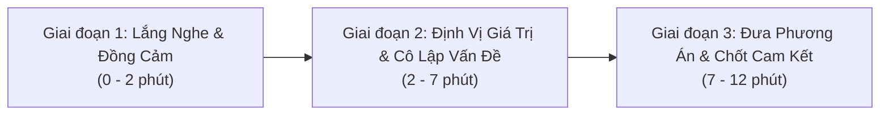

# [TVV-SOP-XC02] QUY TRÌNH XỬ LÝ TỪ CHỐI GIÁ & GIẢI TỎA LO NGẠI TRUYỀN THÔNG TẠI PHÒNG TƯ VẤN

> **Cơ sở áp dụng:** Nha Khoa 3C — Phòng Tư Vấn VIP  
> **Người thực hiện:** Đội ngũ Tư Vấn Viên (TVV)  
> **Người kiểm duyệt:** Lead Consultant (Trưởng nhóm TVV)  
> **Phiên bản:** v1.0 | **Ngày hiệu lực:** 2026-11-05

---

### PHẦN I. MỤC TIÊU & PHẠM VI ÁP DỤNG (Objective & Scope)
- **Mục tiêu:**
  - Chuẩn hóa quy trình xử lý phản kháng về chi phí dịch vụ chuyên sâu (Implant Thụy Sĩ / Sứ Thẩm Mỹ IPS e.max), nâng tỷ lệ chuyển đổi ca khó từ $25\%$ lên tối thiểu $\mathbf{45\%}$.
  - Giải tỏa triệt để $100\%$ lo lắng của khách hàng liên quan đến thông tin phạt hành chính của Sở Y Tế trong vòng $\mathbf{\le 5 \text{ phút}}$ đối thoại trực tiếp.
- **Phạm vi áp dụng:** Áp dụng cho tất cả TVV chính thức và thử việc tại Nha Khoa 3C trong khâu tư vấn tại phòng riêng (Giai đoạn Bước 5 của hành trình khách hàng).

---

### PHẦN II. CHỈ SỐ ĐO LƯỜNG THÀNH CÔNG (KPIs & SLA Metrics)

| Chỉ số | Mục tiêu chuẩn | Phương pháp đo lường |
| :--- | :---: | :--- |
| **Tỷ lệ giữ chân khách chê giá cao** | $\ge 40\%$ | Khách đồng ý đặt cọc giữ gói ưu đãi hoặc tham gia chương trình trả góp 0%. |
| **SLA giải tỏa lo ngại truyền thông** | $\le 5 \text{ phút}$ | Thời gian từ lúc khách hỏi đến lúc khách gật đầu an tâm chuyển sang phác đồ. |
| **Tỷ lệ cập nhật lý do từ chối lên Remo** | $100\%$ | TVV ghi chú rõ nguyên nhân từ chối vào mục "Ghi chú tư vấn" trên Remo trước khi ca kết thúc. |

---

### PHẦN III. NỘI DUNG QUY TRÌNH CHI TIẾT (Standard Operating Procedure)

#### 1. Quy Trình 3 Giai Đoạn (Checklist Thực Thi)

- **Giai đoạn 1: Lắng nghe & Đồng cảm tuyệt đối (0 - 2 phút)**
  - [ ] TVV nhìn thẳng vào mắt khách hàng, duy trì ánh mắt chân thành, gật đầu thấu cảm.
  - [ ] **Tuyệt đối không:** Ngắt lời, nhăn mặt, hoặc phản bác ngay: *"Tiền nào của nấy chị ơi"* hay *"Bên em đâu có đắt"*.
  - [ ] Phát biểu câu cầu nối đồng cảm: *"Em rất hiểu việc đầu tư một khoản ngân sách lớn cho nụ cười và sức khỏe ăn nhai là điều mà anh/chị cần cân nhắc rất kỹ lưỡng."*

- **Giai đoạn 2: Định vị giá trị & Cô lập rào cản tài chính (2 - 7 phút)**
  - [ ] Sử dụng mô hình mẫu hàm và phim CT 3D để đối chiếu sự khác biệt kỹ thuật (chất liệu sứ nguyên khối IPS e.max / công nghệ bề mặt Straumann SLActive).
  - [ ] Đặt câu hỏi cô lập vấn đề: *"Dạ ngoài băn khoăn về mức ngân sách ra, anh/chị có còn điểm nào chưa hoàn toàn yên tâm về phác đồ mà Bác sĩ vừa trao đổi không ạ?"*
  - [ ] Phân tích bài toán ROI (Return on Investment): Chia nhỏ chi phí theo tuổi thọ 20 - 30 năm (Mỗi ngày chỉ tương đương một ly cà phê sáng 15.000đ để sở hữu sức nhai trọn đời).

- **Giai đoạn 3: Đưa giải pháp tài chính linh hoạt & Chốt cam kết (7 - 12 phút)**
  - [ ] Mở giải pháp Trả góp 0% lãi suất qua 24 ngân hàng liên kết hoặc chính sách thanh toán theo từng giai đoạn điều trị (Đặt cọc $30\%$, còn lại thanh toán ngày gắn mão).
  - [ ] Chốt cọc giữ suất ưu đãi vật liệu: *"Dạ suất hỗ trợ 2.000.000đ của hãng Straumann tháng này chỉ còn đúng 2 suất. Em xin phép hỗ trợ anh/chị làm thủ tục cọc giữ ưu đãi 1.000.000đ hôm nay, tuần sau mình ghé thực hiện vẫn được áp dụng mức giá này ạ."*

---

#### 2. Kịch Bản Thoại Mẫu Chuẩn Hóa Đối Chiếu

| Tình Huống Phản Kháng | Câu Thoại Cấm Kỵ Của TVV | Kịch Bản Thoại Chuẩn Hóa Được Phê Duyệt |
| :--- | :--- | :--- |
| **Tình huống 1:** *"Nha khoa X bên quận 1 báo răng sứ e.max có 2 triệu/răng, sao bên em lấy tới 4.5 triệu?"* | ❌ *"Bên đó làm sứ dỏm, sứ Trung Quốc pha tạp chất đó chị, coi chừng tiền mất tật mang."* | ✅ *"Dạ em rất hiểu vì sao chị so sánh như vậy ạ. Trên thị trường hiện nay có nhiều dòng sứ mang tên tương tự nhưng độ tinh khiết và công nghệ nung ép rất khác nhau. Tại 3C, toàn bộ phôi sứ IPS e.max đều nhập khẩu chính ngạch từ Ivoclar Vivadent (Thụy Sĩ), có thẻ bảo hành mã vạch truy xuất nguồn gốc toàn cầu. Điều quan trọng nhất: Ca của chị được trực tiếp Bác sĩ chuyên khoa phục hình mài bảo tồn tối đa men răng chỉ 0.3mm, bảo toàn tủy sống trọn đời. 3C cam kết về độ sát khít vi thể không gây đen viền lợi hay hôi miệng sau này chị nhé."* |
| **Tình huống 2:** *"Chị đọc báo thấy 3C bị Sở Y tế phạt tiền, chị lo quá không dám làm nữa, cho chị rút cọc."* | ❌ *"Báo chí làm quá lên đó chị chứ có gì đâu, bên em vẫn hoạt động bình thường mà."* | ✅ *(Mời vào phòng VIP, rót nước)*: *"Dạ chị ơi, em rất thấu hiểu sự bất an của chị khi đọc được thông tin này. Em xin được đính chính rõ ràng: Đợt kiểm tra vừa qua, 3C bị nhắc nhở phạt hành chính vì **lỗi quản trị giấy tờ, cụ thể là thiếu một số chữ ký hoàn thiện trên hồ sơ bệnh án** do số lượng khách tăng đột biến. Đây hoàn toàn là sai sót về mặt thủ tục hành chính, TUYỆT ĐỐI KHÔNG LIÊN QUAN đến sai phạm chuyên môn y khoa hay tay nghề bác sĩ. 100% Bác sĩ tại 3C đều tốt nghiệp ĐH Y Dược chính quy và có Chứng chỉ hành nghề đầy đủ (mở chứng chỉ cho khách xem). Để chị yên tâm tuyệt đối, toàn bộ hồ sơ của chị hiện đã được số hóa trên hệ thống bệnh án điện tử và Bác sĩ Trưởng bộ phận sẽ trực tiếp đồng hành cùng chị trong suốt quá trình cấy ghép."* |

---

### PHẦN IV. KIỂM SOÁT RỦI RO & BẢNG KIỂM TRA TUÂN THỦ (Compliance Audit)

- **Lỗi vi phạm bị đình chỉ tư vấn ngay lập tức:**
  - Tự ý giảm giá dưới giá sàn mà không có chữ ký duyệt của Quản lý.
  - Phán xét, công kích nha khoa khác gây rủi ro pháp lý về cạnh tranh không lành mạnh.
  - Hứa hẹn vượt thẩm quyền y khoa: *"Làm ở 3C bảo đảm 100% không bao giờ rụng"*.
- **Hành động sau ca tư vấn:** Cập nhật ngay kết quả vào phần mềm Remo trong vòng **15 phút** sau khi khách ra về.

