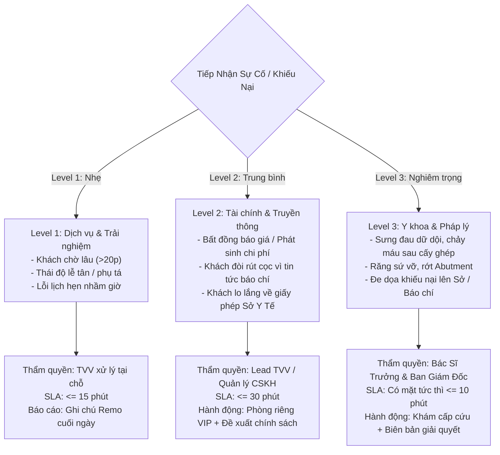

# KHUNG PHÂN CẤP SỰ CỐ & QUY TRÌNH LEO THANG KHỦNG HOẢNG (CRISIS ESCALATION)

> **Cơ sở áp dụng:** Bộ phận Tư vấn, Chăm sóc Khách hàng & Ban Điều Hành Nha Khoa 3C  
> **Mục tiêu:** Kiểm soát và dập tắt xung đột ngay từ trứng nước, bảo vệ tối đa uy tín y khoa của Bác sĩ và phòng khám.

---

## 1. Ma Trận Phân Cấp Khủng Hoảng & Thẩm Quyền Xử Lý

---

## 2. Chi Tiết Các Cấp Độ & Hành Động Cụ Thể

### Cấp Độ 1 (Level 1: Dịch Vụ & Vận Hành)
- **Tình huống:** Khách hàng phàn nàn vì chờ ghế khám quá 20 phút, phòng chờ hết nước/lạnh, trợ thủ thao tác chưa nhẹ nhàng.
- **Người chịu trách nhiệm xử lý:** TVV phụ trách ca.
- **Kịch bản phản ứng:**
  1. Chủ động tiến lại gần, cúi đầu nhận lỗi chân thành: *"Dạ em thành thật xin lỗi vì để cô phải chờ thêm ít phút do ca trước của Bác sĩ phát sinh thêm bước vô trùng kỹ lưỡng. Em xin phép mời cô sang khu vực ghế massage thư giãn và dùng chút trà ấm ạ."*
  2. Trao đổi nhanh với Điều phối để ưu tiên đưa khách vào ghế trong vòng 5 phút tiếp theo.

### Cấp Độ 2 (Level 2: Tài Chính & Truyền Thông / Sở Y Tế)
- **Tình huống:** Khách hàng thấy báo chí đăng thông tin Nha khoa 3C bị Sở Y tế phạt hành chính; đòi rút lại tiền cọc; hoặc khiếu nại bảng giá phát sinh ngoài dự kiến.
- **Người chịu trách nhiệm xử lý:** TVV phối hợp cùng **Lead TVV (Trưởng nhóm)**.
- **Quy trình chuẩn:**
  1. **Cách ly không gian:** Lập tức mời khách vào **Phòng Tư Vấn VIP**, đóng cửa nhẹ nhàng, tuyệt đối không để khách chất vấn lớn tiếng tại sảnh lễ tân trước mặt các khách hàng khác.
  2. **Kịch bản xử lý thông tin Sở Y Tế:**
     > *"Dạ thưa chị, em rất hiểu sự hoang mang của chị khi đọc các bản tin này. Em xin được chia sẻ tường tận sự việc: Đợt vừa rồi Sở Y tế kiểm tra định kỳ và nhắc nhở 3C về **lỗi thủ tục giấy tờ hành chính (cụ thể là thiếu một số chữ ký hoàn tất trên sổ sách lưu trữ do lượng bệnh nhân quá tải)**. Đây 100% là sai sót về thủ tục hành chính, hoàn toàn KHÔNG PHẢI sai phạm về tay nghề Bác sĩ hay chất lượng vật liệu cấy ghép. 100% Bác sĩ tại 3C đều tốt nghiệp Đại học Y Dược chính quy và có Chứng chỉ hành nghề đầy đủ (mở sẵn chứng chỉ cho khách xem). Phòng khám đã khắc phục triệt để bằng hệ thống bệnh án số hóa. Chị hoàn toàn yên tâm tiếp tục liệu trình của mình."*
  3. **Xử lý yêu cầu rút cọc:** Giải thích chính sách cọc vật liệu cá nhân hóa (đã đặt hãng sản xuất theo kích thước xương của khách). Nếu khách vẫn kiên quyết, Lead TVV bảo lưu quyền lợi và chuyển hồ sơ lên Giám đốc trong vòng 24 giờ.

### Cấp Độ 3 (Level 3: Sự Cố Chuyên Môn Y Khoa & Đe Dọa Pháp Lý)
- **Tình huống:** Khách hàng sau cấy ghép Implant bị đau nhức nhiều ngày, chảy máu liên tục, nhiễm trùng; hoặc khách hàng làm răng sứ bị viêm lợi nặng, hỏng tủy và đe dọa gửi đơn kiện.
- **Người chịu trách nhiệm xử lý:** **Bác sĩ Trưởng Chuyên Môn + Ban Giám Đốc** (TVV chỉ đóng vai trò hỗ trợ ghi nhận và chăm sóc tâm lý).
- **Quy trình chuẩn 4 bước:**
  - **Bước 1 (Tiếp nhận khẩn):** Mời khách vào phòng chụp phim CT Cone Beam 3D khẩn cấp để kiểm tra thực thể.
  - **Bước 2 (Bác sĩ chuyên môn hội chẩn):** Bác sĩ Trưởng trực tiếp thăm khám, giải thích cơ chế sinh học trên phim ảnh khoa học cho khách hàng.
  - **Bước 3 (Biên bản y khoa):** Lập biên bản khám lại có chữ ký xác nhận của Bác sĩ Trưởng, ghi rõ nguyên nhân và phác đồ điều trị can thiệp khắc phục hoàn toàn miễn phí cho khách.
  - **Bước 4 (Hậu mãi cam kết):** Điều chuyển TVV có kinh nghiệm nhất chăm sóc 1-1, gọi điện hỏi thăm mỗi ngày trong 7 ngày liên tiếp.

---

## 3. Nguyên Tắc L.A.S.T Trong Giao Tiếp Xoa Dịu Cơn Giận

| Chữ Cái | Nguyên Tắc | Hành Vi Chuẩn Hóa Của TVV | Lời Nói Chuẩn Hóa |
| :---: | :--- | :--- | :--- |
| **L** | **Listen** (Lắng nghe chủ động) | Nhìn thẳng vào mắt khách, gật đầu nhẹ, ghi chép lại từng ý kiến khiếu nại vào sổ tay. Không ngắt lời, không biện minh. | *"Dạ em đang ghi nhận rất kỹ từng điều chị chia sẻ..."* |
| **A** | **Apologize** (Xin lỗi chân thành) | Xin lỗi vì trải nghiệm chưa trọn vẹn của khách hàng, công nhận cảm xúc thất vọng của họ. | *"Em thành thật xin lỗi vì sự bất tiện này đã làm chị phải lo lắng và mất thời gian."* |
| **S** | **Solve** (Đưa ra giải pháp cụ thể) | Đưa ra hành động dứt khoát, có mốc thời gian rõ ràng, không hứa suông. | *"Ngay bây giờ em xin phép mời Bác sĩ Trưởng kiểm tra lại toàn bộ cho chị trong vòng 5 phút nữa ạ."* |
| **T** | **Thank** (Cảm ơn vì đã phản hồi) | Cảm ơn khách hàng đã giúp phòng khám nhìn ra điểm thiếu sót để cải tiến. | *"3C rất trân trọng những góp ý thẳng thắn của chị để dịch vụ ngày càng hoàn thiện hơn."* |

