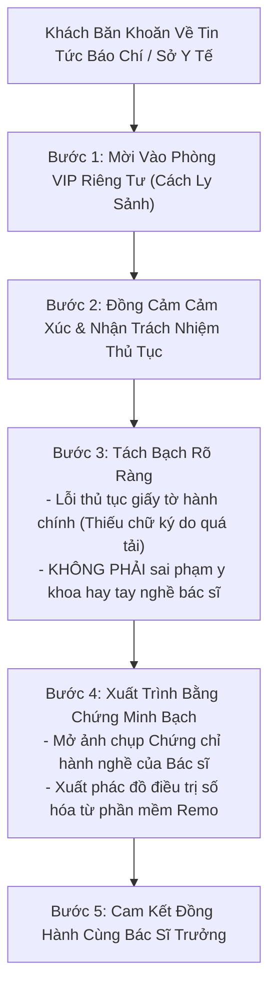

# CẨM NANG THỰC CHIẾN XỬ LÝ 20 TỪ CHỐI & 5 TÌNH HUỐNG KHỦNG HOẢNG (MASTER PLAYBOOK)

> **Căn cứ tài liệu gốc:** `bo-cau-hoi-xu-ly-tu-choi.docx` & `tvv-xulytuchoi-v1.md` (Nha Khoa 3C).  
> **Nguyên tắc cốt lõi:** *Đồng cảm trước — Làm rõ nguyên nhân — Cô lập rào cản — Khẳng định giá trị y khoa — Đưa giải pháp tài chính/hành động dứt khoát.*

---

## PHẦN I. BỘ 5 CÂU HỎI XỬ LÝ KHỦNG HOẢNG TRUYỀN THÔNG (SỞ Y TẾ)

### Câu 1: Khách hỏi về việc Nha khoa 3C bị Sở Y tế phạt tiền
- **Phân tích tâm lý:** Khách hàng đánh đồng việc "Bị Sở Y tế phạt hành chính" với "Phòng khám làm ẩu, kém chất lượng, nguy hiểm".
- **Câu nói cấm kỵ:** ❌ *"Báo chí lá cải nói xấu bên em đó chị, đừng tin"* hoặc *"Có mấy triệu bạc phạt cho có lệ thôi mà"*.
- **Kịch bản thoại chuẩn hóa:**
  > *"Dạ em chào chị, em rất hiểu sự lo lắng của chị khi đọc được những thông tin này. Thay mặt phòng khám, em xin chân thành xin lỗi vì thông tin đã làm ảnh hưởng đến tâm lý của chị.*  
  > *Sự thật là đợt vừa qua Sở Y tế có kiểm tra định kỳ, 3C bị nhắc nhở và phạt hành chính vì **lỗi thiếu sót trong việc cập nhật sổ sách, cụ thể là thiếu một số chữ ký trên hồ sơ bệnh án** do đợt đó lượng khách hàng quá tải. Đây hoàn toàn là sai sót về mặt thủ tục giấy tờ hành chính, KHÔNG PHẢI là sai phạm về chuyên môn y khoa hay chất lượng vật liệu chị ạ. Thậm chí, đoàn kiểm tra của Sở Y tế còn đánh giá rất cao tay nghề điều trị thực tế của đội ngũ Bác sĩ 3C. Hiện tại phòng khám đã chấn chỉnh lại khâu lưu trữ hồ sơ bằng phần mềm số hóa để chuẩn hóa 100%. Chị cứ yên tâm điều trị tiếp chị nhé!"*

### Câu 2: Khách hỏi về việc Bác sĩ bị đình chỉ giấy phép 1 tháng
- **Phân tích tâm lý:** Khách hoang mang mất niềm tin vào tay nghề Bác sĩ trực tiếp điều trị, sợ bị bỏ dở lộ trình.
- **Kịch bản thoại chuẩn hóa:**
  > *"Dạ chị ơi, Bác sĩ Hằng là một trong những Bác sĩ có chuyên môn tay nghề rất giỏi và được nhiều khách hàng yêu mến tại 3C. Việc Bác bị đình chỉ giấy phép 1 tháng vừa qua cũng bắt nguồn từ **lỗi hành chính là chưa ký tên đầy đủ vào hồ sơ bệnh án** sau khi khám xong (do lượng bệnh nhân quá đông), chứ hoàn toàn không phải do Bác điều trị sai hỏng hay gây ra sự cố y khoa nào cả.*  
  > *Quy định của Sở rất nghiêm ngặt nên phòng khám và Bác sĩ xin nghiêm túc chấp hành để hoàn thiện hơn. Trong 1 tháng này, Bác sĩ Trưởng bộ phận sẽ trực tiếp tiếp quản hồ sơ và tiếp tục lộ trình điều trị chuẩn cho chị, không làm gián đoạn tiến độ của mình đâu ạ. Tháng sau Bác Hằng sẽ quay lại đồng hành cùng chị bình thường nhé."*

### Câu 3: Khách thắc mắc Bác sĩ chưa đăng ký danh sách tại cơ sở Cống Quỳnh
- **Phân tích tâm lý:** Nghi ngờ phòng khám sử dụng Bác sĩ "chui", không bằng cấp.
- **Kịch bản thoại chuẩn hóa:**
  > *"Dạ em xin đính chính thông tin này để chị yên tâm tuyệt đối ạ. 100% các y bác sĩ làm việc tại 3C đều **tốt nghiệp Đại học Y Dược chính quy và CÓ ĐẦY ĐỦ Chứng chỉ hành nghề**.*  
  > *Vấn đề báo chí nhắc tới ở đây là do các Bác sĩ mới chuyển công tác về 3C, phòng khám đang trong quá trình nộp hồ sơ lên Sở Y tế để **cập nhật bổ sung tên các Bác vào danh sách nhân sự tại cơ sở Cống Quỳnh**. Quá trình duyệt hồ sơ mất một chút thời gian nên khi Sở kiểm tra thì chưa hiển thị trên hệ thống thôi ạ. Đây là vấn đề chậm trễ thủ tục nhân sự, hoàn toàn không có chuyện 3C thuê Bác sĩ không có bằng cấp đâu chị.*  
  > *(Mở ảnh chụp Chứng chỉ hành nghề trên iPad cho khách xem trực tiếp)*."*

### Câu 4: Khách hàng thân thiết lo lắng về hồ sơ bệnh án của mình
- **Kịch bản:** Xin lỗi chân thành, mời khách xem hồ sơ bệnh án điện tử trên Remo, in bản phác đồ có chữ ký tươi của Bác sĩ Trưởng để khách mang về đối chiếu.

### Câu 5: Khách vừa đặt cọc đòi rút tiền về
- **Kịch bản:** Đồng cảm, lắng nghe lý do. Nếu do tin tức Sở Y Tế $\rightarrow$ Áp dụng câu 1-3. Nếu khách vẫn kiên quyết $\rightarrow$ Giải thích quy định giữ cọc để đặt vật liệu hãng, đề xuất chính sách **bảo lưu cọc 12 tháng** hoặc chuyển nhượng suất ưu đãi cho người thân.

---

## PHẦN II. BỘ 20 CÂU HỎI XỬ LÝ TỪ CHỐI THỰC CHIẾN

### Nhóm 1: Rào Cản Về Giá Cả & Tài Chính (5 Câu)

#### 1. "Giá bên em cao hơn các nha khoa khác chị hỏi."
- **Kỹ thuật:** So sánh TCO (Tổng chi phí sở hữu) & Chất lượng trọn gói không phát sinh.
- **Thoại mẫu:** *"Dạ em hiểu ngân sách là yếu tố quan trọng. Nhưng với dịch vụ Implant/Răng sứ, điều quan trọng nhất là vật liệu chính hãng và Bác sĩ chuyên môn cao thực hiện. Mức giá tại 3C là trọn gói: Đã bao gồm phim CT Cone Beam 3D, chi phí thăm khám, trụ chính hãng có thẻ bảo hành toàn cầu và không phát sinh chi phí ẩn. Nhiều nơi báo giá thấp chỉ là giá trụ trần, khi làm sẽ cộng thêm tiền khớp nối, mão sứ, chi phí vô trùng thì tổng chi phí lại cao hơn nhiều ạ."*

#### 2. "Chị chưa mang đủ tiền / Thẻ chị không đủ hạn mức hôm nay."
- **Kỹ thuật:** Tách nhỏ dòng tiền & Đặt cọc giữ ưu đãi.
- **Thoại mẫu:** *"Dạ không sao chị ơi, hôm nay chị chỉ cần thanh toán phí thăm khám ban đầu hoặc đặt cọc trước từ 1 đến 2 triệu đồng để phòng khám giữ suất trợ giá vật liệu của hãng trong tháng này. Số tiền còn lại mình có thể thanh toán theo từng đợt điều trị hoặc chuyển đổi trả góp 0% qua thẻ tín dụng rất tiện lợi ạ."*

#### 3. "Em bớt cho chị chút nữa đi, hoặc tặng thêm dịch vụ gì đi."
- **Kỹ thuật:** Giữ vững giá trị phác đồ, tặng thêm quà tặng chăm sóc sức khỏe.
- **Thoại mẫu:** *"Dạ bảng giá tại 3C là giá niêm yết chuẩn y khoa để đảm bảo bác sĩ sử dụng vật tư tốt nhất cho chị. Em không thể tự ý giảm tiền điều trị được, nhưng em xin phép đề xuất quản lý tặng chị 1 gói Cạo vôi răng vô trùng bằng sóng siêu âm cho người thân trị giá 500.000đ và 1 bộ chăm sóc răng chuyên dụng sau điều trị nhé."*

#### 4. "Chị đã từng làm chỗ khác rẻ hơn nhiều mà dùng vẫn tốt."
- **Kỹ thuật:** Ghi nhận may mắn của khách, cảnh báo nguy cơ tiềm ẩn về sinh học mô mềm.

#### 5. "Chị là sinh viên / kinh tế eo hẹp, chị muốn làm dòng rẻ nhất thôi."
- **Kỹ thuật:** Down-sell chuẩn y khoa (Hàn Quốc Dentium hoặc niềng mắc cài kim loại tự buộc trả góp 1 triệu/tháng). Tuyệt đối không tư vấn dòng trôi nổi kém chất lượng.

---

### Nhóm 2: Rào Cản Về Nỗi Sợ Y Khoa (5 Câu)

#### 6. "Làm cái này có đau không em? Chị sợ đau lắm."
- **Kỹ thuật:** Mô tả cơ chế kiểm soát vô cảm hiện đại, không hứa hẹn suông.
- **Thoại mẫu:** *"Dạ tâm lý sợ đau là hoàn toàn bình thường chị ạ. Tại 3C, Bác sĩ sử dụng công nghệ gây tê cục bộ kiểm soát tốc độ tiêm nên ngay lúc tiêm chị chỉ thấy như kiến cắn nhẹ. Trong suốt quá trình cấy ghép hoặc làm răng, vùng điều trị hoàn toàn tê êm dịu. Sau khi hết tê, Bác sĩ kê sẵn đơn thuốc giảm đau chuyên dụng nên đa phần khách hàng đều chia sẻ cảm giác êm hơn rất nhiều so với tưởng tượng ban đầu ạ."*

#### 7. "Cấy Implant lỡ bị đào thải, rụng trụ thì sao em?"
- **Kỹ thuật:** Dẫn chứng tỷ lệ thành công quốc tế $98\%$ và chính sách bảo hành cấy lại miễn phí.

#### 8. "Bác sĩ bảo phải ghép xương / nâng xoang, chị sợ nguy hiểm chạm dây thần kinh."
- **Kỹ thuật:** Dùng phim CT 3D chỉ rõ khoảng cách an toàn được đo vẽ bằng phần mềm định vị.

#### 9. "Bác sĩ này nhìn trẻ quá, có đủ tay nghề làm ca khó cho chị không?"
- **Kỹ thuật:** Nêu bật bằng cấp ĐH Y Dược, số ca lâm sàng đã thực hiện thành công ($>1.000$ ca) và có Bác sĩ Trưởng cố vấn.

#### 10. "Thời gian điều trị lâu quá (3-6 tháng), chị không chờ được."
- **Kỹ thuật:** Giải thích quy luật sinh học tích hợp xương tự nhiên & giải pháp gắn hàm tạm ăn nhai tức thì trong 48h.

---

### Nhóm 3: Rào Cản Về Quyết Định & Người Thân (5 Câu)

#### 11. "Để chị về hỏi ý kiến chồng / gia đình rồi mới quyết định."
- **Kỹ thuật:** Đồng cảm, trang bị tài liệu và phim ảnh để khách giải thích cho người nhà, xin phép kết nối trực tiếp.
- **Thoại mẫu:** *"Dạ một kế hoạch sức khỏe lớn như thế này chị bàn bạc với gia đình là rất đúng đắn ạ. Em xin phép in sẵn phác đồ hình ảnh và gửi video mô phỏng qua Zalo cho chị để anh nhà cùng xem. Nếu anh bận không ghé được, chị có thể gọi video call em xin phép hỗ trợ giải thích trực tiếp các thắc mắc chuyên môn cho anh yên tâm nhé."*

#### 12. "Chị cần suy nghĩ thêm."
- **Kỹ thuật:** Đặt câu hỏi cô lập rào cản thực sự (Là giá? Là sợ đau? Hay chưa tin tưởng?).

#### 13. "Chị muốn đi tham khảo thêm 1-2 nha khoa khác xem sao."
- **Kỹ thuật:** Khuyến khích khách tham khảo, đưa ra checklist các tiêu chí cần hỏi khi đi nha khoa khác (Loại trụ? Bảo hành? Bác sĩ chính quy?).

#### 14. "Dạo này chị bận quá, chưa sắp xếp được thời gian làm."
- **Kỹ thuật:** Phân tích sự thuận tiện của việc đặt lịch hẹn linh hoạt cuối tuần hoặc buổi tối.

#### 15. "Đợi khi nào chị gom đủ tiền rồi quay lại làm một lần."
- **Kỹ thuật:** Cảnh báo nguy cơ tiêu xương răng khiến sau này làm sẽ tốn kém hơn do phải ghép xương; mở phương án trả góp 0%.

---

### Nhóm 4: Rào Cản Về Cam Kết & Bảo Hành (5 Câu)

#### 16. "Bên em có cam kết bảo đảm dùng trọn đời không bao giờ hỏng không?"
- **Kỹ thuật:** Ranh giới y khoa: Trụ tích hợp sinh học vĩnh viễn theo cơ thể nếu chăm sóc đúng chỉ dẫn y khoa, có thẻ bảo hành chính hãng.

#### 17. "Nếu làm xong mà không ăn nhai được hoặc bị đào thải thì ai chịu trách nhiệm?"
- **Kỹ thuật:** Cam kết bằng hợp đồng điều trị: 3C chịu trách nhiệm cấy lại trụ mới hoàn toàn miễn phí hoặc hoàn tiền theo điều khoản bảo hành.

#### 18. "Sau này hết thời hạn bảo hành mà răng có vấn đề thì sao?"
- **Kỹ thuật:** Chính sách bảo trì trọn đời: Miễn phí thăm khám, chụp phim kiểm tra và cạo vôi định kỳ hàng năm cho khách hàng trồng Implant/Sứ tại 3C.

#### 19. "Nha khoa lỡ đóng cửa thì thẻ bảo hành còn giá trị không?"
- **Kỹ thuật:** Thẻ bảo hành điện tử chính hãng từ Straumann / Nobel / Ivoclar Vivadent có giá trị truy xuất toàn cầu tại bất kỳ phòng khám đối tác nào trên thế giới.

#### 20. "Bên em cam kết trên giấy tờ có dấu mộc công ty hay chỉ nói miệng?"
- **Kỹ thuật:** Xuất trình mẫu **Hợp đồng cam kết chất lượng điều trị** có đầy đủ chữ ký Giám đốc chuyên môn và dấu mộc đỏ pháp nhân Công ty TNHH TMDV Y Tế 3C.

