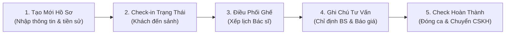

# QUY CHUẨN THAO TÁC PHẦN MỀM REMO CRM & AN TOÀN THÔNG TIN BỆNH ÁN

> **Căn cứ tài liệu gốc:** `quytrinh-thuviec-tvv-3c.md` (Mã WBS 6.2) & Quy định CNTT Nha Khoa 3C.  
> **Nguyên tắc cốt lõi:** *Dữ liệu bệnh nhân là tài sản y tế tối mật — Mọi ca tư vấn bắt buộc phải có dấu vết số hóa (digital trail) trên hệ thống Remo.*

---

## 1. 5 Thao Tác Cốt Lõi Trên Phần Mềm Quản Lý Remo

### Thao Tác 1: Tạo Mới Hồ Sơ Khách Hàng (Thời gian thực hiện $\le 2 \text{ phút}$)
- **Thời điểm:** Ngay khi khách hàng bước vào sảnh lễ tân và chưa có thông tin trên hệ thống.
- **Trường thông tin bắt buộc:**
  - Họ và tên (Viết hoa đúng chính tả).
  - Số điện thoại liên hệ chính thức.
  - Năm sinh / Giới tính / Nghề nghiệp.
  - Nguồn khách hàng (Facebook Ads, Giới thiệu từ người quen, TikTok, Vãng lai).
  - **Mục cảnh báo y khoa:** Bắt buộc tích chọn tiền sử bệnh nền (Cao huyết áp, Tiểu đường, Tim mạch, Dị ứng thuốc tê).

### Thao Tác 2: Check-in Khách Hàng Đến Cơ Sở
- Chuyển trạng thái từ **"Hẹn trước"** sang **"Đang có mặt tại sảnh"**.
- Hệ thống tự động kích hoạt thông báo sang màn hình hiển thị của Kỹ thuật viên X-Quang và Điều phối ghế khám.

### Thao Tác 3: Xem & Điều Phối Lịch Ghế Nha
- TVV kiểm tra sơ đồ ghế nha đang trống theo từng Bác sĩ chuyên môn (Implant, Chỉnh nha, Thẩm mỹ).
- Phối hợp với Điều phối viên xếp khách vào ghế phù hợp, đảm bảo thời gian khách ngồi chờ tại sảnh $\mathbf{\le 10 \text{ phút}}$.

### Thao Tác 4: Nhập Ghi Chú Tư Vấn Chi Tiết (Consultation Notes)
- Sau khi cùng Bác sĩ thăm khám, TVV nhập ngay vào ô "Ghi chú điều trị":
  - Chỉ định của Bác sĩ: Răng số mấy, dòng trụ nào (Straumann / Dentium), có ghép xương hay không.
  - Gói báo giá đã trao đổi: Tổng chi phí, chính sách ưu đãi áp dụng.
  - **Nếu khách chưa chốt:** Bắt buộc phân loại lý do từ chối chính xác:
    - `[TC-GIA]`: Vướng mắc về ngân sách / So sánh giá rẻ.
    - `[TC-DAU]`: Sợ đau, sợ biến chứng, sợ phẫu thuật.
    - `[TC-NT]`: Chờ hỏi ý kiến người thân (Chồng/Vợ).
    - `[TC-TG]`: Chưa sắp xếp được lịch trình / Chờ gom tiền.

### Thao Tác 5: Check "Hoàn Thành" & Bàn Giao CSKH
- Sau khi khách hoàn tất thủ tục thanh toán/đặt cọc hoặc rời phòng khám, TVV bấm nút **"Hoàn Thành Ca Khám"**.
- Hành động này tự động đẩy hồ sơ vào luồng **Chăm Sóc Sau Khám (Aftercare Pipeline)**:
  - Tự động tạo nhắc việc cho TVV gọi điện hỏi thăm sau 24 giờ.
  - Đồng bộ lịch hẹn tái khám lần sau lên ứng dụng của khách hàng.

---

## 2. Quy Định Nghiêm Ngặt Về CNTT & Bảo Mật Dữ Liệu Bệnh Án

> [!CAUTION]
> **CÁC HÀNH VI VI PHẠM PHÁP LÝ & AN TOÀN DỮ LIỆU (SA THẢI NGAY LẬP TỨC)**
> 1. **Cấm Sử Dụng Zalo/Số Cá Nhân:** Mọi liên hệ với khách hàng phải thực hiện $100\%$ qua tài khoản Zalo Business công ty được cài đặt trên máy tính phòng khám. Nghiêm cấm dùng số điện thoại cá nhân kết bạn hoặc nhắn tin riêng với khách.
> 2. **Cấm Chụp Ảnh/Phát Tán Bệnh Án:** Tuyệt đối không chụp ảnh phim CT 3D, thông tin bệnh án, số điện thoại của khách hàng để đăng tải lên mạng xã hội (Facebook, TikTok, Instagram) khi chưa có văn bản đồng ý bằng văn bản của khách hàng và Ban Giám Đốc.
> 3. **Tính Đầy Đủ Của Hồ Sơ Phục Vụ Sở Y Tế:** Mọi hồ sơ bệnh án trên hệ thống phải có đầy đủ: Họ tên Bác sĩ khám, chẩn đoán, phác đồ và chữ ký điện tử hoặc chữ ký tươi trên bệnh án giấy để đảm bảo tuân thủ quy chuẩn kiểm tra của Sở Y Tế.

