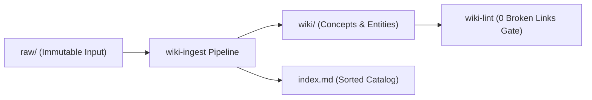
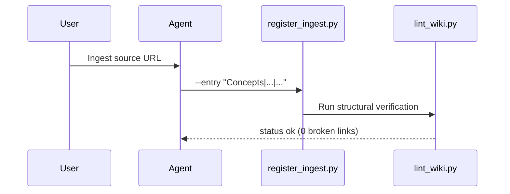
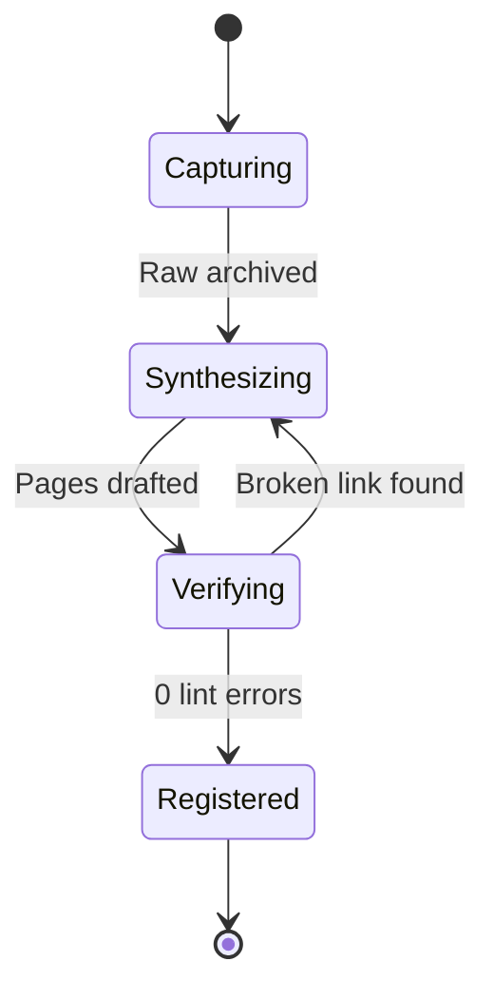
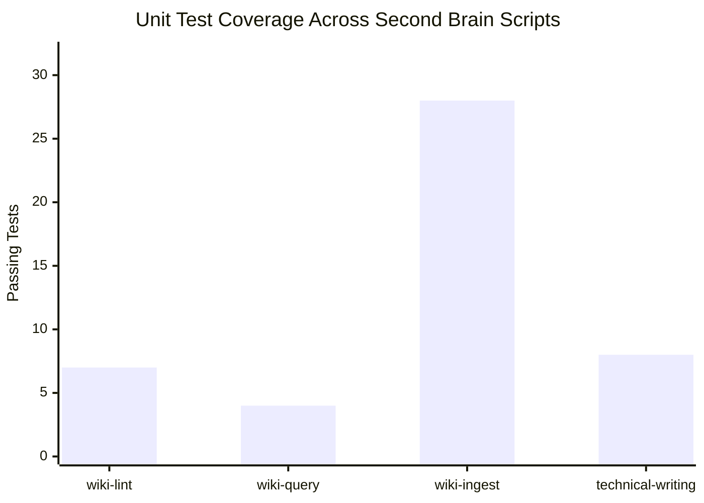

# Visual Vocabulary Reference

Smallest-view templates tailored to `tluc-wiki` and AI engineering workflows. Pick one view (at most two) per explanation, place it directly beside the 2–3 sentences it supports, and remove every node that adds noise rather than clarity.

---

## 1. Pseudocode (Branching Logic)

```text
register_ingest(index_path, log_path, entries)
  parse existing sections in index.md
  for each entry in entries
    resolve exact path in wiki/, mem/, or output/
    percent-encode path and update sorted section
  append single entry to wiki/log.md
  run lint_wiki() -> fail if broken_links or legacy_wikilinks > 0
```

## 2. Call Tree (Pipeline Execution Order)

```text
extract_youtube_transcript.py
  get_video_metadata()          # fetch chapters + metadata in 1 pass
  download_transcript()         # prefer original non-auto track (avoid 429)
  parse_vtt_cues()              # preserve start timestamps per cue
  suggest_keyframe_timestamps() # sample late-chapter + 48% mid-chapter cues
  find_related_wiki_pages()     # rank candidate links from index.md
```

## 3. Component / Skill Tree (Boundaries & Ownership)

```text
Second Brain Architecture (tluc-wiki)
├── raw/    (Immutable ground truth inputs; never edited after capture)
├── wiki/   (LLM-maintained evergreen synthesis: sources, concepts, entities)
├── output/ (Shareable deliverables: reports, documents, summaries, visuals)
├── ctx/    (Reusable prompts, rules, and formatting templates)
└── mem/    (Personal goals, active projects, preferences, network contacts)
```

## 4. File Tree (Progressive Disclosure Skill Layout)

```text
.agents/skills/diagram/
├── SKILL.md                        # Core rules & view matrix (<120 lines)
├── references/visual-vocabulary.md # Copyable templates loaded on demand
└── scripts/check_diagrams.py       # Deterministic Mermaid syntax validator
```

## 5. Mermaid Views (Antigravity-Safe Subset)

### Flowchart (`flowchart LR` with quoted parentheses labels)



### Sequence Diagram (`sequenceDiagram`)



### State Machine (`stateDiagram-v2`)



### Metric Chart (`xychart-beta`)



## 6. Structural Diffs

Use `diff` fences whenever showing how an existing layout, control flow, or state transition changes:

```diff
 .agents/skills/
 ├── wiki-ingest/
+├── diagram/
+│   ├── SKILL.md
+│   └── scripts/check_diagrams.py
 └── wiki-lint/
```

```diff
 on_verification(report)
-  warn if legacy wikilink found
+  if report.legacy_wikilinks or report.broken_links
+    exit 1 and block registration
```

## 7. Complete Non-Elidable Block

When elision would hide ownership or environment behavior, show the full unit once:

```python
def encode_md_path(rel_posix: str) -> str:
    """RFC 3986 percent-encode relative POSIX path for IDE, GitHub, and Obsidian."""
    from urllib.parse import quote
    return quote(rel_posix, safe="/-._~")
```
