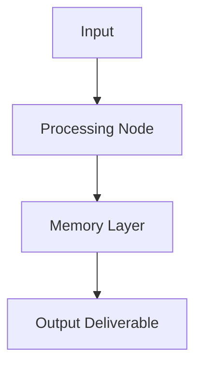
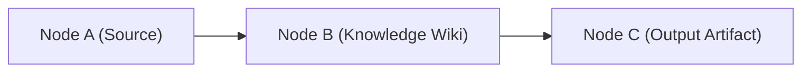

# Deliverable Artifact Templates

This reference guide provides standardized markdown templates for output artifacts in `output/`.

---

## 1. Technical Research Report (`output/reports/`)

```markdown
---
title: "<Report Title>"
date: YYYY-MM-DD
tags:
  - output
  - report
  - <topic-tag>
type: report
---

# <Report Title>

## Executive Summary

<Concise 2-3 paragraph synthesis outlining findings, architecture, and recommendations.>

## Key Findings & Benchmarks

| Metric / Dimension | Option A | Option B | Recommendation |
|--------------------|----------|----------|----------------|
| ...                | ...      | ...      | ...            |

## Deep Architectural Analysis

### 1. <Topic Theme>
<Detailed analysis citing [Concept Name](../../wiki/concepts/Concept%20Name.md) and [Source Name](../../wiki/sources/Source%20Name.md) pages.>

## Recommendations & Next Steps

1. **<Action Item 1>**: <Description>
2. **<Action Item 2>**: <Description>
```

---

## 2. Technical Document & Architecture Spec (`output/documents/`)

```markdown
---
title: "<Document Title>"
date: YYYY-MM-DD
tags:
  - output
  - document
  - <topic-tag>
type: document
---

# <Document Title>

## 1. Overview & Purpose
<Context and objectives.>

## 2. System Architecture


## 3. Component Specifications
<Detailed technical specs citing [Entity Name](../../wiki/entities/Entity%20Name.md) pages.>
```

---

## 3. Executive Summary & Digest (`output/summaries/`)

```markdown
---
title: "<Summary Title>"
date: YYYY-MM-DD
tags:
  - output
  - summary
  - <topic-tag>
type: summary
---

# <Summary Title>

## Core Takeaways (TL;DR)
- Bullet 1
- Bullet 2

## Summary Breakdown
<Structured notes cross-referencing [Page Name](../../wiki/concepts/Page%20Name.md).>
```

---

## 4. Visual Workflow Map & Diagrams (`output/visuals/`)

```markdown
---
title: "<Diagram Title>"
date: YYYY-MM-DD
tags:
  - output
  - visual
  - <topic-tag>
type: visual
---

# <Diagram Title>

## Diagram



## Description & Node Specifications

- **Node A**: Explanation
- **Node B**: Explanation
```
