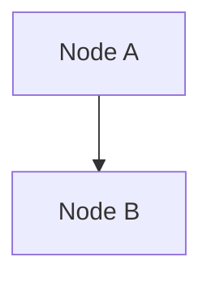

# Visual Workflow Template

```markdown
---
title: "<Visual Title>"
date: YYYY-MM-DD
tags:
  - output
  - visual
type: visual
---

# <Visual Title>



## Node Explanations
- **Node A**: Explanation
```
