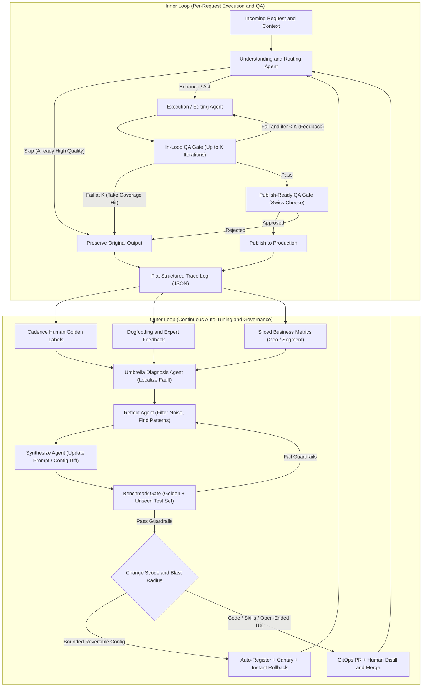
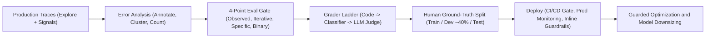

# Closed-Loop Evals: Architecture, Alignment, and Production Blueprint

Closed-Loop Evals turn production agent traces into automated regression checks and bounded prompt/configuration upgrades. This blueprint synthesizes five production frameworks—[Uber](../../wiki/entities/Uber.md), [Hamel Husain](../../wiki/entities/Hamel%20Husain.md), [Warp](../../wiki/entities/Warp.md), [HumanLayer](../../wiki/entities/Kyle%20Mistele.md), and [Anthropic](../../wiki/entities/Anthropic.md)/[OpenAI](../../wiki/entities/OpenAI.md)—into a staged architecture with explicit epistemic confidence tiers, metric disambiguation, and governance gates.

## Executive Summary

Static offline prompt tuning decays once an AI agent meets live long-tail traffic, drifting user inputs, and upstream model updates ([Building Closed-Loop Evals for a Multimodal Agent at Scale](../../wiki/sources/Building%20Closed-Loop%20Evals%20for%20a%20Multimodal%20Agent%20at%20Scale.md)). Production teams solve this drift by closing the feedback loop from execution traces back into prompts, skills, routing configs, and regression suites ([Closed-Loop Evals](../../wiki/concepts/Closed-Loop%20Evals.md), [Hill-Climbing Loop](../../wiki/concepts/Hill-Climbing%20Loop.md)).

Across the surveyed evidence, two design rules govern whether a closed loop compounds reliability or amplifies regressions:

1. **Foundations and Calibrated Binary Evals Preceding Automation** (**Supported**): Every surveyed production team converges on instrumenting flat execution traces first, counting real failure modes through human error analysis, preferring deterministic code assertions over LLM judges, and calibrating any model-based grader on disjoint `Train / Dev / Test` splits before enabling automated optimization ([Product Evals and Error Analysis](../../wiki/concepts/Product%20Evals%20and%20Error%20Analysis.md), [LLM-as-a-Judge and Eval Alignment](../../wiki/concepts/LLM-as-a-Judge%20and%20Eval%20Alignment.md), [Poteto Trust Pyramid](../../wiki/concepts/Poteto%20Trust%20Pyramid.md)).
2. **Governance Depends on Blast Radius, Not Autonomy Dogma** (**Supported**): Fully autonomous config auto-deployment (as reported by [Uber](../../wiki/entities/Uber.md) for bounded image-enhancement configs with instant rollback and Swiss-cheese QA gates) conflicts with GitOps human-gated merges advocated by [Hamel Husain](../../wiki/entities/Hamel%20Husain.md), [Warp](../../wiki/entities/Warp.md), and [Kyle Mistele](../../wiki/entities/Kyle%20Mistele.md). Teams should restrict autonomous rollout to reversible, config-scoped pipelines backed by refreshed human golden sets, and mandate human PR gates whenever agents modify code, skills, or open-ended workflows.

---

## 1. Comparative Landscape: Five Production Frameworks

| Dimension | Uber Eats Closed-Loop Evals | Hamel Husain Product Evals | Warp Dual-Skill Self-Improvement | HumanLayer Control-Loop Engineering | Anthropic / OpenAI Agent Eval Frameworks |
| :--- | :--- | :--- | :--- | :--- | :--- |
| **Primary Domain** | High-throughput multimodal photo enhancement (`$90B` annual run rate, 10,000 cities) | Domain-specific product workflows & RAG assistants | Developer workflows (PR review, issue triage, spec writing) | Production team codebases with SLAs & mandatory review | General multi-turn tool-using agent harnesses |
| **Primary Signal** | Regular human golden labels + dogfooding + marketplace conversion | Manual trace open-annotation & failure counting | In-situ maintainer PR/issue comments ("the why") | Deterministic sensors (`ast-grep`, ESLint) + `FEEDBACK.md` | Full execution transcripts + final environment outcomes |
| **Grader Stack** | Routing confusion matrix + pairwise in-loop QA + publish-ready QA | Code assertions -> Classifiers -> Calibrated binary LLM Judge | Deterministic evals + expert maintainer filter | Static analyzers + CI baseline disturbance dampeners | Code-based + Model-based rubrics + Human calibration |
| **Optimization Loop** | Umbrella Diagnosis Agent -> Reflect + Synthesize -> Golden Benchmark | `Change -> Run Evals -> Candidate / Revert` + unseen test check | Scheduled Outer Improver Skill in Oz -> Minimal Skill Diff | Daily incremental 1-file/1-procedure PRs + `/iterate` | Evaluation Flywheel (`Analyze -> Measure -> Solve`) |
| **Rollout Gate** | Autonomous config registration + instant rollback | Mandatory human prompt review & simplification | Mandatory GitOps PR approval & merge | Adaptive Flow Control (halts if prior PR unreviewed) | Strict regression eval gates + `pass^k` reliability check |
| **Primary Source** | [Uber Talk](../../wiki/sources/Building%20Closed-Loop%20Evals%20for%20a%20Multimodal%20Agent%20at%20Scale.md) | [Hamel Husain](../../wiki/sources/AI%20Eval%20Concepts%20Explained%20in%2015%20Minutes.md) | [Warp Case Study](../../wiki/sources/How%20Warp%20Builds%20Self-Improving%20Agents%20on%20Claude.md) | [Control-Loop Talk](../../wiki/sources/Loop%20Engineering%20from%20First%20Principles.md) | [Anthropic](../../wiki/entities/Anthropic.md) / [OpenAI](../../wiki/entities/OpenAI.md) *(external docs)* |

---

## 2. End-to-End Closed-Loop Architecture

A production closed-loop system separates fast per-request **inner execution and QA verification** from asynchronous **outer diagnosis, prompt/config synthesis, and release governance**.

### Core Architectural Subsystems

1. **Flat Structured Execution Logging (`Start Here`)** (**Direct**): [Uber](../../wiki/entities/Uber.md) logs every sub-agent step for a single request inside one flat JSON record so technical and non-technical reviewers can inspect individual failures and run aggregate rollups (`raw/video-transcripts/building-closed-loop-evals-for-a-multimodal-agent-at-scale-soumya-gupta-jai-chopra-uber.md:L192-L212`). Without full chronological traces (system prompt, user input, tool calls, tool results, retrieved chunks, subagent handoffs), no downstream diagnosis loop has ground truth to optimize ([Product Evals and Error Analysis](../../wiki/concepts/Product%20Evals%20and%20Error%20Analysis.md), [The Art of Loop Engineering](../../wiki/sources/The%20Art%20of%20Loop%20Engineering.md)).
2. **Defense-in-Depth QA (`Swiss Cheese Model`)** (**Direct**): Beyond the inner edit-and-QA loop, Uber runs an independent **Publish-Ready QA Gate** checking holistic quality, policy, and brand compliance to catch failures missed upstream (`raw/video-transcripts/building-closed-loop-evals-for-a-multimodal-agent-at-scale-soumya-gupta-jai-chopra-uber.md:L527-L548`). This parallels the fresh-context adversarial verification in [Second Opinion Pattern](../../wiki/concepts/Second%20Opinion%20Pattern.md) and [Verification Loop](../../wiki/concepts/Verification%20Loop.md).
3. **Umbrella Diagnosis & Split Prompt Optimizer** (**Direct**): Rather than letting a single prompt rewrite itself blindly, Uber splits outer optimization into three bounded roles (`raw/video-transcripts/building-closed-loop-evals-for-a-multimodal-agent-at-scale-soumya-gupta-jai-chopra-uber.md:L340-L393`, `L571-L581`):
   - **Diagnosis Agent**: Ingests heterogeneous signals across feedback loops, localizes which sub-agent(s) drifted, and triggers the tuning pipeline.
   - **Reflect Agent**: Inspects production-vs-golden mismatches, strips labeling noise, and extracts systemic failure patterns.
   - **Synthesize Agent**: Applies targeted edits to the target agent's config/prompt and submits the candidate to offline golden benchmarking.
4. **Three Nested Feedback Loops** (**Direct**): Uber layers three cadences feeding the same Diagnosis Agent (`raw/video-transcripts/building-closed-loop-evals-for-a-multimodal-agent-at-scale-soumya-gupta-jai-chopra-uber.md:L550-L625`):
   - *Model Loop*: Regular production sampling sent to human labelers under objective guidelines to catch online drift against the Golden Dataset.
   - *Dogfooding Loop*: Internal employee, merchant, design, and product feedback (thumbs up/down plus free-form rationale) replayed against flagged examples.
   - *Marketplace Conversion Loop*: Down-funnel business telemetry (add-to-cart, order completion) sliced by geography, dish type, and device to tune underperforming segments.

---

## 3. Prerequisites: Trace-First Error Analysis & Evaluator Alignment

Automated hill-climbing fails when built on uncalibrated graders or generic benchmarks. [Hamel Husain](../../wiki/entities/Hamel%20Husain.md) establishes a mandatory pre-automation pipeline before closing the loop ([AI Eval Concepts Explained in 15 Minutes](../../wiki/sources/AI%20Eval%20Concepts%20Explained%20in%2015%20Minutes.md)):

### Mandatory Pre-Loop Controls

1. **Product Evals Over Foundation Benchmarks** (**Direct**): Public leaderboards (`MMLU`, `Terminal Bench`, `Humanity's Last Exam`) behave like general SAT scores; domain-specific end-to-end product evals produce a **shifted Pareto frontier** where smaller, lower-cost models frequently match or beat frontier models on the concrete workflow ([Product Evals and Error Analysis](../../wiki/concepts/Product%20Evals%20and%20Error%20Analysis.md), [Cost Optimization](../../wiki/concepts/Cost%20Optimization.md)).
2. **Error Analysis Before Automation (`Annotate -> Cluster -> Count`)** (**Direct**): Engineers inspect sampled traces—retaining baseline random sampling (`Explore`) alongside clustering and quantitative outlier signals so *unknown unknowns* remain visible—write open failure notes, recursively split themes into root causes (e.g., splitting `False confirmations` into `Tool failed` vs. `Never called`), and count category frequencies before authoring evals ([AI Eval Concepts Explained in 15 Minutes](../../wiki/sources/AI%20Eval%20Concepts%20Explained%20in%2015%20Minutes.md)).
3. **Realistic Synthetic Inputs (Never Fake Full Traces)** (**Direct**): When live traffic is sparse, synthesize messy user inputs across scenario dimensions and execute the real application to produce genuine traces; for RAG, use reverse synthetic question generation from source chunks to verify exact chunk retrieval ([Product Evals and Error Analysis](../../wiki/concepts/Product%20Evals%20and%20Error%20Analysis.md)).
4. **The 4-Point Eval Worthiness Gate** (**Direct**): Reject vague `1–5` Likert rubrics (`4.2` vs. `4.5` carries zero shipping signal). Author an automated eval only when a defect is **Observed**, **Iterative** (`Change -> Check again`), **Specific**, and **Binary (`Pass / Fail`)** ([AI Eval Concepts Explained in 15 Minutes](../../wiki/sources/AI%20Eval%20Concepts%20Explained%20in%2015%20Minutes.md)).
5. **Grader Hierarchy & `Train / Dev / Test` Alignment** (**Direct**): Order graders from highest determinism to highest flexibility—**Code Assertions -> Supervised Classifiers -> Calibrated LLM-as-a-Judge**—matching the inverted leverage order of the [Poteto Trust Pyramid](../../wiki/concepts/Poteto%20Trust%20Pyramid.md). Validate every automated judge against human labels by tracking False Negatives (*Missed Failures*) and False Positives (*False Alarms*) across three disjoint partitions ([LLM-as-a-Judge and Eval Alignment](../../wiki/concepts/LLM-as-a-Judge%20and%20Eval%20Alignment.md), [Model Evaluation and Validation](../../wiki/concepts/Model%20Evaluation%20and%20Validation.md)):
   - **Train**: Supplies curated `Pass / Fail` few-shot examples inside the evaluator prompt (never score judge accuracy on Train).
   - **Dev (`~40%`)**: Iterative prompt refinement loop until human-judge agreement converges.
   - **Test**: Held-out audit executed once on the finalized judge prompt to confirm out-of-sample generalization.
6. **Countering Four `LLM-as-a-Judge` Biases** (**Direct**): Production LLM judges require active mitigations for **Verbosity Bias** (length-controlled concise-grounding rubrics), **Position Bias** (pairwise evaluation with position swapping), **Self-Preference** (never let a model act as sole uncalibrated judge of its own outputs), and **Leniency Drift** (reference-based rubrics anchored to human-labeled anchors) ([LLM-as-a-Judge and Eval Alignment](../../wiki/concepts/LLM-as-a-Judge%20and%20Eval%20Alignment.md), [AI Engineer Interview Notes](../../wiki/sources/AI%20Engineer%20Interview%20Notes.md)).

---

## 4. Metric Semantics & Production Failure Mode Taxonomy

### Critical Metric Disambiguation (`Pass at K` vs. `pass@k` vs. `pass^k`)

Teams frequently conflate three distinct metrics that answer opposite reliability questions:

| Metric | Definition | What It Measures | Correct Production Use |
| :--- | :--- | :--- | :--- |
| **Sequential `Pass at K`** ([Uber](../../wiki/sources/Building%20Closed-Loop%20Evals%20for%20a%20Multimodal%20Agent%20at%20Scale.md)) | Cumulative pass rate after up to `K` feedback-guided edit-and-QA iterations inside one request | In-loop self-correction recovery rate before taking a coverage hit | Bounded generative retry loops with an explicit fallback (keep original if iteration `K` fails) |
| **Stochastic `pass@k`** ([Anthropic](../../wiki/entities/Anthropic.md) external guide) | Probability of **at least 1** success across `k` independent trials | Best-case capability frontier | Capability evals & interactive workflows where users can retry or pick among candidates |
| **Consecutive `pass^k`** ([Anthropic](../../wiki/entities/Anthropic.md) external guide) | Probability that **all `k` consecutive trials** succeed without failure | Consistency and operational reliability | Unattended closed-loop pipelines, CI release gates, and automated production rollouts |
| **Routing Recall & Precision** ([Uber](../../wiki/sources/Building%20Closed-Loop%20Evals%20for%20a%20Multimodal%20Agent%20at%20Scale.md)) | Confusion matrix (`2x2` binary or `N x N` multi-model router) vs. human golden labels | Guardrail preventing bad inputs slipping through (Recall) vs. wasted compute & degradation (Precision) | Selective enhancement routers and tiered small-vs-frontier model routing |

### Six Production Failure Modes Documented in Primary Evidence

Every failure below is documented as **Direct** evidence from Uber's production multimodal trace audit (`raw/video-transcripts/building-closed-loop-evals-for-a-multimodal-agent-at-scale-soumya-gupta-jai-chopra-uber.md`):

1. **Precision Miss (Compute Waste + Quality Degradation)** (`L289-L301`): Routing agent misclassified a crisp cheeseburger photo as low quality and sent it to enhancement—incurring compute spend for zero lift while risking degradation of an already strong input.
2. **Recall Miss Triggering Cross-Modal Hallucination** (`L302-L317`): Photo depicted 6 chicken wings while menu text stated "8 pieces"; approving enhancement risked hallucinating 2 extra wings to satisfy the text description, breaching **faithfulness**.
3. **Faithfulness Violation (Fabricated Content)** (`L475-L478`): Enhancer inserted shrimp absent from the original dish.
4. **Completeness Violation (Dropped Content)** (`L479-L483`): Enhancer removed sushi sauce present at the bottom of the original photo.
5. **In-Loop Reward Hacking ("Nugatory Change")** (`L484-L501`): After the QA gate rejected a creative first edit, iteration 2 oversteered into an overly conservative generic ceramic bowl that satisfied pixel-diff and safety checks without delivering meaningful visual lift.
6. **Upstream Model Physics Leak & Safe Abstention (`yes / no / unsure`)** (`L468-L469`, `L502-L526`): Frontier image-edit artifacts (plate covering sauce) leaked upward into the application, and obscured items (8 wontons uncountable in the frame) forced the QA evaluator to emit `unsure`—triggering safe production rejection rather than fabricated confidence.

---

## 5. Contradictions & Trade-offs: Autonomous Auto-Deploy vs. Human-Gated Merge

> ⚠️ **Evolving claim**: Industry leaders currently disagree on whether the outer improvement loop should **auto-deploy** passing prompt/config candidates without a human gate or require **human review / GitOps merge** on every candidate diff.

- **Camp A — Autonomous Config-Driven Auto-Deploy** ([Uber](../../wiki/entities/Uber.md)):
  > "the beauty of this is this is completely config driven and doesn't require human in the loop. Your diagnoser agent can write your config and trigger the auto-tuning pipeline here." (`raw/video-transcripts/building-closed-loop-evals-for-a-multimodal-agent-at-scale-soumya-gupta-jai-chopra-uber.md:L354-L359`)
  - Crucially, Uber's auto-deploy **still relies on humans upstream** to label both the initial representative Golden Dataset (`L260-L273`) and regular cadence production samples (`L332-L336`), plus fast rollback and guardrail observability (`L395-L399`). Human gating is removed only from the *candidate config promotion step*, not from ground-truth definition.
- **Camp B — Human-Guarded Optimization & GitOps PR Gates** ([Hamel Husain](../../wiki/entities/Hamel%20Husain.md), [Warp](../../wiki/entities/Warp.md), [Kyle Mistele](../../wiki/entities/Kyle%20Mistele.md), [Lauren Tan](../../wiki/entities/Lauren%20Tan.md)):
  - **Metric Hacking & Prompt Bloat** ([AI Eval Concepts Explained in 15 Minutes](../../wiki/sources/AI%20Eval%20Concepts%20Explained%20in%2015%20Minutes.md)): Autonomous optimizers exploit blind spots in incomplete eval suites and accumulate brittle prompt patches unless humans review, simplify, and validate on unseen test cases.
  - **Feedback Poisoning & GitOps Control** ([How Warp Builds Self-Improving Agents on Claude](../../wiki/sources/How%20Warp%20Builds%20Self-Improving%20Agents%20on%20Claude.md)): Warp restricts outer-loop signal ingestion to verified maintainers and forces every Outer Improver Skill diff through standard GitHub PR review (*"Harness Before Loop"*).
  - **Review Saturation & Foundations First** ([Control-Loop Engineering](../../wiki/concepts/Control-Loop%20Engineering.md), [Poteto Trust Pyramid](../../wiki/concepts/Poteto%20Trust%20Pyramid.md)): HumanLayer pauses new loop PRs via **Adaptive Flow Control** when prior PRs sit unreviewed, while Lauren Tan warns (*"Foundations Before Factories"*) that scaling autonomous outer loops over weak inner checks accelerates slop generation.

### Governance Decision Matrix (Synthesized Rule)

| Condition | Recommended Promotion Gate | Required Safeguards |
| :--- | :--- | :--- |
| **Bounded prompt/routing config** with refreshed human golden labels, Swiss-cheese runtime QA, and instant rollback | **Autonomous Config Auto-Deploy** (canary/segmented) | Unseen holdout benchmark + strict recall/faithfulness guardrails + automated rollback alerts |
| **Source code, agent skills (`SKILL.md`), tool schemas, or `mem/` policies** | **Mandatory Human GitOps PR / Diff Gate** | Minimal focused diff + deterministic test/lint suite + expert signal filtering |
| **Early-stage product with incomplete failure taxonomy** | **Human-in-the-Loop Error Analysis Only** | Block autonomous prompt rewriting until binary evals achieve calibrated `Test`-set alignment |

---

## 6. Epistemic Audit of Claims (5 Confidence Tiers)

- **Direct**: Uber Eats operates at `$90B` annual run rate across `10,000` cities growing `20%` year-on-year, uses flat JSON logging, splits prompt optimization into Reflect + Synthesize sub-agents, uses `yes / no / unsure` QA verdicts, and combines Model, Dogfooding, and Marketplace Conversion feedback loops (`raw/video-transcripts/building-closed-loop-evals-for-a-multimodal-agent-at-scale-soumya-gupta-jai-chopra-uber.md:L44-L55`, `L192-L212`, `L374-L393`, `L468-L469`, `L550-L625`).
- **Direct**: Hamel Husain mandates binary `Pass / Fail` evals, `Train / Dev (~40%) / Test` evaluator validation, the 4-point worthiness gate (`Observed`, `Iterative`, `Specific`, `Binary`), synthetic user inputs rather than synthetic full traces, and human review of automated prompt candidates ([AI Eval Concepts Explained in 15 Minutes](../../wiki/sources/AI%20Eval%20Concepts%20Explained%20in%2015%20Minutes.md)).
- **Direct**: Warp runs over `10,000,000` Claude Code sessions across `800,000` monthly developers (reported in Anthropic's customer spotlight) and enforces GitOps PR approval on its Dual-Skill Outer Improver loop ([How Warp Builds Self-Improving Agents on Claude](../../wiki/sources/How%20Warp%20Builds%20Self-Improving%20Agents%20on%20Claude.md)).
- **Direct**: Lauren Tan's [Poteto Trust Pyramid](../../wiki/concepts/Poteto%20Trust%20Pyramid.md) grew custom AST lint rules from `7` to `167` in 4 months and reports `11,000` PRs/month at a `~0.5%` revert rate while allocating roughly `70%` of agent tokens (estimate reported in talk) to verification ([All Code Is Slop (Except Mine) — Lauren Tan, SpaceXSI](../../wiki/sources/All%20Code%20Is%20Slop%20%28Except%20Mine%29%20%E2%80%94%20Lauren%20Tan%2C%20SpaceXSI.md)).
- **Supported**: Across [Uber](../../wiki/sources/Building%20Closed-Loop%20Evals%20for%20a%20Multimodal%20Agent%20at%20Scale.md), [LangChain](../../wiki/sources/The%20Art%20of%20Loop%20Engineering.md), [Hamel Husain](../../wiki/sources/AI%20Eval%20Concepts%20Explained%20in%2015%20Minutes.md), and [Warp](../../wiki/sources/How%20Warp%20Builds%20Self-Improving%20Agents%20on%20Claude.md), durable execution traces + deterministic/calibrated eval suites are non-negotiable prerequisites before autonomous self-improvement can safely run.
- **Inferred**: Given Uber's reliance on human-labeled cadence sampling and instant rollback alongside Hamel Husain's metric-hacking warning, autonomous promotion appears viable only when the mutable artifact is a narrowly scoped config validated against a continuously refreshed golden distribution rather than arbitrary code.
- **Speculative**: One possibility is that multi-month autonomous prompt synthesis without periodic human distillation accumulates redundant clauses that degrade latency and instruction following, though direct longitudinal telemetry is missing from our sources.
- **Unknown**: Exact quantitative production lift, `K` caps, rollback rates, and compute-per-image economics of Uber's auto-tuning loop remain unpublished in available primary sources (detailed in Section 8).

---

## 7. Implementation Blueprint & Mapping to `tluc-wiki`

### Four-Stage Production Rollout Roadmap

| Stage | Objective | Concrete Exit Check |
| :--- | :--- | :--- |
| **Stage 0 — Traces & Taxonomy** | Instrument flat JSON traces per request; run weekly manual open annotation + failure counting | Named failure taxonomy with ranked counts and reproducible trace IDs |
| **Stage 1 — Deterministic Assertions** | Encode every repeatable invariant into code assertions, schema validators, and static linters (Layers 1–2) | CI/session suite fails deterministically on seeded regressions (`Prove it fires`) |
| **Stage 2 — Calibrated Judges & Guarded Loops** | Build binary LLM judges only for defects passing the 4-point gate; validate on `Train / Dev / Test`; run outer observer proposing human-reviewed diffs | Held-out `Test` alignment meets target FN/FP bounds; human PR merge gate active |
| **Stage 3 — Bounded Config Auto-Tuning** | Enable Diagnosis -> Reflect -> Synthesize over versioned prompt/router configs with unseen golden benchmark, `pass^k` stability gate, and automated rollback | Zero unrecovered guardrail regressions over canary window; rollback verified in staging |

### How `tluc-wiki` Maps to This Blueprint Today

The `tluc-wiki` Second Brain already operates at **Stage 1–2 (Human-Guarded Self-Improvement)** aligned with [AI Engineering Mastery 2026](../../mem/goals/AI%20Engineering%20Mastery%202026.md) and [agent-doc-and-correction-rules.md](../../ctx/rules/agent-doc-and-correction-rules.md):

- **Layer 1–2 Deterministic Graders (Inner Loop)**: Six deterministic CLI linters (`lint_wiki.py`, `lint_skills.py`, `check_memory.py`, `check_prose.py`, `check_research.py`, `check_diagrams.py`) backed by `94` automated unit tests (`run_all_tests.py`).
- **Outer Observer Loop (Human-Gated)**: The `reflect` skill indexes session traces (`transcript.jsonl`), seats a 3-lens read-only panel (*Tooling*, *Judgment*, *Divergent*), climbs the 5-level mistake-elimination ladder, and proposes cited diffs requiring explicit user approval—mirroring [Warp](../../wiki/entities/Warp.md)'s human-gated outer loop and avoiding unreviewed prompt drift.
- **Next Practical Leap for Engineering Projects**: When deploying an external LLM/agent service, pair this exact deterministic grader discipline with trace storage (e.g., Langfuse/Opik/Postgres), a `Train / Dev / Test` binary judge calibration notebook, and `pass^k` consistency tracking before attempting Stage 3 auto-tuning.

---

## 8. What Remains Unknown & Open Limitations

Audited local sources (`wiki/concepts/`, `wiki/sources/`, `raw/video-transcripts/building-closed-loop-evals-for-a-multimodal-agent-at-scale-soumya-gupta-jai-chopra-uber.md`, `raw/video-transcripts/ai-eval-concepts-explained-in-15-minutes.md`) and external documentation summaries (`Anthropic: Demystifying evals for AI agents`, `OpenAI: Evaluation Flywheel & Agent Evals`) leave four concrete gaps unresolved:

1. **Undisclosed Uber Quantitative Baselines (`unmeasured`)**: Uber's primary transcript does not publish numeric Recall/Precision thresholds, the maximum edit loop iteration count `K`, measured `Pass at K` improvement percentages, auto-deploy rollback frequency, or GPU/VLM cost per enhanced menu item.
2. **Proprietary Quality Rubric Specifications**: Uber explicitly withheld its internal pairwise quality rubric details (`raw/video-transcripts/building-closed-loop-evals-for-a-multimodal-agent-at-scale-soumya-gupta-jai-chopra-uber.md:L455-L458`), preventing direct replication of its faithfulness/completeness scoring prompts.
3. **Longitudinal Prompt-Bloat Data Under Autonomous Synthesis**: No checked source provides controlled multi-month measurements comparing autonomous `Reflect + Synthesize` config loops against human-distilled GitOps loops on prompt token growth, unseen-distribution decay, or silent failure drift.
4. **External Full-Text Archival**: Anthropic's `Demystifying evals for AI agents` and OpenAI's `Evaluation Flywheel` guidelines were verified via live web search summaries (`search_web`) rather than full archived raw snapshots in `raw/`; any detailed benchmark tables from those posts should be ingested into `raw/articles/` before citing numerical claims from them ([epistemics.md](../../.agents/skills/deep-research/references/epistemics.md)).

---

## Related Pages

- **Concepts**:
  - [Closed-Loop Evals](../../wiki/concepts/Closed-Loop%20Evals.md)
  - [Product Evals and Error Analysis](../../wiki/concepts/Product%20Evals%20and%20Error%20Analysis.md)
  - [LLM-as-a-Judge and Eval Alignment](../../wiki/concepts/LLM-as-a-Judge%20and%20Eval%20Alignment.md)
  - [Hill-Climbing Loop](../../wiki/concepts/Hill-Climbing%20Loop.md)
  - [Control-Loop Engineering](../../wiki/concepts/Control-Loop%20Engineering.md)
  - [Self-Improving Agents](../../wiki/concepts/Self-Improving%20Agents.md)
  - [Loop Engineering](../../wiki/concepts/Loop%20Engineering.md)
  - [Verification Loop](../../wiki/concepts/Verification%20Loop.md)
  - [Poteto Trust Pyramid](../../wiki/concepts/Poteto%20Trust%20Pyramid.md)
  - [Agentic Engineering Principles](../../wiki/concepts/Agentic%20Engineering%20Principles.md)
  - [Harness Engineering](../../wiki/concepts/Harness%20Engineering.md)
  - [Second Opinion Pattern](../../wiki/concepts/Second%20Opinion%20Pattern.md)
  - [Cost Optimization](../../wiki/concepts/Cost%20Optimization.md)
  - [Model Evaluation and Validation](../../wiki/concepts/Model%20Evaluation%20and%20Validation.md)
- **Entities**:
  - [Uber](../../wiki/entities/Uber.md)
  - [Hamel Husain](../../wiki/entities/Hamel%20Husain.md)
  - [Warp](../../wiki/entities/Warp.md)
  - [Kyle Mistele](../../wiki/entities/Kyle%20Mistele.md)
  - [Lauren Tan](../../wiki/entities/Lauren%20Tan.md)
  - [LangChain Engine](../../wiki/entities/LangChain%20Engine.md)
  - [Anthropic](../../wiki/entities/Anthropic.md)
  - [OpenAI](../../wiki/entities/OpenAI.md)
- **Sources**:
  - [Building Closed-Loop Evals for a Multimodal Agent at Scale](../../wiki/sources/Building%20Closed-Loop%20Evals%20for%20a%20Multimodal%20Agent%20at%20Scale.md)
  - [AI Eval Concepts Explained in 15 Minutes](../../wiki/sources/AI%20Eval%20Concepts%20Explained%20in%2015%20Minutes.md)
  - [How Warp Builds Self-Improving Agents on Claude](../../wiki/sources/How%20Warp%20Builds%20Self-Improving%20Agents%20on%20Claude.md)
  - [The Art of Loop Engineering](../../wiki/sources/The%20Art%20of%20Loop%20Engineering.md)
  - [Loop Engineering from First Principles](../../wiki/sources/Loop%20Engineering%20from%20First%20Principles.md)
  - [All Code Is Slop (Except Mine) — Lauren Tan, SpaceXSI](../../wiki/sources/All%20Code%20Is%20Slop%20%28Except%20Mine%29%20%E2%80%94%20Lauren%20Tan%2C%20SpaceXSI.md)
  - [AI Engineer Interview Notes](../../wiki/sources/AI%20Engineer%20Interview%20Notes.md)
  - [Engineering Principles Library (pstack and OMC)](../../wiki/sources/Engineering%20Principles%20Library%20%28pstack%20and%20OMC%29.md)
- **Raw Ground Truth & Workspace Context**:
  - [Uber Multimodal Closed-Loop Evals Transcript](../../raw/video-transcripts/building-closed-loop-evals-for-a-multimodal-agent-at-scale-soumya-gupta-jai-chopra-uber.md)
  - [Hamel Husain AI Eval Concepts Transcript](../../raw/video-transcripts/ai-eval-concepts-explained-in-15-minutes.md)
  - [AI Engineering Mastery 2026](../../mem/goals/AI%20Engineering%20Mastery%202026.md)
  - [agent-doc-and-correction-rules.md](../../ctx/rules/agent-doc-and-correction-rules.md)
  - [epistemics.md](../../.agents/skills/deep-research/references/epistemics.md)
