# Quy Trình Tư Vấn (Phiên bản 1)

**Đối tượng áp dụng:** Tư vấn viên (TVV), Lễ tân (LT), Chăm sóc khách hàng (CS), Bác sĩ (BS), Phụ tá (PT), Bộ phận liên quan (BP).
**Phạm vi:** Nha khoa tại Q.1, Tp.HCM.

---

## 1. Diễn giải chi tiết các bước trong quy trình

**Bước 1: Tiếp đón khách hàng**
- **Nhân sự:** Tư vấn viên (TVV)
- **Công việc:** Tiếp đón KH đến cửa, xin thông tin cơ bản.

**Bước 2: Kiểm tra thông tin**
- **Nhân sự:** Lễ tân / Chăm sóc khách hàng (LT/CS)
- **Công việc:** Kiểm tra sổ theo tên / SĐT / Mã Thẻ / ID... để xác định là Khách hàng mới hay Khách hàng cũ đang điều trị.

**Phân nhánh A: Khách hàng mới**
1. **Lập hồ sơ:** Lễ tân (LT) lập hồ sơ KH trên phần mềm Nemo.
2. **Nắm thông tin:** Bộ phận (BP) nắm thông tin, sắp xếp bệnh và gọi điện lên phòng điều trị để chuẩn bị ghế.
3. **Chỉ định chụp phim:** Bộ phận (BP) hỏi ý kiến KH có đồng ý chụp phim để kiểm tra không?
   - *Trường hợp Không đồng ý chụp phim:* Chuyển thẳng đến bước Đưa KH lên phòng thực hiện điều trị.
   - *Trường hợp Cần chụp phim để kiểm tra:* Bộ phận (BP) kiểm tra phim để xem có vấn đề gì phát sinh không.
     - *Phim không có vấn đề:* Chuyển thẳng đến bước Đưa KH lên phòng thực hiện điều trị.
     - *Phim có vấn đề, cần tư vấn:* 
       - Tư vấn viên (TVV) đưa KH lên phòng điều trị để tư vấn với bác sĩ chuyên môn.
       - Bác sĩ (BS) và TVV tư vấn đúng chuyên môn để tiếp nhận thông tin tư vấn của bác sĩ. Ghi chú lại các vấn đề phát sinh của KH.
       - Tư vấn viên (TVV) tư vấn lại giúp cho KH hiểu hơn các dịch vụ cần thiết bác sĩ đã chỉ định, trao đổi với KH để lựa chọn được dịch vụ phù hợp.
       - Tư vấn viên (TVV) chốt lại xem KH quyết định điều trị hay không?
         - **Không đồng ý:** TVV Cảm ơn KH, tiếp tục follow KH bằng Zalo công ty, thuyết phục KH dùng dịch vụ. Nhập những ghi chú và nội dung tư vấn lên Nemo để CSKH hằng năm thông tin. Sau đó Bộ phận (BP) check "Hoàn Thành" trên Nemo.
         - **Đồng ý làm dịch vụ:** Chuyển sang bước Đưa KH lên phòng thực hiện điều trị.

**Phân nhánh B: Khách hàng cũ, đang điều trị**
1. **Lấy hồ sơ:** Lễ tân (LT) lấy hồ sơ bệnh án.
2. **Nắm thông tin:** Bộ phận (BP) nắm thông tin, sắp xếp bệnh và gọi điện lên phòng điều trị để chuẩn bị ghế.
3. Chuyển sang bước Đưa KH lên phòng thực hiện điều trị.

**Bước 3: Thực hiện điều trị**
- **Nhân sự:** Tư vấn viên (TVV)
- **Công việc:** Đưa KH lên phòng điều trị (để thực hiện điều trị).

**Bước 4: Hoàn tất điều trị tại phòng**
- **Nhân sự:** Bác sĩ / Phụ tá / Lễ tân
- **Công việc:** Sau khi điều trị xong, Phụ tá (PT) sẽ đưa KH xuống quầy. Tư vấn viên (TVV) tiếp nhận.

**Bước 5: Đánh giá nhu cầu điều trị tiếp**
- **Nhân sự:** Tư vấn viên (TVV)
- **Công việc:** Hỏi thăm xem KH có điều trị tiếp hay không.
  - *Trường hợp Đồng ý làm dịch vụ:* Vòng lại bước Thực hiện điều trị (Đưa KH lên phòng).
  - *Trường hợp Không:* Chuyển sang bước chăm sóc sau điều trị.

**Bước 6: Chăm sóc sau điều trị & Thanh toán**
- **Công việc của TVV:** Cảm ơn KH đã sử dụng dịch vụ. Hỏi thăm KH có đau không, dặn dò, hướng dẫn cách chăm sóc sau điều trị. Nhập những ghi chú hoặc những vấn đề phát sinh của KH lên Nemo để CSKH cùng nắm thông tin.
- **Công việc của LT (Song song):** Thu tiền, xuất hóa đơn, thu tạm ứng (nếu có). Nhập lịch hẹn.

**Bước 7: Đánh giá sự hài lòng**
- **Nhân sự:** Tư vấn viên (TVV)
- **Công việc:** Hỏi thăm KH có hài lòng sau khi điều trị xong?
  - *Trường hợp Hài lòng:* TVV xin đánh giá chất lượng trên các nền tảng.
  - *Trường hợp Không hài lòng:* TVV hỏi thăm, động viên, xin lỗi; xin ý kiến Trưởng bộ phận (TBP); gửi quà tặng kèm (voucher CSKH).
- **Kết thúc:** Bộ phận (BP) check "Hoàn Thành" trên Nemo đối với cả hai trường hợp.

---

## 2. Sơ đồ luồng quy trình (Flowchart)

```mermaid
graph TD
    Start(["TVV<br>- Tiếp đón KH đến cửa<br>- Xin thông tin"]) --> CheckKhachHang["LT/CS<br>- Kiểm tra sổ theo tên/SĐT/Mã Thẻ/ID..."]
    CheckKhachHang --> IsNewKH{"LT/CS<br>KH mới hay cũ"}

    %% Nhánh KH mới
    IsNewKH -- KH mới --> LapHoSo["LT<br>- Lập hồ sơ KH trên Nemo"]
    LapHoSo --> NamThongTinMoi["BP<br>- Nắm thông tin, sắp xếp bệnh và gọi điện lên<br>phòng điều trị để chuẩn bị ghế"]
    NamThongTinMoi --> ChupPhim{"BP<br>Chỉ định của KH đi chụp phim<br>(hỏi ý kiến KH có đồng ý chụp không?)"}

    ChupPhim -- Cần chụp phim để kiểm tra --> KiemTraPhim{"BP<br>Kiểm tra phim để xem có vấn đề gì<br>phát sinh không"}
    
    KiemTraPhim -- Phim có vấn đề, cần tư vấn --> DuaKHLenTuVan["TVV<br>- Đưa KH lên phòng điều trị để<br>tư vấn với bác sĩ chuyên môn"]
    DuaKHLenTuVan --> TuVanChuyenMon["BS+TVV<br>- Tư vấn đúng chuyên môn để tiếp nhận<br>thông tin tư vấn của bác sĩ<br>- Ghi chú lại các vấn đề phát sinh của KH"]
    TuVanChuyenMon --> TuVanLai["TVV<br>- Tư vấn lại giúp cho KH hiểu hơn các dịch vụ<br>cần thiết bác sĩ đã chỉ định<br>- Trao đổi với KH để lựa chọn được dịch vụ phù hợp"]
    TuVanLai --> QuyetDinhDieuTri{"TVV<br>KH quyết định điều trị<br>hay không?"}

    QuyetDinhDieuTri -- Không đồng ý --> TuChoiDieuTri["TVV<br>- Cảm ơn KH<br>- Tiếp tục follow KH bằng Zalo công ty,<br>thuyết phục KH dùng dịch vụ<br>- Nhập những ghi chú và nội dung tư vấn<br>lên Nemo để CSKH hằng năm thông tin"]
    TuChoiDieuTri --> EndTuChoi(["BP<br>- Check 'Hoàn Thành' trên Nemo"])

    %% Nhánh KH cũ
    IsNewKH -- KH cũ, đang điều trị --> LayHoSo["LT<br>- Lấy hồ sơ bệnh án"]
    LayHoSo --> NamThongTinCu["BP<br>- Nắm thông tin, sắp xếp bệnh và gọi điện lên<br>phòng điều trị để chuẩn bị ghế"]

    %% Hội tụ vào thực hiện điều trị
    ChupPhim -- Không đồng ý chụp phim --> DuaKHLenDieuTri["TVV<br>- Đưa KH lên phòng điều trị<br>(để thực hiện điều trị)"]
    KiemTraPhim -- Phim không có vấn đề --> DuaKHLenDieuTri
    QuyetDinhDieuTri -- Đồng ý làm dịch vụ --> DuaKHLenDieuTri
    NamThongTinCu --> DuaKHLenDieuTri

    %% Quá trình sau điều trị
    DuaKHLenDieuTri --> SauDieuTri["BS / PT / LT<br>- Sau khi điều trị xong PT sẽ đưa KH xuống quầy<br>- TVV tiếp nhận"]
    
    SauDieuTri --> HoiDieuTriTiep{"TVV<br>KH có điều trị tiếp<br>hay không"}
    HoiDieuTriTiep -- Đồng ý làm dịch vụ --> DuaKHLenDieuTri
    HoiDieuTriTiep -- Không --> CamOnSauDieuTri["TVV<br>- Cảm ơn KH đã sử dụng dịch vụ<br>- Hỏi thăm KH có đau không, dặn dò,<br>hướng dẫn cách chăm sóc sau điều trị<br>- Nhập những ghi chú hoặc những vấn đề<br>phát sinh của KH lên Nemo để CSKH cùng nắm thông tin"]

    %% Xử lý sau khi cảm ơn
    CamOnSauDieuTri --> ThuTien(["LT<br>- Thu tiền, xuất hóa đơn, thu tạm ứng (nếu có)<br>- Nhập lịch hẹn"])
    CamOnSauDieuTri --> DanhGiaHaiLong{"TVV<br>Hỏi thăm KH có hài lòng<br>sau khi điều trị xong?"}

    DanhGiaHaiLong -- Hài lòng --> XinDanhGia["TVV<br>- Xin đánh giá chất lượng<br>trên các nền tảng"]
    DanhGiaHaiLong -- Không hài lòng --> XuLyKhongHaiLong["TVV<br>- Hỏi thăm, động viên, xin lỗi<br>- Xin ý kiến TBP<br>- Gửi quà tặng kèm (voucher CSKH)"]

    XinDanhGia --> EndHoanThanh(["BP<br>- Check 'Hoàn Thành' trên Nemo"])
    XuLyKhongHaiLong --> EndHoanThanh
```

