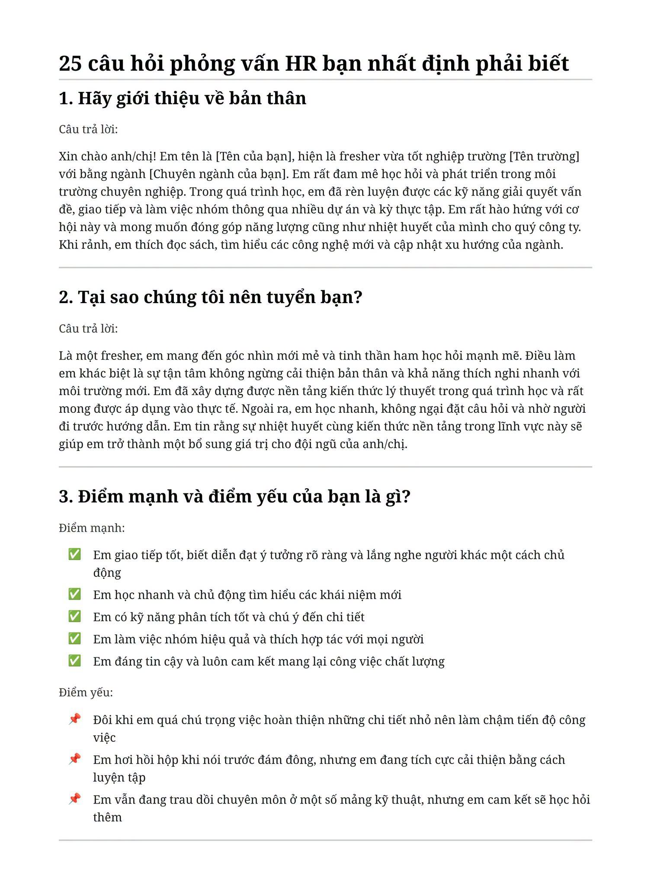
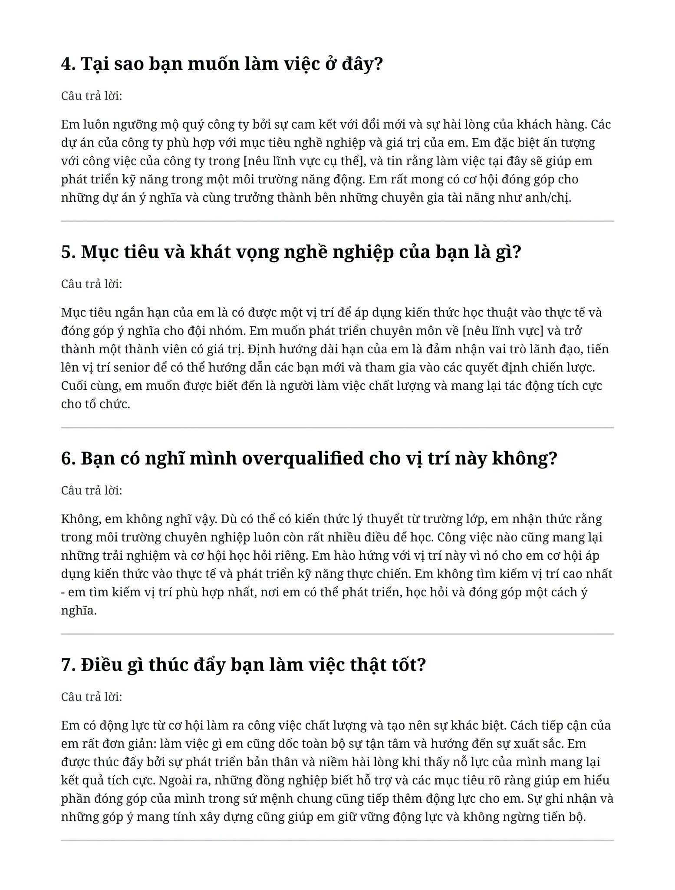
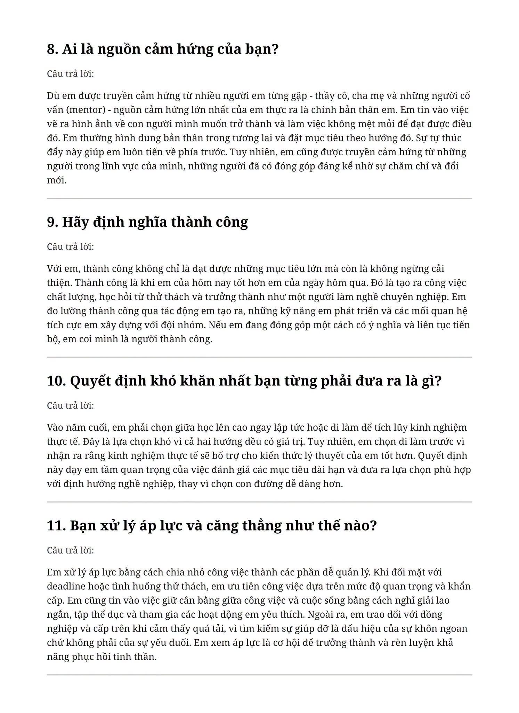
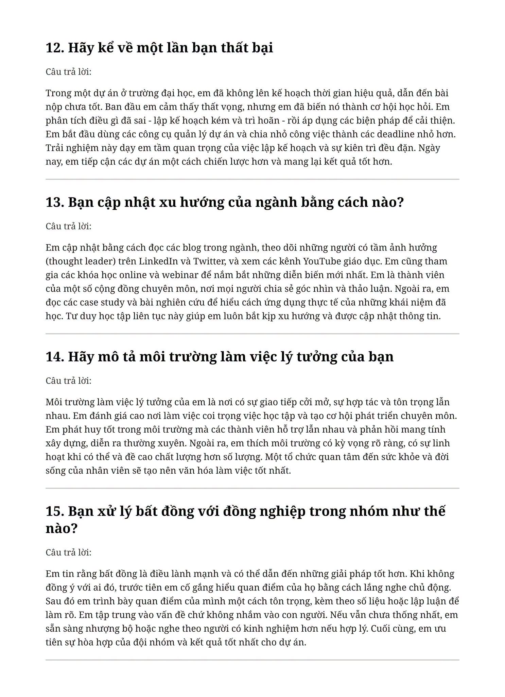
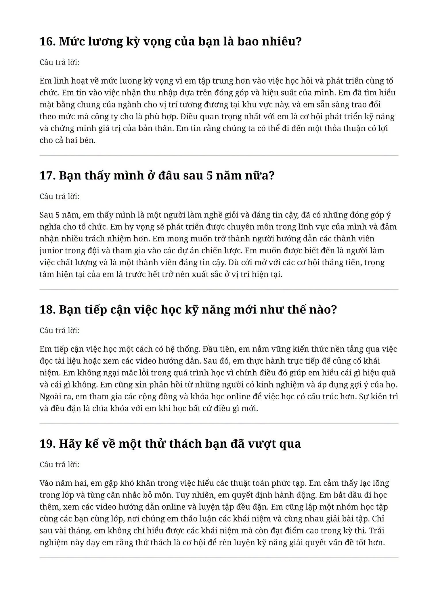
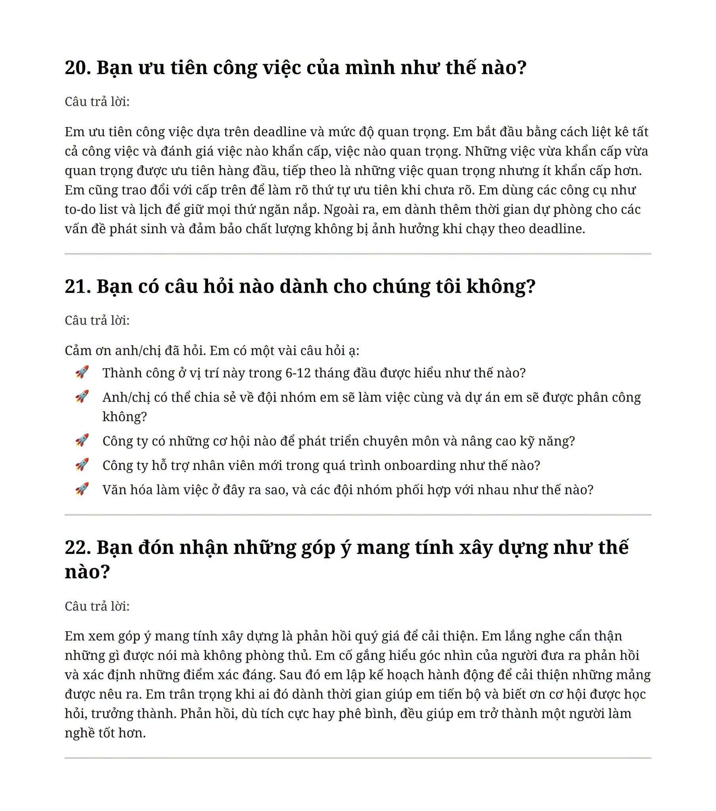
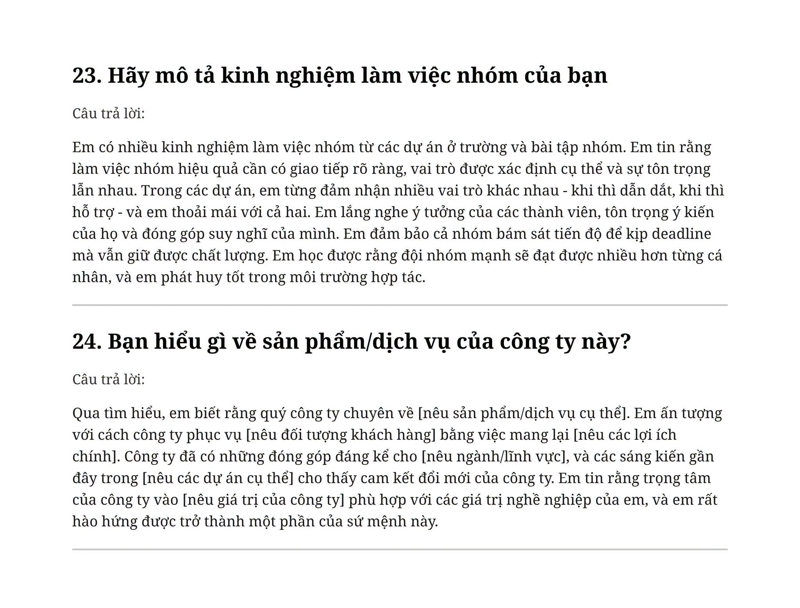
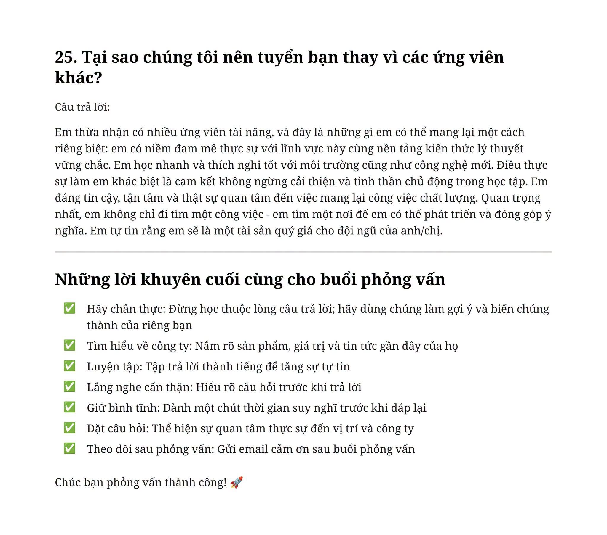

# 25 câu hỏi phỏng vấn bằng tiếng Việt

- **Nguồn bài viết:** [Facebook — Việt Nguyễn AI](https://web.facebook.com/vietnh1009/posts/pfbid02C2KCkxRH9hriCAy8B4yrn56RXaqNu5u92gZyYQTy9Cscvk84GzA7GrnQe5dQpMqVl)
- **Thời gian đăng:** 6 November 2026 at 10:00 (UTC+7)
- **Tương tác tại thời điểm thu thập:** 309 reactions (290 Like, 19 Love), 0 bình luận, 707 lượt chia sẻ
- **Nguồn gốc tiếng Anh được tác giả trích dẫn:** https://www.instagram.com/p/DdeLBEQGK1-/?img_index=1
- **Thư mục hình ảnh gốc (8 trang):** `raw/screenshots/25-interview-questions-vietnamese/` (`00.jpg` – `07.jpg`)

---

## Nội Dung Nguyên Văn Bài Đăng Facebook

> 25 câu hỏi phỏng vấn bằng tiếng Việt 🔥
> Mình xin chia sẻ bộ 25 câu hỏi phỏng vấn phổ biến nhất, kèm câu trả lời mẫu cho từng câu. Bộ tài liệu đặc biệt hữu ích cho các bạn fresher đang chuẩn bị đi phỏng vấn.
> Nội dung chính:
> 🚀 25 câu hỏi kinh điển: giới thiệu bản thân, điểm mạnh và điểm yếu, mức lương kỳ vọng, bạn thấy mình ở đâu sau 5 năm nữa...
> ✅ Câu trả lời mẫu viết sẵn, chỉ cần thay thông tin của bạn vào các chỗ trong [ ]
> 📌 Phần lời khuyên cuối cùng giúp bạn tự tin hơn khi bước vào phòng phỏng vấn
> Note: Mình sử dụng AI để convert và dịch sang tiếng Việt, nên sẽ có những chỗ làm chưa thực sự tốt về nội dung hay hình ảnh so với bản gốc. Nếu bạn đọc được tiếng Anh thì có thể xem bản gốc tại: https://www.instagram.com/p/DdeLBEQGK1-/?img_index=1

---

## Chi Tiết 8 Trang Tài Liệu (25 Câu Hỏi & Câu Trả Lời Mẫu)

### Trang 1 / 8 — Câu 1–3 *(1505x2048)*

#### Tiêu đề ảnh: *25 câu hỏi phỏng vấn HR bạn nhất định phải biết*

**1. Hãy giới thiệu về bản thân**
- Mẫu trả lời: *"Xin chào anh/chị! Em tên là [Tên của bạn], hiện là fresher vừa tốt nghiệp trường [Tên trường] với bằng ngành [Chuyên ngành của bạn]. Em rất đam mê học hỏi và phát triển trong môi trường chuyên nghiệp. Trong quá trình học, em đã rèn luyện được các kỹ năng giải quyết vấn đề, giao tiếp và làm việc nhóm thông qua nhiều dự án và kỳ thực tập. Em rất hào hứng với cơ hội này và mong muốn đóng góp năng lượng cũng như nhiệt huyết của mình cho quý công ty. Khi rảnh, em thích đọc sách, tìm hiểu các công nghệ mới và cập nhật xu hướng của ngành."*

**2. Tại sao chúng tôi nên tuyển bạn?**
- Mẫu trả lời: Fresher mang góc nhìn mới mẻ, tinh thần ham học hỏi mạnh mẽ, tận tâm cải thiện bản thân và thích nghi nhanh; có nền tảng lý thuyết vững, chủ động đặt câu hỏi và học từ người đi trước để trở thành bổ sung giá trị cho đội ngũ.

**3. Điểm mạnh và điểm yếu của bạn là gì?**
- **Điểm mạnh:** Giao tiếp rõ ràng & lắng nghe chủ động; Học nhanh & chủ động tìm hiểu khái niệm mới; Phân tích tốt & chú ý chi tiết; Làm việc nhóm hiệu quả & hợp tác; Đáng tin cậy & cam kết chất lượng.
- **Điểm yếu (nêu kèm hướng khắc phục):** Đôi khi quá chú trọng tiểu tiết làm chậm tiến độ; Hơi hồi hộp khi nói trước đám đông nhưng đang luyện tập tích cực; Đang tiếp tục trau dồi thêm một số mảng kỹ thuật chuyên sâu.

---

### Trang 2 / 8 — Câu 4–7 *(1555x2048)*

**4. Tại sao bạn muốn làm việc ở đây?**
- Mẫu trả lời: Ngưỡng mộ cam kết đổi mới và trải nghiệm khách hàng; dự án của công ty phù hợp mục tiêu nghề nghiệp; ấn tượng mảng `[nêu lĩnh vực cụ thể]` và muốn trưởng thành cùng đội ngũ chuyên gia.

**5. Mục tiêu và khát vọng nghề nghiệp của bạn là gì?**
- Mẫu trả lời: Ngắn hạn: áp dụng kiến thức vào thực tế, phát triển chuyên môn về `[nêu lĩnh vực]` và đóng góp ý nghĩa. Dài hạn: lên vị trí senior, hướng dẫn nhân sự mới và tham gia quyết định chiến lược.

**6. Bạn có nghĩ mình overqualified cho vị trí này không?**
- Mẫu trả lời: Không; lý thuyết trường lớp luôn cần thực chiến bổ sung. Tìm kiếm **vị trí phù hợp nhất** để học hỏi và tạo giá trị thực chất, không chạy theo chức danh cao nhất.

**7. Điều gì thúc đẩy bạn làm việc thật tốt?**
- Mẫu trả lời: Cơ hội tạo công việc chất lượng, tác động tích cực, sự phát triển bản thân, đồng nghiệp hỗ trợ, mục tiêu rõ ràng cùng sự ghi nhận và góp ý xây dựng.

---

### Trang 3 / 8 — Câu 8–11 *(1493x2048)*

**8. Ai là nguồn cảm hứng của bạn?**
- Mẫu trả lời: Được truyền cảm hứng từ thầy cô, gia đình, mentor và những người dẫn dắt trong ngành, đồng thời tự thúc đẩy từ hình ảnh bản thân mong muốn đạt tới trong tương lai.

**9. Hãy định nghĩa thành công**
- Mẫu trả lời: Không chỉ đạt mục tiêu lớn mà là **cải thiện liên tục** ("hôm nay tốt hơn hôm qua"), đo bằng tác động tạo ra, kỹ năng tích lũy và quan hệ tích cực với đội ngũ.

**10. Quyết định khó khăn nhất bạn từng phải đưa ra là gì?**
- Mẫu trả lời: Năm cuối phải chọn giữa học tiếp lên cao ngay hay đi làm tích lũy thực tế — chọn đi làm trước để kinh nghiệm thực chiến bổ trợ kiến thức lý thuyết theo mục tiêu dài hạn.

**11. Bạn xử lý áp lực và căng thẳng như thế nào?**
- Mẫu trả lời: Chia nhỏ việc, ưu tiên theo mức độ quan trọng & khẩn cấp, giữ cân bằng nghỉ ngắn/thể dục, và chủ động trao đổi với đồng nghiệp/cấp trên khi quá tải (*tìm kiếm trợ giúp là khôn ngoan, không phải yếu đuối*).

---

### Trang 4 / 8 — Câu 12–15 *(1486x2048)*

**12. Hãy kể về một lần bạn thất bại**
- Mẫu trả lời: Dự án đại học thiếu lập kế hoạch thời gian dẫn tới bài nộp chưa tốt; phân tích nguyên nhân (trì hoãn/lập kế hoạch kém), áp dụng công cụ quản lý dự án & chia milestone deadline nhỏ để cải thiện kết quả sau này.

**13. Bạn cập nhật xu hướng của ngành bằng cách nào?**
- Mẫu trả lời: Đọc blog chuyên ngành, theo dõi thought leaders trên LinkedIn/Twitter, xem YouTube giáo dục, tham gia khóa học/webinar, sinh hoạt cộng đồng chuyên môn, và đọc case study / paper nghiên cứu.

**14. Hãy mô tả môi trường làm việc lý tưởng của bạn**
- Mẫu trả lời: Giao tiếp cởi mở, hợp tác, tôn trọng lẫn nhau; đề cao học hỏi & phát triển chuyên môn; phản hồi mang tính xây dựng thường xuyên; kỳ vọng rõ ràng, coi trọng chất lượng hơn số lượng và chăm lo sức khỏe nhân viên.

**15. Bạn xử lý bất đồng với đồng nghiệp trong nhóm như thế nào?**
- Mẫu trả lời: Xem bất đồng là lành mạnh; lắng nghe chủ động trước, trình bày quan điểm tôn trọng kèm số liệu/lập luận, **tập trung vào vấn đề chứ không công kích cá nhân**, sẵn sàng nhượng bộ theo phương án hợp lý hơn vì mục tiêu chung.

---

### Trang 5 / 8 — Câu 16–19 *(1523x2048)*

**16. Mức lương kỳ vọng của bạn là bao nhiêu?**
- Mẫu trả lời: Linh hoạt, đặt trọng tâm vào cơ hội học hỏi & chứng minh giá trị; đã tham khảo mặt bằng chung khu vực/vị trí và sẵn sàng trao đổi theo khung phù hợp cho cả hai bên.

**17. Bạn thấy mình ở đâu sau 5 năm nữa?**
- Mẫu trả lời: Trở thành người làm nghề giỏi, đáng tin cậy, chuyên sâu chuyên môn, hướng dẫn được junior và tham gia các dự án chiến lược — trong khi vẫn ưu tiên xuất sắc ở vai trò hiện tại trước.

**18. Bạn tiếp cận việc học kỹ năng mới như thế nào?**
- Mẫu trả lời: Học có hệ thống: (1) Nắm nền tảng qua tài liệu/video $\rightarrow$ (2) Thực hành trực tiếp, không ngại sai $\rightarrow$ (3) Xin feedback từ người có kinh nghiệm $\rightarrow$ (4) Tham gia khóa học/cộng đồng để học đều đặn có cấu trúc.

**19. Hãy kể về một thử thách bạn đã vượt qua**
- Mẫu trả lời: Năm hai gặp khó với môn thuật toán phức tạp; chủ động học thêm, luyện video, lập nhóm học tập thảo luận giải bài và đạt điểm cao — rút ra tư duy coi thử thách là cơ hội rèn giải quyết vấn đề.

---

### Trang 6 / 8 — Câu 20–22 *(1808x2048)*

**20. Bạn ưu tiên công việc của mình như thế nào?**
- Mẫu trả lời: Liệt kê toàn bộ việc, phân loại **Khẩn cấp × Quan trọng** (làm việc vừa khẩn cấp vừa quan trọng trước, tiếp theo là quan trọng ít khẩn cấp), làm rõ ưu tiên với cấp trên khi cần, dùng to-do list/lịch và chừa buffer thời gian tránh ảnh hưởng chất lượng.

**21. Bạn có câu hỏi nào dành cho chúng tôi không?**
- 5 câu hỏi gợi ý chất lượng:
  1. Thành công ở vị trí này trong 6–12 tháng đầu được hiểu như thế nào?
  2. Anh/chị có thể chia sẻ về đội nhóm em sẽ làm việc cùng và dự án em sẽ được phân công không?
  3. Công ty có những cơ hội nào để phát triển chuyên môn và nâng cao kỹ năng?
  4. Công ty hỗ trợ nhân viên mới trong quá trình onboarding như thế nào?
  5. Văn hóa làm việc ở đây ra sao, và các đội nhóm phối hợp với nhau như thế nào?

**22. Bạn đón nhận những góp ý mang tính xây dựng như thế nào?**
- Mẫu trả lời: Coi phản hồi là tài nguyên cải thiện; lắng nghe không phòng thủ, hiểu góc nhìn người góp ý, xác định điểm xác đáng và lập kế hoạch hành động sửa đổi.

---

### Trang 7 / 8 — Câu 23–24 *(2048x1557)*

**23. Hãy mô tả kinh nghiệm làm việc nhóm của bạn**
- Mẫu trả lời: Tham gia nhiều dự án nhóm ở trường; coi trọng giao tiếp rõ vai trò và tôn trọng lẫn nhau; linh hoạt cả vai dẫn dắt lẫn hỗ trợ, lắng nghe ý kiến và giữ tiến độ deadline mà không đánh đổi chất lượng.

**24. Bạn hiểu gì về sản phẩm/dịch vụ của công ty này?**
- Mẫu trả lời điền khuyết `[...]`: Nghiên cứu kỹ `[sản phẩm/dịch vụ cụ thể]`, cách phục vụ `[đối tượng khách hàng]` với `[lợi ích chính]`, đóng góp cho `[ngành/lĩnh vực]`, các sáng kiến `[dự án cụ thể]` và sự đồng điệu với `[giá trị của công ty]`.

---

### Trang 8 / 8 — Câu 25 & Những Lời Khuyên Cuối Cùng *(2048x1808)*

**25. Tại sao chúng tôi nên tuyển bạn thay vì các ứng viên khác?**
- Mẫu trả lời: Kết hợp niềm đam mê thực sự + nền tảng lý thuyết vững + tốc độ học & thích nghi công nghệ mới + cam kết cải thiện liên tục, sự đáng tin cậy và mong muốn gắn bó đóng góp dài hạn.

**Những lời khuyên cuối cùng cho buổi phỏng vấn (7 nguyên tắc):**
1. **Hãy chân thực:** Đừng học thuộc lòng câu trả lời; dùng làm gợi ý và biến thành câu chuyện riêng của bạn.
2. **Tìm hiểu về công ty:** Nắm rõ sản phẩm, giá trị và tin tức gần đây.
3. **Luyện tập:** Tập trả lời thành tiếng để tăng tự tin.
4. **Lắng nghe cẩn thận:** Hiểu đúng câu hỏi trước khi trả lời.
5. **Giữ bình tĩnh:** Dành một chút thời gian suy nghĩ trước khi đáp lại.
6. **Đặt câu hỏi:** Thể hiện sự quan tâm thực sự đến vị trí và công ty.
7. **Theo dõi sau phỏng vấn:** Gửi email cảm ơn sau buổi phỏng vấn.
