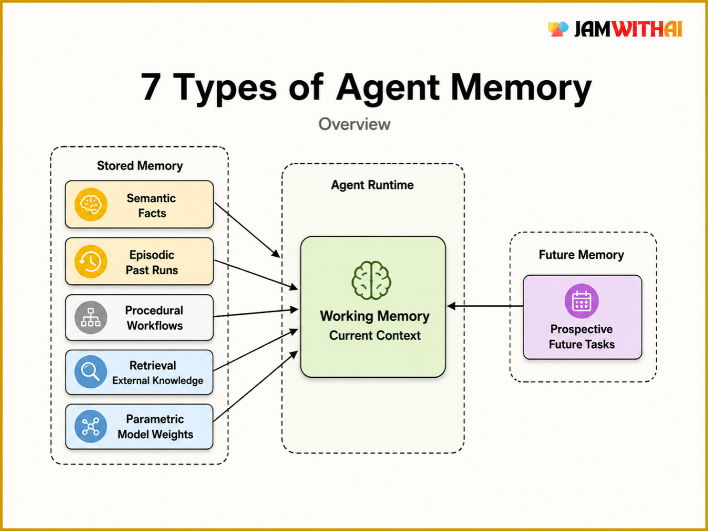
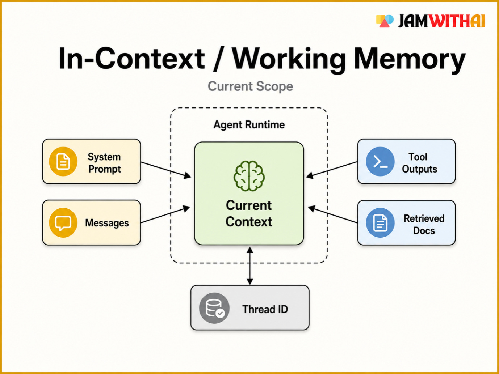
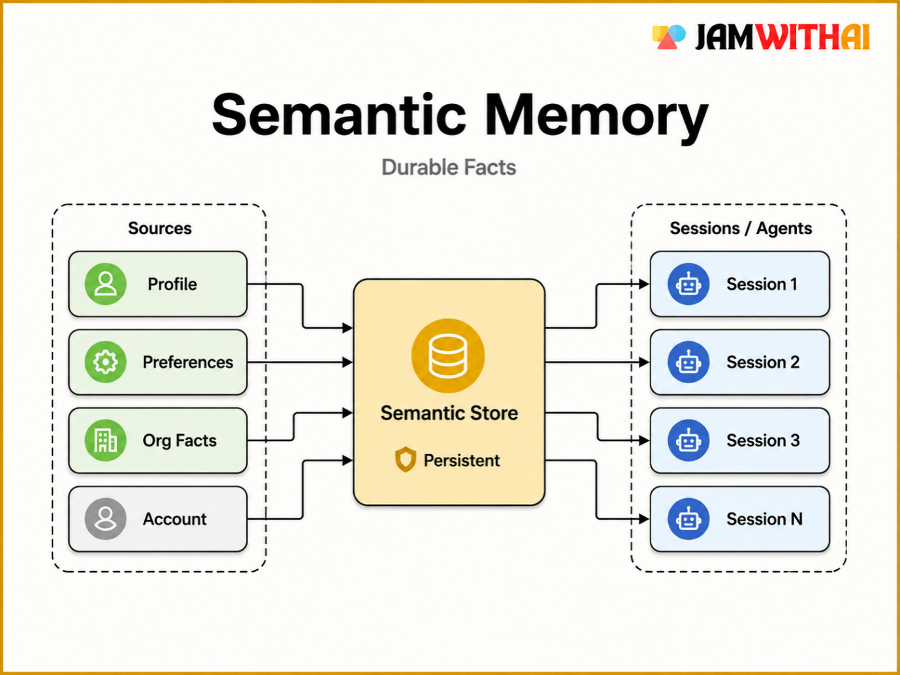
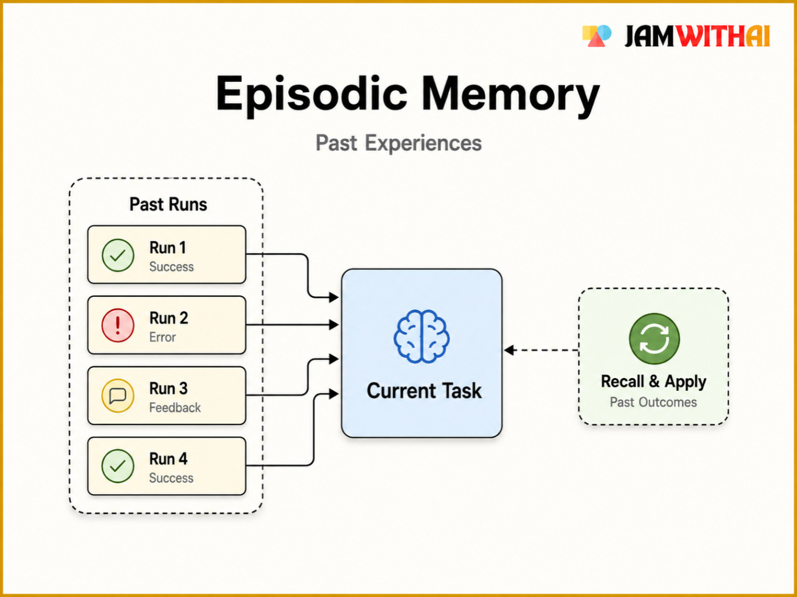
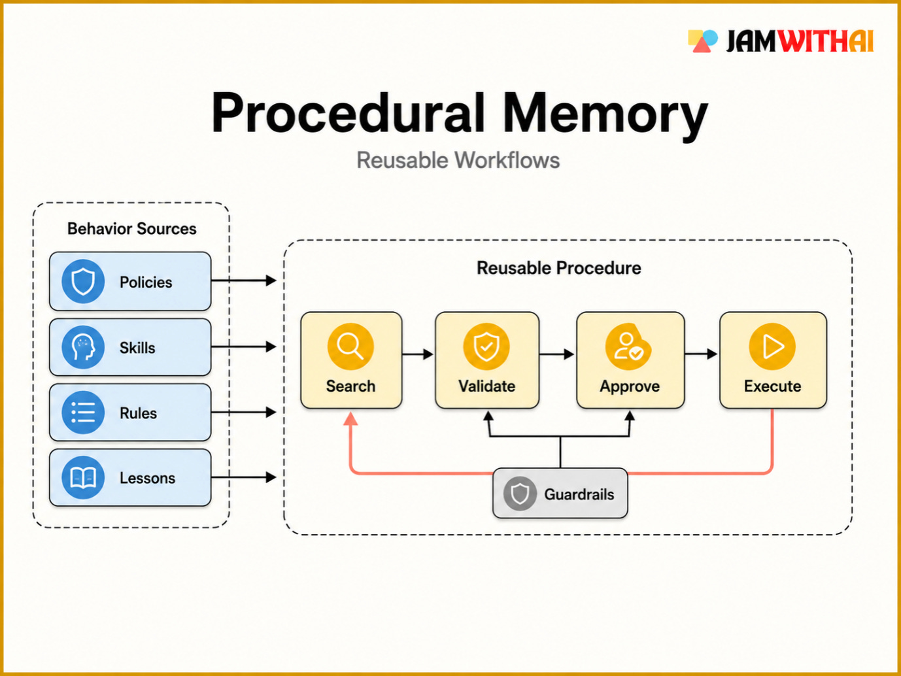
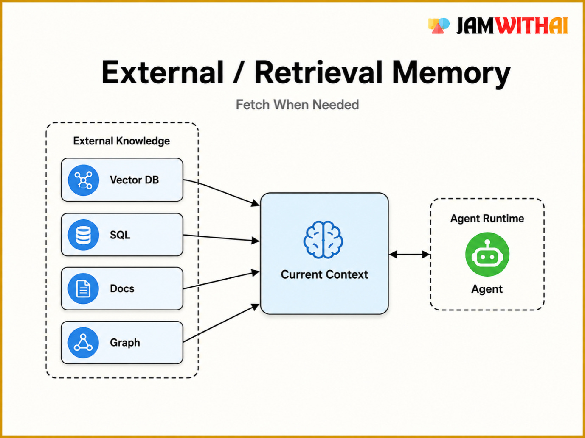
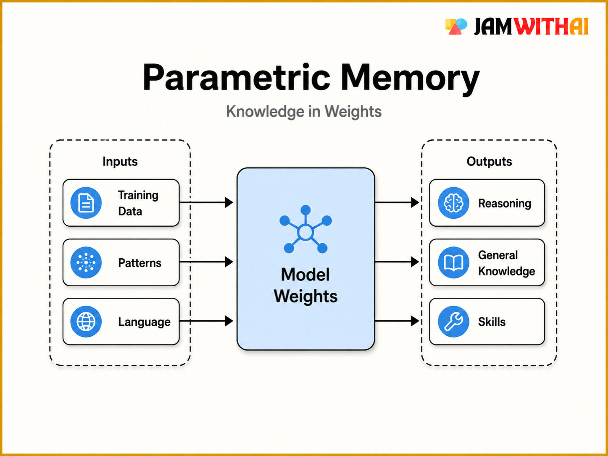
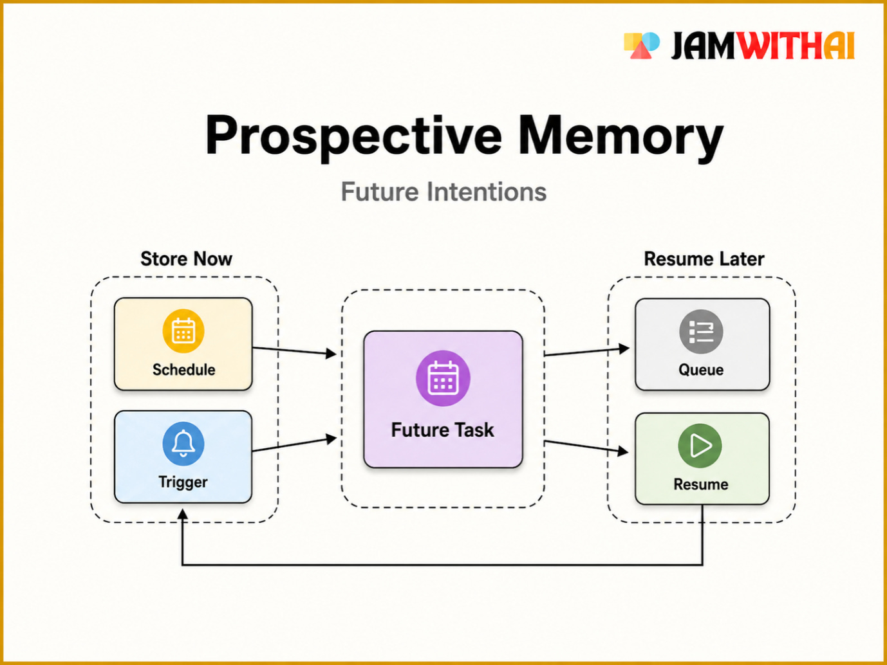

# Agent Memory: the 7 types you should know before you ship to production

- **Nguồn bài viết:** https://jamwithai.substack.com/p/agent-memory-the-7-types-you-should
- **Thời gian đăng:** 2026-07-01
- **Thư mục hình ảnh gốc (9 trang):** `raw/screenshots/agent-memory-the-7-types-you-should-know/`

---

## Nội Dung Nguyên Văn Bài Viết

### You know RAG. You know vector databases. But can you say what your agent should remember, for how long, and when it should forget?

Hey there 👋,

If you have ever built a chatbot, you know that first version feels almost magical. You ask a question, it answers. You ask a follow-up, and it answers that too, picking up on exactly what you just said. Then the conversation ends. The same user comes back an hour later, says hello, and the agent has no idea who they are. Brilliant one minute, a complete stranger the next.

That blank slate is the problem the word “memory” is meant to solve. A language model on its own remembers nothing once a chat session finishes, so the moment you want it to actually know the people and tasks it works with, you reach for memory.

This is where it gets confusing, because “memory” turns out to be a single word for several very different things. Remembering what a user said three messages ago is not the same as remembering, weeks later, that they prefer Python. Recalling how a task failed last time is not the same as knowing the steps to run it. And neither is the same as remembering to follow up with someone next Tuesday.

Those are distinct kinds of memory, each with its own way of being stored, recalled, and going wrong. Lumping them together is where most “we added memory and the agent got worse” stories begin. Pile everything into one store and the agent gets slower, more expensive, and oddly inconsistent: old preferences stay active long after they should, irrelevant conversations resurface, and a one-time instruction quietly becomes a permanent rule.

> More memory is not a better agent. A better agent forgets on purpose.

So the useful design question is not “how do we add memory to the agent?” It is: what should the agent remember, for how long, and under what conditions should that information come back?

This post is the framework we use to answer that. There is no shortage of content explaining what a vector database does. What is missing is a way to decide which of seven different things you are actually building when you say “memory,” and how to wire each one correctly. We will define all seven, show where each one breaks in production, point at what actually implements it, and then run a single real request through all of them so you can see the system instead of the parts.

The seven types:
- In-context / working memory
- Semantic memory
- Episodic memory
- Procedural memory
- External / retrieval memory
- Parametric memory
- Prospective memory

Most agents use several of these. Very few need all seven. Let’s start with the one every agent already has.

## Build stronger data foundations for “agentic AI” at scale

And everything above runs on one thing: data. Every memory type is just data underneath, and an agent is only as good as the data it reads from.

Build stronger data foundations for agentic AI at scale

Building an AI demo is easy. Building agentic systems that scale across an enterprise is the hard part, and it comes down to the data foundation. Senior leaders from AWS, Prudential, Siemens, GAF, and HF Sinclair get into exactly that in this free virtual panel.

Here’s what you’ll learn:
- Scale past the proof of concept. Build industrial-scale systems with classical and generative AI.
- Fix the data problem. Power AI with governed, high-quality data.
- Make better architecture decisions. Choose the right databases for AI applications.
- Streamline deployment. Discover, procure, and deploy AI solutions with AWS Marketplace.

(Thanks to AWS for partnering on this post.)

## The mental model you need first

Lets understand the mental model comes before the list, because without it the seven types are just vocabulary.
- In-context / working memory
- Semantic memory
- Episodic memory
- Procedural memory
- External / retrieval memory
- Parametric memory
- Prospective memory

These categories are not arbitrary. They map onto the kinds of memory cognitive scientists have studied for decades (semantic versus episodic, declarative versus procedural), and that mapping was formalized for LLM agents in CoALA: Cognitive Architectures for Language Agents (Sumers, Yao, Narasimhan, and Griffiths, 2023). The practitioner takeaway from that work is simple and useful: an agent has one short-term working memory and several optional long-term memories, and naming each one tells you which slot your system is missing.

Hold on to two distinctions as you read.

The first is stored versus active. Your application can hold an entire conversation in a database, but the model cannot reason over a single byte of it until those bytes are placed back into the current prompt. Storage is potential. Working memory is what the model can actually use right now.

The second is what versus where. Semantic, episodic, and procedural memory describe what is being remembered. Retrieval and parametric memory are about where knowledge lives and how it gets back to the model. Mixing these two axes is why “just add a vector DB” feels like an answer and then quietly fails.

Every type below is some combination of those two ideas.

## 1. In-Context / Working Memory

What it is A language model forgets everything the moment it finishes a reply. Once the call ends, the last message is gone from its mind. So to make a conversation work at all, your app re-sends the entire chat or last N messages every time the user says something new: the instructions you gave the model, all the earlier messages, any results from tools, and anything you looked up for it. That whole package of text you send in is working memory. It is the only thing the model can see while it writes its answer.

Why it matters The model can only use what is in that package right now. If something is not in there, it may as well not exist. Say a user mentions early on that they are on AWS and cannot use Kubernetes. Ten messages later the agent is still suggesting ECS (Amazon’s non-Kubernetes option) instead of EKS (its Kubernetes one). It looks like the agent remembered the rule. It did not. That first message is simply still part of the package being re-sent each turn, so the model can still read it. Stop including it and the “memory” vanishes.

Where it breaks That package has a size limit, called the context window: the maximum amount of text a model can read at once. Text is measured in tokens, which are roughly small chunks of words. A short chat fits with room to spare. A long one does not. Once the conversation grows past the limit, you have to choose what to keep, what to shorten, and what to drop. Choose badly and the agent forgets the one detail that actually mattered.

The reasoning could go beyond the context window, even if the context window is unlimited. At the end, you are putting a lot of data in the context, which increases its latency and cost of processing, and that's also something you want to avoid in your real-time systems.

In real world AI applications, this is where the checkpointer comes in, and it answers the question the setup above left open: if the model forgets everything, how does your app still have the conversation to re-send? Because it saved it. A checkpointer is that save file. After each step it stores the current chat and the agent’s state (usually in a database), and when the next message arrives, your app loads it back and sends it in again. That reload-and-resend loop is working memory in action, and it is what lets an agent pause and pick a conversation back up instead of starting cold. Frameworks like LangGraph give you a checkpointer ready-made.

The second job is keeping that conversation from growing too big. As it creeps toward the context window limit, a trimming or summarizing step decides what to keep and what to compress so the package still fits. The paper to read here is MemGPT (Packer et al., 2023), which treats the window like a computer’s memory and swaps information in and out as needed.

> Working memory should hold the smallest amount the agent needs for its next good decision. Nothing more.

## 2. Semantic Memory

What it is Facts worth keeping, saved on their own so they outlive the conversation. Working memory disappears the second a chat ends. Semantic memory is the part that sticks around: “this user prefers Python,” “their company runs on AWS,” “they are on the enterprise plan.” Plain, lasting facts, kept somewhere the agent can look them up in any future chat.

Why it matters Without it, the agent starts every conversation from zero and has to figure out who it is talking to all over again. With it, the agent just reads the fact. It does not dig back through a six-month-old chat to work out that the user likes Python. It loads “prefers Python” from storage and moves on. The important part is that the fact has been separated from the original event. This makes semantic memory useful for personalization, user profiles, organizational knowledge, and stable domain facts.

Where it breaks The hard part is deciding what is worth saving. “Keep it short today” is a one-off. “I always want short answers” is a lasting preference. Save everything and the store fills up with outdated and conflicting facts, and the agent starts acting on things that are no longer true. A wrong saved fact is worse than none, because the agent trusts it completely. So you need rules for adding, updating, and deleting facts, not just a growing pile.

In practice Semantic memory is usually a simple store of facts, with a separate bucket per user so one person’s information never mixes with another’s, plus a step (often the model itself) that reads a conversation and decides which facts are worth saving. LangGraph’s long-term memory store is a ready-made version of exactly this.

A production system therefore needs rules for extraction, validation, updating, and deletion. Otherwise, semantic memory slowly fills with outdated or contradictory facts. And sometimes a fact alone is not enough. Knowing that a deployment failed tells you very little. You may also need to know when it failed, what the agent attempted, and what happened next. That requires a record of the event itself.

This is the role of episodic memory.

## 3. Episodic Memory

What it is A record of specific things that happened, saved as whole events. The difference from semantic memory is easy to see. Semantic memory stores the fact (”the user prefers ECS”). Episodic memory stores the story behind it: what the agent was asked to do, the steps it took, what the tools returned, where it went wrong, and how it turned out. It is the agent’s diary of past runs. An episode can include:
- The original objective
- The actions the agent took
- Tool calls and observations
- Errors or failed approaches
- User feedback
- The final outcome

Why it matters It lets an agent learn from experience instead of repeating the same mistakes. A coding agent can look back at how it fixed a similar bug last week. A support agent can pull up how the same customer issue was solved last month, rather than working it out from scratch again. The more often an agent repeats a kind of task, the more these past runs are worth.

Where it breaks Saving every run is not the same as learning from it. A pile of ten thousand old runs is just an archive. It only helps if the agent can find the right one and pull out the lesson. So episodic memory is usually paired with reflection: after finishing a task, the agent writes a short summary of what worked and what did not, and saves that summary next to the run. That summary is what gets reused later, not the full transcript.

In practice Episodic memory is a store of past runs (the same information your logging or tracing tools already collect), plus the reflection step that turns those runs into lessons. The classic example is the Generative Agents paper (Park et al., 2023), where agents record what happens to them and, every so often, distill those records into higher-level takeaways. At that point, experience starts becoming behavior.

The agent is no longer remembering only what happened. It is beginning to remember how to act. That brings us to procedural memory.

## 4. Procedural Memory

What it is The agent’s know-how: the steps, rules, and habits for doing a task. If semantic memory is facts and episodic memory is past events, procedural memory is method, the how-to. For example:
- Search internal docs before searching the web
- Check that generated SQL is valid before running it
- Get a human to approve before issuing a refund
- Escalate anything security-related to a person

Why it matters It keeps the agent’s behavior consistent from one run to the next, and it is how an agent gets better without retraining the model. Say the agent notices, across many past runs, that deployments keep failing because someone forgot to set an environment variable (a setting an app needs in order to run). That repeated lesson becomes a fixed rule: always check the environment variables before deploying. A pattern spotted in episodic memory turns into a standing procedure.

Where it breaks If all these rules live jumbled together inside one giant prompt, they start to contradict each other and become impossible to update safely. The opposite mistake is just as easy: turn one unlucky run into a permanent rule and you have taught the agent a bad habit it will now repeat every time.

In practice Procedural memory lives in the instructions and policies in your prompt, the descriptions you write for each tool, the workflow itself (the fixed sequence of steps the agent follows), and reusable “skills.” The real work is taking the lessons piling up in episodic memory and turning the good ones into these repeatable procedures.

But facts, episodes, and procedures can all grow far beyond what fits into the context window. The agent therefore needs a way to locate the right information at the right time. This is where retrieval memory enters the architecture.

## 5. External / Retrieval Memory

What it is, Retrieval memory is slightly different from the previous categories. Semantic, episodic, and procedural memory describe what is being remembered. Retrieval memory is primarily about where that information lives and how it returns to the model. The store might be a vector database (a database that finds text by meaning rather than exact words), an ordinary database, a set of documents, or just files. Retrieval is the act of reaching into that store and fetching what is relevant.

Why it matters Facts, past runs, and procedures quickly grow too big to fit in the context window. You cannot hand the model everything, so you keep it all in outside storage and fetch only the few pieces that matter for the current question. Those pieces then go into working memory. This “fetch only what you need” step is the heart of most RAG systems.

Where it breaks “Just add a vector database” is the common mistake. Searching by meaning is great when you want things that are related in idea (”find notes similar to this question”), but it is the wrong tool for many lookups. Match the method to what you are actually after:
- Search by meaning for related documents
- An exact database lookup for a specific fact (a user’s plan, an order number)
- Filters for categories or permissions (only this team’s data)
- Time-based lookups for deadlines and schedules
- Following the links between related items

In practice Retrieval memory is usually a mix of the stores above, with something deciding which one to ask for each kind of question. And whatever it fetches still has to be dropped into working memory before the model can use it, because that package is the only thing the model actually reads.

Retrieval memory extends what the agent can access, but the retrieved information still has to enter working memory before the model can use it. And even before any retrieval happens, the model already carries another kind of memory, one acquired during training aka parametric memory.

## 6. Parametric Memory

What it is The knowledge already built into the model when it was trained. This is the one kind of memory you do not build or manage: it comes with the model itself. It is why a general model can write Python or explain how an API works without looking anything up. The name comes from the model’s parameters, the billions of numbers (also called weights) that were set during training and that hold this knowledge.

Why it matters It is the foundation under everything else: language, general world knowledge, and basic reasoning. Every other memory type sits on top of it.

Where it breaks This knowledge is frozen at training time, so it can be out of date. It cannot know anything private to your company. It can sound completely confident and still be wrong. And you cannot reach in and fix a single fact. Fine-tuning (training the model further on your own examples) can change its style and behavior, but it is a poor way to store facts that keep changing.

In practice Treat parametric memory as your general-ability layer, and reach for external memory whenever you need something specific, current, or private. The model knows how expense policies work in general; your company’s actual reimbursement limit should come from a trusted source you control, not from the model’s weights.

So far, every memory type has focused on the present or the past: what the agent knows, what happened previously, and how it should behave. Long-running agents need one more capability.

They must remember the future.

## 7. Prospective Memory

What it is Remembering to do something later. It is the agent’s to-do list for the future:
- Follow up with the customer on Friday
- Retry the job once the rate limit resets
- Check the deployment again after monitoring data comes in
- Remind the user before their subscription renews

Why it matters It is what lets an agent work across hours, days, or weeks instead of only inside a single chat. Without it, anything the agent cannot finish right now just falls through the cracks.

Where it breaks A future task cannot simply “wait inside the conversation.” The model is not running the whole time, and the chat may be long gone by the time the moment arrives. So the reminder has to live somewhere outside the model, with a clear rule for when it fires and when it counts as done, so it neither nags forever nor quietly disappears.

In practice Prospective memory runs on the usual tools for scheduled work: schedulers, task queues, timers (cron, a standard way to run jobs on a schedule), and systems built to reliably run long-delayed jobs (such as Temporal). A good prospective record stores what to do, when or what triggers it, the information needed to pick the task back up, whether it is finished, and who has to approve it before it runs.

> These seven are not separate modules. They are a system.

## How the seven work together

## This post is for paid subscribers

---

## Hình Ảnh & Sơ Đồ Đính Kèm (9 ảnh)

### Hình 1 / 9 *(1280x720)*

### Hình 2 / 9 *(1378x1034)*

### Hình 3 / 9 *(1378x1034)*

### Hình 4 / 9 *(1378x1034)*

### Hình 5 / 9 *(1378x1034)*

### Hình 6 / 9 *(1378x1034)*

### Hình 7 / 9 *(1378x1034)*

### Hình 8 / 9 *(1447x1086)*

### Hình 9 / 9 *(1378x1034)*

## Liên Kết Tham Khảo

- https://substack.com/@shantanuladhwe
- https://substack.com/@shirinkjam
- https://pages.awscloud.com/awsmp-gim-guf2-webinar-aim-enterprise-ai-and-data-leader-panel-lt-panel-2.html?trk=b69c9e72-00ee-4bb9-90d5-6e794118ec29&sc_channel=el
- https://aws.amazon.com/
- https://arxiv.org/abs/2309.02427
- https://arxiv.org/abs/2310.08560
- https://arxiv.org/abs/2304.03442
- https://jamwithai.substack.com/subscribe?simple=true&next=https%3A%2F%2Fjamwithai.substack.com%2Fp%2Fagent-memory-the-7-types-you-should&utm_source=paywall&utm_medium=web&utm_content=204286660
- https://substack.com/sign-in?redirect=%2Fp%2Fagent-memory-the-7-types-you-should&for_pub=jamwithai&change_user=true
