# Cẩm nang AI toàn tập bằng tiếng Việt - Từ cơ bản đến ứng dụng thực tế

- **Nguồn bài viết:** [Facebook — Việt Nguyễn AI](https://web.facebook.com/vietnh1009/posts/pfbid02tqE2HNnmhrRkUSQpqeaCSAJ7XVh7jZ2PKHHgp4tPw9WbAbfH2R7uhz3sbvuiFScil)
- **Thời gian đăng:** 29 October 2026 at 16:00 (UTC+7; `2026-10-29T09:00:05.000Z`)
- **Tương tác tại thời điểm thu thập:** 115 reactions (104 Like, 11 Love), 0 bình luận, 122 lượt chia sẻ
- **Nguồn gốc tiếng Anh được tác giả trích dẫn:** https://www.instagram.com/p/DdL7cWIH0Wb/
- **Thư mục hình ảnh gốc (20 trang):** `raw/screenshots/ai-complete-handbook/` (`00.jpg` – `19.jpg`)

---

## Nội Dung Nguyên Văn Bài Đăng Facebook

> 📚 Cẩm nang AI toàn tập bằng tiếng Việt - Từ cơ bản đến ứng dụng thực tế
> Mình xin chia sẻ bộ cẩm nang tổng hợp kiến thức AI, gồm 20 chủ đề đi từ nền tảng cho tới ứng dụng thực tế, phù hợp cho các bạn mới bắt đầu lẫn các bạn muốn hệ thống lại kiến thức.
> Bộ tài liệu bao gồm:
> 🧠 Nền tảng AI, Tác nhân thông minh, Giải quyết vấn đề & các thuật toán Search (BFS, DFS, UCS, Heuristic, A*)
> 🎮 Trò chơi & Minimax, Biểu diễn tri thức, Logic & Suy luận, Xác suất & Suy luận Bayesian
> 📊 Machine Learning: Supervised, Unsupervised, Neural Networks & Deep Learning
> 💬 NLP & Computer Vision, Generative AI & LLMs, Prompt Engineering
> 🚀 RAG & Vector Databases, AI Agents & Tool Calling
> ✅ Đánh giá - An toàn - Đạo đức AI, và Triển khai AI vào thực tế
> Mỗi trang đều có lý thuyết ngắn gọn, sơ đồ trực quan, bảng so sánh và ví dụ minh họa cụ thể, giúp nắm khái niệm nhanh mà không bị ngợp.
> Note: Mình sử dụng AI để convert và dịch sang tiếng Việt, nên sẽ có những chỗ làm chưa thực sự tốt về nội dung hay hình ảnh so với bản gốc. Nếu bạn đọc được tiếng Anh thì có thể xem bản gốc tại: https://www.instagram.com/p/DdL7cWIH0Wb/

---

## Chi Tiết 20 Trang Cẩm Nang (Visual Transcription)

### Trang 1 / 20 — Bìa: AI Toàn Tập Ghi Chú *(1638x2048)*
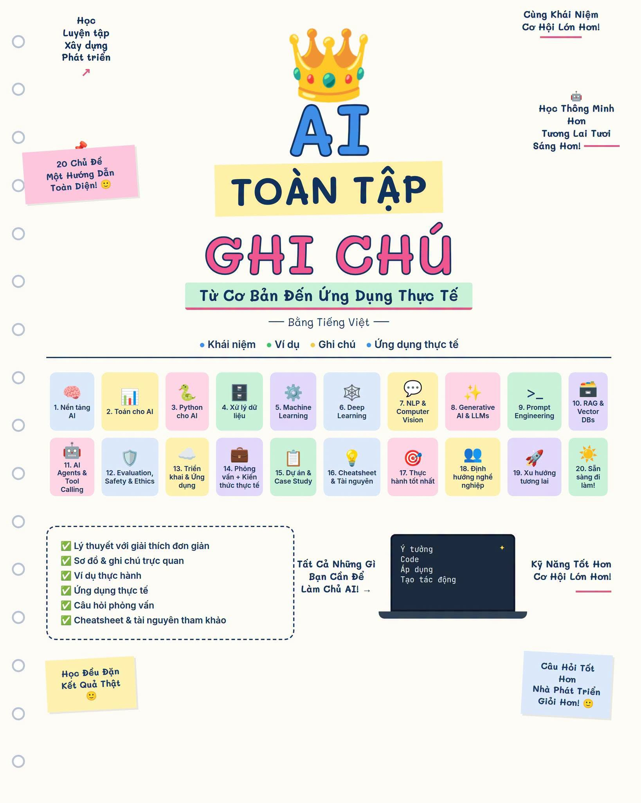

- **Tiêu đề bìa:** *AI TOÀN TẬP GHI CHÚ — Từ Cơ Bản Đến Ứng Dụng Thực Tế — Bằng Tiếng Việt*
- **Các nhãn định hướng:** *20 Chủ Đề — Một Hướng Dẫn Toàn Diện!* · *Khái niệm · Ví dụ · Ghi chú · Ứng dụng thực tế* · *Học Thông Minh Hơn, Tương Lai Tươi Sáng Hơn!* · *Câu Hỏi Tốt Hơn → Nhà Phát Triển Giỏi Hơn!*
- **Mục lục 20 ô icon trên bìa (lưu ý kỹ thuật):** Bìa in sẵn danh sách 20 ô tổng quát theo lộ trình *Nền tảng AI → Toán cho AI → Python cho AI → Xử lý dữ liệu → ML → DL → NLP & CV → GenAI → Prompt → RAG → Agents → Eval/Safety → Triển khai → Phỏng vấn → Dự án → Cheatsheet → Best Practices → Nghề nghiệp → Xu hướng → Sẵn sàng đi làm*, **khác với 19 trang nội dung thực tế (`01.jpg`–`19.jpg`)** vốn bám sát đúng caption bài viết đi sâu vào **AI cổ điển (Agents, Search, Minimax, KR, Logic, Bayesian)** từ mục 1–9 rồi nối tiếp **ML/DL → NLP/CV → GenAI/LLMs → Prompt → RAG → Agents → Eval/Safety/Ethics → Deployment** ở mục 10–19.
- **Tuyên ngôn học tập:** *Ý tưởng → Code → Áp dụng → Tạo tác động* · *Lý thuyết giải thích đơn giản · Sơ đồ trực quan · Ví dụ thực hành · Ứng dụng thực tế · Câu hỏi phỏng vấn · Cheatsheet.*

---

### Trang 2 / 20 — 1. Nền tảng AI *(1638x2048)*
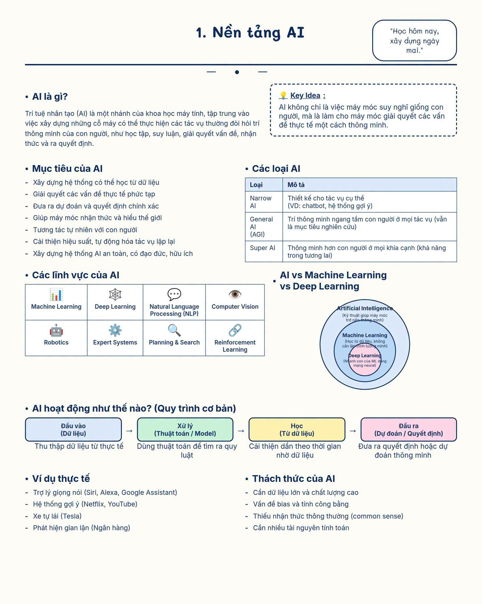

- **Quote:** *"Học hôm nay, xây dựng ngày mai."*
- **AI là gì?:** Nhánh của khoa học máy tính tập trung xây dựng cỗ máy thực hiện các tác vụ đòi hỏi trí thông minh con người (học tập, suy luận, giải quyết vấn đề, nhận thức, ra quyết định). **Key Idea:** Không chỉ làm máy suy nghĩ giống người, mà làm máy giải quyết vấn đề thực tế một cách thông minh.
- **Mục tiêu của AI:** Học từ dữ liệu, giải quyết vấn đề phức tạp, dự đoán/quyết định chính xác, nhận thức thế giới, tương tác tự nhiên, tự động hóa tác vụ lặp lại, xây dựng hệ thống an toàn/đạo đức/hữu ích.
- **Các loại AI:**
  | Loại | Mô tả |
  | :--- | :--- |
  | Narrow AI | Thiết kế cho tác vụ cụ thể (chatbot, hệ thống gợi ý) |
  | General AI (AGI) | Trí thông minh ngang tầm con người ở mọi tác vụ (mục tiêu nghiên cứu) |
  | Super AI | Thông minh hơn con người ở mọi khía cạnh (khả năng tương lai) |
- **Các lĩnh vực của AI (8 nhánh):** Machine Learning, Deep Learning, Natural Language Processing (NLP), Computer Vision, Robotics, Expert Systems, Planning & Search, Reinforcement Learning.
- **Vòng tròn đồng tâm AI vs ML vs DL:** `Artificial Intelligence` (kỹ thuật giúp máy thông minh) $\supset$ `Machine Learning` (học từ dữ liệu, không cần lập trình tường minh) $\supset$ `Deep Learning` (nhánh con của ML dùng mạng neural).
- **Quy trình cơ bản:** `Đầu vào (Dữ liệu)` $\rightarrow$ `Xử lý (Thuật toán / Model)` $\rightarrow$ `Học (Từ dữ liệu)` $\rightarrow$ `Đầu ra (Dự đoán / Quyết định)`.
- **Ví dụ & Thách thức:** Siri/Alexa/Google Assistant, Netflix/YouTube, xe tự lái Tesla, phát hiện gian lận ngân hàng. Thách thức: cần dữ liệu lớn & sạch, bias & công bằng, thiếu common sense, đòi hỏi compute cao.

---

### Trang 3 / 20 — 2. Tác nhân thông minh (Intelligent Agent) *(1430x2048)*
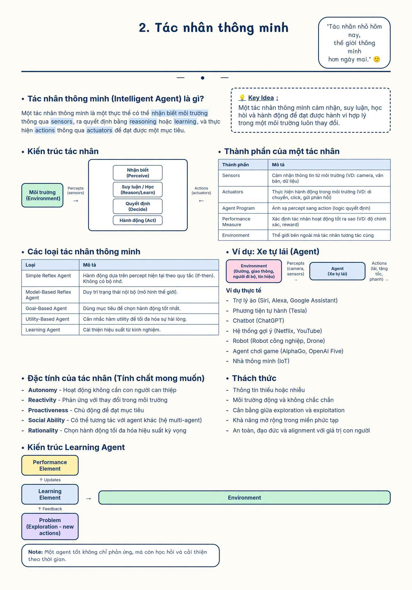

- **Quote:** *"Tác nhân nhỏ hôm nay, thế giới thông minh hơn ngày mai."*
- **Định nghĩa:** Thực thể **nhận biết môi trường** qua `sensors`, quyết định bằng `reasoning` hoặc `learning`, và thực hiện `actions` qua `actuators` để đạt mục tiêu trong môi trường thay đổi.
- **Thành phần tác nhân:**
  | Thành phần | Mô tả |
  | :--- | :--- |
  | Sensors | Cảm nhận thông tin từ môi trường (camera, văn bản, dữ liệu) |
  | Actuators | Thực hiện hành động (di chuyển, click, gửi phản hồi) |
  | Agent Program | Ánh xạ percept sang action (logic quyết định) |
  | Performance Measure | Tiêu chuẩn đánh giá mức độ tốt (độ chính xác, reward) |
  | Environment | Thế giới bên ngoài mà tác nhân tương tác |
- **Vòng tuần hoàn:** `Environment` $\xrightarrow{\text{Percepts (sensors)}}$ `[Nhận biết (Perceive) -> Suy luận/Học -> Quyết định -> Hành động]` $\xrightarrow{\text{Actions (actuators)}}$ `Environment`.
- **5 loại tác nhân thông minh:**
  1. **Simple Reflex Agent:** Hành động theo luật `if-then` từ percept hiện tại, không có bộ nhớ.
  2. **Model-Based Reflex Agent:** Duy trì trạng thái nội bộ (mô hình thế giới).
  3. **Goal-Based Agent:** Dùng mục tiêu để chọn hành động tốt nhất.
  4. **Utility-Based Agent:** Cân nhắc hàm utility để tối đa hóa sự hài lòng/hiệu quả.
  5. **Learning Agent:** Cải thiện hiệu suất từ kinh nghiệm qua 4 khối: `Problem Generator` (thử hành động mới) $\rightarrow$ `Learning Element` (feedback từ Environment) $\rightarrow$ cập nhật `Performance Element`.
- **5 đặc tính mong muốn:** `Autonomy` (tự chủ), `Reactivity` (phản ứng kịp thời), `Proactiveness` (chủ động theo mục tiêu), `Social Ability` (giao tiếp multi-agent), `Rationality` (tối đa hóa hiệu suất kỳ vọng).
- **Ví dụ & Thách thức:** Xe tự lái (sensors camera $\rightarrow$ lái/tăng tốc/phanh), trợ lý ảo, chatbot, AlphaGo/OpenAI Five, robot công nghiệp/drone, smart home IoT. Thách thức: thiếu/nhiễu thông tin, môi trường động bất định, exploration vs exploitation, khả năng mở rộng, safety/alignment.

---

### Trang 4 / 20 — 3. Giải quyết vấn đề & Tìm kiếm (Problem Solving & Search) *(1294x2048)*
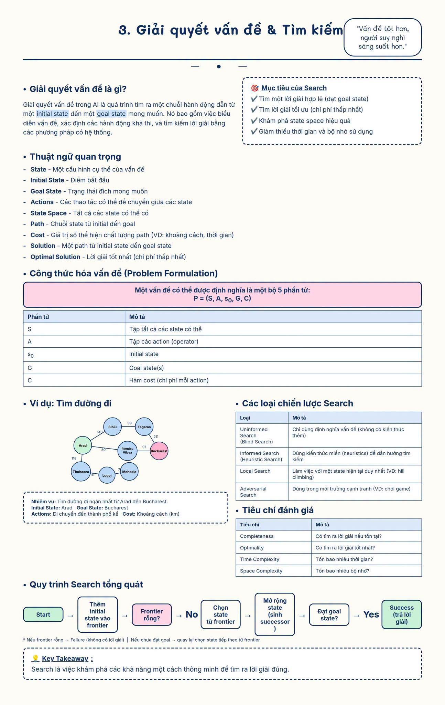

- **Quote:** *"Vấn đề tốt hơn, người suy nghĩ sáng suốt hơn."*
- **Khái niệm:** Quá trình tìm chuỗi hành động từ `Initial State` đến `Goal State` bằng cách biểu diễn vấn đề và tìm kiếm có hệ thống qua `State Space`.
- **Công thức hóa vấn đề (5-tuple):** $P = (S, A, s_0, G, C)$ — $S$ (tập state), $A$ (tập action/operator), $s_0$ (initial state), $G$ (goal state), $C$ (hàm cost).
- **Ví dụ kinh điển (Bản đồ Romania):** Tìm đường ngắn nhất từ `Arad` đến `Bucharest` qua Sibiu (`140`), Fagaras (`99`, `211`), Rimnicu Vilcea (`80`), Pitesti, Timisoara (`118`), Lugoj (`111`), Mehadia...
- **4 chiến lược Search:** `Uninformed (Blind)` (không có tri thức thêm), `Informed (Heuristic)` (dùng heuristic dẫn hướng), `Local Search` (làm việc trên 1 state hiện tại, VD: Hill Climbing), `Adversarial Search` (môi trường cạnh tranh/game).
- **4 tiêu chí đánh giá:** `Completeness` (tìm ra nghiệm nếu tồn tại?), `Optimality` (nghiệm chi phí thấp nhất?), `Time Complexity`, `Space Complexity`.
- **Quy trình Search tổng quát:** `Start` $\rightarrow$ `Thêm s0 vào frontier` $\rightarrow$ `Frontier rỗng?` (Yes $\rightarrow$ Failure) $\rightarrow$ `Chọn state từ frontier` $\rightarrow$ `Mở rộng state (sinh successor)` $\rightarrow$ `Đạt goal?` (Yes $\rightarrow$ Success; No $\rightarrow$ lặp).

---

### Trang 5 / 20 — 4. BFS, DFS & Uniform Cost Search *(1195x2048)*
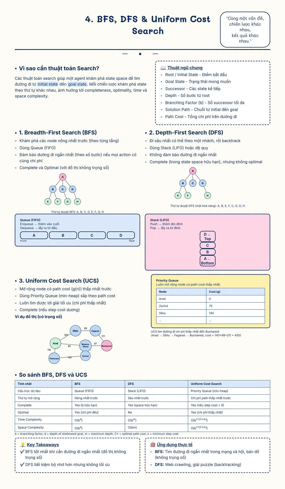

- **Quote:** *"Cùng một vấn đề, chiến lược khác nhau, kết quả khác nhau."*
- **Thuật ngữ:** Root, Goal State, Successor, Depth, Branching Factor ($b$), Solution Path, Path Cost ($C^*$, $\epsilon$ step cost tối thiểu).
- **3 thuật toán Uninformed Search:**
  1. **Breadth-First Search (BFS):** Mở rộng từng tầng nông nhất trước bằng **Queue (FIFO)** (`Enqueue` cuối, `Dequeue` đầu). Complete và Optimal nếu chi phí các bước bằng nhau.
  2. **Depth-First Search (DFS):** Đi sâu nhất theo 1 nhánh rồi backtrack bằng **Stack (LIFO)** hoặc đệ quy (`Push`/`Pop` đỉnh). Complete trong không gian hữu hạn, **không Optimal**, tiết kiệm bộ nhớ hơn.
  3. **Uniform Cost Search (UCS):** Mở rộng node có tổng chi phí đường đi $g(n)$ thấp nhất bằng **Priority Queue (min-heap)**. Complete (nếu step cost $> 0$) và luôn **Optimal** (VD: Arad $\rightarrow$ Sibiu $\rightarrow$ Fagaras $\rightarrow$ Bucharest = `140 + 99 + 211 = 450` được trình bày trong hộp minh họa UCS).
- **Bảng so sánh độ phức tạp:**
  | Tính chất | BFS | DFS | Uniform Cost Search (UCS) |
  | :--- | :--- | :--- | :--- |
  | Cấu trúc dữ liệu | Queue (FIFO) | Stack (LIFO) | Priority Queue (min-heap) |
  | Thứ tự mở rộng | Nông nhất trước | Sâu nhất trước | Path cost $g(n)$ thấp nhất |
  | Complete | Yes ($b$ hữu hạn) | Yes (space hữu hạn) | Yes (step cost $> 0$) |
  | Optimal | Yes (chi phí đều) | No | Yes (chi phí thấp nhất) |
  | Time Complexity | $O(b^d)$ | $O(b^m)$ | $O(b^{1+\lfloor C^*/\epsilon \rfloor})$ |
  | Space Complexity | $O(b^d)$ | $O(bm)$ | $O(b^{1+\lfloor C^*/\epsilon \rfloor})$ |
- **Ứng dụng:** BFS (đường ngắn nhất đồ thị không trọng số, mạng xã hội), DFS (web crawling, giải puzzle backtracking).

---

### Trang 6 / 20 — 5. Tìm kiếm Heuristic & A* *(1638x2048)*
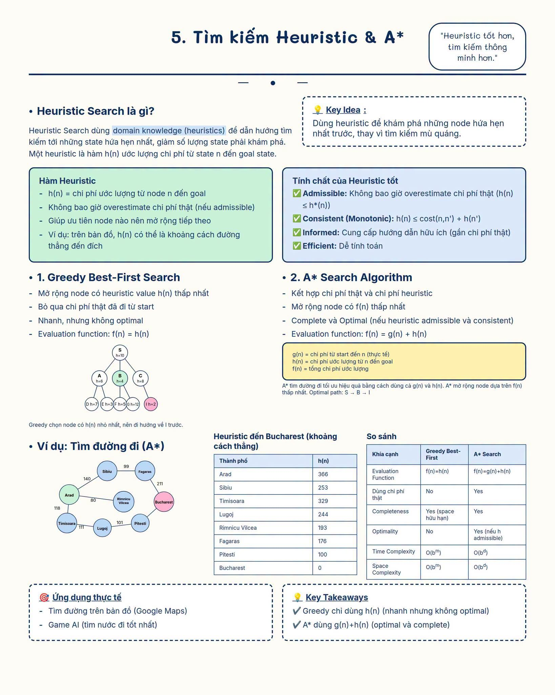

- **Quote:** *"Heuristic tốt hơn, tìm kiếm thông minh hơn."*
- **Heuristic $h(n)$:** Chi phí ước lượng từ state $n$ tới goal (VD: đường chim bay thẳng trên bản đồ tới Bucharest: `Arad=366, Sibiu=253, Timisoara=329, Lugoj=244, Rimnicu Vilcea=193, Fagaras=176, Pitesti=100, Bucharest=0`).
- **4 tính chất của Heuristic tốt:**
  - `Admissible`: Không bao giờ overestimate chi phí thật ($h(n) \le h^*(n)$).
  - `Consistent (Monotonic)`: $h(n) \le \text{cost}(n, n') + h(n')$.
  - `Informed`: Gần chi phí thật, dẫn hướng hiệu quả.
  - `Efficient`: Dễ tính toán nhanh.
- **So sánh Greedy Best-First Search vs A* Search:**
  | Khía cạnh | Greedy Best-First | A* Search |
  | :--- | :--- | :--- |
  | Evaluation Function | $f(n) = h(n)$ | $f(n) = g(n) + h(n)$ |
  | Dùng chi phí thật $g(n)$ | No | Yes |
  | Completeness | Yes (space hữu hạn) | Yes |
  | Optimality | No (bị bẫy cục bộ) | Yes (nếu $h$ admissible/consistent) |
  | Time Complexity | $O(b^m)$ | $O(b^d)$ |
  | Space Complexity | $O(b^m)$ | $O(b^d)$ |
- **Ứng dụng:** Định tuyến bản đồ (Google Maps), tìm đường/nước đi cho AI trong game.

---

### Trang 7 / 20 — 6. Trò chơi & Minimax *(1436x2048)*
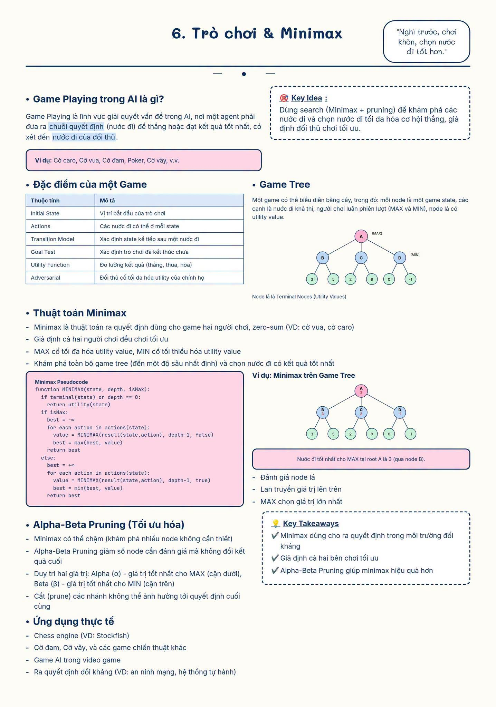

- **Quote:** *"Nghĩ trước, chơi khôn, chọn nước đi tốt hơn."*
- **Game Playing (Adversarial Search):** Giải quyết bài toán 2 người chơi đối kháng, tổng bằng không (**zero-sum**: cờ vua, cờ caro, cờ đam, cờ vây, poker) giả định đối thủ chơi tối ưu.
- **Thành phần Game:** `Initial State`, `Actions`, `Transition Model`, `Goal Test`, `Utility Function` (thắng/thua/hòa), `Adversarial` (MAX muốn tối đa hóa utility, MIN muốn tối thiểu hóa utility).
- **Pseudocode Minimax:** Đệ quy tới nút lá `terminal(state)` hoặc `depth == 0`, nút MAX chọn `max(best, MINIMAX(..., false))`, nút MIN chọn `min(best, MINIMAX(..., true))`. (Ví dụ cây trò chơi: lá `3, 5, 2, 9, 0, -1` $\rightarrow$ nút MIN `B=3, C=2, D=-1` $\rightarrow$ root MAX `A=3` chọn đi qua nhánh `B`).
- **Alpha-Beta Pruning:** Cắt tỉa nhánh không thể ảnh hưởng quyết định cuối cùng mà vẫn giữ nguyên kết quả Minimax, duy trì cận dưới **Alpha ($\alpha$)** cho MAX và cận trên **Beta ($\beta$)** cho MIN.
- **Ứng dụng:** Chess engine (Stockfish), cờ vây/cờ đam, Game AI, ra quyết định đối kháng (an ninh mạng, hệ tự hành).

---

### Trang 8 / 20 — 7. Biểu diễn tri thức (Knowledge Representation — KR) *(1412x2048)*
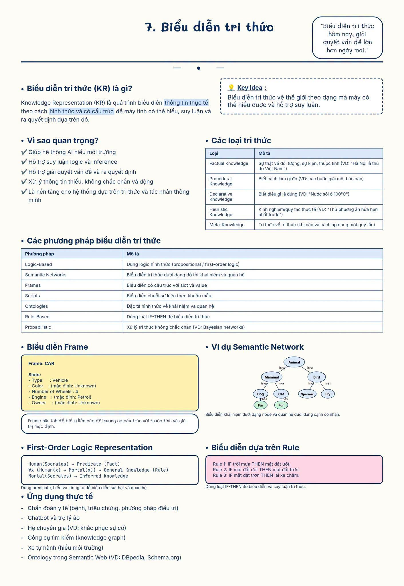

- **Quote:** *"Biểu diễn tri thức hôm nay, giải quyết vấn đề lớn hơn ngày mai."*
- **Định nghĩa KR:** Biểu diễn thông tin thực tế theo cấu trúc hình thức để máy tính hiểu, suy luận (inference) và ra quyết định, ngay cả khi thông tin thiếu/không chắc chắn.
- **5 loại tri thức:** `Factual` (sự thật về đối tượng: *"Hà Nội là thủ đô Việt Nam"*), `Procedural` (cách làm), `Declarative` (khẳng định chân lý: *"Nước sôi ở 100°C"*), `Heuristic` (kinh nghiệm thực tế), `Meta-Knowledge` (tri thức về việc khi nào áp dụng quy tắc nào).
- **7 phương pháp biểu diễn tri thức:**
  1. `Logic-Based`: Propositional / First-Order Logic (VD: `Human(Socrates)`, $\forall x (\text{Human}(x) \rightarrow \text{Mortal}(x)) \implies \text{Mortal}(\text{Socrates})$).
  2. `Semantic Networks`: Đồ thị nút khái niệm & cạnh quan hệ có nhãn (`Dog --is-a--> Mammal --is-a--> Animal`, `Dog --has--> Fur`, `Sparrow --is-a--> Bird --can--> Fly`).
  3. `Frames`: Cấu trúc đối tượng gồm `Slots` và giá trị mặc định (VD `Frame: CAR` với Type, Color, Wheels, Engine, Owner).
  4. `Scripts`: Biểu diễn chuỗi sự kiện theo khuôn mẫu.
  5. `Ontologies`: Đặc tả hình thức khái niệm & quan hệ (DBpedia, Schema.org).
  6. `Rule-Based`: Chuỗi luật `IF-THEN` (Mưa $\rightarrow$ ướt $\rightarrow$ trơn $\rightarrow$ lái chậm).
  7. `Probabilistic`: Xử lý tri thức bất định (Bayesian networks).
- **Ứng dụng:** Chẩn đoán y tế, chatbot/trợ lý ảo, hệ chuyên gia khắc phục sự cố, Knowledge Graph tìm kiếm, xe tự hành, Semantic Web.

---

### Trang 9 / 20 — 8. Logic & Suy luận (Logic & Inference) *(1545x2048)*
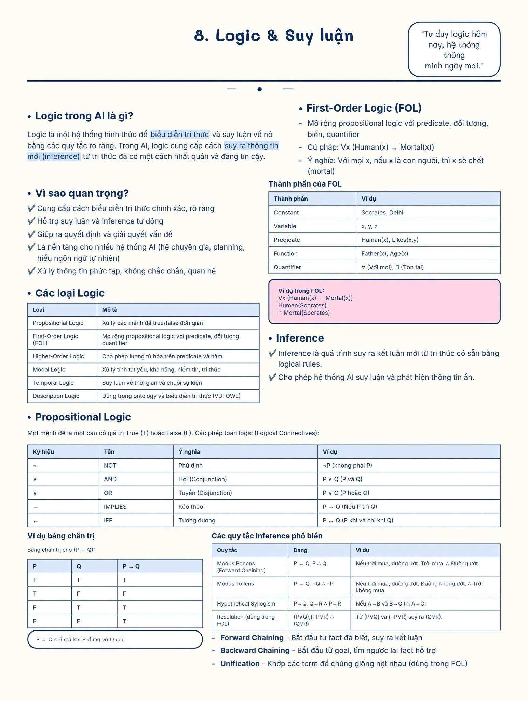

- **Quote:** *"Tư duy logic hôm nay, hệ thống thông minh ngày mai."*
- **6 loại Logic:** `Propositional Logic` (mệnh đề True/False), `First-Order Logic (FOL)` (predicate, object, variable, quantifier), `Higher-Order Logic` (lượng từ hóa trên predicate/hàm), `Modal Logic` (tất yếu/khả năng/niềm tin), `Temporal Logic` (thời gian & chuỗi sự kiện), `Description Logic` (nền tảng cho Ontology/OWL).
- **Propositional Logic & Bảng chân trị:** 6 phép toán $\neg$ (`NOT`), $\land$ (`AND`), $\lor$ (`OR`), $\rightarrow$ (`IMPLIES`, chỉ sai khi $P=T, Q=F$), $\leftrightarrow$ (`IFF`).
- **Thành phần First-Order Logic (FOL):** `Constant` (`Socrates, Delhi`), `Variable` (`x, y, z`), `Predicate` (`Human(x), Likes(x,y)`), `Function` (`Father(x), Age(x)`), `Quantifier` ($\forall$ Với mọi, $\exists$ Tồn tại).
- **4 quy tắc suy diễn (Inference Rules) & Chiến lược:**
  - `Modus Ponens (Forward Chaining)`: $P \rightarrow Q, P \therefore Q$.
  - `Modus Tollens`: $P \rightarrow Q, \neg Q \therefore \neg P$.
  - `Hypothetical Syllogism`: $P \rightarrow Q, Q \rightarrow R \therefore P \rightarrow R$.
  - `Resolution (FOL)`: $(P \lor Q), (\neg P \lor R) \therefore (Q \lor R)$.
  - **Forward Chaining** (từ fact $\rightarrow$ kết luận), **Backward Chaining** (từ goal truy ngược về fact), **Unification** (khớp biến/term trong FOL).

---

### Trang 10 / 20 — 9. Xác suất & Suy luận Bayesian *(1461x2048)*
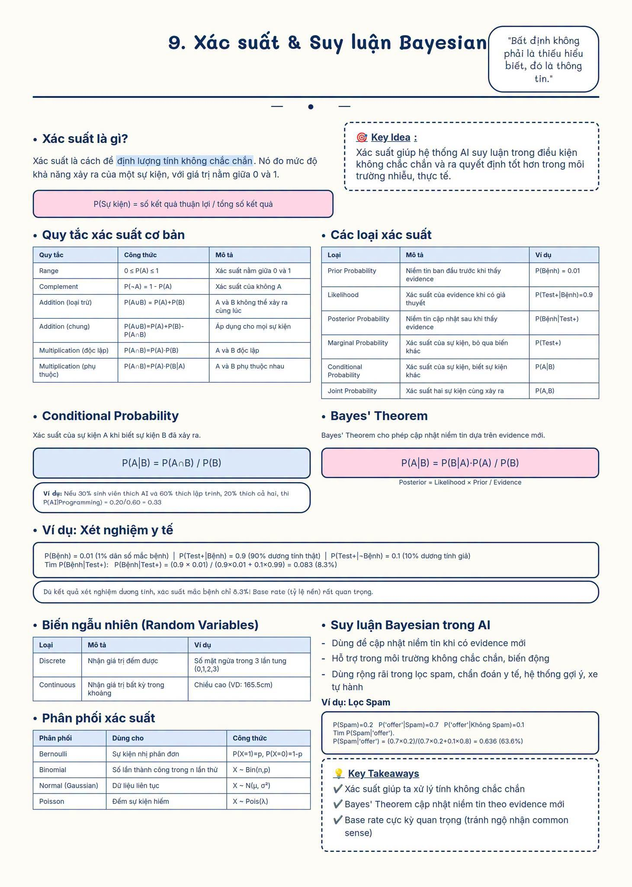

- **Quote:** *"Bất định không phải là thiếu hiểu biết, đó là thông tin."*
- **Quy tắc xác suất cơ bản:** Range ($0 \le P(A) \le 1$), Complement ($P(\neg A) = 1 - P(A)$), Addition loại trừ/chung ($P(A \cup B) = P(A) + P(B) - P(A \cap B)$), Multiplication độc lập ($P(A)P(B)$) / phụ thuộc ($P(A)P(B|A)$).
- **Conditional Probability & Bayes' Theorem:**
  - $P(A|B) = P(A \cap B) / P(B)$ (VD: 30% thích AI, 60% thích lập trình, 20% cả hai $\Rightarrow P(\text{AI}|\text{Prog}) = 0.20/0.60 = 0.33$).
  - $P(A|B) = \frac{P(B|A) \cdot P(A)}{P(B)}$ (`Posterior = Likelihood × Prior / Evidence`).
- **Ví dụ Base Rate Fallacy (Xét nghiệm y tế):** $P(\text{Bệnh})=0.01$ (1%), $P(\text{Test}+|\text{Bệnh})=0.9$, $P(\text{Test}+|\neg\text{Bệnh})=0.1 \implies P(\text{Bệnh}|\text{Test}+) = \frac{0.9 \times 0.01}{0.9 \times 0.01 + 0.1 \times 0.99} = 0.083$ (**chỉ 8.3%** dù test dương tính — tầm quan trọng sống còn của *base rate* / tỷ lệ nền!).
- **Ví dụ Lọc Spam:** $P(\text{Spam})=0.2, P(\text{'offer'}|\text{Spam})=0.7, P(\text{'offer'}|\text{Ham})=0.1 \implies P(\text{Spam}|\text{'offer'}) = \frac{0.7 \times 0.2}{0.7 \times 0.2 + 0.1 \times 0.8} = 0.636$ (**63.6%**).
- **Biến ngẫu nhiên & 4 phân phối:** Discrete vs Continuous; `Bernoulli`, `Binomial` $\text{Bin}(n,p)$, `Normal/Gaussian` $N(\mu, \sigma^2)$, `Poisson` $\text{Pois}(\lambda)$.

---

### Trang 11 / 20 — 10. Nền tảng Machine Learning *(1403x2048)*
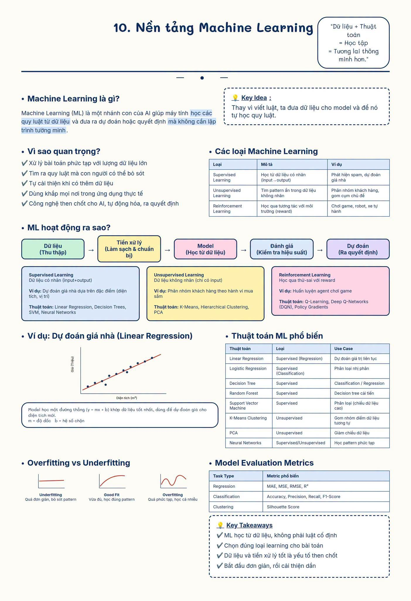

- **Quote:** *"Dữ liệu + Thuật toán = Học tập = Tương lai thông minh hơn."*
- **Key Idea:** Thay vì viết luật thủ công, đưa dữ liệu cho model tự học quy luật (`Dữ liệu -> Tiền xử lý -> Model -> Đánh giá -> Dự đoán`).
- **3 nhóm chính:** Supervised (dữ liệu có nhãn), Unsupervised (dữ liệu không nhãn), Reinforcement Learning (thử-sai với reward: Q-Learning, DQN, Policy Gradients).
- **8 thuật toán phổ biến:** Linear Regression ($y = mx + b$ dự đoán giá nhà), Logistic Regression, Decision Tree, Random Forest, SVM, K-Means Clustering, PCA, Neural Networks.
- **Fit Diagnostics & Metrics:** `Underfitting` (quá đơn giản) vs `Good Fit` vs `Overfitting` (học cả nhiễu). Metrics: Regression (`MAE, MSE, RMSE, R²`), Classification (`Accuracy, Precision, Recall, F1-Score`), Clustering (`Silhouette Score`).

---

### Trang 12 / 20 — 11. Supervised & Unsupervised Learning *(1359x2048)*
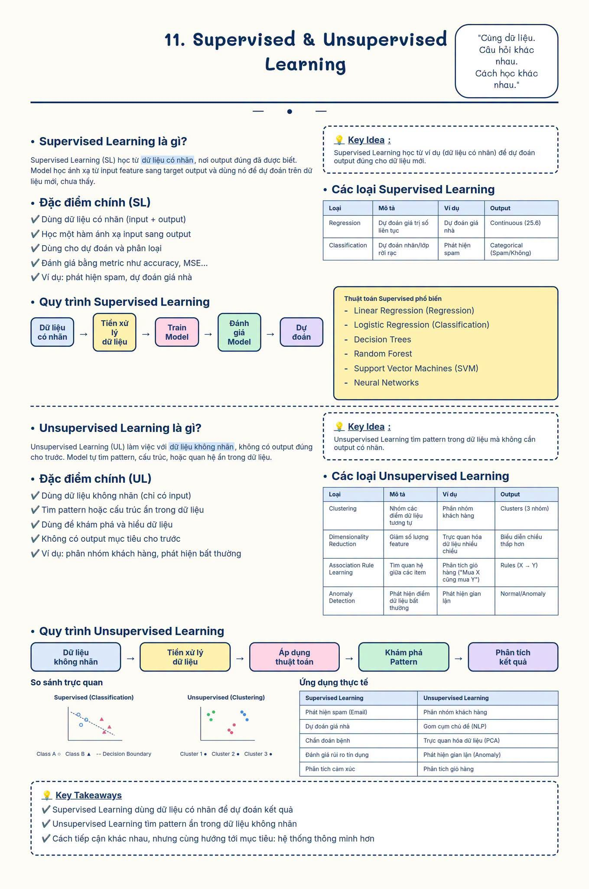

- **Quote:** *"Cùng dữ liệu. Câu hỏi khác nhau. Cách học khác nhau."*
- **Supervised Learning (SL):** Học hàm ánh xạ từ dữ liệu có nhãn (`Regression` $\rightarrow$ số liên tục như giá nhà `25.6`; `Classification` $\rightarrow$ nhãn rời rạc Spam/Không). Quy trình: `Dữ liệu có nhãn -> Tiền xử lý -> Train Model -> Đánh giá -> Dự đoán`.
- **Unsupervised Learning (UL):** Khám phá cấu trúc ẩn không cần nhãn qua 4 bài toán: `Clustering` (3 clusters), `Dimensionality Reduction` (PCA trực quan hóa), `Association Rule Learning` ($X \rightarrow Y$ phân tích giỏ hàng), `Anomaly Detection` (phát hiện gian lận `Normal/Anomaly`).
- **So sánh ứng dụng thực tế:** SL (email spam, giá nhà, chẩn đoán bệnh, rủi ro tín dụng, phân tích cảm xúc) vs UL (phân nhóm khách hàng, gom cụm chủ đề NLP, PCA, phát hiện bất thường, giỏ hàng).

---

### Trang 13 / 20 — 12. Neural Networks & Deep Learning *(1617x2048)*
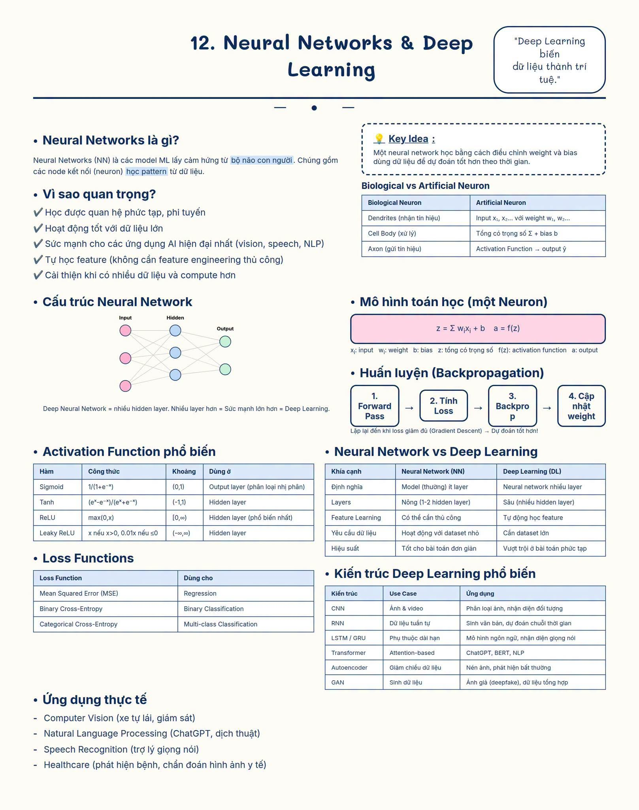

- **Quote:** *"Deep Learning biến dữ liệu thành trí tuệ."*
- **Biological vs Artificial Neuron:** `Dendrites` $\leftrightarrow$ input $x_i$ với weight $w_i$; `Cell Body` $\leftrightarrow$ $z = \sum w_i x_i + b$; `Axon` $\leftrightarrow$ activation $a = f(z) = \hat{y}$.
- **4 bước Backpropagation:** `1. Forward Pass` $\rightarrow$ `2. Tính Loss` (`MSE` cho regression, `Binary Cross-Entropy`, `Categorical Cross-Entropy`) $\rightarrow$ `3. Backprop` $\rightarrow$ `4. Cập nhật weight` (Gradient Descent lặp đi lặp lại).
- **4 Activation Functions phổ biến:**
  | Hàm | Công thức | Khoảng giá trị | Dùng ở |
  | :--- | :--- | :--- | :--- |
  | Sigmoid | $1/(1+e^{-x})$ | $(0, 1)$ | Output layer (nhị phân) |
  | Tanh | $(e^x - e^{-x})/(e^x + e^{-x})$ | $(-1, 1)$ | Hidden layer |
  | ReLU | $\max(0, x)$ | $[0, \infty)$ | Hidden layer (phổ biến nhất) |
  | Leaky ReLU | $x$ nếu $x > 0$, $0.01x$ nếu $x \le 0$ | $(-\infty, \infty)$ | Hidden layer |
- **6 kiến trúc Deep Learning:** `CNN` (ảnh & video), `RNN` (dữ liệu tuần tự), `LSTM / GRU` (phụ thuộc dài hạn, giọng nói), `Transformer` (attention-based: ChatGPT, BERT), `Autoencoder` (nén ảnh, phát hiện bất thường), `GAN` (sinh dữ liệu, deepfake).

---

### Trang 14 / 20 — 13. NLP & Computer Vision *(1427x2048)*
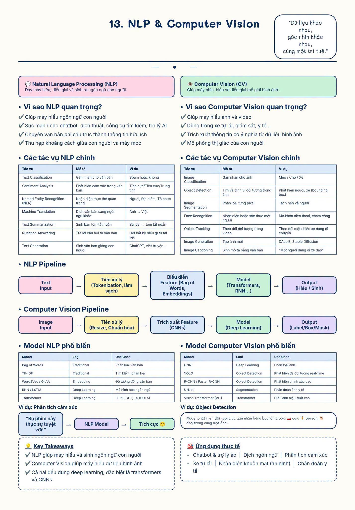

- **Quote:** *"Dữ liệu khác nhau, góc nhìn khác nhau, cùng một trí tuệ."*
- **NLP (Xử lý ngôn ngữ tự nhiên):** 7 tác vụ chính (`Text Classification`, `Sentiment Analysis`, `Named Entity Recognition - NER`, `Machine Translation`, `Text Summarization`, `Question Answering`, `Text Generation`). Pipeline: `Text Input -> Tokenization/Làm sạch -> Feature (Bag of Words, Embeddings) -> Model (Transformers, RNN) -> Output`. Models: `BoW`, `TF-IDF`, `Word2Vec/GloVe`, `RNN/LSTM`, `Transformer (BERT, GPT, T5 SOTA)`.
- **Computer Vision (CV):** 7 tác vụ chính (`Image Classification`, `Object Detection`, `Image Segmentation`, `Face Recognition`, `Object Tracking`, `Image Generation`, `Image Captioning`). Pipeline: `Image Input -> Resize/Chuẩn hóa -> Trích xuất Feature (CNNs) -> Model (Deep Learning) -> Output (Label/Box/Mask)`. Models: `CNN`, `YOLO` (real-time), `R-CNN / Faster R-CNN`, `U-Net` (y tế), `Vision Transformer (ViT)`.

---

### Trang 15 / 20 — 14. Generative AI & LLMs *(1252x2048)*
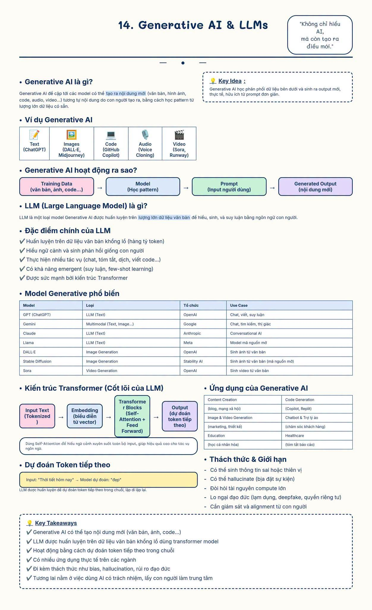

- **Quote:** *"Không chỉ hiểu AI, mà còn tạo ra điều mới."*
- **Generative AI:** Học phân phối dữ liệu để sinh nội dung mới qua 5 modality: `Text` (ChatGPT), `Images` (DALL·E, Midjourney), `Code` (GitHub Copilot), `Audio` (Voice Cloning), `Video` (Sora, Runway).
- **LLM & Kiến trúc Transformer:** Huấn luyện trên hàng tỷ token, khả năng `emergent` (suy luận, few-shot). Luồng xử lý: `Input Text (Tokenized) -> Embedding -> Transformer Blocks (Self-Attention + Feed Forward) -> Output (dự đoán token tiếp theo)`.
- **Bảng 7 model tiêu biểu:** GPT (OpenAI), Gemini (Google multimodal), Claude (Anthropic), Llama (Meta mã nguồn mở), DALL·E & Sora (OpenAI), Stable Diffusion (Stability AI mở).
- **Thách thức:** Sai lệch/bias, `hallucinate`, compute khổng lồ, rủi ro đạo đức (deepfake, privacy), cần giám sát & alignment từ con người.

---

### Trang 16 / 20 — 15. Prompt Engineering *(1544x2048)*
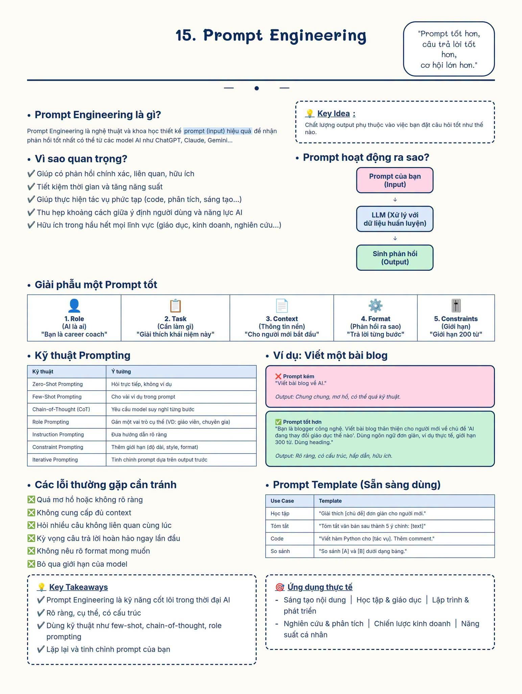

- **Quote:** *"Prompt tốt hơn, câu trả lời tốt hơn, cơ hội lớn hơn."*
- **Giải phẫu 1 Prompt tốt (5 thành phần):** `1. Role` (*AI là ai*) $\rightarrow$ `2. Task` (*cần làm gì*) $\rightarrow$ `3. Context` (*thông tin nền*) $\rightarrow$ `4. Format` (*định dạng output*) $\rightarrow$ `5. Constraints` (*giới hạn, VD 200 từ*).
- **7 kỹ thuật Prompting:** `Zero-Shot`, `Few-Shot`, `Chain-of-Thought (CoT)`, `Role Prompting`, `Instruction Prompting`, `Constraint Prompting`, `Iterative Prompting`.
- **Ví dụ & Anti-patterns:** So sánh prompt mơ hồ vs prompt có Role + Context + Example + Length + Heading. Tránh 6 lỗi thường gặp: mơ hồ, thiếu context, hỏi dồn nhiều việc không liên quan, kỳ vọng hoàn hảo ngay lần đầu, không nêu format, bỏ qua giới hạn model.

---

### Trang 17 / 20 — 16. RAG & Vector Databases *(1388x2048)*
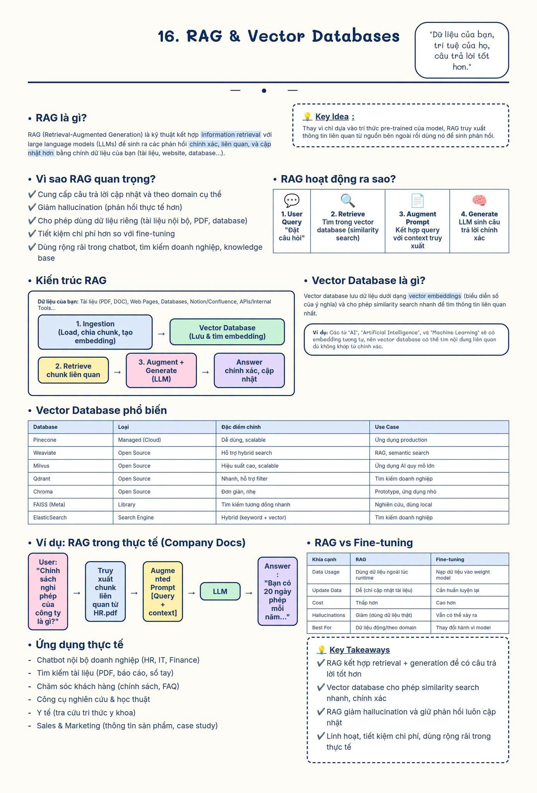

- **Quote:** *"Dữ liệu của bạn, trí tuệ của họ, câu trả lời tốt hơn."*
- **RAG Architecture:** Kết hợp retrieval với LLM để giảm hallucination và dùng dữ liệu nội bộ cập nhật theo 4 bước: `1. User Query -> 2. Retrieve (Vector similarity search) -> 3. Augment Prompt [Query + Context] -> 4. Generate`. Nhánh Ingestion: `PDF/DOC/Web/Notion/APIs -> Load, chia chunk, tạo embedding -> Vector Database`.
- **7 Vector Databases phổ biến:** `Pinecone` (Managed Cloud), `Weaviate` (Open Source, hybrid search), `Milvus` (Open Source, quy mô lớn), `Qdrant` (Open Source, filter mạnh), `Chroma` (nhẹ, prototype), `FAISS (Meta)` (thư viện nghiên cứu/local), `ElasticSearch` (Hybrid keyword + vector).
- **RAG vs Fine-tuning:**
  | Khía cạnh | RAG | Fine-tuning |
  | :--- | :--- | :--- |
  | Data Usage | Dùng dữ liệu ngoài lúc runtime | Nạp dữ liệu vào weight model |
  | Update Data | Dễ (chỉ cập nhật tài liệu) | Phải huấn luyện lại |
  | Cost | Thấp hơn | Cao hơn |
  | Hallucinations | Giảm rõ (dùng dữ liệu thật) | Vẫn có thể xảy ra |
  | Best For | Dữ liệu động / theo domain | Thay đổi hành vi / văn phong model |

---

### Trang 18 / 20 — 17. AI Agents & Tool Calling *(1338x2048)*
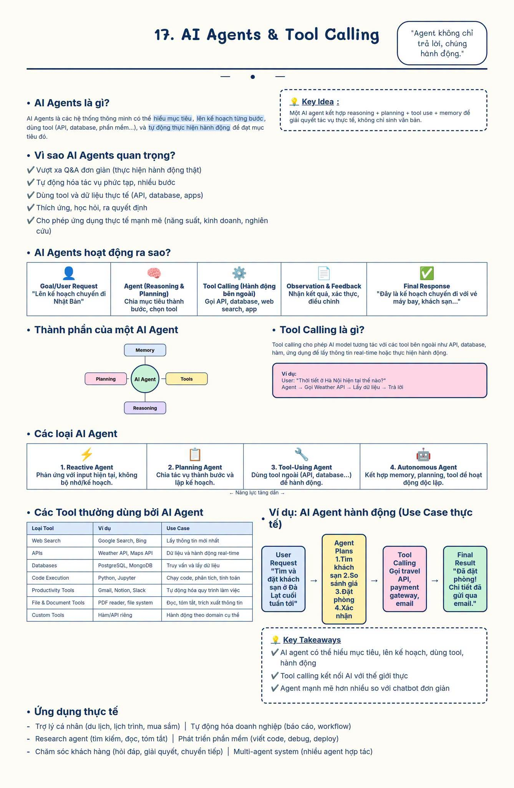

- **Quote:** *"Agent không chỉ trả lời, chúng hành động."*
- **4 trụ cột cốt lõi:** `AI Agent` = `Memory` + `Planning` + `Reasoning` + `Tools`.
- **Vòng lặp hành động:** `Goal / User Request` (*"Lên kế hoạch chuyến đi Nhật Bản"*) $\rightarrow$ `Agent (Reasoning & Planning)` $\rightarrow$ `Tool Calling` (API, web search, DB) $\rightarrow$ `Observation & Feedback` (xác thực & điều chỉnh) $\rightarrow$ `Final Response`.
- **4 cấp độ tiến hóa Agent (năng lực tăng dần):** `1. Reactive Agent` (không memory/kế hoạch) $\rightarrow$ `2. Planning Agent` (chia bước lập kế hoạch) $\rightarrow$ `3. Tool-Using Agent` (gọi API/DB) $\rightarrow$ `4. Autonomous Agent` (kết hợp memory + planning + tool hoạt động độc lập).
- **7 nhóm Tool phổ biến:** Web Search (Google/Bing), APIs (Weather/Maps), Databases (PostgreSQL/MongoDB), Code Execution (Python/Jupyter), Productivity Tools (Gmail/Notion/Slack), File & Document Tools (PDF reader/filesystem), Custom Tools (hàm/API riêng theo domain).

---

### Trang 19 / 20 — 18. Đánh giá, An toàn & Đạo đức AI *(1355x2048)*
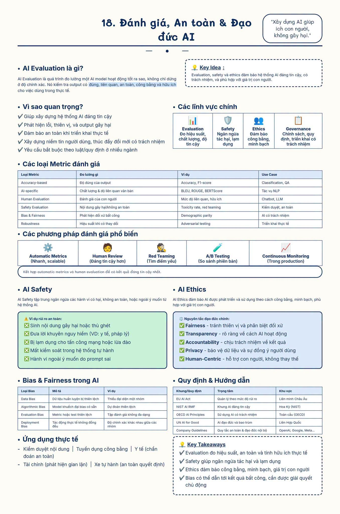

- **Quote:** *"Xây dựng AI giúp ích con người, không gây hại."*
- **4 lĩnh vực cốt lõi:** `Evaluation` (đo hiệu suất/độ tin cậy) · `Safety` (ngăn tác hại/lạm dụng) · `Ethics` (công bằng/minh bạch) · `Governance` (chính sách/quy định).
- **6 loại Metric đánh giá:** `Accuracy-based` (`Accuracy, F1`), `AI-specific NLP` (`BLEU, ROUGE, BERTScore`), `Human Evaluation`, `Safety Evaluation` (`Toxicity rate, Red teaming`), `Bias & Fairness` (`Demographic parity`), `Robustness` (`Adversarial testing`).
- **5 phương pháp đánh giá:** `Automatic Metrics` (nhanh, scalable) · `Human Review` (tin cậy cao) · `Red Teaming` (tìm điểm yếu) · `A/B Testing` (so sánh phiên bản) · `Continuous Monitoring` (trong production).
- **AI Safety & 5 nguyên tắc Ethics:** Ngăn nội dung thù ghét, lời khuyên y tế/pháp lý nguy hiểm, lạm dụng tấn công mạng, mất kiểm soát hệ tự hành, hành vi ngoài ý muốn từ prompt sai. Đạo đức: `Fairness`, `Transparency`, `Accountability`, `Privacy`, `Human-Centric`.
- **4 loại Bias:** `Data Bias` (thiếu đại diện nhóm), `Algorithmic Bias` (khuếch đại bias), `Evaluation Bias` (bộ test thiên lệch), `Deployment Bias` (tác động thực tế không đồng đều giữa các nhóm).
- **4 Khung quy định quốc tế:** `EU AI Act` (quản lý theo mức độ rủi ro — Châu Âu), `NIST AI RMF` (khung AI đáng tin cậy — Hoa Kỳ), `OECD AI Principles` (toàn cầu), `UN AI for Good` (Liên Hợp Quốc), cùng `Company Guidelines` (OpenAI, Google, Meta...).

---

### Trang 20 / 20 — 19. Triển khai AI & Ứng dụng thực tế *(1360x2048)*
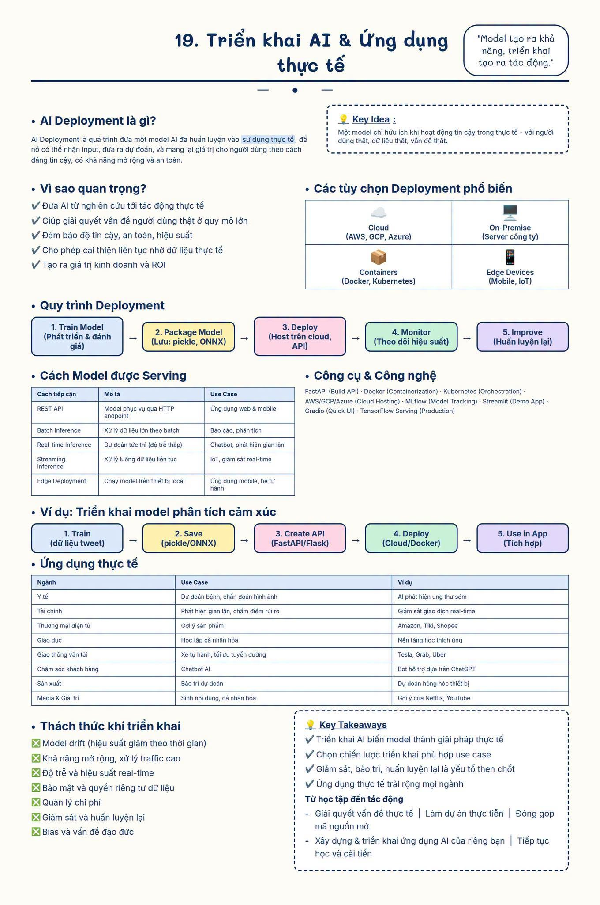

- **Quote:** *"Model tạo ra khả năng, triển khai tạo ra tác động."*
- **4 hạ tầng triển khai:** `Cloud` (AWS, GCP, Azure) · `On-Premise` (Server công ty) · `Containers` (Docker, Kubernetes) · `Edge Devices` (Mobile, IoT).
- **Quy trình 5 bước:** `1. Train Model` $\rightarrow$ `2. Package Model (pickle, ONNX)` $\rightarrow$ `3. Deploy (Host Cloud/API)` $\rightarrow$ `4. Monitor` $\rightarrow$ `5. Improve (Huấn luyện lại)`.
- **5 phương thức Serving:** `REST API` (HTTP cho web/mobile), `Batch Inference` (báo cáo/phân tích dữ liệu lớn), `Real-time Inference` (độ trễ thấp — chatbot/chống gian lận), `Streaming Inference` (luồng dữ liệu liên tục — IoT), `Edge Deployment` (chạy local trên thiết bị).
- **Stack công cụ:** `FastAPI`, `Docker`, `Kubernetes`, `AWS/GCP/Azure`, `MLflow`, `Streamlit`, `Gradio`, `TensorFlow Serving`.
- **8 ngành ứng dụng thực tế & 7 thách thức vận hành:** Y tế (ung thư sớm), Tài chính (gian lận real-time), TMĐT (Amazon/Tiki/Shopee), Giáo dục (học thích ứng), Giao thông (Tesla/Grab/Uber), CSKH (bot ChatGPT), Sản xuất (bảo trì dự đoán), Media (Netflix/YouTube). Thách thức: `Model drift`, scalability/traffic cao, độ trễ real-time, bảo mật/privacy, quản lý chi phí, monitoring/retraining, bias/đạo đức.
