# Ghi chú AI Deployment bằng tiếng Việt

- **Nguồn bài viết:** [Facebook — Việt Nguyễn AI](https://web.facebook.com/vietnh1009/posts/pfbid02AvrwcGMpQip51cRxqLPy9JAZ89DtKN9XnyGmUoAGd2S6WApWbqjXw8GdW3kVKvWQl) (`post_id`: `1744979343264533`)
- **Thời gian đăng:** 2026-11-15 16:00:25 (UTC+7)
- **Nguồn gốc tiếng Anh được tác giả trích dẫn:** https://www.instagram.com/p/Ddkzwpmku1K/?img_index=1
- **Thư mục hình ảnh gốc (12 trang):** `raw/screenshots/ai-deployment-notes/` (`00.jpg` – `11.jpg`)

---

## Nội Dung Nguyên Văn Bài Đăng Facebook

> Ghi chú AI Deployment bằng tiếng Việt 🚀
>
> Mình xin chia sẻ bộ ghi chú về AI Deployment, tổng hợp các kiến thức nền tảng để đưa một model AI từ giai đoạn train ra phục vụ người dùng thật.
>
> Bộ tài liệu gồm 12 trang với sơ đồ trực quan, đi qua các nội dung chính:
> 📌 Giới thiệu về AI Deployment và vòng đời của ứng dụng AI/ML
> 📌 AI Development vs AI Deployment, Model Training vs Model Inference
> 📌 Môi trường Development, Staging và Production
> 📌 Model Packaging, Registry và Versioning
> 📌 Batch vs Real-Time Inference, Online vs Offline Predictions
> 📌 Cloud vs Edge Deployment
> 📌 Kiến trúc AI Deployment, Model Serving và Inference Servers
>
> Tài liệu phù hợp cho bạn nào muốn hiểu rõ phần "sau khi train xong thì làm gì" của một hệ thống AI trong thực tế.
>
> Note: Mình sử dụng AI để convert và dịch sang tiếng Việt, nên sẽ có những chỗ làm chưa thực sự tốt về nội dung hay hình ảnh so với bản gốc. Nếu bạn đọc được tiếng Anh thì có thể xem bản gốc tại: https://www.instagram.com/p/Ddkzwpmku1K/?img_index=1

---

## Chi Tiết 12 Trang Hình Ảnh Đính Kèm (Visual Transcription)

### Trang 00 (Cover) — AI DEPLOYMENT: Chương 1 — Ghi chú đầy đủ: Giới thiệu về AI deployment
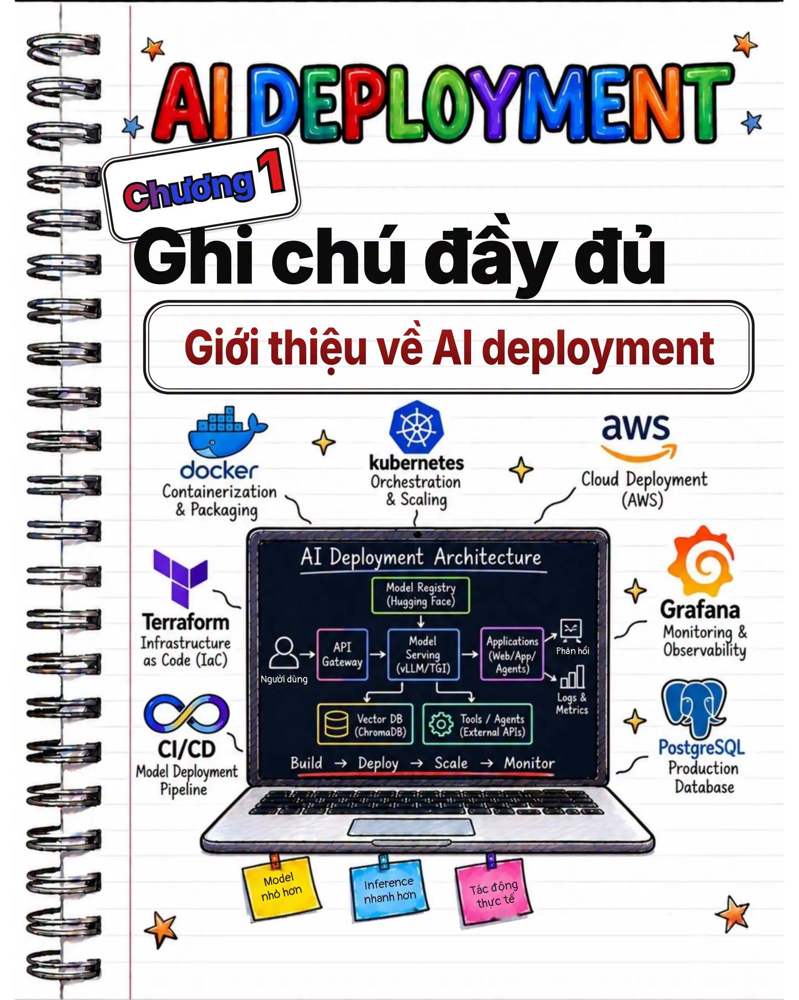

- **Hệ sinh thái công cụ quanh laptop `AI Deployment Architecture`:**
  - **Docker:** Containerization & Packaging
  - **Kubernetes:** Orchestration & Scaling
  - **AWS:** Cloud Deployment (AWS)
  - **Terraform:** Infrastructure as Code (IaC)
  - **CI/CD:** Model Deployment Pipeline
  - **Grafana:** Monitoring & Observability
  - **PostgreSQL:** Production Database
- **Sơ đồ trung tâm `AI Deployment Architecture`:**
  - `Model Registry (Hugging Face)` $\downarrow$
  - `Người dùng` $\rightarrow$ `API Gateway` $\rightarrow$ `Model Serving (vLLM/TGI)` $\rightarrow$ `Applications (Web/App/Agents)` $\rightarrow$ `Phản hồi` & `Logs & Metrics`
  - Phía dưới `Model Serving`: `Vector DB (ChromaDB)` và `Tools / Agents (External APIs)`
  - Chu trình: `Build → Deploy → Scale → Monitor`
- **3 ghi chú dính dưới cùng:** `Model nhỏ hơn` • `Inference nhanh hơn` • `Tác động thực tế`.

---

### Trang 01 — Giới thiệu về AI Deployment
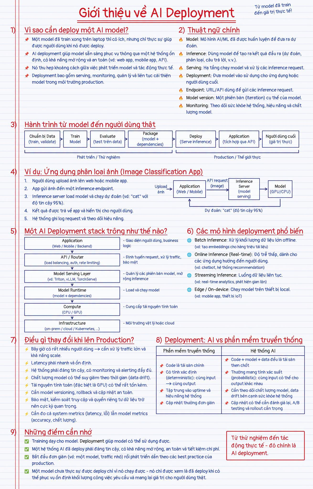

- **1) Vì sao cần deploy một AI model?** Model train xong trên laptop chỉ hữu ích khi được đưa vào hệ thống ổn định, mở rộng được và an toàn (web/mobile/API), thu hẹp khoảng cách từ phát triển tới tác động thực tế (gồm serving, monitoring, quản lý và cải thiện liên tục).
- **2) Thuật ngữ chính:**
  - **Model:** Mô hình AI/ML đã huấn luyện để đưa ra dự đoán.
  - **Inference:** Dùng model tạo kết quả đầu ra cho input mới.
  - **Serving:** Hạ tầng chạy model và xử lý inference request.
  - **Deployment:** Đưa model vào sử dụng cho ứng dụng hoặc người dùng cuối.
  - **Endpoint:** URL/API để gửi inference request.
  - **Model version:** Phiên bản (iteration) cụ thể của model.
  - **Monitoring:** Theo dõi sức khỏe hệ thống, hiệu năng và chất lượng model.
- **3) Hành trình từ model đến người dùng thật:**
  - *Phát triển / Thử nghiệm:* `Chuẩn bị Data (train, validate)` $\rightarrow$ `Train Model` $\rightarrow$ `Evaluate (test trên data)` $\rightarrow$ `Package (model + dependencies)`
  - *Production / Thế giới thực:* `Deploy (Serve inference)` $\rightarrow$ `Application (tích hợp qua API)` $\rightarrow$ `Người dùng cuối (giá trị thực)`
- **4) Ví dụ Image Classification App:** User upload ảnh $\rightarrow$ App gửi API request (image) $\rightarrow$ Inference Server (model serving) $\rightarrow$ Model (GPU/CPU) $\rightarrow$ trả dự đoán `"cat"` (độ tin cậy 95%) và ghi log/theo dõi hiệu năng.
- **5) AI Deployment Stack (6 tầng từ trên xuống):**
  1. `Application` (Web / Mobile / Backend — giao diện & business logic)
  2. `API / Router` (load balancing, auth, rate limiting)
  3. `Model Serving Layer` (Triton, vLLM, TorchServe — quản lý version & scale inference)
  4. `Model Runtime` (model + dependencies)
  5. `Compute` (CPU / GPU)
  6. `Infrastructure` (on-prem / cloud / Kubernetes...)
- **6) Các mô hình deployment phổ biến:** Batch Inference (offline, tạo embeddings hàng triệu tài liệu) • Online Inference (real-time, độ trễ thấp: chatbot, recommendation) • Streaming Inference (luồng dữ liệu liên tục: real-time analytics, phát hiện gian lận) • Edge / On-device (chạy local trên mobile/IoT).
- **7–8) Production & Khác biệt với phần mềm truyền thống:** Phần mềm truyền thống lấy *code* làm tài sản chính và mang tính *xác định* (deterministic); hệ thống AI gồm *code + model + data*, mang tính *xác suất* (probabilistic), chịu ảnh hưởng **data drift**, đòi hỏi đo cả system metrics lẫn model metrics và cập nhật qua đánh giá lại / A/B testing / rollout cẩn trọng.
- **9) Điểm cần nhớ:** *"Training dạy cho model. Deployment giúp model có thể sử dụng được."* Một model chỉ thực sự được xem là đã deploy khi phục vụ ổn định khối lượng công việc yêu cầu và tạo giá trị cho người dùng thật.

---

### Trang 02 — Vòng đời của ứng dụng AI/ML
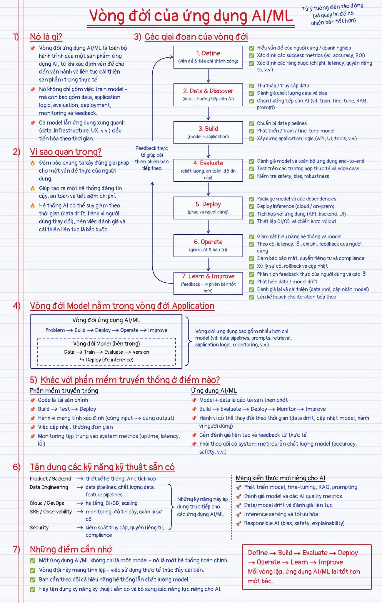

- **7 giai đoạn vòng đời (kèm vòng lặp phản hồi thực tế từ Operate/Learn về Define/Data/Build):**
  1. **Define:** Hiểu vấn đề người dùng/doanh nghiệp, xác định success metrics (accuracy, ROI), ràng buộc (chi phí, latency, quyền riêng tư).
  2. **Data & Discover:** Thu thập/truy cập data, đánh giá chất lượng & bias, chọn hướng tiếp cận (train, fine-tune, RAG, prompt).
  3. **Build:** Chuẩn bị data pipelines, train/fine-tune model, xây application logic (API, UI, tools...).
  4. **Evaluate:** Đánh giá model và ứng dụng end-to-end, test các trường hợp thực tế & edge case, kiểm tra safety, bias, robustness.
  5. **Deploy:** Package model + dependencies, deploy inference (cloud/on-prem), tích hợp API/backend/UI, thiết lập CI/CD & chiến lược rollout.
  6. **Operate:** Giám sát hiệu năng hệ thống & model (latency, lỗi, chi phí, feedback), bảo mật/compliance, xử lý sự cố/rollback/cập nhật.
  7. **Learn & Improve:** Phân tích feedback & lỗi thực tế, phát hiện data/model drift, đánh giá lại/cập nhật model và lập kế hoạch iteration tiếp theo.
- **Vòng đời lồng nhau:** `Vòng đời Model` (`Data → Train → Evaluate → Version → Deploy để inference`) nằm bên trong `Vòng đời Application` (`Problem → Build → Deploy → Operate → Improve`).
- **Tận dụng kỹ năng sẵn có + Mảng kiến thức mới cho AI:** Product/Backend, Data Engineering, Cloud/DevOps, SRE/Observability, Security chuyển sang trực tiếp; bổ sung thêm phát triển/fine-tuning/RAG/prompting, AI quality metrics, data/model drift, inference serving, Responsible AI.

---

### Trang 03 — AI Development vs AI Deployment
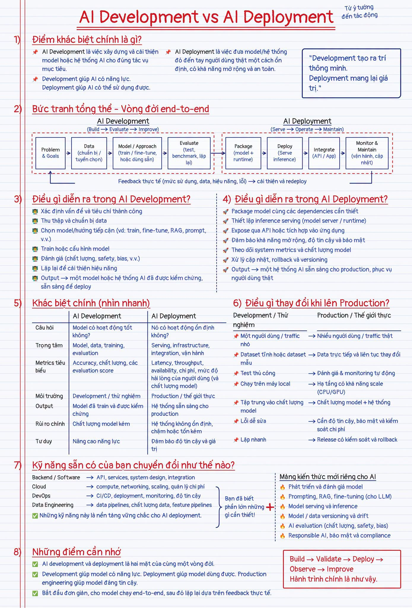

- **Triết lý:** *"Development tạo ra trí thông minh. Deployment mang lại giá trị."*
- **Vòng đời End-to-End:**
  - *AI Development (`Build → Evaluate → Improve`):* `Problem & Goals` $\rightarrow$ `Data` $\rightarrow$ `Model / Approach` $\rightarrow$ `Evaluate (test, benchmark, lặp lại)`.
  - *AI Deployment (`Serve → Operate → Maintain`):* `Package (model + runtime)` $\rightarrow$ `Deploy (Serve inference)` $\rightarrow$ `Integrate (API / App)` $\rightarrow$ `Monitor & Maintain`.
  - Vòng phản hồi thực tế (mức sử dụng, data, hiệu năng, lỗi) nối từ Deployment quay về Development để cải thiện & redeploy.
- **Bảng so sánh nhanh:**

| Tiêu chí | AI Development | AI Deployment |
|---|---|---|
| **Câu hỏi cốt lõi** | Model có hoạt động tốt không? | Hệ thống có hoạt động ổn định không? |
| **Trọng tâm** | Model, data, training, evaluation | Serving, infrastructure, integration, vận hành |
| **Metrics tiêu biểu** | Accuracy, chất lượng, evaluation scores | Latency, throughput, availability, chi phí, hài lòng user & chất lượng model |
| **Môi trường** | Development / thử nghiệm | Production / thế giới thực |
| **Rủi ro chính** | Chất lượng model kém | Hệ thống không ổn định, chậm hoặc tốn kém |
| **Tư duy** | Nâng cao năng lực | Đảm bảo độ tin cậy và giá trị |

- **Thay đổi khi lên Production:** Traffic thật nhiều người dùng • Data trực tiếp và liên tục biến đổi • Đánh giá & monitoring tự động • Hạ tầng scale (CPU/GPU) • Giám sát cả chất lượng model lẫn hệ thống • Release có kiểm soát và rollback.

---

### Trang 04 — Model Training vs Model Inference
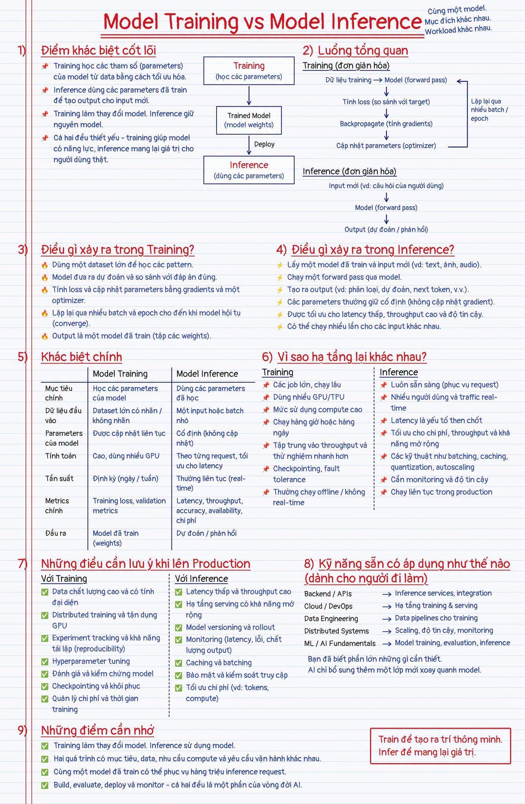

- **Khác biệt cốt lõi:** Training *học và cập nhật parameters* (weights) qua forward pass $\rightarrow$ tính loss $\rightarrow$ backpropagation $\rightarrow$ optimizer qua nhiều batch/epoch. Inference *giữ cố định parameters*, chạy forward pass trên input mới để sinh dự đoán / next token.
- **Bảng đối chiếu Training vs Inference:**

| Khía cạnh | Model Training | Model Inference |
|---|---|---|
| **Mục tiêu chính** | Học các parameters của model | Dùng các parameters đã học |
| **Dữ liệu đầu vào** | Dataset lớn có nhãn / không nhãn | 1 input hoặc batch nhỏ |
| **Parameters** | Cập nhật liên tục | Cố định (không cập nhật) |
| **Tính toán & Hạ tầng** | Job lớn, nhiều GPU/TPU, chạy hàng giờ/ngày, checkpointing & fault tolerance, thường offline | Luôn sẵn sàng, tối ưu latency, batching, caching, quantization, autoscaling |
| **Tần suất** | Định kỳ (ngày / tuần) | Liên tục (real-time) |
| **Metrics chính** | Training loss, validation metrics | Latency, throughput, accuracy, availability, chi phí (tokens, compute) |

- **Châm ngôn:** *"Train để tạo ra trí thông minh. Infer để mang lại giá trị."* Cùng một model đã train có thể phục vụ hàng triệu inference request.

---

### Trang 05 — Development, Staging và Production
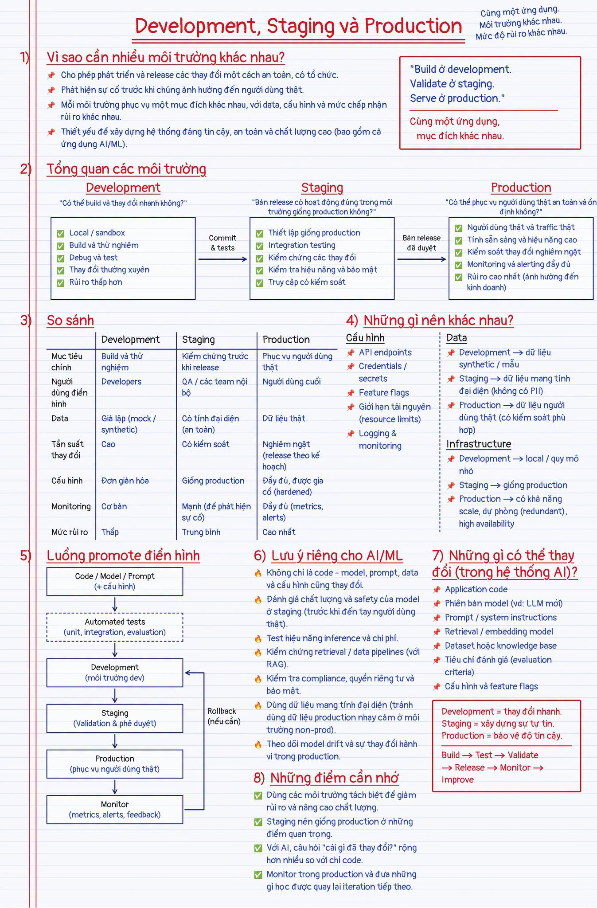

- **Nguyên tắc:** *"Build ở development. Validate ở staging. Serve ở production."*
- **3 môi trường:**
  - **Development:** Local/sandbox, data giả lập/synthetic, thay đổi nhanh & thường xuyên, monitoring cơ bản, rủi ro thấp.
  - **Staging:** Cấu hình và hạ tầng giống production, data đại diện an toàn (**không chứa PII**), integration testing, kiểm tra hiệu năng/bảo mật, monitoring mạnh để bắt sự cố trước release.
  - **Production:** Traffic & dữ liệu người dùng thật, hạ tầng hardened/scale/redundant/high-availability, kiểm soát thay đổi chặt chẽ, monitoring & alerting đầy đủ, rủi ro kinh doanh cao nhất.
- **Luồng promote:** `Code / Model / Prompt (+ cấu hình)` $\rightarrow$ `Automated tests (unit, integration, evaluation)` $\rightarrow$ `Development` $\rightarrow$ `Staging (Validation & phê duyệt)` $\rightarrow$ `Production` $\rightarrow$ `Monitor (metrics, alerts, feedback)` (kèm đường **Rollback**).
- **Đặc thù cho hệ thống AI/ML:** Trong AI, "cái gì đã thay đổi?" không chỉ là application code mà gồm: **Application code**, **Phiên bản model**, **Prompt / system instructions**, **Retrieval / embedding model**, **Dataset / knowledge base**, **Tiêu chí đánh giá (eval criteria)**, và **Cấu hình / feature flags**.

---

### Trang 06 — Model Packaging, Registry & Versioning
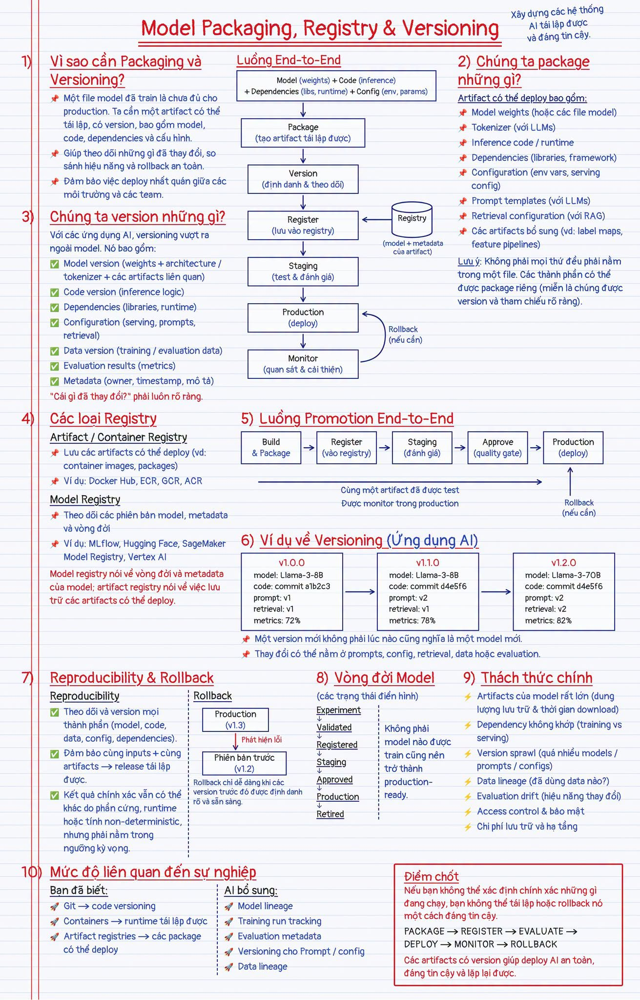

- **Luồng End-to-End:** `Model (weights) + Code (inference) + Dependencies + Config` $\rightarrow$ `Package` $\rightarrow$ `Version` $\rightarrow$ `Register (vào Registry)` $\rightarrow$ `Staging` $\rightarrow$ `Production` $\rightarrow$ `Monitor` (+ `Rollback`).
- **Những gì cần package & version cho ứng dụng AI:** Model weights, Tokenizer (với LLMs), Inference code/runtime, Dependencies, Configuration, **Prompt templates (với LLMs)**, **Retrieval configuration (với RAG)**, Data version, Evaluation results, Metadata (owner, timestamp, mô tả).
- **Artifact/Container Registry vs Model Registry:**
  - *Artifact / Container Registry* (Docker Hub, ECR, GCR, ACR): Lưu các deployable artifacts (container images, packages).
  - *Model Registry* (MLflow, Hugging Face, SageMaker Model Registry, Vertex AI): Theo dõi phiên bản model, metadata và vòng đời.
- **Ví dụ versioning ứng dụng AI:**
  - `v1.0.0`: `model: Llama-3-8B`, `code: a1b2c3`, `prompt: v1`, `retrieval: v1` $\rightarrow$ `metrics: 72%`
  - `v1.1.0`: `model: Llama-3-8B` (giữ nguyên), `code: d4e5f6`, `prompt: v2`, `retrieval: v1` $\rightarrow$ `metrics: 78%`
  - `v1.2.0`: `model: Llama-3-70B`, `code: d4e5f6`, `prompt: v2`, `retrieval: v2` $\rightarrow$ `metrics: 82%`
  *(Một version mới không nhất thiết thay đổi model weights—có thể đến từ thay đổi prompt, retrieval, config hoặc data).*
- **Các trạng thái vòng đời Model:** `Experiment → Validated → Registered → Staging → Approved → Production → Retired`.
- **Thách thức chính:** Artifacts kích thước rất lớn • Lệch dependencies (training vs serving) • Version sprawl • Data lineage • Evaluation drift • Access control & bảo mật • Chi phí lưu trữ/hạ tầng.

---

### Trang 07 — Batch vs Real-Time Inference
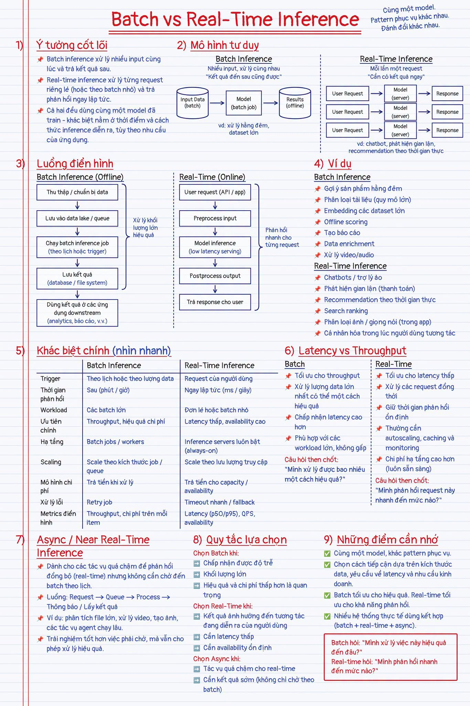

- **Ý tưởng cốt lõi:** Batch inference xử lý lượng lớn input offline theo lịch hoặc theo lượng data (*tối ưu throughput & chi phí*); Real-Time inference xử lý từng request hoặc micro-batch (*tối ưu latency thấp & availability cao*).
- **So sánh nhanh:**
  - **Batch:** Trigger theo lịch/lượng data, phản hồi phút/giờ, scale theo kích thước job/queue, retry job khi lỗi, metrics: `Throughput, chi phí/item`.
  - **Real-Time:** Trigger từ user request, phản hồi ms/giây, inference servers always-on, timeout nhanh/fallback khi lỗi, metrics: `Latency (p50/p95), QPS, availability`.
- **Async / Near Real-Time Inference:** Dành cho tác vụ quá chậm cho đồng bộ real-time nhưng không thể chờ lịch batch (phân tích file lớn, xử lý video, tạo ảnh, tác vụ agent chạy lâu): `Request → Queue → Process → Thông báo / Lấy kết quả`.
- **Câu hỏi tổng kết:** Batch hỏi: *"Mình xử lý việc này hiệu quả đến đâu?"*; Real-Time hỏi: *"Mình phản hồi nhanh đến mức nào?"*

---

### Trang 08 — Online vs Offline Predictions
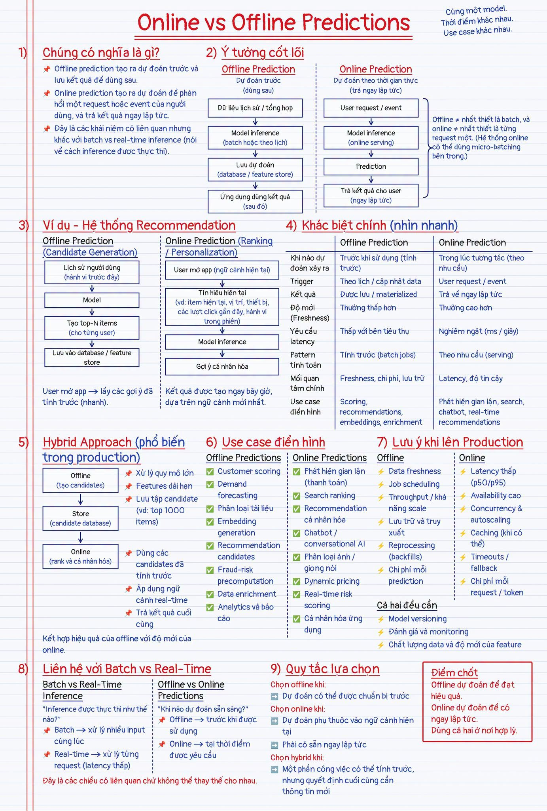

- **Phân biệt với Batch vs Real-Time:** `Batch vs Real-Time` trả lời **"Inference được thực thi như thế nào?"**, còn `Offline vs Online` trả lời **"Khi nào dự đoán sẵn sàng?"**:
  - **Offline Prediction:** Dự đoán trước từ dữ liệu lịch sử, lưu vào database / feature store để ứng dụng lấy dùng sau (freshness thấp hơn, chi phí thấp).
  - **Online Prediction:** Tạo dự đoán ngay lúc tương tác dựa trên ngữ cảnh thời gian thực (độ mới cao, yêu cầu latency ms/giây).
  - *(Lưu ý: Offline không nhất thiết là batch, và online không nhất thiết là từng request một — hệ thống online thường dùng micro-batching).*
- **Hybrid Approach (phổ biến trong production — ví dụ Recommendation):**
  - `Offline (tạo candidates)` từ lịch sử dài hạn $\rightarrow$ lưu top-1000 candidates vào DB/feature store $\rightarrow$ `Online (rank & cá nhân hóa)` dựa trên cú click và ngữ cảnh phiên hiện tại $\rightarrow$ trả kết quả cuối.

---

### Trang 09 — Cloud vs Edge Deployment
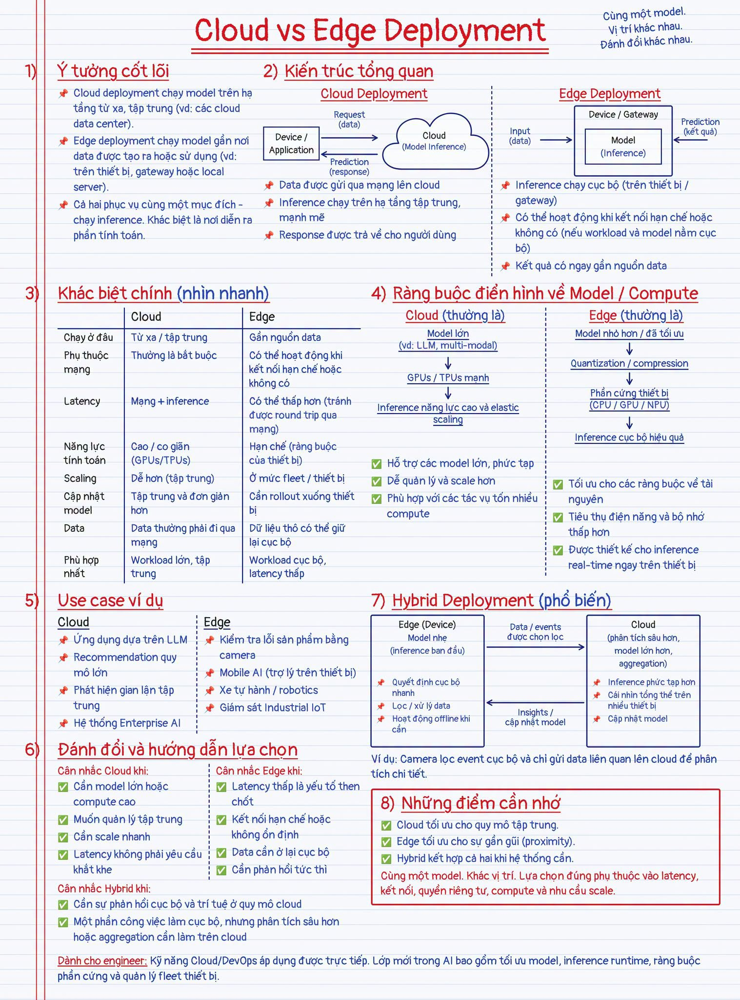

- **Cloud Deployment:** Chạy trên data center tập trung (hỗ trợ model lớn LLM/multi-modal với GPU/TPU mạnh, dễ scale và cập nhật tập trung, nhưng phụ thuộc mạng và phát sinh độ trễ mạng).
- **Edge Deployment:** Chạy cục bộ gần nguồn dữ liệu (trên thiết bị/gateway/IoT/mobile), giảm latency (không cần round trip mạng), hoạt động được khi mất mạng, giữ dữ liệu thô tại chỗ (privacy), nhưng compute/RAM/pin hạn chế nên cần **model nhỏ hơn + quantization/compression** và cơ chế rollout xuống fleet thiết bị.
- **Hybrid Deployment (phổ biến):** Edge chạy model nhẹ để lọc event/quyết định tức thì tại chỗ và hoạt động offline khi cần; chỉ gửi dữ liệu đã chọn lọc lên Cloud để model lớn phân tích sâu, tổng hợp đa thiết bị và đẩy cập nhật model xuống lại Edge.

---

### Trang 10 — AI Deployment Architecture
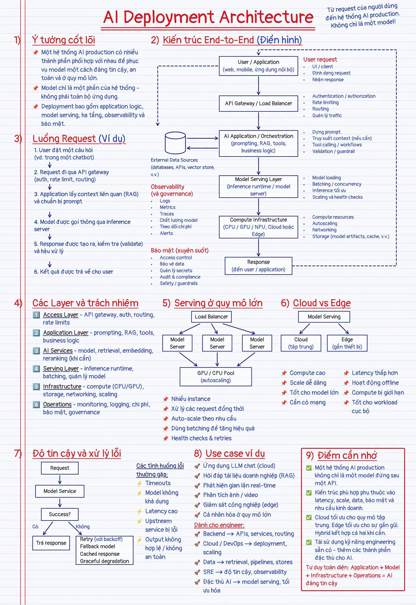

- **6 Layer & trách nhiệm trong kiến trúc End-to-End:**
  1. **Access Layer:** API Gateway / Load Balancer (auth, authorization, rate limiting, routing, quản lý traffic).
  2. **Application Layer:** AI Application / Orchestration (prompting, RAG, tool calling/workflows, business logic, validation/guardrail).
  3. **AI Services:** Model, retrieval, embedding, reranking (External Data Sources: databases, APIs, vector store).
  4. **Serving Layer:** Inference runtime / model server (model loading, batching/concurrency, inference optimization, scaling, health checks).
  5. **Infrastructure:** Compute (CPU/GPU/NPU, Cloud hoặc Edge), autoscaling, networking, storage (model artifacts, cache).
  6. **Operations (xuyên suốt):**
     - *Observability & Governance:* Logs, Metrics, Traces, Chất lượng model, Theo dõi chi phí, Alerts.
     - *Bảo mật:* Access control, Bảo vệ data, Quản lý secrets, Audit & compliance, Safety / guardrails.
- **Độ tin cậy & Xử lý lỗi (Reliability):** Trước các lỗi *Timeouts, Model không khả dụng, Latency cao, Upstream error, Output không hợp lệ/không an toàn*, nhánh lỗi `Success? = Không` áp dụng: **Retry (với backoff)**, **Fallback model**, **Cached response**, và **Graceful degradation**.

---

### Trang 11 — Model Serving & Inference Servers
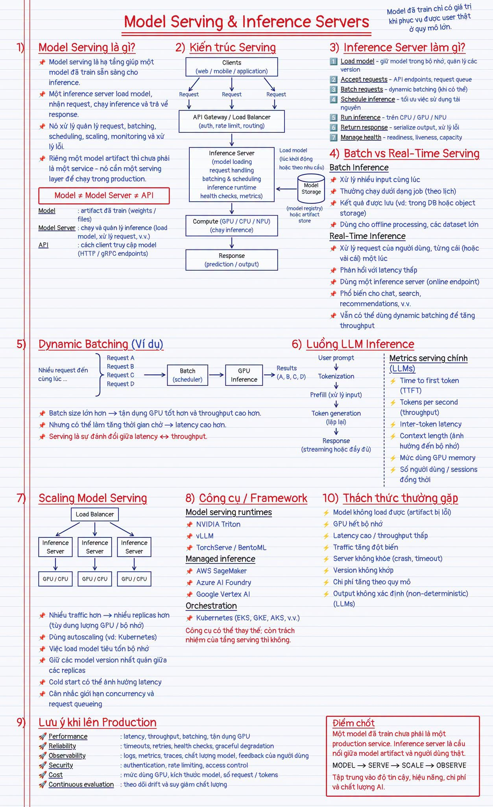

- **Phân tách 3 khái niệm:** `Model` (artifact/weights đã train) $\neq$ `Model Server` (hạ tầng chạy & quản lý inference) $\neq$ `API` (HTTP/gRPC endpoints để client gọi).
- **7 nhiệm vụ của Inference Server:** (1) Load model & quản lý version, (2) Accept requests (endpoints, queue), (3) Dynamic batching, (4) Schedule inference tối ưu GPU/CPU, (5) Run inference, (6) Return response (serialize, xử lý lỗi), (7) Manage health (readiness, liveness, capacity).
- **Dynamic Batching:** Gom các request đồng thời (`A, B, C, D`) qua `Batch (scheduler)` vào `GPU Inference` — batch lớn tăng throughput và tận dụng GPU nhưng có thể làm tăng thời gian chờ (*đánh đổi latency $\leftrightarrow$ throughput*).
- **Luồng LLM Inference & Metrics chính:**
  - *Luồng:* `User prompt` $\rightarrow$ `Tokenization` $\rightarrow$ `Prefill (xử lý input)` $\rightarrow$ `Token generation (lặp)` $\rightarrow$ `Response (streaming hoặc đầy đủ)`.
  - *Metrics:* **Time to first token (TTFT)** • **Tokens per second (throughput)** • **Inter-token latency** • **Context length** (ảnh hưởng bộ nhớ) • **GPU memory** • **Số người dùng / sessions đồng thời**.
- **Công cụ / Framework tiêu biểu:**
  - *Model serving runtimes:* NVIDIA Triton, vLLM, TorchServe / BentoML (cùng TGI trên trang bìa).
  - *Managed inference:* AWS SageMaker, Azure AI Foundry, Google Vertex AI.
  - *Orchestration:* Kubernetes (EKS, GKE, AKS...).
- **6 trụ cột lên Production:** Performance • Reliability • Observability • Security • Cost • Continuous evaluation (*`MODEL → SERVE → SCALE → OBSERVE`*).
