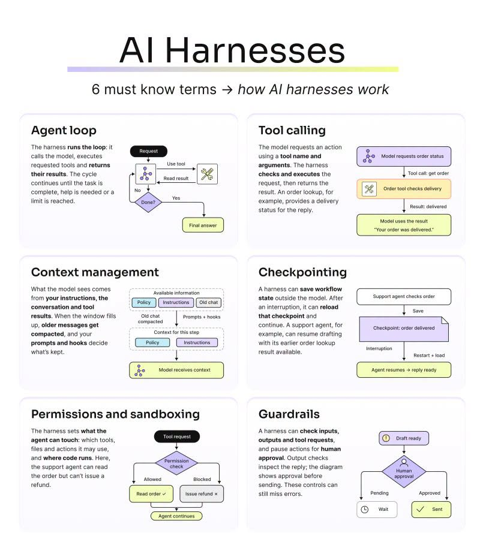

# AI Harness làm gì để agent hoàn thành công việc?

- **Nguồn bài viết:** [Facebook — Việt Nguyễn AI](https://www.facebook.com/vietnh1009/posts/pfbid0VejzMavZhUeQeLTd2UH1fPE85gJmK9ZeRiYDbo48aVeJr6ToxfjWsupR6HweFY82l)
- **Thời gian đăng:** Saturday 21 November 2026 at 14:00 (UTC+7)
- **Tương tác tại thời điểm thu thập:** 8 Likes, 1 comment (*Lại Quang Vũ*: `"Còn AI Bot thì sao A?"`, chưa có phản hồi từ tác giả), 4 shares
- **Tài sản hình ảnh đính kèm:** `raw/assets/ai-harness-six-components-01.jpg` (`800x934`)

---

## Nội Dung Nguyên Văn Bài Đăng Facebook

> AI Harness làm gì để agent hoàn thành công việc? 🔥
>
> Agent = Model + Harness
>
> Trong Agent, model đưa ra dự đoán, còn harness tổ chức việc thực thi. Ví dụ với một agent kiểm tra đơn hàng và soạn câu trả lời cho khách, có 6 thành phần cơ bản:
>
> 🔄 Vòng lặp agent: Chọn hành động → chạy công cụ → nhận kết quả. Lặp lại đến khi xong, cần trợ giúp hoặc chạm giới hạn.
> 🔧 Gọi công cụ: Mô hình yêu cầu tra đơn hàng. Harness kiểm tra yêu cầu, thực thi và trả lại tình trạng giao hàng.
> 🧠 Quản lý ngữ cảnh: Sắp xếp hướng dẫn, hội thoại và kết quả công cụ để mô hình có đủ thông tin. Khi gần đầy, nội dung cũ có thể được tóm gọn.
> 💾 Lưu trạng thái: Ghi lại tiến độ bên ngoài mô hình để khi bị gián đoạn, quy trình có thể tiếp tục từ điểm đã lưu.
> 🔐 Phân quyền và môi trường cách ly: Quy định agent được truy cập gì, làm gì và chạy mã ở đâu. Chẳng hạn, được xem đơn nhưng không được hoàn tiền.
> 🛡️ Kiểm soát an toàn: Kiểm tra nội dung trả lời hoặc yêu cầu người duyệt trước khi gửi. Mỗi lớp có vai trò riêng và vẫn có thể bỏ sót lỗi.

---

## Chi Tiết Infographic: AI Harnesses — 6 Must Know Terms *(800x934)*

### Tiêu đề hình ảnh
- **AI Harnesses** — *6 must know terms -> how AI harnesses work*

### 6 Khối Chức Năng Trong Ví Dụ Customer Support Agent
1. **Agent loop (Vòng lặp agent):**
   - *Mô tả gốc:* *"The harness runs the loop: it calls the model, executes requested tools and returns their results. The cycle continues until the task is complete, help is needed or a limit is reached."*
   - *Sơ đồ:* `Request` $\rightarrow$ `[Model]` $\xrightarrow{\text{Use tool}}$ `[Tool]` $\xrightarrow{\text{Read result}}$ `[Model]` $\rightarrow$ `Done?` (`No` $\rightarrow$ quay lại vòng lặp; `Yes` $\rightarrow$ `Final answer`).
2. **Tool calling (Gọi công cụ):**
   - *Mô tả gốc:* *"The model requests an action using a tool name and arguments. The harness checks and executes the request, then returns the result. An order lookup, for example, provides a delivery status for the reply."*
   - *Sơ đồ:* `Model requests order status` $\xrightarrow{\text{Tool call: get order}}$ `Order tool checks delivery` $\xrightarrow{\text{Result: delivered}}$ `Model uses the result: "Your order was delivered."`
3. **Context management (Quản lý ngữ cảnh):**
   - *Mô tả gốc:* *"What the model sees comes from your instructions, the conversation and tool results. When the window fills up, older messages get compacted, and your prompts and hooks decide what's kept."*
   - *Sơ đồ:* `Available information [Policy | Instructions | Old chat]` $\xrightarrow{\text{Old chat compacted / Prompts + hooks}}$ `Context for this step [Policy | Instructions]` $\rightarrow$ `Model receives context`.
4. **Checkpointing (Lưu trạng thái):**
   - *Mô tả gốc:* *"A harness can save workflow state outside the model. After an interruption, it can reload that checkpoint and continue. A support agent, for example, can resume drafting with its earlier order lookup result available."*
   - *Sơ đồ:* `Support agent checks order` $\xrightarrow{\text{Save}}$ `Checkpoint: order delivered` $\rightarrow$ *(Interruption)* $\xrightarrow{\text{Restart + load}}$ `Agent resumes -> reply ready`.
5. **Permissions and sandboxing (Phân quyền & môi trường cách ly):**
   - *Mô tả gốc:* *"The harness sets what the agent can touch: which tools, files and actions it may use, and where code runs. Here, the support agent can read the order but can't issue a refund."*
   - *Sơ đồ:* `Tool request` $\rightarrow$ `Permission check` $\rightarrow$ `Allowed (Read order ✓)` vs `Blocked (Issue refund ✗)` $\rightarrow$ `Agent continues`.
6. **Guardrails (Kiểm soát an toàn):**
   - *Mô tả gốc:* *"A harness can check inputs, outputs and tool requests, and pause actions for human approval. Output checks inspect the reply; the diagram shows approval before sending. These controls can still miss errors."*
   - *Sơ đồ:* `Draft ready` $\rightarrow$ `Human approval` $\rightarrow$ `Pending (Wait)` vs `Approved (Sent ✓)`.
