# Ghi chú các dịch vụ AWS cốt lõi bằng tiếng Việt

- **Nguồn bài viết:** [Facebook — Việt Nguyễn AI](https://web.facebook.com/vietnh1009/posts/pfbid0tjDepyu8Q5XSfMnCrW5XbbUSU1w6rzKafgWq7W6oXtV6T8ajuQnLZDuAnEJ9a9F2l)
- **Thời gian đăng:** 16 November 2026 at 09:00
- **Nguồn gốc tiếng Anh được tác giả trích dẫn:** https://www.instagram.com/p/Ddpj30hEnZK/?img_index=1
- **Thư mục hình ảnh gốc (18 trang):** `raw/screenshots/aws-core-services-notes/` (`00.jpg` – `17.jpg`)

---

## Nội Dung Nguyên Văn Bài Đăng Facebook

> Ghi chú các dịch vụ AWS cốt lõi bằng tiếng Việt 🚀
> Mình xin chia sẻ bộ ghi chú dạng sổ tay về các dịch vụ AWS quan trọng, gồm 18 trang với sơ đồ minh họa trực quan, ví dụ thực tế và các thực hành tốt nhất cho từng dịch vụ.
> 🚀 Nền tảng: AWS Regions, IAM, VPC
> ⚡️ Tính toán và lưu trữ: EC2, EBS
> 🌐 Mạng và phân phối: ELB/ALB/NLB, Route 53
> 📌 Cơ sở dữ liệu: RDS, DynamoDB
> 🔥 Container và hàng đợi: SQS, ECS, EKS, ECR
> ✅ Giám sát và bảo mật: CloudWatch, CloudTrail, Secrets Manager, KMS
> Phù hợp cho bạn nào đang bắt đầu với AWS, ôn lại kiến thức hoặc chuẩn bị cho phỏng vấn DevOps/Cloud.
> Note: Mình sử dụng AI để convert và dịch sang tiếng Việt, nên sẽ có những chỗ làm chưa thực sự tốt về nội dung hay hình ảnh so với bản gốc. Nếu bạn đọc được tiếng Anh thì có thể xem bản gốc tại: https://www.instagram.com/p/Ddpj30hEnZK/?img_index=1

---

## Chi Tiết 18 Trang Hình Ảnh Đính Kèm (Visual Transcription)

### Trang 0 (Cover) — AWS: Ghi chú đầy đủ
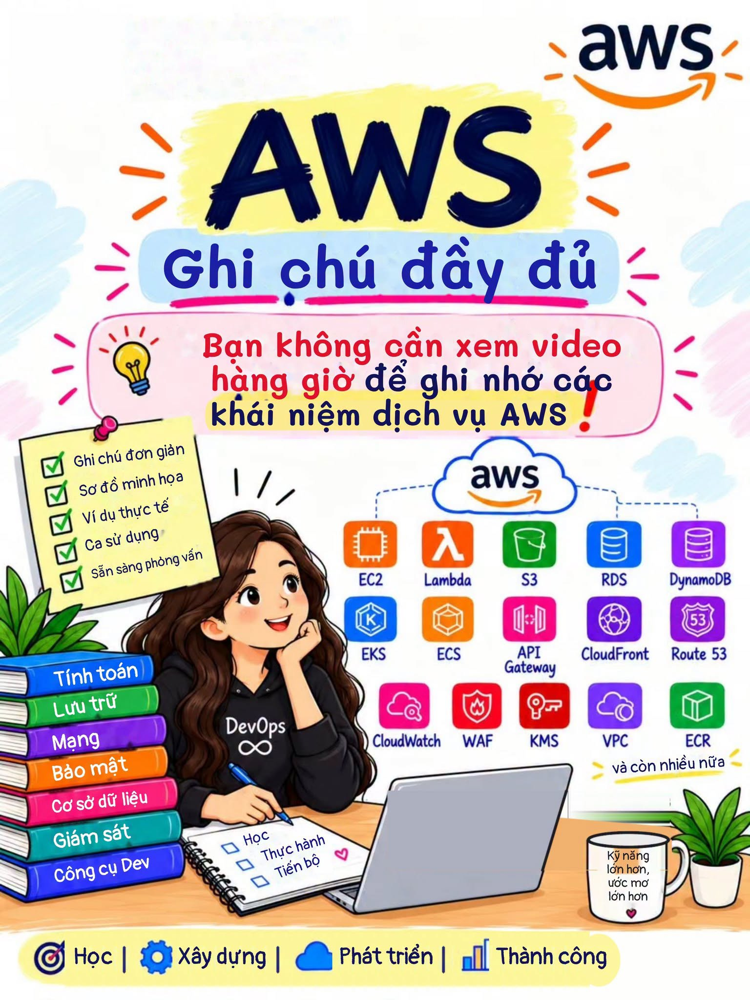

- **Thông điệp chính:** *"Bạn không cần xem video hàng giờ để ghi nhớ các khái niệm dịch vụ AWS!"* — Ghi chú đơn giản • Sơ đồ minh họa • Ví dụ thực tế • Ca sử dụng • Sẵn sàng phỏng vấn.
- **7 nhóm chủ đề & biểu tượng dịch vụ:** Tính toán (`EC2`, `Lambda`), Lưu trữ (`S3`, `EBS`), Mạng (`VPC`, `CloudFront`, `Route 53`, `API Gateway`), Bảo mật (`IAM`, `WAF`, `KMS`, `Secrets Manager`), Cơ sở dữ liệu (`RDS`, `DynamoDB`), Container/Hàng đợi (`ECS`, `EKS`, `ECR`, `SQS`), Giám sát & Công cụ Dev (`CloudWatch`, `CloudTrail`).

### Trang 1 — AWS Regions
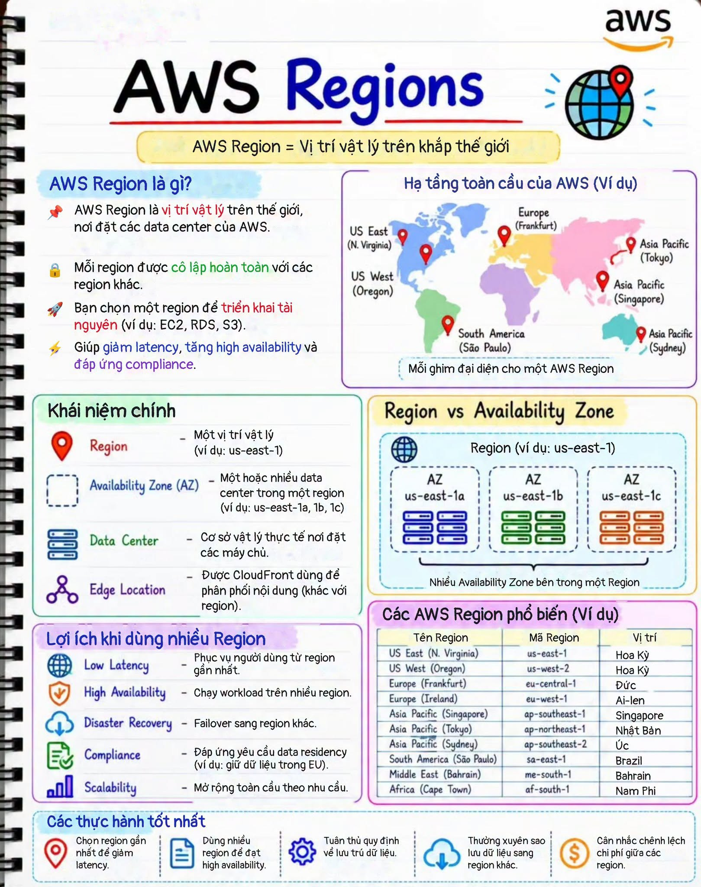

- **Định nghĩa:** AWS Region là **vị trí vật lý trên khắp thế giới** nơi đặt các data center của AWS; mỗi region **cô lập hoàn toàn** với các region khác. Chọn region để triển khai tài nguyên (`EC2`, `RDS`, `S3`) giúp giảm latency, tăng high availability và đáp ứng compliance.
- **Khái niệm chính:**
  - **Region:** Một vị trí vật lý (vd: `us-east-1`).
  - **Availability Zone (AZ):** Một hoặc nhiều data center độc lập trong một region (vd: `us-east-1a`, `us-east-1b`, `us-east-1c`).
  - **Data Center:** Cơ sở vật lý thực tế đặt máy chủ.
  - **Edge Location:** Điểm phân phối nội dung của CloudFront (khác với Region).
- **Lợi ích đa Region:** Low Latency • High Availability • Disaster Recovery (failover) • Compliance (data residency) • Scalability.
- **Các AWS Region phổ biến:** `us-east-1` (N. Virginia), `us-west-2` (Oregon), `eu-central-1` (Frankfurt), `eu-west-1` (Ireland), `ap-southeast-1` (Singapore), `ap-northeast-1` (Tokyo), `ap-southeast-2` (Sydney), `sa-east-1` (São Paulo), `me-south-1` (Bahrain), `af-south-1` (Cape Town).
- **Best Practices:** Chọn region gần nhất để giảm latency; chạy multi-region cho HA; tuân thủ lưu trữ dữ liệu; sao lưu cross-region; cân nhắc chênh lệch giá giữa các region.

### Trang 2 — IAM (Identity and Access Management)
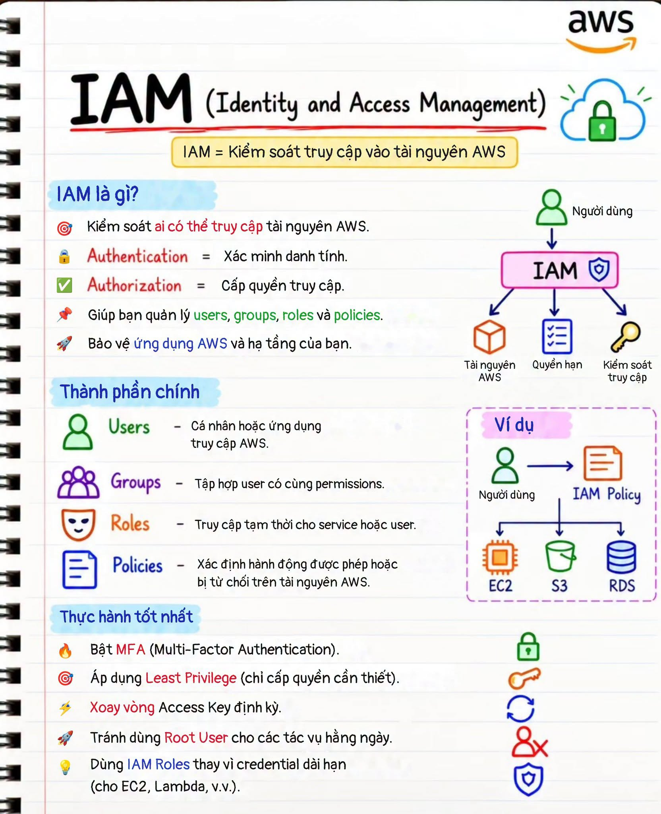

- **IAM là gì?** Kiểm soát **ai có thể truy cập** tài nguyên AWS (`Authentication` = xác minh danh tính; `Authorization` = cấp quyền truy cập). Quản lý `users`, `groups`, `roles` và `policies`.
- **4 thành phần chính:**
  - **Users:** Cá nhân hoặc ứng dụng truy cập AWS.
  - **Groups:** Tập hợp user có chung permissions.
  - **Roles:** Quyền truy cập tạm thời cho service hoặc user.
  - **Policies:** Tài liệu xác định hành động được phép hoặc từ chối trên tài nguyên AWS (`EC2`, `S3`, `RDS`, ...).
- **Best Practices (5 điểm):** Bật MFA • Áp dụng Least Privilege • Xoay vòng Access Key định kỳ • Tránh dùng Root User hằng ngày • Dùng **IAM Roles** thay credential dài hạn cho `EC2`, `Lambda`, v.v.

### Trang 3 — EC2 (Elastic Compute Cloud)
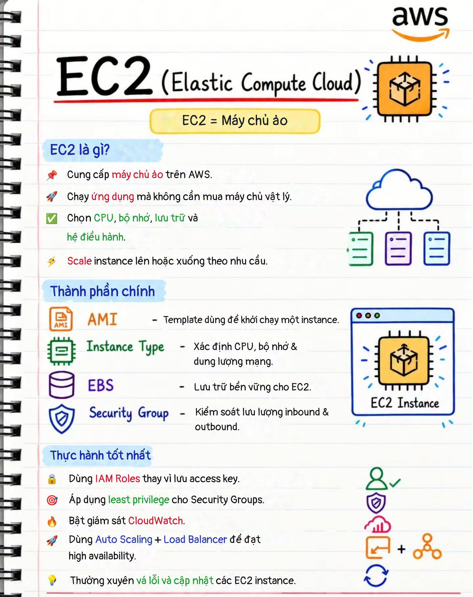

- **EC2 là gì?** Cung cấp máy chủ ảo trên AWS, chọn CPU, bộ nhớ, lưu trữ và hệ điều hành; scale lên/xuống theo nhu cầu mà không cần mua phần cứng vật lý.
- **Thành phần chính:** **AMI** (template khởi chạy instance) • **Instance Type** (CPU, RAM, băng thông mạng) • **EBS** (lưu trữ bền vững) • **Security Group** (kiểm soát lưu lượng inbound & outbound).
- **Best Practices:** Dùng IAM Roles thay vì lưu access key; Least Privilege cho Security Groups; bật CloudWatch; kết hợp Auto Scaling + Load Balancer cho HA; vá lỗi và cập nhật EC2 định kỳ.

### Trang 4 — EBS (Elastic Block Store)
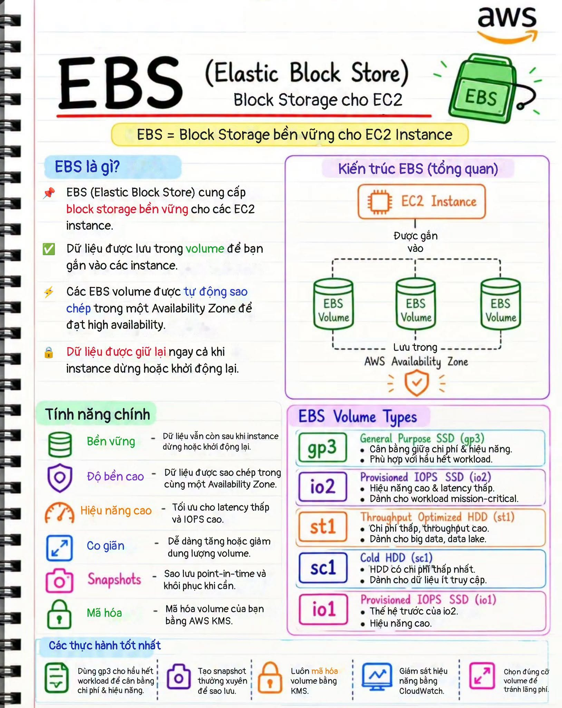

- **EBS là gì?** Cung cấp **block storage bền vững** dưới dạng `volume` gắn vào EC2 instance; tự động sao chép (*replicated*) trong **cùng một Availability Zone**, dữ liệu vẫn giữ lại khi instance dừng hoặc khởi động lại.
- **6 tính năng chính:** Bền vững • Độ bền cao (nội bộ AZ) • Hiệu năng cao (IOPS cao, latency thấp) • Co giãn dung lượng • **Snapshots** (sao lưu point-in-time) • Mã hóa bằng **AWS KMS**.
- **5 EBS Volume Types:**
  - `gp3` (*General Purpose SSD*): Cân bằng chi phí & hiệu năng, phù hợp hầu hết workload.
  - `io2` (*Provisioned IOPS SSD*): Hiệu năng cao, latency thấp cho mission-critical.
  - `st1` (*Throughput Optimized HDD*): Chi phí thấp, throughput cao cho big data / data lake.
  - `sc1` (*Cold HDD*): Chi phí thấp nhất cho dữ liệu ít truy cập.
  - `io1` (*Provisioned IOPS SSD*): Thế hệ trước của `io2`.
- **Best Practices:** Mặc định chọn `gp3`; chụp snapshot định kỳ; luôn mã hóa bằng KMS; giám sát qua CloudWatch; chọn kích thước hợp lý tránh lãng phí.

### Trang 5 — VPC (Virtual Private Cloud)
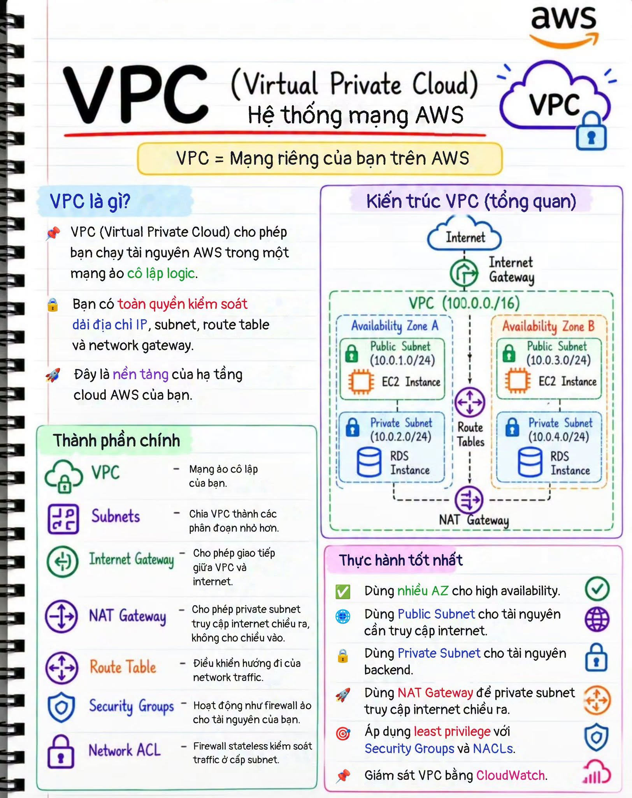

- **VPC là gì?** Mạng ảo **cô lập logic** do bạn toàn quyền kiểm soát dải địa chỉ IP, subnet, route table và network gateway — nền tảng hạ tầng cloud AWS.
- **Sơ đồ & Thành phần chính (7 mục):** *(Chú thích bản in: hộp sơ đồ ghi `VPC (100.0.0./16)`, CIDR nhất quán với các subnet bên dưới `10.0.1.0/24`..`10.0.4.0/24` là `10.0.0.0/16`)*
  - **VPC:** Mạng ảo cô lập.
  - **Subnets:** Phân đoạn nhỏ hơn (`Public Subnet` chứa EC2 qua IGW; `Private Subnet` chứa backend/RDS).
  - **Internet Gateway (IGW):** Cho phép giao tiếp giữa VPC và internet.
  - **NAT Gateway:** Cho phép private subnet truy cập internet **chiều ra**, chặn chiều vào.
  - **Route Table:** Điều khiển hướng đi của network traffic.
  - **Security Groups:** Firewall ảo cấp instance/resource (stateful).
  - **Network ACL (NACL):** Firewall **stateless** kiểm soát traffic ở cấp subnet.
- **Best Practices:** Dùng nhiều AZ (AZ A + AZ B) cho HA; phân tách Public/Private Subnet; đặt NAT Gateway cho outbound từ Private Subnet; Least Privilege cho SG & NACL; giám sát bằng CloudWatch (VPC Flow Logs).

### Trang 6 — ELB / ALB / NLB (Cân bằng tải)
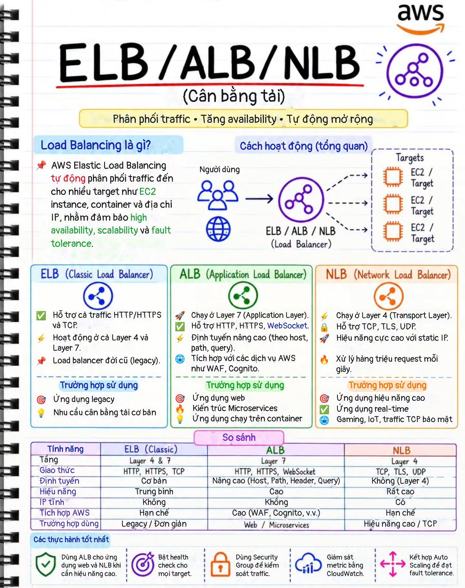

- **Load Balancing:** Tự động phân phối traffic tới nhiều target (`EC2`, container, IP) đảm bảo high availability, scalability và fault tolerance.
- **So sánh 3 loại Load Balancer:**

| Tính năng | ELB (Classic) | ALB (Application Load Balancer) | NLB (Network Load Balancer) |
| :--- | :--- | :--- | :--- |
| **Tầng (OSI)** | Layer 4 & Layer 7 | Layer 7 (Application Layer) | Layer 4 (Transport Layer) |
| **Giao thức** | HTTP, HTTPS, TCP | HTTP, HTTPS, **WebSocket** | TCP, TLS, UDP |
| **Định tuyến** | Cơ bản | **Nâng cao** (Host, Path, Header, Query) | Không (Layer 4) |
| **Hiệu năng** | Trung bình | Cao | **Rất cao** (hàng triệu req/s) |
| **IP tĩnh** | Không | Không | **Có** (Static IP) |
| **Tích hợp AWS** | Hạn chế | Cao (**WAF, Cognito**, v.v.) | Hạn chế |
| **Trường hợp dùng** | Legacy / đơn giản | Web, Microservices, Container | Hiệu năng cực cao, Real-time, Gaming, IoT, TCP bảo mật |

- **Best Practices:** Dùng ALB cho web và NLB cho throughput siêu cao; bật health check cho mọi target; kiểm soát bằng Security Group; giám sát bằng CloudWatch; kết hợp Auto Scaling.

### Trang 7 — Route 53 (DNS & Định tuyến Traffic)
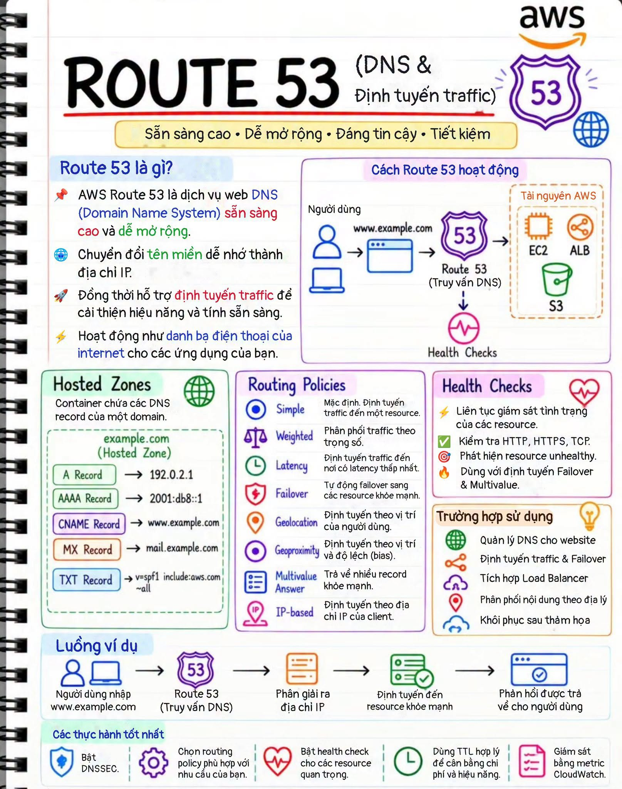

- **Route 53 là gì?** Dịch vụ DNS sẵn sàng cao, dễ mở rộng ("danh bạ điện thoại của internet"), phân giải tên miền thành IP và định tuyến traffic đến EC2, ALB, S3.
- **Hosted Zones & Records:** `A` (IPv4 `192.0.2.1`), `AAAA` (IPv6 `2001:db8::1`), `CNAME`, `MX`, `TXT` (`v=spf1 ...`).
- **8 Routing Policies:**
  1. `Simple` — Định tuyến mặc định đến một resource.
  2. `Weighted` — Phân phối theo trọng số.
  3. `Latency` — Chuyển tới region có độ trễ thấp nhất.
  4. `Failover` — Tự động failover sang resource khỏe mạnh.
  5. `Geolocation` — Định tuyến theo vị trí địa lý người dùng.
  6. `Geoproximity` — Theo khoảng cách vị trí và độ lệch (`bias`).
  7. `Multivalue Answer` — Trả về nhiều record khỏe mạnh.
  8. `IP-based` — Định tuyến theo dải IP client.
- **Health Checks & Best Practices:** Giám sát HTTP/HTTPS/TCP tự động cho Failover/Multivalue; bật **DNSSEC**; chọn policy phù hợp; tinh chỉnh TTL hợp lý; theo dõi metric qua CloudWatch.

### Trang 8 — RDS (Relational Database Service)
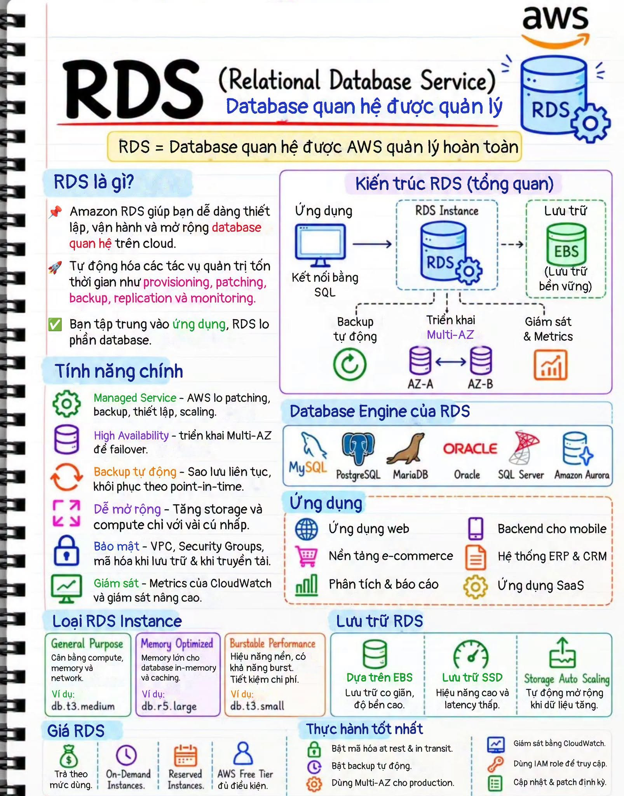

- **RDS là gì?** Database quan hệ được AWS quản lý hoàn toàn (tự động provisioning, patching, backup, replication, monitoring), lưu trữ dựa trên EBS SSD với Storage Auto Scaling.
- **6 Database Engines:** MySQL • PostgreSQL • MariaDB • Oracle • SQL Server • **Amazon Aurora**.
- **Tính năng & Loại Instance:** Multi-AZ failover (AZ-A ↔ AZ-B) • Point-in-Time Recovery (`PITR`) • Bảo mật VPC/Security Groups + mã hóa at-rest/in-transit • CloudWatch & Enhanced Monitoring. Instance families: *General Purpose* (`db.t3.medium`), *Memory Optimized* (`db.r5.large`), *Burstable Performance* (`db.t3.small`).
- **Chi phí & Best Practices:** Pay-as-you-go, On-Demand, Reserved Instances, Free Tier. Luôn mã hóa at-rest/in-transit, bật backup tự động, chạy **Multi-AZ cho production**, dùng IAM role truy cập, patch định kỳ.

### Trang 9 — DynamoDB (NoSQL Database)
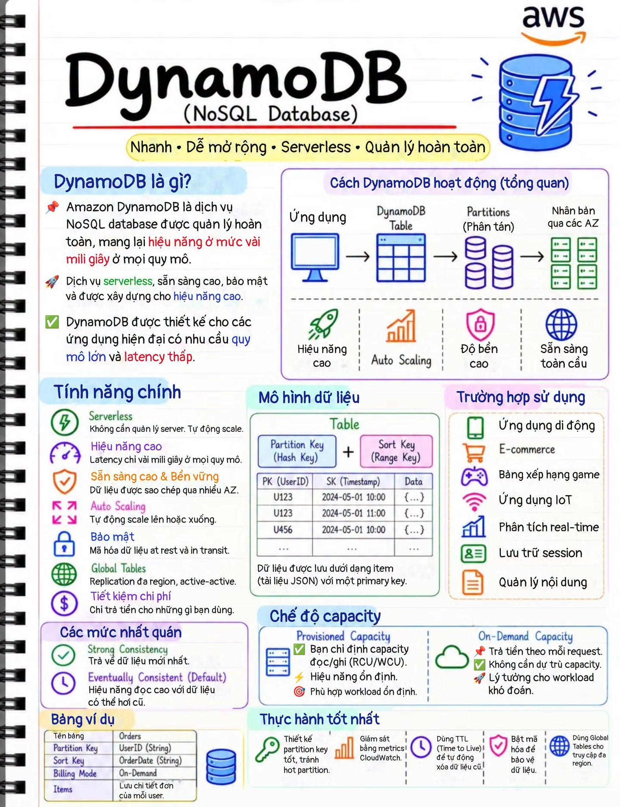

- **DynamoDB là gì?** Dịch vụ NoSQL database **serverless, quản lý hoàn toàn**, hiệu năng ở mức **vài mili giây ở mọi quy mô**, tự động phân vùng (`Partitions`) và nhân bản đa AZ.
- **Mô hình dữ liệu:** Item (dạng JSON) trong Table xác định bằng Primary Key gồm **Partition Key (Hash Key)** + tùy chọn **Sort Key (Range Key)** (ví dụ bảng `Orders`: `PK = UserID (String)`, `SK = OrderDate (String)`).
- **2 mức nhất quán:** `Strong Consistency` (trả về dữ liệu mới nhất) vs `Eventually Consistent (Default)` (hiệu năng đọc cao với dữ liệu có thể trễ nhẹ).
- **2 chế độ Capacity:** `Provisioned Capacity (RCU/WCU)` cho workload ổn định vs `On-Demand Capacity` (trả theo từng request, phù hợp traffic khó đoán).
- **Tính năng & Best Practices:** Thiết kế partition key tốt để **tránh hot partition**; bật **TTL (Time to Live)** tự xóa dữ liệu cũ; dùng **Global Tables** cho replication multi-region active-active; mã hóa dữ liệu; giám sát CloudWatch.

### Trang 10 — SQS (Simple Queue Service)
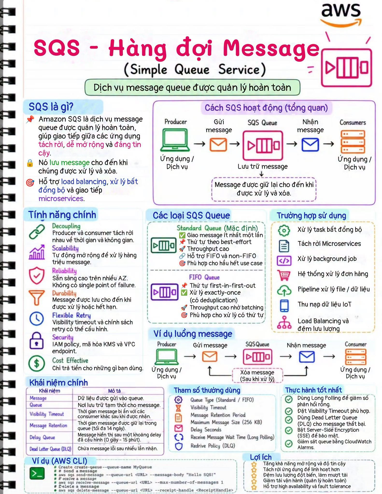

- **SQS là gì?** Hàng đợi message (*message queue*) quản lý hoàn toàn giúp tách rời (*decoupling*) Producer và Consumer cả về thời gian lẫn không gian, đệm lưu lượng và hỗ trợ microservice bất đồng bộ.
- **2 loại Queue:**
  - **Standard Queue (Mặc định):** Giao message ít nhất một lần (*at-least-once*), thứ tự *best-effort*, throughput rất cao. *(Chú thích bản in: slide ghi thêm dòng "Hỗ trợ FIFO và non-FIFO" chung cho dịch vụ SQS; riêng Standard là non-FIFO, muốn thứ tự nghiêm ngặt chọn FIFO Queue).*
  - **FIFO Queue:** Thứ tự nghiêm ngặt *First-In-First-Out*, xử lý *exactly-once* (có deduplication), throughput cao khi dùng batching.
- **6 khái niệm & tham số quan trọng:** `Message` (tối đa **256 KB**), `Queue`, **Visibility Timeout** (thời gian message tạm ẩn với consumer khác sau khi nhận), **Message Retention Period** (`60s` – **tối đa 14 ngày**; *trên ảnh in `0 giây - 15 phút` là dải của Delay Seconds / Long Polling `0–20s`, retention chuẩn của SQS là 1 phút–14 ngày*), **Delay Queue**, **Dead Letter Queue (`DLQ`)** + **Redrive Policy**.
- **AWS CLI Mẫu:** `aws sqs create-queue`, `send-message`, `receive-message --max-number-of-messages 1`, `delete-message --receipt-handle`.
- **Best Practices:** Dùng **Long Polling** giảm phản hồi rỗng; đặt Visibility Timeout phù hợp; cấu hình DLQ; bật SSE (Server-Side Encryption); giám sát CloudWatch Alarms.

### Trang 11 — ECS (Amazon Elastic Container Service)
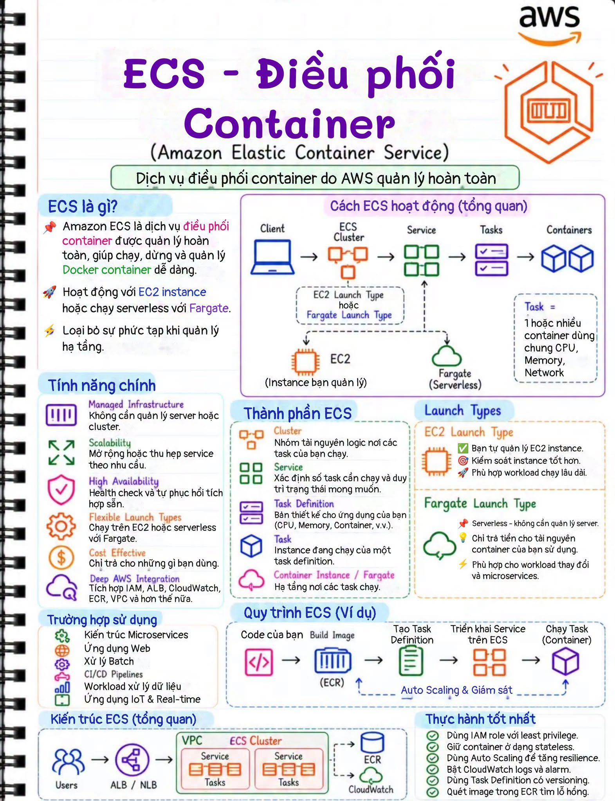

- **ECS là gì?** Dịch vụ điều phối Docker container được AWS quản lý hoàn toàn, tích hợp sâu IAM, ALB/NLB, CloudWatch, ECR, VPC.
- **5 thành phần:** `Cluster` (nhóm tài nguyên logic) → `Service` (duy trì số lượng task mong muốn) → `Task Definition` (bản thiết kế CPU, Memory, Container) → `Task` (instance đang chạy của 1+ container chia sẻ CPU/RAM/Network) → `Container Instance / Fargate`.
- **2 Launch Types:** **EC2 Launch Type** (tự quản lý EC2, kiểm soát sâu, hợp workload dài hạn) vs **Fargate Launch Type** (Serverless, trả tiền theo tài nguyên container dùng thực tế, hợp microservice biến động).
- **Quy trình CI/CD:** Code → Build Image → Push **ECR** → Tạo **Task Definition** → Triển khai Service trên ECS → Auto Scaling & CloudWatch.
- **Best Practices:** IAM role least privilege cho Task; giữ container stateless; bật Auto Scaling; CloudWatch logs/alarms; versioning Task Definition; **quét lỗ hổng image trong ECR**.

### Trang 12 — EKS (Amazon Elastic Kubernetes Service)
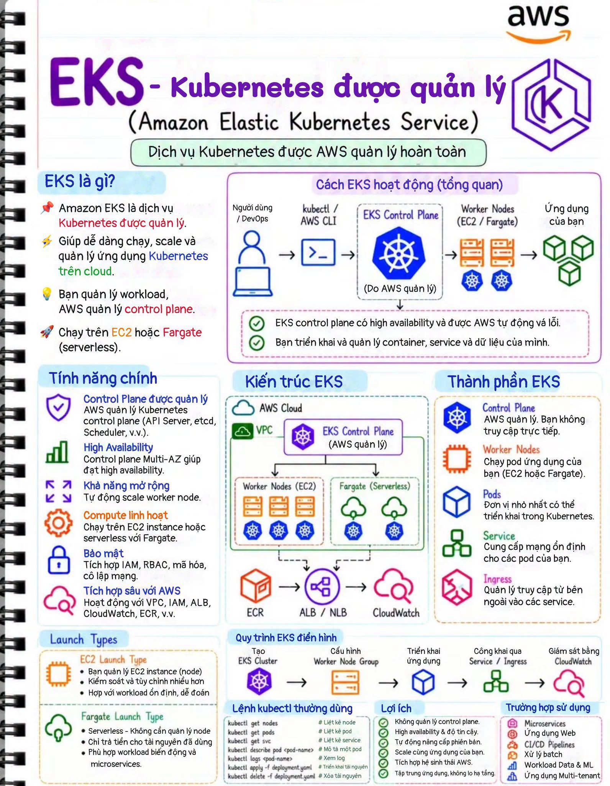

- **EKS là gì?** Dịch vụ Kubernetes được AWS quản lý toàn bộ **Control Plane** (API Server, `etcd`, Scheduler) theo mô hình Multi-AZ HA và tự vá lỗi; người dùng quản lý **Worker Nodes** (`EC2` hoặc `Fargate serverless`) và workload (`Pods`, `Service`, `Ingress`).
- **Quy trình chuẩn:** Tạo EKS Cluster → Cấu hình Worker Node Group → Triển khai ứng dụng → Công khai qua `Service / Ingress` (`ALB/NLB`) → Giám sát qua CloudWatch (image từ ECR).
- **Lệnh `kubectl` thiết yếu:** `kubectl get nodes`, `get pods`, `get svc`, `describe pod <pod-name>`, `logs <pod-name>`, `apply -f deployment.yaml`, `delete -f deployment.yaml`.

### Trang 13 — ECR (Amazon Elastic Container Registry)
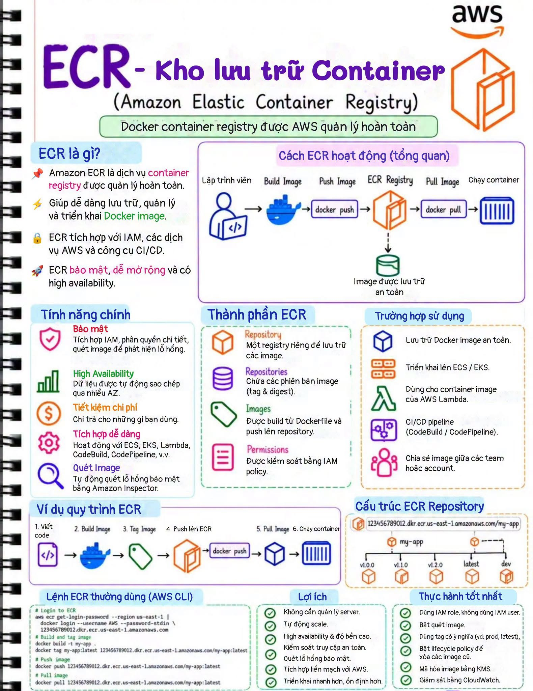

- **ECR là gì?** Docker container registry quản lý hoàn toàn, sao chép đa AZ, tích hợp chặt với IAM, ECS, EKS, Lambda, CodeBuild/CodePipeline và **quét lỗ hổng tự động qua Amazon Inspector**.
- **Cấu trúc URI & Versioning:** `<account>.dkr.ecr.us-east-1.amazonaws.com/my-app` gắn tag (`v1.0.0`, `v1.1.0`, `latest`, `dev`) và digest.
- **AWS CLI Mẫu:** `aws ecr get-login-password --region us-east-1 | docker login ...`, `docker build`, `docker tag`, `docker push`, `docker pull`.
- **Best Practices:** Dùng IAM role thay user tĩnh; bật scan image; tag có nghĩa; bật **Lifecycle Policy** dọn image cũ; mã hóa bằng KMS; giám sát CloudWatch.

### Trang 14 — CloudWatch (Giám sát & Logs)
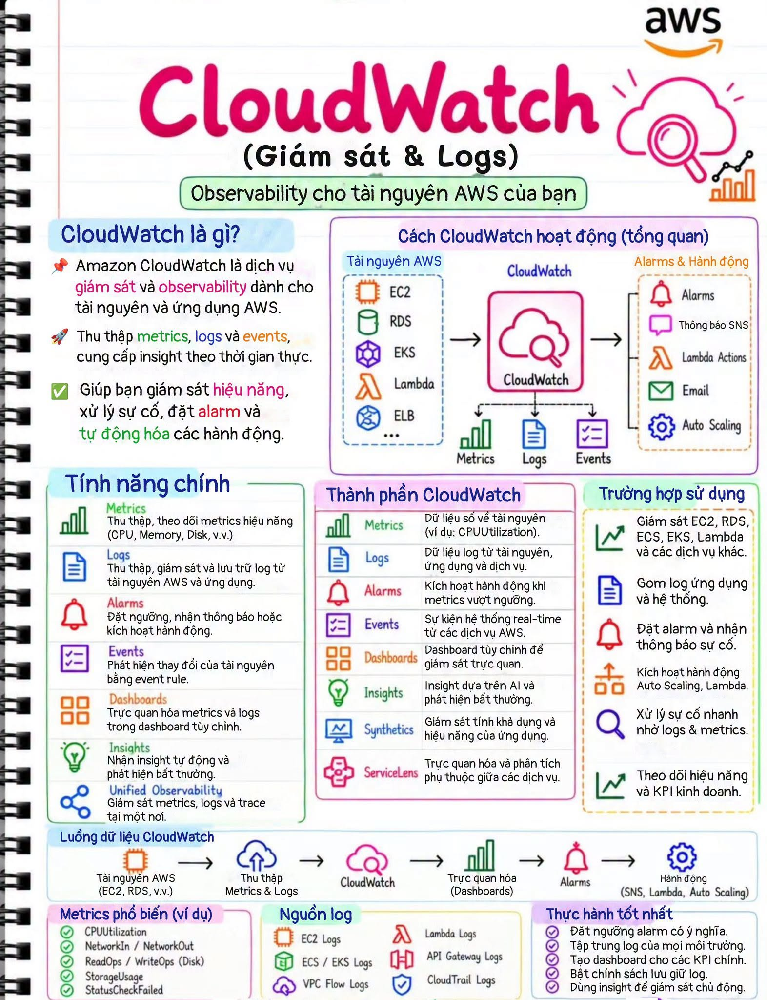

- **CloudWatch là gì?** Nền tảng **giám sát và observability thống nhất** thu thập **Metrics**, **Logs** và **Events** theo thời gian thực từ tài nguyên AWS (`EC2`, `RDS`, `EKS`, `Lambda`, `ELB`, `VPC Flow Logs`, `API Gateway Logs`, `CloudTrail Logs`) để hiển thị Dashboard, cảnh báo và tự động hóa (`SNS`, `Lambda Actions`, `Email`, `Auto Scaling`).
- **7 thành phần chính:** `Metrics` (`CPUUtilization`, `NetworkIn/Out`, `ReadOps/WriteOps`, `StorageUsage`, `StatusCheckFailed`), `Logs`, `Alarms`, `Events`, `Dashboards`, `Insights` (AI phát hiện bất thường), `Synthetics`, `ServiceLens` (phân tích phụ thuộc dịch vụ).
- **Best Practices:** Đặt ngưỡng alarm có ý nghĩa; gom log tập trung mọi môi trường; tạo dashboard cho KPI trọng yếu; đặt chính sách retention cho log; dùng Insights giám sát chủ động.

### Trang 15 — CloudTrail (Kiểm toán AWS API)
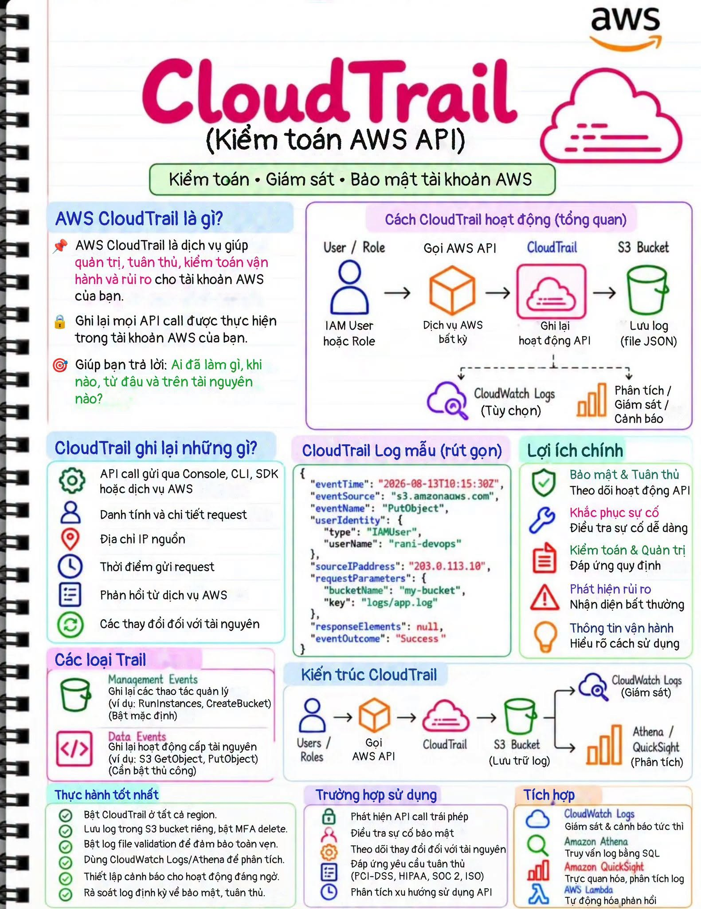

- **AWS CloudTrail là gì?** Dịch vụ quản trị, tuân thủ và **kiểm toán rủi ro** ghi lại mọi lời gọi API qua Console, CLI, SDK hoặc dịch vụ AWS dưới dạng **JSON log** (*Ai đã làm gì, khi nào, từ IP nguồn nào, trên tài nguyên nào*).
- **2 loại Event:**
  - **Management Events:** Thao tác quản lý tài nguyên như `RunInstances`, `CreateBucket` (**bật mặc định**).
  - **Data Events:** Thao tác cấp tài nguyên/dữ liệu như `S3 GetObject`, `PutObject` (**phải bật thủ công**).
- **Log JSON mẫu & Tích hợp:** Ghi nhận `eventTime`, `eventSource`, `eventName`, `userIdentity`, `sourceIPAddress`, `requestParameters`, `eventOutcome`. Lưu bền vững vào **S3 Bucket** rồi kết nối **CloudWatch Logs** (cảnh báo tức thì), **Amazon Athena** (truy vấn SQL), **Amazon QuickSight** (trực quan hóa) và **AWS Lambda** (phản hồi tự động). *(Chú thích bản in: log mẫu JSON gõ nhầm `"s3.amzonaaws.com"` — chuẩn là `"s3.amazonaws.com"`).*
- **Best Practices:** Bật CloudTrail ở **tất cả regions**; lưu trong S3 bucket riêng có **MFA Delete**; bật **Log File Validation** đảm bảo tính toàn vẹn log; gửi sang CloudWatch/Athena cảnh báo hành vi bất thường; rà soát tuân thủ (`PCI-DSS`, `HIPAA`, `SOC 2`, `ISO`).

### Trang 16 — Secrets Manager (Secret & Thông tin xác thực)
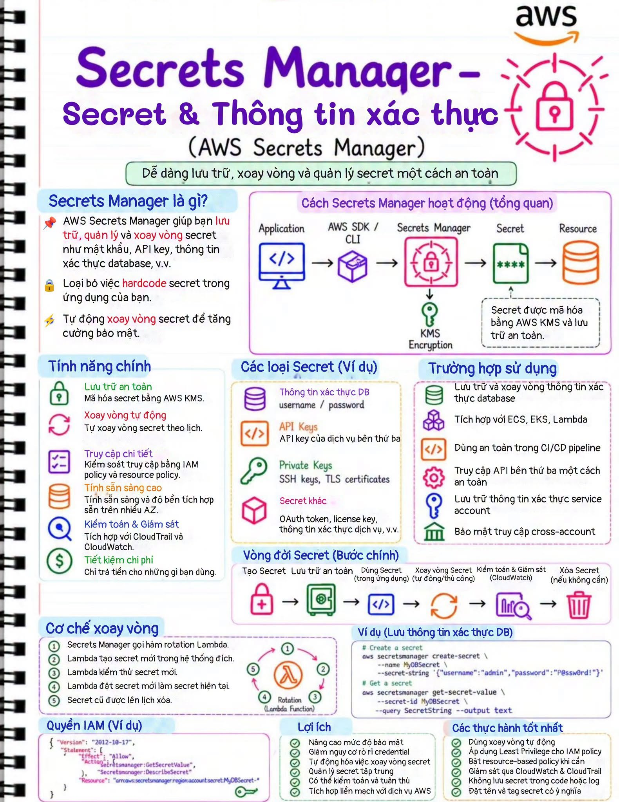

- **Secrets Manager là gì?** Dịch vụ lưu trữ, quản lý và **tự động xoay vòng secret** (thông tin DB, API keys bên thứ 3, SSH/TLS private keys, OAuth tokens) nhằm loại bỏ hoàn toàn **hardcode secret** trong mã nguồn hay log; mọi secret đều mã hóa bằng **AWS KMS**.
- **Cơ chế xoay vòng 5 bước (qua Lambda Function):** (1) Secrets Manager gọi rotation Lambda → (2) Lambda tạo secret mới trên hệ thống đích → (3) Kiểm thử secret mới → (4) Đặt secret mới thành phiên bản hiện tại → (5) Lên lịch xóa secret cũ.
- **AWS CLI & IAM Policy mẫu:**
  - `aws secretsmanager create-secret --name MyDBSecret --secret-string '...'`
  - `aws secretsmanager get-secret-value --secret-id MyDBSecret --query SecretString --output text`
  - IAM Policy cấp quyền tối thiểu `secretsmanager:GetSecretValue` và `secretsmanager:DescribeSecret` trên ARN cụ thể.
- **Best Practices:** Bật auto-rotation; IAM Least Privilege; Resource-based policy khi cần cross-account; giám sát CloudWatch & CloudTrail; **không bao giờ in secret ra code hoặc log**; đặt tên và tag có nghĩa.

### Trang 17 — KMS (AWS Key Management Service)
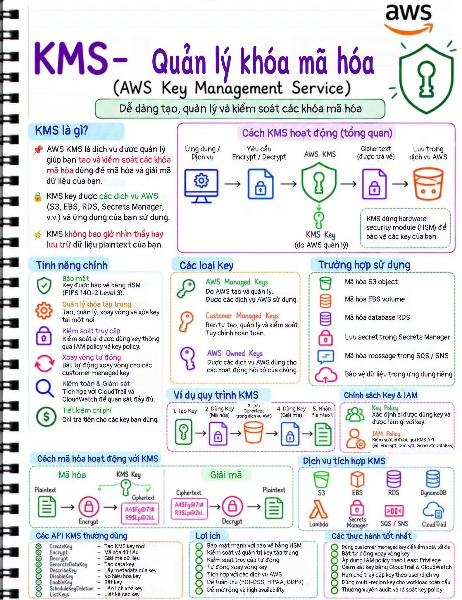

- **AWS KMS là gì?** Dịch vụ quản lý và kiểm soát **khóa mã hóa** bảo vệ bằng **Hardware Security Module (HSM, FIPS 140-2 Level 3)**. KMS **không bao giờ nhìn thấy hay lưu trữ dữ liệu plaintext** của bạn.
- **3 loại Key:** `AWS Managed Keys` (AWS tạo/quản lý cho dịch vụ), `Customer Managed Keys (CMK)` (bạn tạo/tùy chỉnh/kiểm soát toàn phần) và `AWS Owned Keys` (dùng nội bộ bởi dịch vụ AWS).
- **Cơ chế kiểm soát kép:** **Key Policy** (trên khóa — ai được dùng key và làm gì) + **IAM Policy** (trên identity — ai được gọi API KMS như `Encrypt`, `Decrypt`, `GenerateDataKey`, `CreateKey`, `DescribeKey`, `DisableKey`, `EnableKey`, `ScheduleKeyDeletion`, `ListKeys`).
- **Tích hợp rộng khắp:** S3, EBS, RDS, DynamoDB, Lambda, Secrets Manager, SQS/SNS, CloudTrail.
- **Best Practices:** Ưu tiên **Customer Managed Keys** để kiểm soát tối đa; bật **tự động xoay vòng key**; áp dụng Least Privilege cho IAM + Key Policy; dùng multi-region key cho workload toàn cầu; audit thường xuyên qua CloudTrail & CloudWatch.
