# Bộ tổng hợp Computer Vision bằng tiếng Việt: 12 bài từ cơ bản đến thực tế

- **Nguồn bài viết:** [Facebook — Việt Nguyễn AI](https://web.facebook.com/vietnh1009/posts/pfbid02d94uzLq2g1awNnJapARHctQDYfwdwJSU3BgyZbH93rPwUj8Z8yfFFu8dmRoHbBSgl)
- **Thời gian đăng:** 12 November 2026 at 16:00
- **Nguồn gốc tiếng Anh được tác giả trích dẫn:** https://www.instagram.com/p/DdCsRfok1At/?img_index=1
- **Thư mục hình ảnh gốc (12 trang):** `raw/screenshots/computer-vision-handbook/` (`00.jpg` – `11.jpg`)

---

## Nội Dung Nguyên Văn Bài Đăng Facebook

> Bộ tổng hợp Computer Vision bằng tiếng Việt: 12 bài từ cơ bản đến thực tế 🔥
> Mình xin chia sẻ bộ cheatsheet Computer Vision gồm 12 trang, trình bày trực quan theo phong cách ghi chú tay, đi từ nền tảng đến ứng dụng thực tế:
> 🔥 Cách máy tính nhìn thấy: pixel, RGB, tensor
> ⚡️ CNN, Feature Maps, Stride, Padding và quá trình huấn luyện
> 📌 Phân loại ảnh, Object Detection, YOLO, Image Segmentation
> 🚀 Vision Transformers, CLIP, Multimodal AI
> ✅ Quy trình xây dựng một hệ thống Vision AI thực tế
> Tài liệu phù hợp cho bạn nào mới bắt đầu hoặc muốn hệ thống lại kiến thức Computer Vision.
> Note: Mình sử dụng AI để convert và dịch sang tiếng Việt, nên sẽ có những chỗ làm chưa thực sự tốt về nội dung hay hình ảnh so với bản gốc. Nếu bạn đọc được tiếng Anh thì có thể xem bản gốc tại: https://www.instagram.com/p/DdCsRfok1At/?img_index=1

---

## Chi Tiết 12 Trang Cheatsheet (Visual Transcription)

### Bài 1 — Cách máy tính nhìn thấy (Pixels → RGB → Hình ảnh → Tensors)
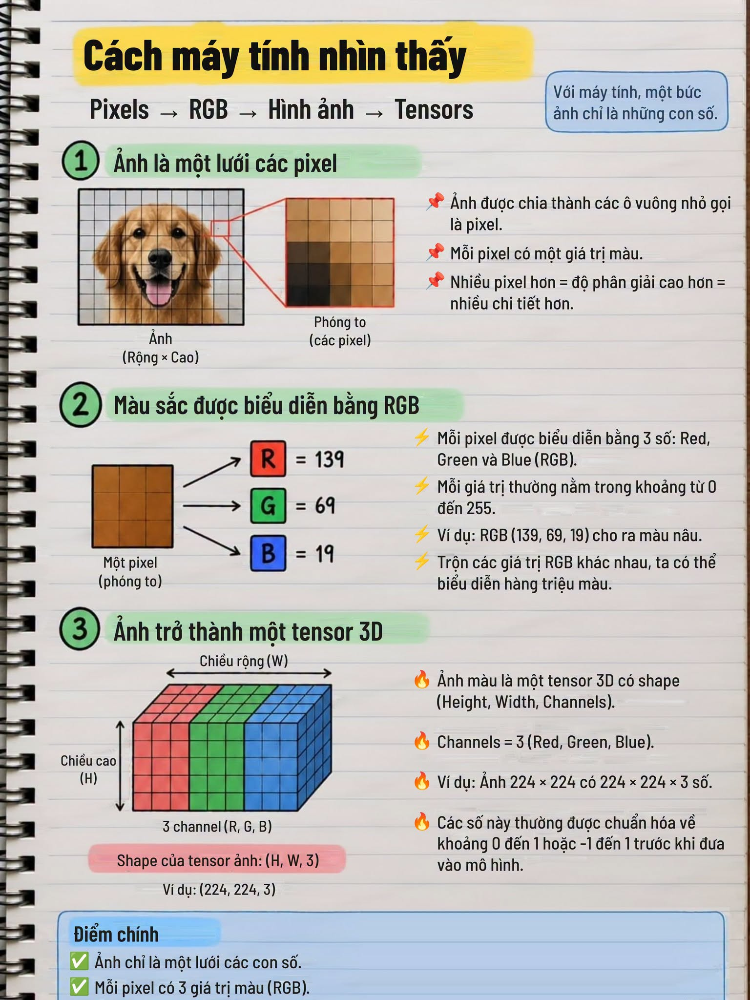

- **1. Ảnh là lưới các pixel:** Chia thành các ô vuông mang giá trị màu; nhiều pixel hơn = độ phân giải cao hơn = nhiều chi tiết hơn.
- **2. Màu sắc RGB:** Mỗi pixel biểu diễn bằng 3 kênh **Red, Green, Blue** giá trị `0..255` (vd: `RGB(139, 69, 19)` tạo màu nâu).
- **3. Tensor 3D:** Ảnh màu có shape `(Height, Width, Channels)`, với `Channels = 3` (ví dụ `224 × 224 × 3`). Giá trị thường chuẩn hóa (*normalized*) về `[0, 1]` hoặc `[-1, 1]` trước khi đưa vào mô hình.

### Bài 2 — Từ Pixel đến Pattern (Edges → Textures → Shapes → Features)
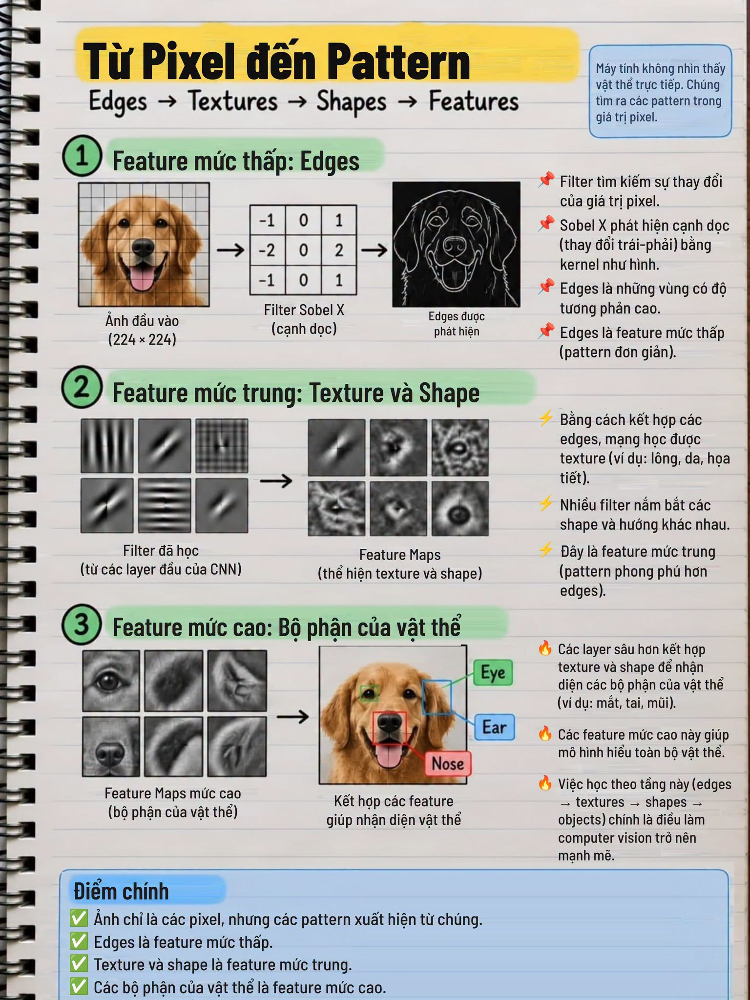

- **1. Feature mức thấp (Edges):** Filter phát hiện độ tương phản cao giữa pixel lân cận; ví dụ kernel **Sobel X** `[[-1,0,1],[-2,0,2],[-1,0,1]]` phát hiện cạnh dọc.
- **2. Feature mức trung (Texture & Shape):** Các layer đầu CNN kết hợp cạnh thành texture (lông, da, họa tiết) và shape qua nhiều filter định hướng.
- **3. Feature mức cao (Bộ phận vật thể):** Các layer sâu ghép texture/shape thành bộ phận ngữ nghĩa (**Eye**, **Ear**, **Nose**) giúp hiểu toàn bộ vật thể.

### Bài 3 — Cách CNN thực sự hoạt động (Convolution, Feature Maps, Stride, Padding)
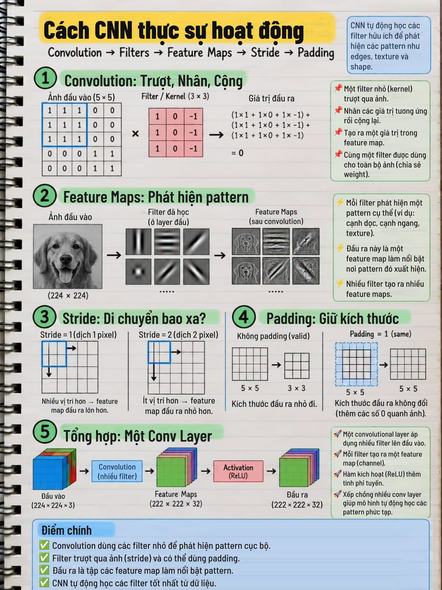

- **1. Convolution:** Trượt kernel nhỏ (vd `3×3`) qua ảnh (`5×5`), nhân từng phần tử rồi cộng lại để tạo giá trị feature map (dùng chung weight trên toàn ảnh).
- **2. Feature Maps:** Mỗi filter phát hiện một pattern cụ thể; nhiều filter sinh ra nhiều feature map xếp chồng.
- **3. Stride:** `Stride = 1` dịch từng 1 pixel (feature map đầu ra lớn); `Stride = 2` dịch 2 pixel (feature map nhỏ hơn).
- **4. Padding:** Không padding (`valid`: `5×5 -> 3×3` làm nhỏ đầu ra) vs `Padding = 1` (`same`: thêm viền số `0` quanh ảnh giữ nguyên kích thước `5×5 -> 5×5`).
- **5. Một Conv Layer:** Input `(224×224×3)` → Convolution (32 filter) → Feature Maps `(222×222×32)` → Activation **ReLU** (thêm tính phi tuyến).

### Bài 4 — Cách AI học những gì nó nhìn thấy (Forward Pass → Loss → Backprop → Optimizer)
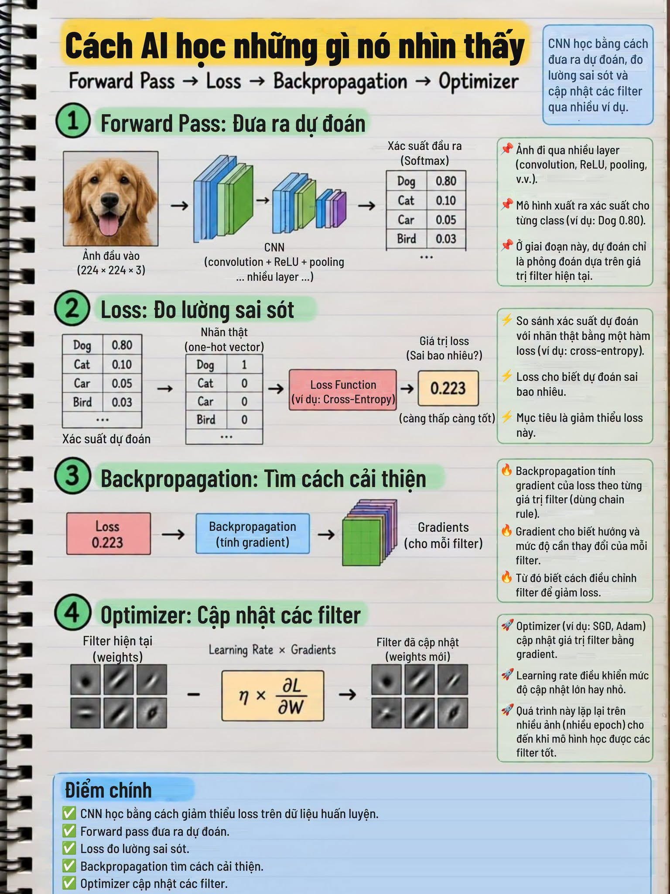

- **1. Forward Pass:** Ảnh `(224×224×3)` đi qua CNN (`conv + ReLU + pooling`) xuất xác suất **Softmax** (`Dog 0.80, Cat 0.10, Car 0.05, Bird 0.03`).
- **2. Loss:** So sánh xác suất dự đoán với nhãn thật dạng **one-hot vector** (`[1, 0, 0, 0]`) qua **Cross-Entropy Loss** (ví dụ `0.223`, càng thấp càng tốt).
- **3. Backpropagation:** Dùng *chain rule* tính **Gradient** của loss theo từng weight trong mỗi filter.
- **4. Optimizer (`SGD`, `Adam`):** Cập nhật weight theo công thức $W_{\text{new}} = W - \eta \times \frac{\partial L}{\partial W}$ với learning rate $\eta$, lặp lại qua nhiều epoch.

### Bài 5 — Phân loại ảnh (Image Classification)
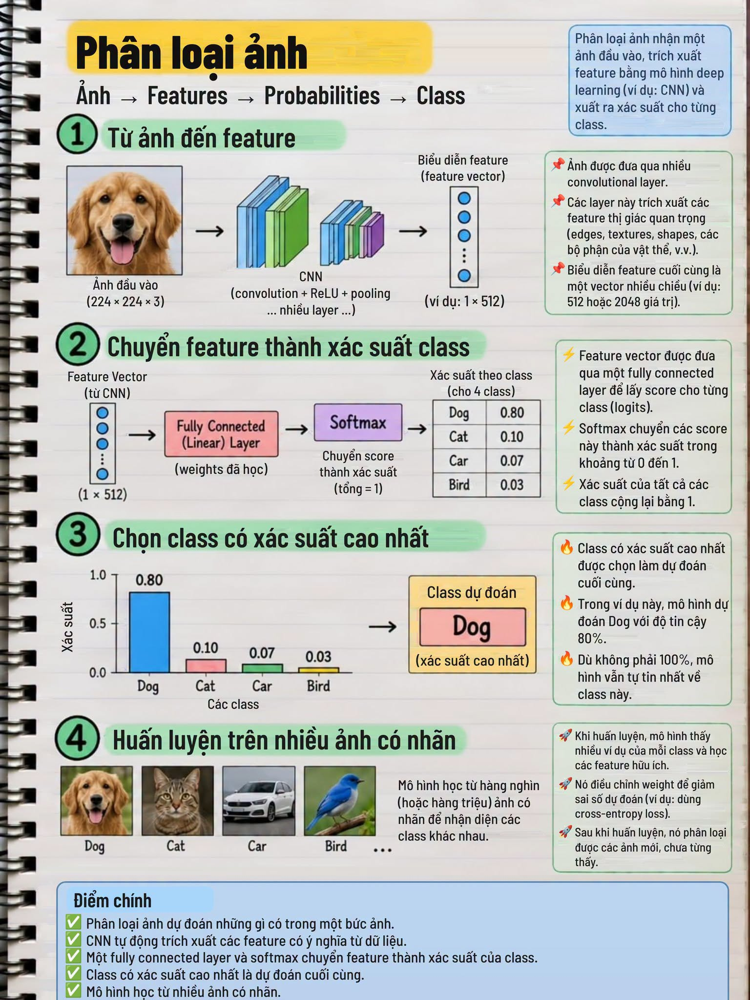

- **Luồng xử lý:** `Ảnh (224×224×3) → CNN Feature Extractor → Feature Vector (1×512 hoặc 1×2048) → Fully Connected (Linear) Layer → Logits → Softmax (tổng = 1) → Chọn class xác suất cao nhất (argmax)`.

### Bài 6 — Phát hiện đối tượng (Object Detection: Cái gì + Ở đâu)
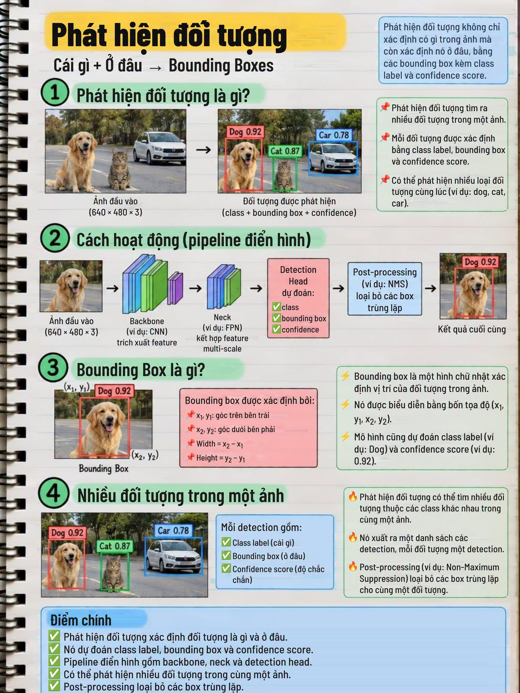

- **Pipeline điển hình:** `Input (640×480×3) → Backbone (CNN trích feature) → Neck (vd FPN kết hợp multi-scale feature) → Detection Head (Class + Bounding Box + Confidence) → Post-processing (NMS loại box trùng lặp)`.
- **Bounding Box:** Xác định bằng 4 tọa độ `(x1, y1)` góc trên-trái và `(x2, y2)` góc dưới-phải (`Width = x2 - x1`, `Height = y2 - y1`). Mỗi ảnh có thể chứa nhiều đối tượng thuộc nhiều class (`Dog 0.92`, `Cat 0.87`, `Car 0.78`).

### Bài 7 — Bên trong YOLO (You Only Look Once)
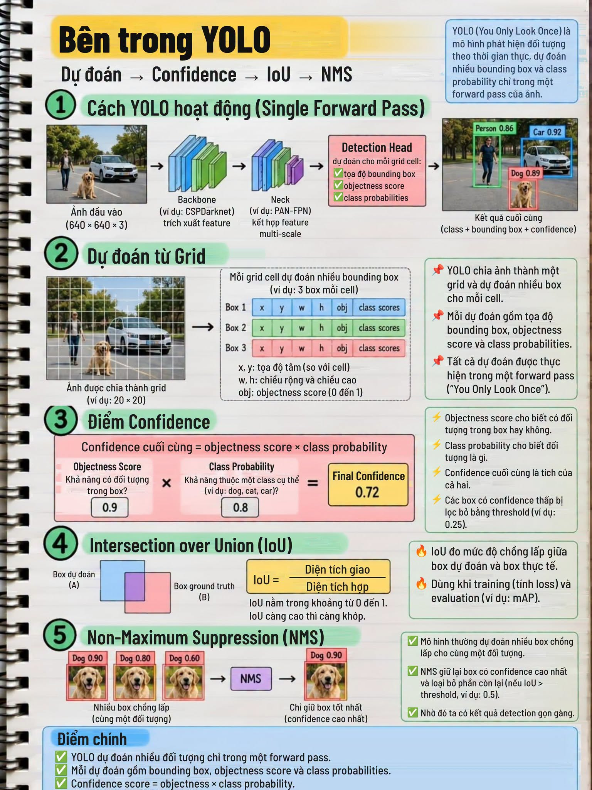

- **1. Single Forward Pass:** Input `(640×640×3)` → **Backbone** (`CSPDarknet`) → **Neck** (`PAN-FPN`) → **Detection Head** dự đoán đồng thời mọi đối tượng chỉ trong 1 lượt forward.
- **2. Dự đoán từ Grid (`20×20`):** Mỗi grid cell dự đoán nhiều box (vd 3 box/cell), mỗi box gồm `[x, y, w, h, obj, class scores]`.
- **3. Final Confidence:** $\text{Final Confidence} = \text{Objectness Score} \times \text{Class Probability}$ (vd `0.9 × 0.8 = 0.72`; lọc bỏ box dưới threshold, vd `0.25`).
- **4. IoU (Intersection over Union):** $\text{IoU} = \frac{\text{Diện tích giao}}{\text{Diện tích hợp}} \in [0, 1]$, dùng tính loss khi train và đánh giá `mAP`.
- **5. NMS (Non-Maximum Suppression):** Giữ box có confidence cao nhất (`Dog 0.90`) và loại các box chồng lấp (`IoU > 0.5` như `Dog 0.80`, `Dog 0.60`).

### Bài 8 — Phân đoạn ảnh (Image Segmentation: Semantic → Instance → Panoptic)
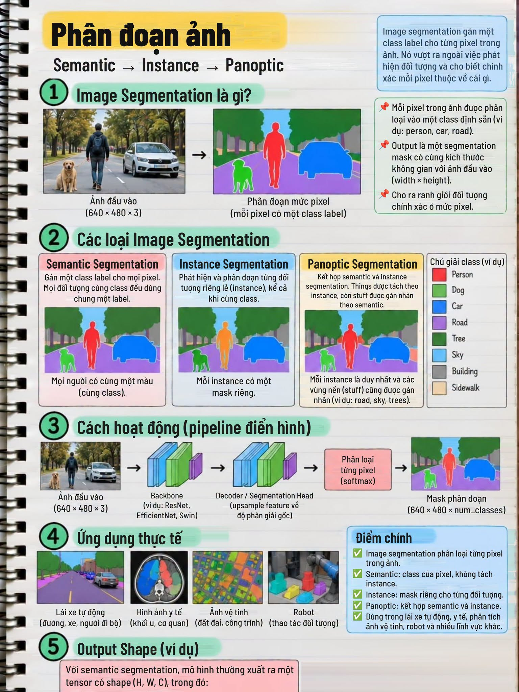

- **Phân loại từng pixel:** Xuất mask phân đoạn có cùng kích thước không gian `(H, W)` với ảnh gốc.
- **3 loại Segmentation:**
  - **Semantic Segmentation:** Mọi đối tượng cùng class dùng chung 1 nhãn/màu (không phân biệt từng cá thể).
  - **Instance Segmentation:** Phân tách từng cá thể đối tượng riêng lẻ (*things*) bằng mask riêng ngay cả khi cùng class.
  - **Panoptic Segmentation:** Kết hợp cả hai — gán mask riêng cho *things* (Person, Dog, Car) và nhãn semantic cho vùng nền *stuff* (Road, Tree, Sky, Building, Sidewalk).
- **Pipeline & Output:** `Input (640×480×3) → Backbone (ResNet, EfficientNet, Swin) → Decoder / Upsampling Segmentation Head → Pixel-wise Softmax → Mask (640×480×num_classes)`.

### Bài 9 — Vision Transformers (ViT: Patches → Embeddings → Attention)
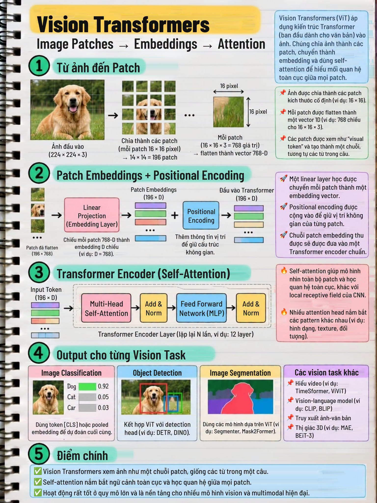

- **1. Patchification:** Chia ảnh `(224×224×3)` thành lưới `14×14 = 196` patch `16×16` pixel; flatten mỗi patch thành vector `768-D` (`16×16×3 = 768`) đóng vai trò *visual token*.
- **2. Patch Embeddings + Positional Encoding:** Chiếu tuyến tính `196×768 → 196×D` (`D = 768`), cộng thêm **Positional Encoding** để giữ vị trí không gian.
- **3. Transformer Encoder:** Lặp `N` layer (`vd 12 layer`), mỗi layer gồm `Multi-Head Self-Attention → Add & Norm → Feed Forward Network (MLP) → Add & Norm`, cho phép mô hình nắm bắt **ngữ cảnh toàn cục** ngay từ các layer đầu (khác với *local receptive field* của CNN).
- **4. Downstream Tasks:** `[CLS]` token cho Classification; kết hợp head **DETR / DINO** cho Object Detection; **Segmenter / Mask2Former** cho Segmentation; **TimeSformer / ViViT** cho Video; **CLIP / BLIP** cho VLM; **MAE / BEiT-3** cho tự giám sát / thị giác 3D.

### Bài 10 — Thị giác + Ngôn ngữ (CLIP → Vision-Language Models)
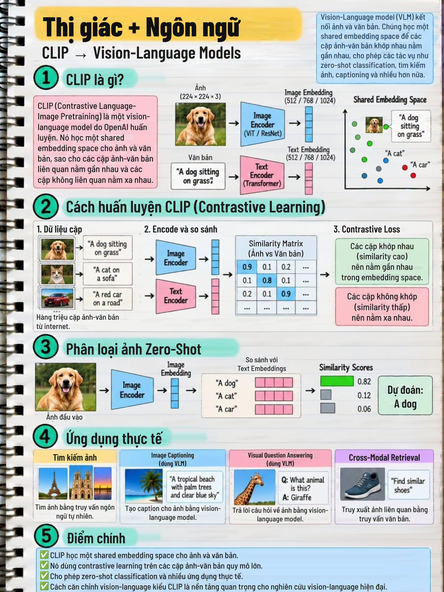

- **1. CLIP (Contrastive Language-Image Pretraining):** Do OpenAI huấn luyện với **Image Encoder** (`ViT / ResNet`) và **Text Encoder** (`Transformer`) ánh xạ vào chung **Shared Embedding Space** (`512 / 768 / 1024` chiều).
- **2. Contrastive Learning:** Học từ hàng triệu cặp *(ảnh, mô tả)*; tối ưu ma trận similarity sao cho đường chéo (cặp khớp nhau) có similarity cao (`0.9`, `0.8`) nằm gần nhau, còn cặp lệch nằm xa nhau (*Contrastive Loss*).
- **3. Zero-Shot Classification:** Đưa ảnh qua Image Encoder, so cosine similarity với embedding của các prompt class (`"A dog"`, `"A cat"`, `"A car"`) → chọn điểm cao nhất (`0.82 -> A dog`) mà không cần fine-tune lại!
- **4. Ứng dụng:** Semantic Image Search, Image Captioning, Visual Question Answering (VQA), Cross-Modal Retrieval.

### Bài 11 — Multimodal AI (Ảnh + Văn bản + Âm thanh + Video → Hiểu & Suy luận)
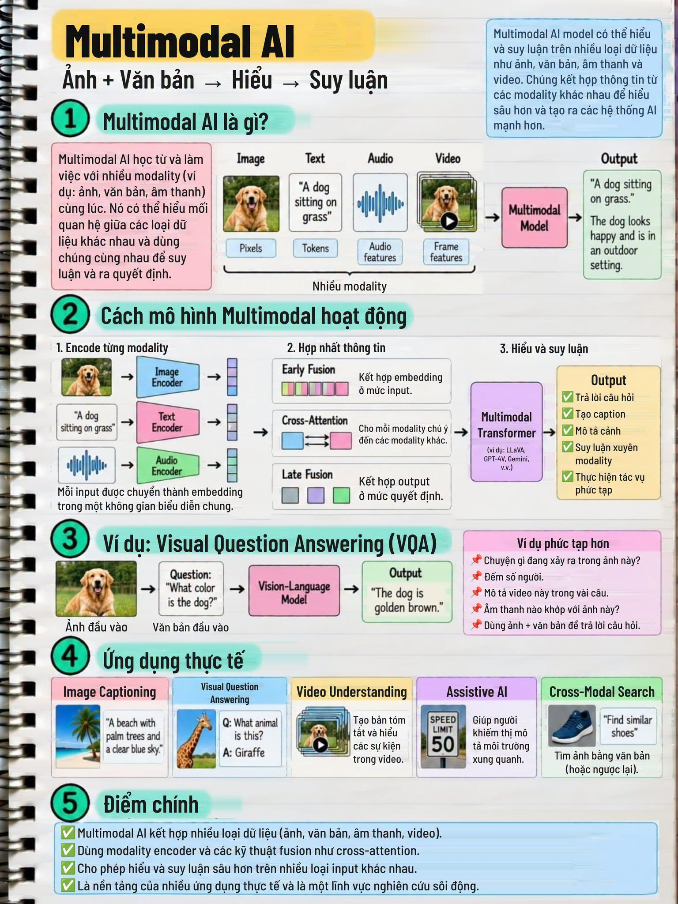

- **1. Hợp nhất nhiều Modality:** Kết hợp Pixels (Image), Tokens (Text), Audio features và Frame features (Video).
- **2. Ba cơ chế Fusion chính:**
  - **Early Fusion:** Ghép embedding từ sớm ngay ở đầu vào.
  - **Cross-Attention:** Cho phép mỗi modality chú ý chéo (*attend*) sang các modality khác.
  - **Late Fusion:** Kết hợp output ở mức quyết định cuối cùng.
- **3. Mô hình & Ứng dụng:** Multimodal Transformer (`LLaVA`, `GPT-4V`, `Gemini`) thực hiện **VQA**, tóm tắt/hiểu video, **Assistive AI** cho người khiếm thị và tìm kiếm chéo modality.

### Bài 12 — Xây dựng Vision AI thực tế (Từ ý tưởng đến tác động)
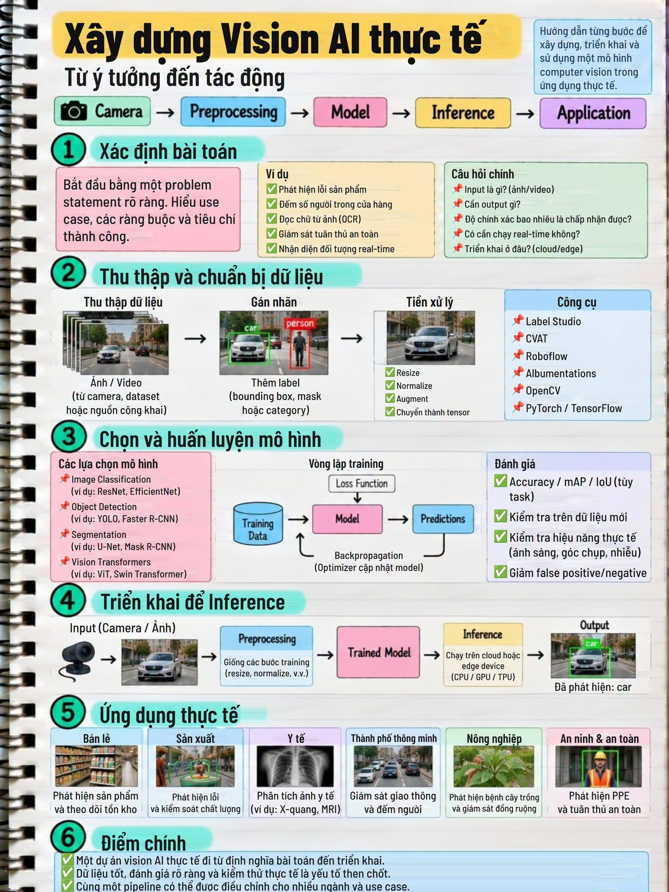

- **Pipeline 5 bước:** `Camera → Preprocessing → Model → Inference → Application`.
- **1. Xác định bài toán:** Chốt input, output, ngưỡng chính xác chấp nhận được, yêu cầu real-time và nơi triển khai (cloud/edge).
- **2. Dữ liệu & Công cụ:** Gán nhãn (`Label Studio`, `CVAT`, `Roboflow`), tiền xử lý/augmentation (`Resize`, `Normalize`, `Augment`, chuyển tensor với `Albumentations`, `OpenCV`, `PyTorch/TensorFlow`).
- **3. Chọn mô hình & Đánh giá:** Classification (`ResNet`, `EfficientNet`), Detection (`YOLO`, `Faster R-CNN`), Segmentation (`U-Net`, `Mask R-CNN`), ViT (`ViT`, `Swin Transformer`). Đo bằng `Accuracy / mAP / IoU`; kiểm thử điều kiện thực tế (ánh sáng, góc chụp, nhiễu) để giảm FP/FN.
- **4. Triển khai & 6 Lĩnh vực thực tế:** Inference trên **Cloud hoặc Edge Device** (`CPU / GPU / TPU`) áp dụng đồng nhất bước preprocessing lúc train; triển khai trong *Bán lẻ (kiểm kê), Sản xuất (lỗi sản phẩm/QC), Y tế (X-quang/MRI), Đô thị thông minh (giao thông), Nông nghiệp (bệnh cây trồng), và An ninh – An toàn lao động (PPE)*.
