# Cẩm nang LLM bằng tiếng Việt - 50 khái niệm cần nắm vững

**Author**: Việt Nguyễn AI (`vietnh1009`) | **Published**: 2026-11-11 (`11 November at 16:00`)
**Facebook Post**: https://web.facebook.com/vietnh1009/posts/pfbid0g3aXPLj3DsP3HWD4qytFnqe9gnyb4Pu8hfyy1PoyuFJCKkzymTqV1qCJcWF2C44vl
**Original English Source (Instagram)**: https://www.instagram.com/p/DdjbVVblt_Y/?img_index=1
**Engagement**: 199 reactions (Like: 183, Love: 16) · 3 comments · 313 shares

---

## Original Post Text

> Cẩm nang LLM bằng tiếng Việt - 50 khái niệm cần nắm vững
> Mình xin chia sẻ bộ cẩm nang LLM (Large Language Model) gồm 20 trang, tổng hợp 50 khái niệm cốt lõi mà bất kỳ ai làm việc với AI cũng nên nắm vững. Nội dung chính bao gồm:
> 📌 Nền tảng: LLM là gì, kiến trúc Transformer, tokenization, embeddings, pre-training
> 📌 Huấn luyện và tinh chỉnh: fine-tuning, LoRA/QLoRA, RLHF, DPO, Prompt Engineering
> 📌 Ứng dụng: RAG, Vector DBs, LLM Agents, LangChain, LlamaIndex, LangGraph
> 📌 Vận hành: Quantization, KV Cache, vLLM, mở rộng quy mô và chi phí hạ tầng
> 📌 Đánh giá mô hình, bảo mật, xu hướng, câu hỏi phỏng vấn và lộ trình trở thành LLM Engineer
> Note: Mình sử dụng AI để convert và dịch sang tiếng Việt, nên sẽ có những chỗ làm chưa thực sự tốt về nội dung hay hình ảnh so với bản gốc. Nếu bạn đọc được tiếng Anh thì có thể xem bản gốc tại: https://www.instagram.com/p/DdjbVVblt_Y/?img_index=1

---

## Slide-by-Slide Verbatim Transcriptions (20 Pages)

### Page 01 (Trang 1/20) — 1. LLM là gì?
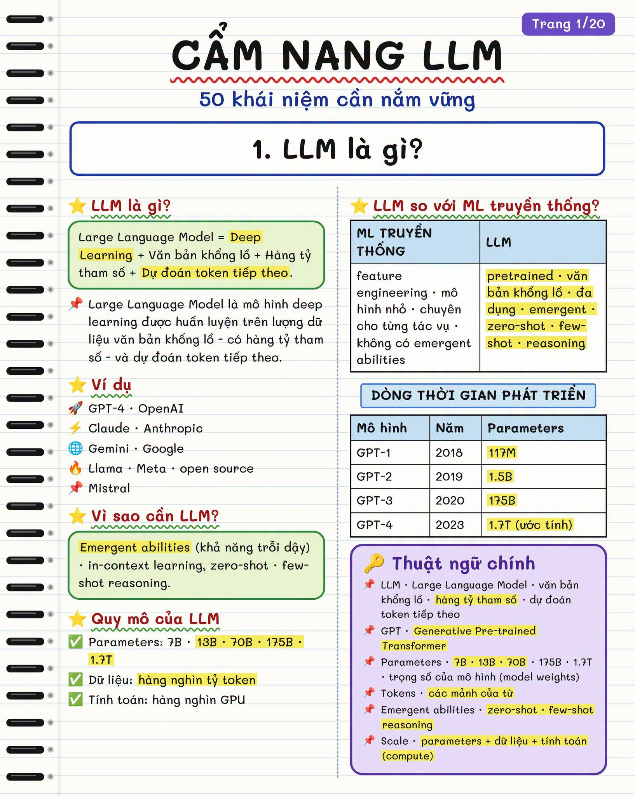

- **LLM là gì?**: Large Language Model = Deep Learning + Văn bản khổng lồ + Hàng tỷ tham số + Dự đoán token tiếp theo. (Mô hình deep learning được huấn luyện trên lượng dữ liệu văn bản khổng lồ, có hàng tỷ tham số, dự đoán token tiếp theo.)
- **Ví dụ**: GPT-4 (OpenAI), Claude (Anthropic), Gemini (Google), Llama (Meta - open source), Mistral.
- **Vì sao cần LLM?**: Emergent abilities (khả năng trỗi dậy): in-context learning, zero-shot, few-shot reasoning.
- **Quy mô của LLM**: Parameters `7B · 13B · 70B · 175B · 1.7T`; Dữ liệu: hàng nghìn tỷ token; Tính toán: hàng nghìn GPU.
- **LLM so với ML truyền thống**: ML truyền thống (feature engineering, mô hình nhỏ, chuyên từng tác vụ, không có emergent abilities) vs LLM (pretrained, văn bản khổng lồ, đa dụng, emergent, zero-shot, few-shot, reasoning).
- **Dòng thời gian phát triển**: `GPT-1 (2018): 117M` → `GPT-2 (2019): 1.5B` → `GPT-3 (2020): 175B` → `GPT-4 (2023): 1.7T (ước tính)`.
- **Thuật ngữ chính**: LLM, GPT (Generative Pre-trained Transformer), Parameters (trọng số mô hình / model weights), Tokens (các mảnh từ), Emergent abilities, Scale (`parameters + dữ liệu + compute`).

---

### Page 02 (Trang 2/20) — 2. Kiến trúc Transformer - Cốt lõi của LLM
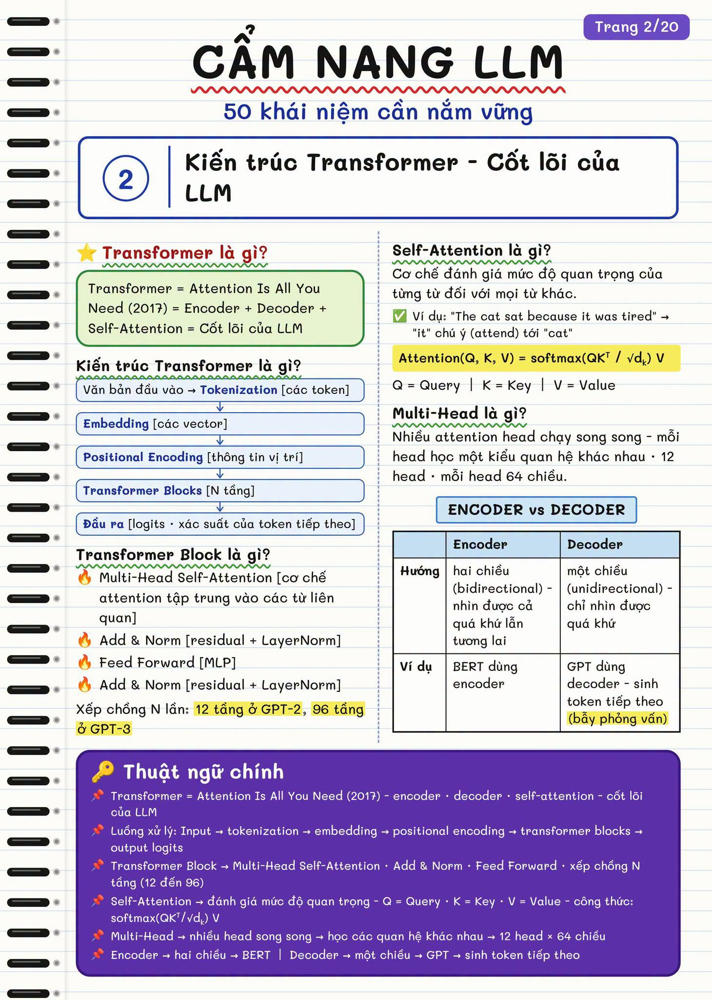

- **Transformer là gì?**: `Transformer = Attention Is All You Need (2017) = Encoder + Decoder + Self-Attention = Cốt lõi của LLM`.
- **Luồng kiến trúc Transformer**: `Văn bản đầu vào → Tokenization [các token] → Embedding [các vector] → Positional Encoding [thông tin vị trí] → Transformer Blocks [N tầng] → Đầu ra [logits · xác suất của token tiếp theo]`.
- **Transformer Block**: Multi-Head Self-Attention → Add & Norm (`residual + LayerNorm`) → Feed Forward (`MLP`) → Add & Norm (`residual + LayerNorm`). Xếp chồng N lần (`12 tầng ở GPT-2`, `96 tầng ở GPT-3`).
- **Self-Attention**: Đánh giá mức độ quan trọng của từng từ đối với mọi từ khác (ví dụ `"The cat sat because it was tired"` → `"it"` chú ý tới `"cat"`). Công thức: `Attention(Q, K, V) = softmax(QK^T / sqrt(d_k)) V`, với `Q = Query`, `K = Key`, `V = Value`.
- **Multi-Head**: Nhiều attention head chạy song song học các kiểu quan hệ khác nhau (`12 head × 64 chiều`).
- **Encoder vs Decoder**:
  - Encoder: hai chiều (`bidirectional` - nhìn cả quá khứ lẫn tương lai), ví dụ `BERT`.
  - Decoder: một chiều (`unidirectional` - chỉ nhìn quá khứ), ví dụ `GPT` sinh token tiếp theo (*bẫy phỏng vấn*).

---

### Page 03 (Trang 3/20) — 3. Tokenization & Embeddings
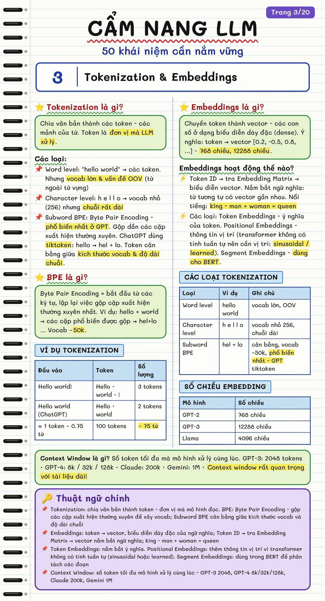

- **Tokenization**: Chia văn bản thành các token (mảnh từ) — đơn vị LLM xử lý.
  - *Word level*: vocab lớn & vấn đề OOV (từ ngoài từ vựng).
  - *Character level*: vocab nhỏ (`256`) nhưng chuỗi rất dài.
  - *Subword BPE (Byte Pair Encoding)*: phổ biến nhất ở GPT (`tiktoken`, gộp dần cặp xuất hiện thường xuyên nhất, e.g., `hello → hel + lo`, vocab `~50k`).
  - Quy ước: `Hello world!` → `Hello · world · !` (3 tokens); `≈ 1 token ~ 0.75 từ` (`100 tokens ≈ 75 từ`).
- **Embeddings**: Biểu diễn dày đặc (dense vector, e.g., `768 chiều`, `12288 chiều`): `Token ID → tra Embedding Matrix → vector nắm bắt ngữ nghĩa` (`king - man + woman = queen`).
  - Các loại: *Token Embeddings* (ý nghĩa), *Positional Embeddings* (`sinusoidal / learned` — thêm vị trí vì Transformer không tuần tự), *Segment Embeddings* (dùng cho BERT).
  - **Số chiều Embedding**: `GPT-2: 768 chiều`, `GPT-3: 12288 chiều`, `Llama: 4096 chiều`.
- **Context Window**: Số token tối đa mô hình xử lý cùng lúc: `GPT-3: 2048`, `GPT-4: 8k / 32k / 128k`, `Claude: 200k`, `Gemini: 1M`.

---

### Page 04 (Trang 4/20) — 4. Pre-training & Training - LLM được huấn luyện như thế nào
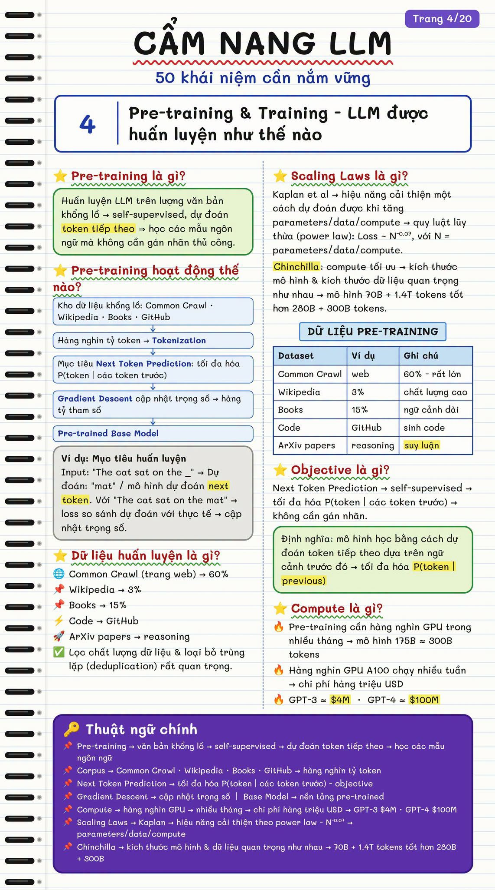

- **Pre-training**: Huấn luyện `self-supervised` trên văn bản khổng lồ với mục tiêu **Next Token Prediction** (tối đa hóa `P(token | các token trước)` không cần gán nhãn thủ công).
- **Quy trình**: `Kho dữ liệu (Common Crawl · Wikipedia · Books · GitHub) → Tokenization hàng nghìn tỷ token → Next Token Prediction → Gradient Descent cập nhật trọng số → Pre-trained Base Model`.
- **Dữ liệu Pre-training**: Common Crawl (`60%`), Books (`15%`), Wikipedia (`3%`), Code (`GitHub`), ArXiv papers (`suy luận/reasoning`). Cần lọc chất lượng và deduplication.
- **Scaling Laws**:
  - *Kaplan et al.*: Hiệu năng cải thiện theo power law `Loss ~ N^-0.07` khi tăng `parameters / data / compute`.
  - *Chinchilla*: Compute tối ưu khi cân bằng kích thước mô hình & số token dữ liệu → `70B + 1.4T tokens` tốt hơn `280B + 300B tokens`.
- **Compute**: `175B ≈ 300B tokens`, cần hàng nghìn GPU A100 nhiều tuần/tháng (`GPT-3 ≈ $4M`, `GPT-4 ≈ $100M`).

---

### Page 05 (Trang 5/20) — 5. Fine-tuning & Instruction Tuning
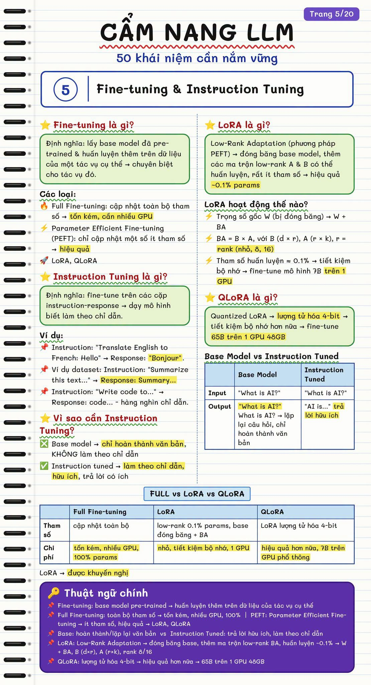

- **Fine-tuning**: Lấy base model pre-trained huấn luyện thêm cho một tác vụ cụ thể:
  - *Full Fine-tuning*: Cập nhật 100% tham số, tốn kém, nhiều GPU.
  - *PEFT (Parameter-Efficient Fine-Tuning)*: Chỉ cập nhật rất ít tham số (`LoRA`, `QLoRA`).
- **Instruction Tuning**: Fine-tune trên cặp `(instruction, response)` giúp mô hình làm theo chỉ dẫn hữu ích thay vì chỉ hoàn thành tiếp văn bản như Base Model.
- **LoRA (Low-Rank Adaptation)**: Đóng băng trọng số gốc `W` → `W + BA` với `B (d×r)`, `A (r×k)`, rank nhỏ (`r = 8, 16`), chỉ huấn luyện `~0.1% params` (fine-tune `7B` trên 1 GPU).
- **QLoRA**: LoRA kết hợp lượng tử hóa `4-bit`, tiết kiệm bộ nhớ hơn nữa → fine-tune `65B` trên 1 GPU `48GB`.

---

### Page 06 (Trang 6/20) — 6. RLHF & Alignment - Giúp LLM hữu ích và an toàn
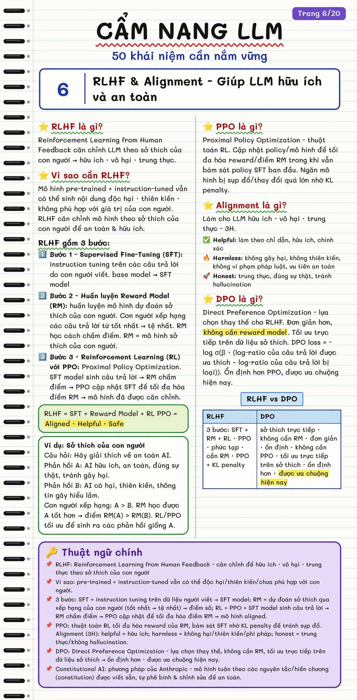

- **Alignment (3H)**: `Helpful` (hữu ích), `Harmless` (vô hại, không thiên kiến), `Honest` (trung thực, tránh hallucination).
- **RLHF (Reinforcement Learning from Human Feedback)** — 3 bước:
  1. **SFT (Supervised Fine-Tuning)**: Instruction tuning trên câu trả lời do người viết → `SFT model`.
  2. **Reward Model (RM)**: Huấn luyện mô hình dự đoán sở thích từ xếp hạng của con người (`A > B → RM(A) > RM(B)`).
  3. **RL với PPO (Proximal Policy Optimization)**: Cập nhật SFT model để tối đa hóa điểm RM với **KL penalty** ngăn policy sụp đổ/lệch quá xa SFT ban đầu.
- **DPO (Direct Preference Optimization)**: Lựa chọn thay thế RLHF **không cần Reward Model & không cần PPO** — tối ưu trực tiếp trên dữ liệu sở thích (`DPO loss = -log σ(β · (log-ratio preferred - log-ratio rejected))`), đơn giản và ổn định hơn.
- **Constitutional AI (Anthropic)**: Mô hình tuân theo nguyên tắc "hiến chương" viết sẵn, tự phê bình và chỉnh sửa để an toàn.

---

### Page 07 (Trang 7/20) — 7. Prompt Engineering - Quan trọng nhất với người dùng
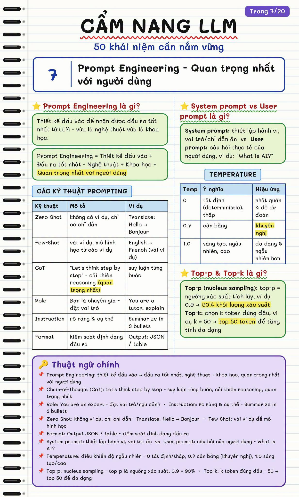

- **Kỹ thuật Prompting**:
  - *Zero-Shot*: Chỉ có chỉ dẫn, không ví dụ.
  - *Few-Shot*: Kèm vài ví dụ để mô hình học theo.
  - *Chain-of-Thought (CoT)*: `"Let's think step by step"` — cải thiện reasoning mạnh nhất.
  - *Role / Instruction / Format*: Gán vai trò (`You are an expert`), chỉ dẫn rõ ràng, kiểm soát đầu ra (`JSON / table`).
- **System prompt vs User prompt**: System prompt đặt hành vi/vai trò ẩn; User prompt là yêu cầu thực tế từ người dùng.
- **Sampling Hyperparameters**:
  - *Temperature*: `0` (tất định/deterministic, nhất quán), `0.7` (cân bằng — khuyến nghị), `1.0` (sáng tạo/ngẫu nhiên).
  - *Top-p (nucleus sampling)*: Ngưỡng xác suất tích lũy (`0.9 = 90%` khối lượng xác suất).
  - *Top-k*: Chọn `k` token xác suất cao nhất đứng đầu (`k = 50`).

---

### Page 08 (Trang 8/20) — 8. RAG - Retrieval Augmented Generation
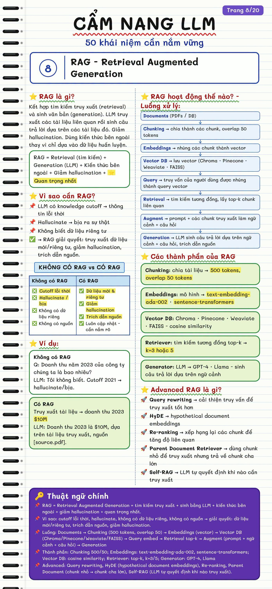

- **Định nghĩa & Lý do**: Kết hợp tìm kiếm truy xuất (Retrieval) + sinh văn bản (Generation) với kiến thức bên ngoài giúp khắc phục knowledge cutoff, truy xuất dữ liệu riêng tư/mới, giảm hallucination và trích dẫn nguồn (`[source.pdf]`).
- **Luồng RAG tiêu chuẩn**: `Documents → Chunking (~500 tokens, overlap 50) → Embeddings (text-embedding-ada-002 / sentence-transformers) → Vector DB (Chroma · Pinecone · Weaviate · FAISS) → Query Embed → Retrieval (top-k, k=3 hoặc 5, cosine similarity) → Augment (prompt + retrieved chunks) → Generation (GPT-4 / Llama + citation)`.
- **Advanced RAG**: *Query rewriting*, *HyDE* (Hypothetical Document Embeddings), *Re-ranking*, *Parent Document Retriever* (tìm chunk nhỏ, trả chunk cha lớn), *Self-RAG* (LLM tự quyết định khi nào cần truy xuất).

---

### Page 09 (Trang 9/20) — 9. Vector DBs & Embeddings
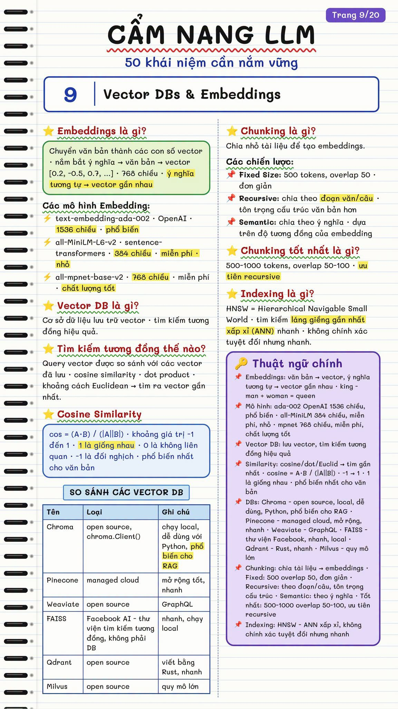

- **Mô hình Embedding**: `text-embedding-ada-002` (OpenAI, `1536 chiều`), `all-MiniLM-L6-v2` (`384 chiều`, miễn phí/nhỏ), `all-mpnet-base-v2` (`768 chiều`, miễn phí/chất lượng tốt).
- **Similarity Metrics**: `Cosine similarity = (A·B)/(|A||B|)` (`-1` đối nghịch đến `1` giống nhau — phổ biến nhất cho text), dot product, khoảng cách Euclidean.
- **So sánh Vector DBs**: `Chroma` (open source, Python local), `Pinecone` (managed cloud, mở rộng tốt), `Weaviate` (open source, GraphQL), `FAISS` (Facebook AI, thư viện tìm kiếm tương đồng local rất nhanh — không phải DB), `Qdrant` (Rust, nhanh), `Milvus` (quy mô lớn).
- **Chiến lược Chunking**: *Fixed Size* (`500` tokens, overlap `50`), *Recursive* (tôn trọng cấu trúc đoạn/câu — **ưu tiên**, `500–1000` tokens, overlap `50–100`), *Semantic* (chia theo độ tương đồng embedding).
- **Indexing**: `HNSW (Hierarchical Navigable Small World)` — tìm kiếm láng giềng gần nhất xấp xỉ (`ANN`) cực nhanh.

---

### Page 10 (Trang 10/20) — 10. LLM Agents
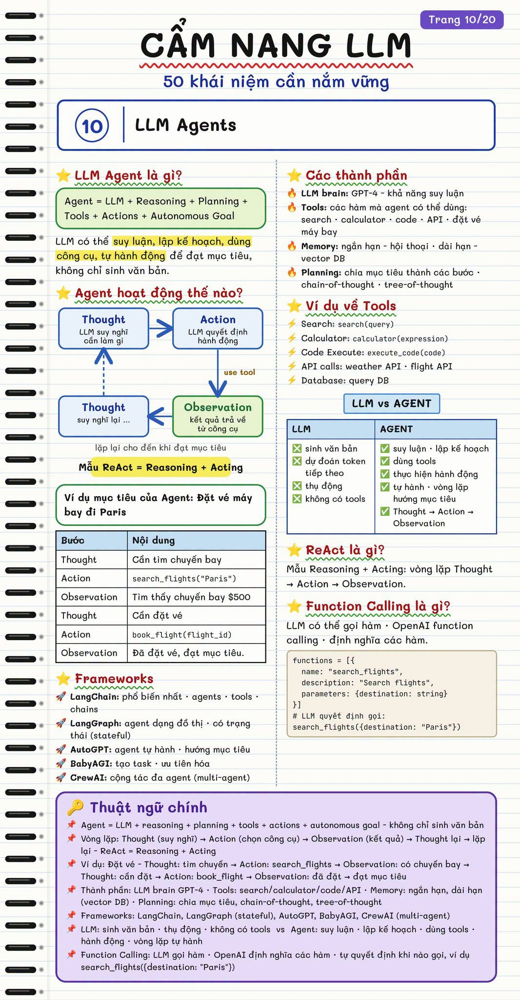

- **Định nghĩa**: `Agent = LLM + Reasoning + Planning + Tools + Actions + Autonomous Goal` (khác với LLM thuần thụ động chỉ sinh token).
- **Thành phần**: LLM brain, Tools (`search`, `calculator`, `execute_code`, API, query DB), Memory (ngắn hạn hội thoại + dài hạn Vector DB), Planning (CoT, ToT).
- **Vòng lặp ReAct (Reasoning + Acting)**: `Thought (suy nghĩ) → Action (dùng tool) → Observation (kết quả) → Thought lại...` (Ví dụ: `search_flights("Paris")` → tìm thấy `$500` → `book_flight(flight_id)` → hoàn thành mục tiêu).
- **Function Calling**: Định nghĩa schema JSON hàm để LLM tự quyết định tham số gọi hàm.
- **Frameworks**: `LangChain`, `LangGraph` (agent đồ thị có trạng thái stateful), `AutoGPT`, `BabyAGI`, `CrewAI` (multi-agent).

---

### Page 11 (Trang 11/20) — 11. Evaluation & Benchmarks - Đánh giá LLM
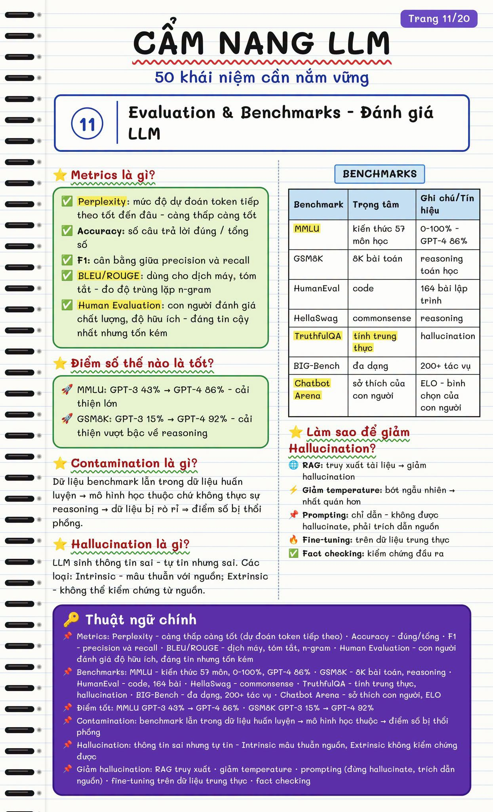

- **Metrics**: *Perplexity* (càng thấp càng tốt — dự đoán token tiếp theo), *Accuracy*, *F1* (cân bằng precision & recall), *BLEU/ROUGE* (trùng lặp n-gram cho dịch/tóm tắt), *Human Evaluation* (đáng tin cậy nhất nhưng tốn kém).
- **Benchmarks**: `MMLU` (kiến thức 57 môn: GPT-3 `43%` → GPT-4 `86%`), `GSM8K` (8K bài toán reasoning: GPT-3 `15%` → GPT-4 `92%`), `HumanEval` (164 bài code), `HellaSwag` (commonsense), `TruthfulQA` (tính trung thực/hallucination), `BIG-Bench` (200+ tác vụ), `Chatbot Arena` (ELO bình chọn của con người).
- **Contamination**: Dữ liệu benchmark rò rỉ vào tập huấn luyện khiến mô hình học thuộc thay vì reasoning thực sự.
- **Hallucination**: Sai tự tin gồm *Intrinsic* (mâu thuẫn nguồn) & *Extrinsic* (không kiểm chứng được từ nguồn). Cách giảm: RAG, giảm temperature, prompting trích dẫn nguồn, fine-tuning dữ liệu trung thực, fact checking.

---

### Page 12 (Trang 12/20) — 12. Tối ưu hóa LLM & Quantization
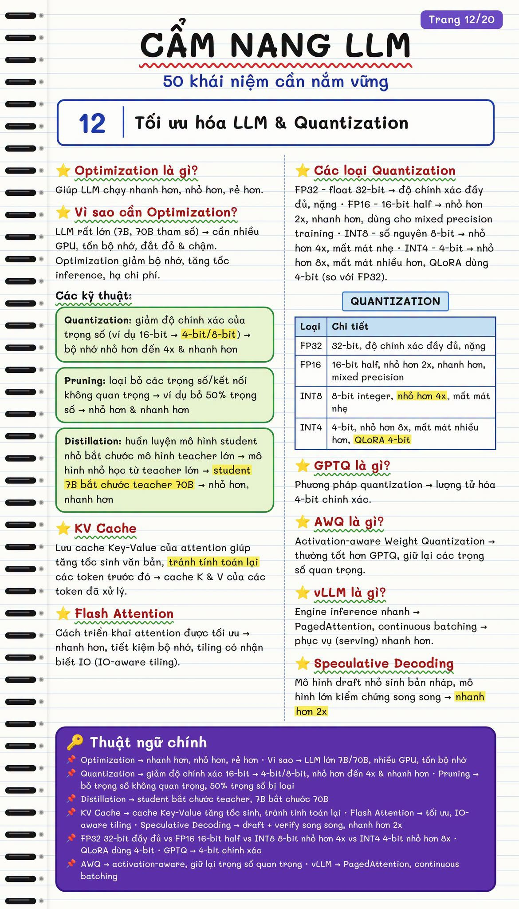

- **Kỹ thuật tối ưu**: *Quantization* (`16-bit → 4-bit/8-bit`, giảm bộ nhớ 4x–8x), *Pruning* (bỏ 50% trọng số/kết nối ít quan trọng), *Distillation* (student `7B` học từ teacher `70B`).
- **Các mức Quantization**: `FP32` (32-bit đầy đủ), `FP16` (16-bit half — mixed precision, nhỏ 2x), `INT8` (nhỏ 4x, mất mát nhẹ), `INT4` (nhỏ 8x, mất mát nhiều hơn — dùng trong QLoRA).
- **Phương pháp quantization 4-bit**: *GPTQ*, *AWQ* (Activation-aware Weight Quantization — giữ trọng số quan trọng, thường tốt hơn GPTQ).
- **Tối ưu Inference**: *KV Cache* (lưu K & V các token trước tránh tính toán lại), *Flash Attention* (IO-aware tiling tiết kiệm VRAM & tăng tốc), *vLLM* (`PagedAttention` + continuous batching), *Speculative Decoding* (draft model nhỏ sinh nháp + model lớn verify song song → nhanh hơn 2x).

---

### Page 13 (Trang 13/20) — 13. Bảo mật & An toàn cho LLM
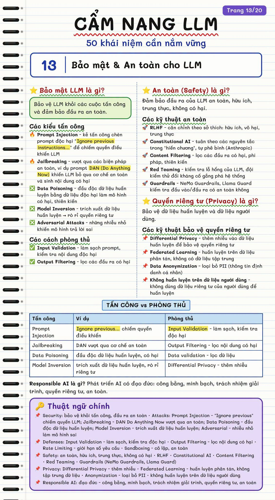

- **Kiểu tấn công**: *Prompt Injection* (`"Ignore previous instructions..."`), *Jailbreaking* (`DAN - Do Anything Now`), *Data Poisoning*, *Model Inversion* (trích xuất dữ liệu huấn luyện rò rỉ privacy), *Adversarial Attacks*.
- **Phòng thủ & An toàn**: *Input Validation*, *Output Filtering*, *Rate Limiting*, *Sandboxing*, *RLHF / Constitutional AI*, *Content Filtering*, *Red Teaming*, *Guardrails* (`NeMo Guardrails`, `Llama Guard`).
- **Quyền riêng tư (Privacy)**: *Differential Privacy* (thêm nhiễu), *Federated Learning* (huấn luyện phân tán), *Data Anonymization* (loại PII), không dùng dữ liệu riêng tư người dùng để train.
- **Responsible AI**: Công bằng, minh bạch, trách nhiệm giải trình, quyền riêng tư, an toàn.

---

### Page 14 (Trang 14/20) — 14. LLM Frameworks & Tools - Xây dựng ứng dụng LLM
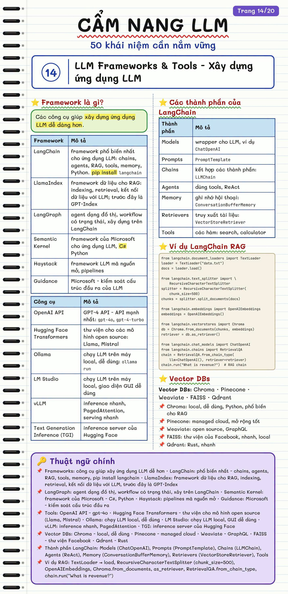

- **Frameworks**: `LangChain`, `LlamaIndex` (trước đây là GPT-Index — indexing/retrieval RAG), `LangGraph` (stateful graph agents), `Semantic Kernel` (Microsoft C#/Python), `Haystack`, `Guidance` (Microsoft controlled output).
- **Công cụ & Serving**: `OpenAI API` (`gpt-4o`, `gpt-4-turbo`), `Hugging Face Transformers`, `Ollama` (chạy local CLI), `LM Studio` (local GUI), `vLLM`, `Text Generation Inference (TGI)` (Hugging Face).
- **Thành phần LangChain & RAG mẫu**: `Models` (`ChatOpenAI`), `Prompts` (`PromptTemplate`), `Chains` (`LLMChain`), `Agents` (`ReAct`), `Memory` (`ConversationBufferMemory`), `Retrievers` (`VectorStoreRetriever`), `Tools`; kèm code snippet Python `TextLoader → RecursiveCharacterTextSplitter(chunk_size=500) → OpenAIEmbeddings → Chroma → RetrievalQA`.

---

### Page 15 (Trang 15/20) — 15. Portfolio dự án LLM
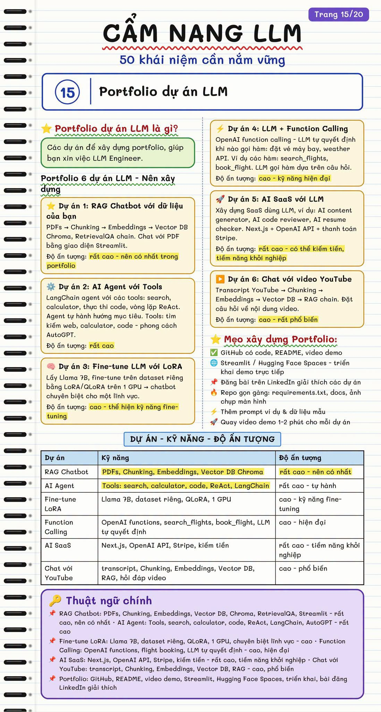

- **6 Dự án LLM nên xây dựng**:
  1. *RAG Chatbot với dữ liệu riêng* (PDF → Chunking → Chroma → RetrievalQA + Streamlit — **nên có nhất**).
  2. *AI Agent với Tools* (ReAct + LangChain: search, calculator, code execution).
  3. *Fine-tune LLM với LoRA/QLoRA* (Llama 7B trên dataset riêng, 1 GPU).
  4. *LLM + Function Calling* (`search_flights`, `book_flight`, weather API).
  5. *AI SaaS với LLM* (`Next.js + OpenAI API + Stripe`).
  6. *Chat với video YouTube* (Transcript → Chunking → Vector DB → RAG).
- **Mẹo portfolio**: GitHub README + `requirements.txt` + demo live Streamlit / Hugging Face Spaces + video demo 1–2 phút + bài đăng LinkedIn.

---

### Page 16 (Trang 16/20) — 16. Câu hỏi phỏng vấn LLM - Những bẫy phải biết
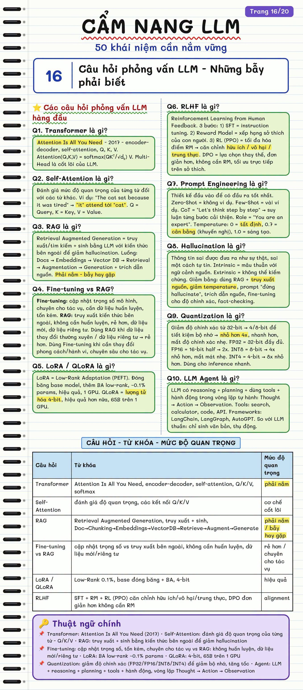

- **10 Câu hỏi cốt lõi (Q1–Q10)**:
  1. Transformer là gì? (`Attention Is All You Need`, Q/K/V, Multi-Head, Encoder vs Decoder)
  2. Self-Attention là gì?
  3. RAG là gì? (*bẫy hay gặp — bắt buộc nắm chắc*)
  4. Fine-tuning vs RAG? (Dữ liệu thay đổi thường xuyên / riêng tư → RAG rẻ hơn; cần đổi phong cách/hành vi → Fine-tuning)
  5. LoRA / QLoRA là gì? (`0.1% params`, `BA`, `4-bit` 65B trên 1 GPU)
  6. RLHF là gì? (`SFT + RM + RL/PPO` vs `DPO` không cần RM)
  7. Prompt Engineering là gì? (Zero-shot, Few-shot, CoT, Temp `0 / 0.7 / 1.0`)
  8. Hallucination là gì? (*Intrinsic* vs *Extrinsic* & 5 cách giảm)
  9. Quantization là gì? (`FP32/FP16/INT8/INT4`)
  10. LLM Agent là gì? (`Reasoning + Planning + Tools + ReAct`)

---

### Page 17 (Trang 17/20) — 17. Mở rộng quy mô & Hạ tầng LLM - Triển khai LLM
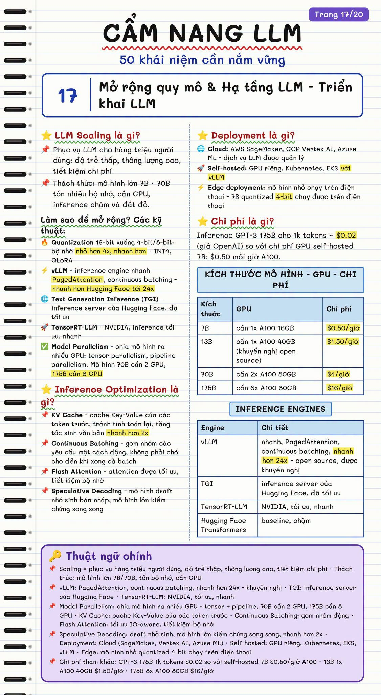

- **Kỹ thuật mở rộng & Inference Engines**: Quantization (`4-bit/8-bit`), `vLLM` (PagedAttention + continuous batching — **nhanh hơn Hugging Face tới 24x**), `TGI`, `TensorRT-LLM` (NVIDIA), *Model Parallelism* (tensor + pipeline parallelism: `70B` cần `2 GPU`, `175B` cần `8 GPU`).
- **Tối ưu Inference**: *KV Cache* (nhanh >2x), *Continuous Batching*, *Flash Attention*, *Speculative Decoding* (nhanh >2x).
- **Deployment Topologies**: *Cloud* (AWS SageMaker, GCP Vertex AI, Azure ML), *Self-hosted* (GPU riêng, Kubernetes/EKS + vLLM), *Edge* (mô hình 7B quantized 4-bit trên điện thoại).
- **Bảng chi phí phần cứng tham khảo (A100)**:
  - `7B`: `1x A100 16GB` (`$0.50/giờ`)
  - `13B`: `1x A100 40GB` (`$1.50/giờ`, khuyến nghị open source)
  - `70B`: `2x A100 80GB` (`$4/giờ`)
  - `175B`: `8x A100 80GB` (`$16/giờ`; so với GPT-3 175B API `~$0.02 / 1k tokens`).

---

### Page 18 (Trang 18/20) — 18. Xu hướng & Tương lai của LLM - Điều gì tiếp theo?
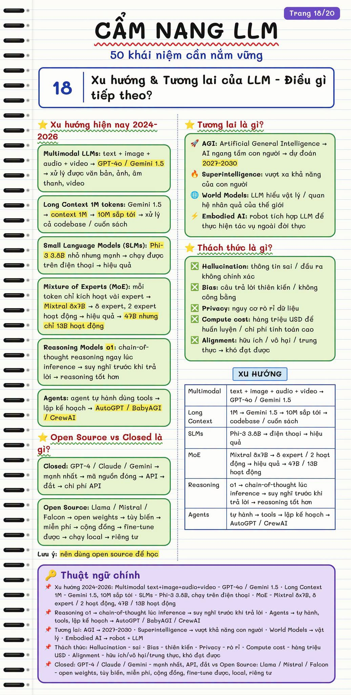

- **6 Xu hướng 2024–2026**: *Multimodal LLMs* (`GPT-4o / Gemini 1.5`), *Long Context* (`1M → 10M` tokens), *Small Language Models / SLMs* (`Phi-3 3.8B` chạy trên điện thoại), *Mixture of Experts / MoE* (`Mixtral 8x7B` — 8 expert, kích hoạt 2 expert = `47B` tổng nhưng chỉ `13B` hoạt động), *Reasoning Models o1* (`CoT` lúc inference), *Autonomous Agents* (`AutoGPT / BabyAGI / CrewAI`).
- **Closed vs Open Source**: Closed (`GPT-4 / Claude / Gemini` — mạnh nhất, đắt qua API) vs Open Source (`Llama / Mistral / Falcon` — open weights, tùy biến, fine-tune, chạy local riêng tư; nên dùng để học).
- **Tương lai & Thách thức**: *AGI (2027–2030)*, *Superintelligence*, *World Models*, *Embodied AI*; thách thức: Hallucination, Bias, Privacy, Compute cost, Alignment (3H).

---

### Page 19 (Trang 19/20) — 19. Sự nghiệp & Mức lương LLM - Lộ trình
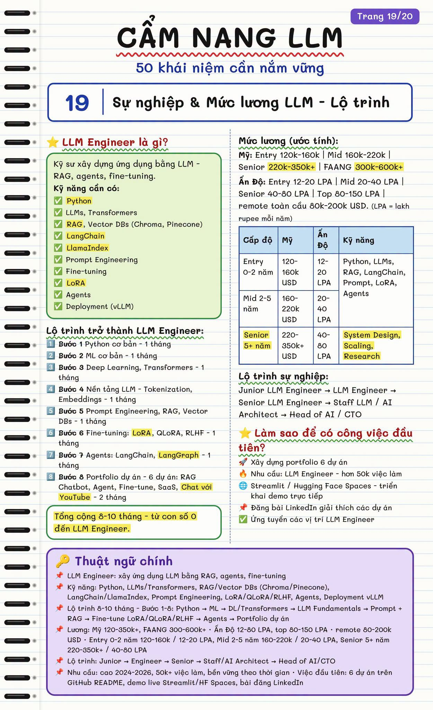

- **Kỹ năng LLM Engineer**: Python, LLMs/Transformers, RAG & Vector DBs (Chroma/Pinecone), LangChain, LlamaIndex, Prompt Engineering, Fine-tuning (LoRA), Agents, Deployment (`vLLM`).
- **Lộ trình 8 bước (8–10 tháng từ số 0)**:
  1. Python cơ bản (`1 tháng`) → 2. ML cơ bản (`1 tháng`) → 3. Deep Learning & Transformers (`1 tháng`) → 4. Nền tảng LLM (`Tokenization, Embeddings` — `1 tháng`) → 5. Prompt Engineering, RAG & Vector DBs (`1 tháng`) → 6. Fine-tuning (`LoRA, QLoRA, RLHF` — `1 tháng`) → 7. Agents (`LangChain, LangGraph` — `1 tháng`) → 8. Portfolio 6 dự án (`2 tháng`).
- **Lộ trình thăng tiến & Mức lương tham khảo**: `Junior LLM Engineer → LLM Engineer → Senior LLM Engineer → Staff LLM / AI Architect → Head of AI / CTO`. Tại Mỹ: Entry (`$120k–160k`), Mid (`$160k–220k`), Senior 5+ năm (`$220k–350k+`), FAANG (`$300k–600k+`); Ấn Độ (`12–80+ LPA`); Remote toàn cầu (`$80k–200k USD`).

---

### Page 20 (Trang 20/20) — 20. Tổng kết - Chủ đề vs Trạng thái - Đã hoàn thành tất cả
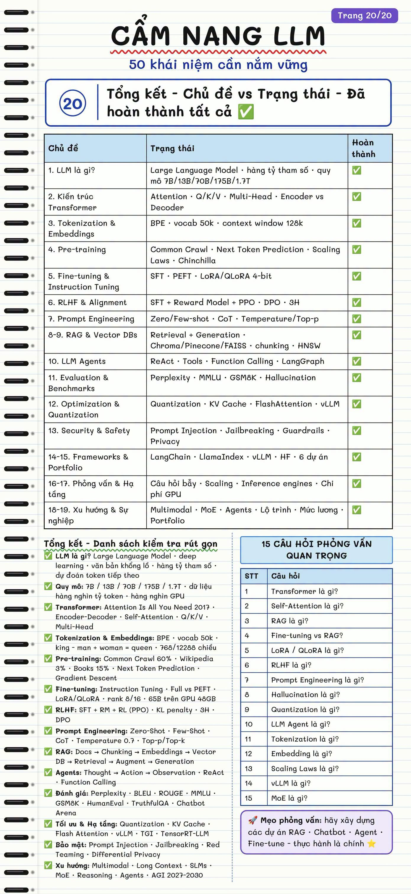

- **Bảng tổng hợp 20 chủ đề**: Từ 1. LLM là gì → 2. Transformer → 3. Tokenization & Embeddings → 4. Pre-training → 5. Fine-tuning/Instruction Tuning → 6. RLHF/Alignment → 7. Prompt Engineering → 8–9. RAG & Vector DBs → 10. LLM Agents → 11. Evaluation/Benchmarks → 12. Optimization/Quantization → 13. Security/Safety → 14–15. Frameworks/Portfolio → 16–17. Phỏng vấn/Hạ tầng → 18–19. Xu hướng/Sự nghiệp.
- **15 Câu hỏi phỏng vấn quan trọng nhất**: Transformer, Self-Attention, RAG, Fine-tuning vs RAG, LoRA/QLoRA, RLHF, Prompt Engineering, Hallucination, Quantization, LLM Agent, Tokenization, Embedding, Scaling Laws, vLLM, MoE.
- **Mẹo phỏng vấn cốt lõi**: Hãy xây dựng các dự án RAG Chatbot, Agent, Fine-tune — thực hành là chính.

---

## Community Comments & Engagement Snapshot

- `Nguyễn Thảo`: *"Cho mình xin file pdf với nhé, thanks"*
- `Trần Đức`: *"Cho mình xin file pdf nhé, xin cảm ơn!"*
- `Thiên Di`: *"Cho mình xin file pdf"*
