# Cẩm nang Large Language Models (LLM) bằng tiếng Việt

- **Nguồn bài viết:** [Facebook — Việt Nguyễn AI](https://www.facebook.com/vietnh1009/posts/pfbid02JAT4PtPQHZyZuYVzMDAq6gKGvMXh6dNpj6kDeE8FCCRq7q2dKtCW9HjT5KoV93sdl)
- **Thời gian đăng:** Friday 20 November 2026 at 16:00 (UTC+7)
- **Tương tác tại thời điểm thu thập:** 60 reactions (53 Like, 7 Love), 1 bình luận, 90 lượt chia sẻ
- **Nguồn gốc tiếng Anh được tác giả trích dẫn:** https://www.instagram.com/p/DdjICn_iJg5/?img_index=1
- **Thư mục hình ảnh gốc (15 trang):** `raw/screenshots/llm-handwritten-handbook-15-pages/` (`00.jpg` – `14.jpg`, `1536x2048`)

---

## Nội Dung Nguyên Văn Bài Đăng & Bình Luận

> Cẩm nang Large Language Models (LLM) bằng tiếng Việt 🔥
> Mình xin chia sẻ bộ tổng hợp kiến thức đầy đủ về Large Language Models (LLM) trong 15 trang, trình bày theo phong cách ghi chú viết tay, dễ nhìn và dễ theo dõi.
> Nội dung đi từ nền tảng đến ứng dụng thực tế:
> 📌 Kiến thức cơ bản về LLM, tokenization và embeddings
> 📌 Kiến trúc Transformer, cơ chế attention và các kiến trúc LLM phổ biến
> 📌 Pretraining, huấn luyện và tối ưu hóa, fine-tuning (LoRA, QLoRA, ...)
> 📌 Prompt engineering, inference và decoding
> 📌 RAG, LLM agents và tool use
> 📌 Đánh giá, an toàn và alignment
> Hy vọng bộ tài liệu này hữu ích cho những ai đang bắt đầu tìm hiểu hoặc muốn hệ thống lại kiến thức về LLM.
> Note: Mình sử dụng AI để convert và dịch sang tiếng Việt, nên sẽ có những chỗ làm chưa thực sự tốt về nội dung hay hình ảnh so với bản gốc. Nếu bạn đọc được tiếng Anh thì có thể xem bản gốc tại: https://www.instagram.com/p/DdjICn_iJg5/?img_index=1

**Bình luận đáng chú ý (1):**
- **Chan Đục** (`2026-11-21 05:33`): Ghi nhận bộ 15 trang rất tiện để hệ thống kiến thức (đặc biệt RAG và Agents), đồng thời góp ý nên có bảng thuật ngữ Anh–Việt ở cuối vì bản dịch AI đôi chỗ dịch thuật ngữ (*attention*, *alignment*) chưa đồng nhất.

---

## Chi Tiết 15 Trang Ghi Chú Viết Tay (Visual Transcription)

### Trang 1 / 15 — Bìa: LLM Large Language Models — Cẩm nang học tập đầy đủ *(1536x2048)*
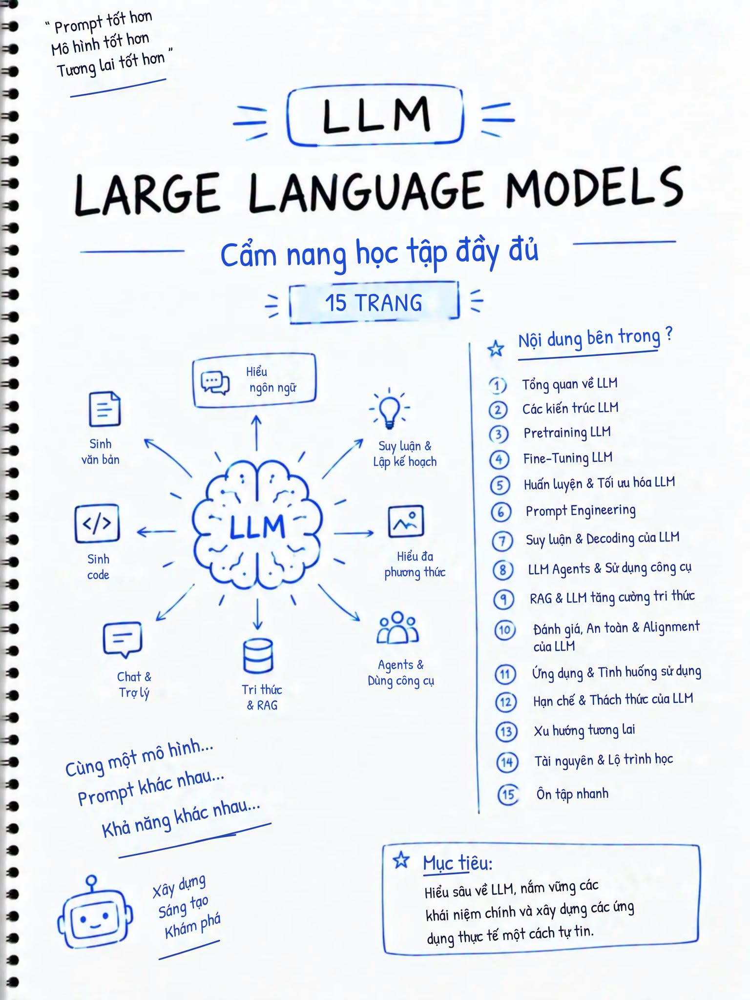

- **Quote:** *"Prompt tốt hơn, Mô hình tốt hơn, Tương lai tốt hơn"* · *"Cùng một mô hình... Prompt khác nhau... Khả năng khác nhau..."* · *"Xây dựng, Sáng tạo, Khám phá"*
- **Sơ đồ 8 năng lực LLM:** Sinh văn bản, Hiểu ngôn ngữ, Suy luận & Lập kế hoạch, Hiểu đa phương thức, Agents & Dùng công cụ, Tri thức & RAG, Chat & Trợ lý, Sinh code.
- **Lưu ý về mục lục bìa vs nội dung thực tế:** Mục lục bìa liệt kê 15 chủ đề (`1. Tổng quan` đến `10. Đánh giá, An toàn & Alignment`, kèm `11. Ứng dụng`, `12. Hạn chế`, `13. Xu hướng tương lai`, `14. Tài nguyên & Lộ trình học`, `15. Ôn tập nhanh`). Tuy nhiên 14 trang nội dung (`01.jpg`–`14.jpg`, đánh số `LLM - Trang 1` đến `LLM - Trang 14`) đi sâu chi tiết vào 14 chuyên đề kỹ thuật (tách riêng Tokenization, Embeddings, Transformer, Attention, Kiến trúc, Pretraining, Optimization, Fine-Tuning, Prompting, Decoding, RAG, Agents, Evaluation/Alignment) và không kèm các trang 11–15 của mục lục bìa.

---

### Trang 2 / 15 — LLM Trang 1: Kiến thức nền tảng về LLM *(1536x2048)*
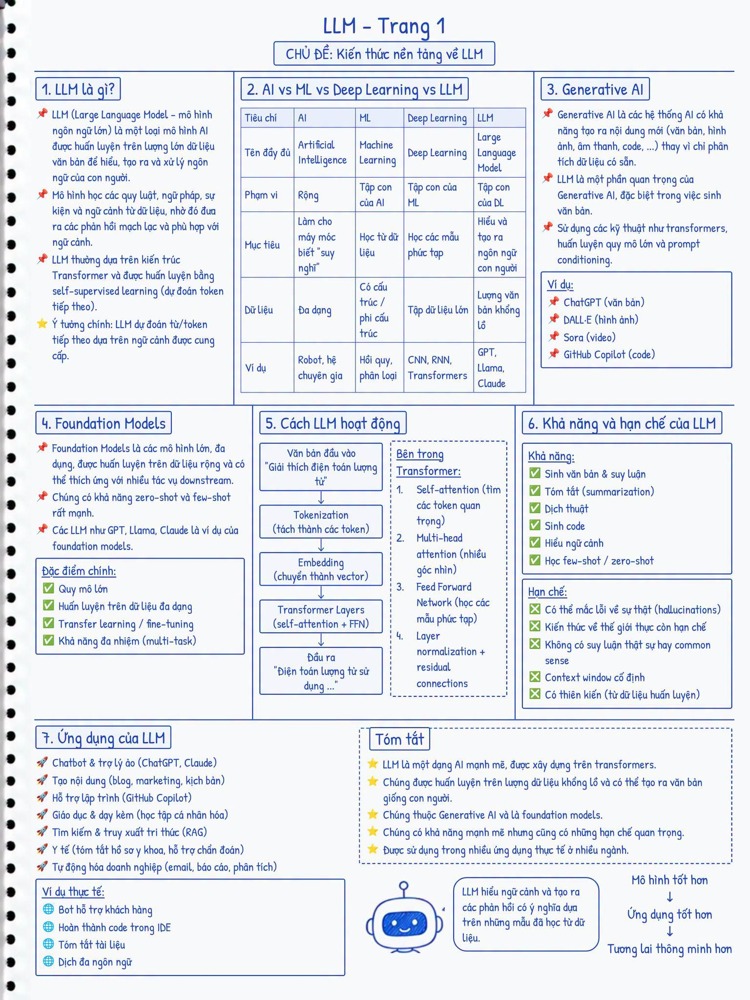

- **LLM & Generative AI:** Mô hình ngôn ngữ lớn xây dựng trên Transformer + self-supervised next-token prediction; nằm trong hệ phân cấp `AI > ML > Deep Learning > LLM`.
- **Foundation Models:** Quy mô lớn, dữ liệu đa dạng, hỗ trợ transfer learning/fine-tuning và đa nhiệm (`GPT, Llama, Claude`).
- **Luồng hoạt động:** `"Giải thích điện toán lượng tử"` $\rightarrow$ `Tokenization` $\rightarrow$ `Embedding` $\rightarrow$ `Transformer Layers (Self-Attention + FFN + Multi-head + LayerNorm + Residual)` $\rightarrow$ `Đầu ra`.
- **Khả năng & Hạn chế:** Khả năng (`sinh văn bản/code`, `tóm tắt`, `dịch`, `hiểu ngữ cảnh`, `zero/few-shot`); Hạn chế (`hallucinations`, `kiến thức thế giới thực hữu hạn`, `không có common sense thực thụ`, `context window cố định`, `bias dữ liệu huấn luyện`).

---

### Trang 3 / 15 — LLM Trang 2: Văn bản & Tokenization *(1536x2048)*
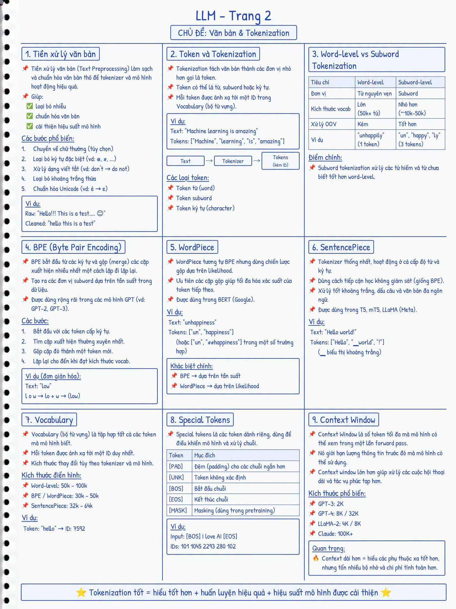

- **Tiền xử lý văn bản (5 bước):** Chữ thường $\rightarrow$ loại ký tự đặc biệt (`@, #`) $\rightarrow$ tách viết tắt (`don't -> do not`) $\rightarrow$ bỏ khoảng trắng thừa $\rightarrow$ chuẩn hóa Unicode.
- **Word-level vs Subword Tokenization:** Word-level (`50k+` từ, xử lý OOV kém: `"unhappily"` = 1 token) vs Subword (`10k–50k`, OOV tốt: `"un"`, `"happy"`, `"ly"`).
- **3 thuật toán Subword:**
  - `BPE` (Byte Pair Encoding — GPT-2/GPT-3): Gộp cặp theo **tần suất** (`30k–50k`).
  - `WordPiece` (BERT): Gộp cặp tối đa hóa **likelihood** (`"un"`, `"##happiness"`).
  - `SentencePiece` (T5, mT5, LLaMA): Hoạt động trực tiếp trên raw text không cần tách từ trước, dùng `_` biểu thị khoảng trắng (`32k–64k`).
- **Special Tokens & Context Window:** `[PAD]`, `[UNK]`, `[BOS]`, `[EOS]`, `[MASK]`. Kích thước cửa sổ: `GPT-3 (2K)`, `GPT-4 (8K/32K)`, `LLaMA-2 (4K/8K)`, `Claude (100K+)`.

---

### Trang 4 / 15 — LLM Trang 3: Embeddings & Biểu diễn (Representations) *(1536x2048)*
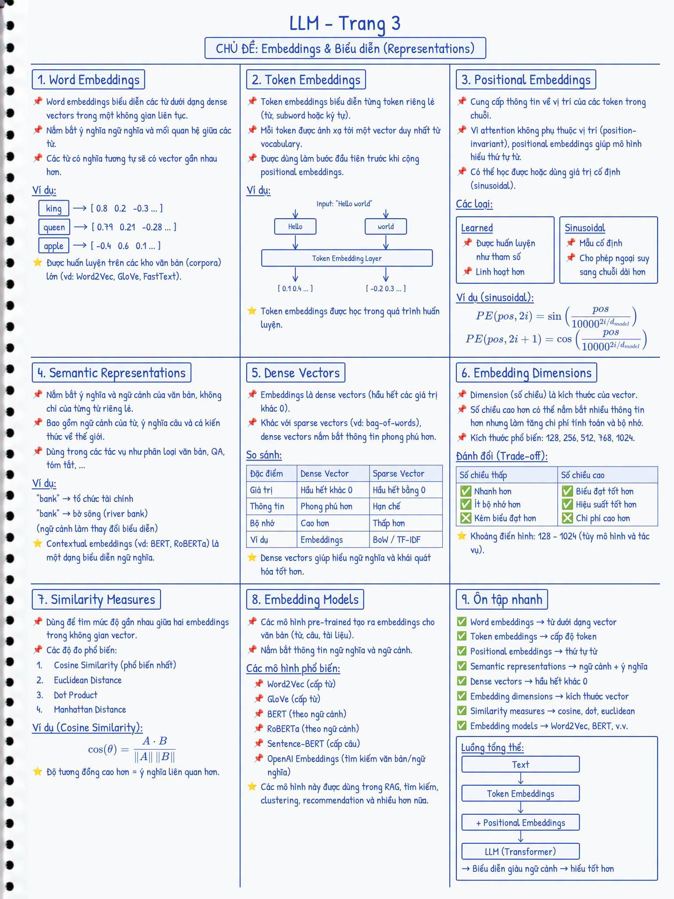

- **Word / Token / Contextual Embeddings:** `king`, `queen`, `apple` (`Word2Vec`, `GloVe`, `FastText`), token vectors trước khi cộng **Positional Embeddings** (Learned vs Sinusoidal: $PE(pos, 2i) = \sin(pos/10000^{2i/d_{model}})$ và cosine cho $2i+1$). Semantic representations phân biệt đa nghĩa theo ngữ cảnh (`"bank"` tổ chức tài chính vs bờ sông trong `BERT`/`RoBERTa`).
- **Dense vs Sparse Vectors & Dimensions:** Dense (hầu hết khác 0, embeddings) vs Sparse (hầu hết 0, `BoW`/`TF-IDF`). Chiều phổ biến `128, 256, 512, 768, 1024` (đánh đổi tốc độ/RAM vs độ biểu đạt).
- **4 Similarity Measures:** Cosine Similarity ($\cos(\theta) = \frac{A\cdot B}{\|A\|\|B\|}$), Euclidean, Dot Product, Manhattan. Models: `Sentence-BERT`, `OpenAI Embeddings`.

---

### Trang 5 / 15 — LLM Trang 4: Kiến trúc Transformer *(1536x2048)*
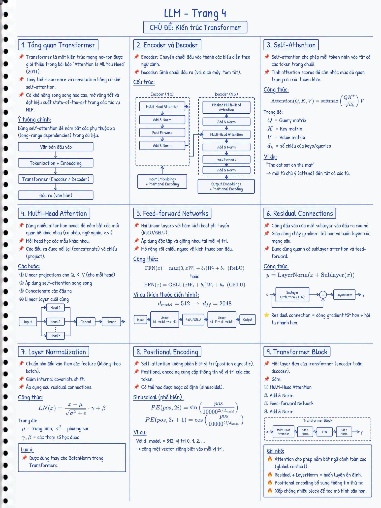

- **Tổng quan Encoder (N×) vs Decoder (N×):** Encoder (`Multi-Head Attention -> Add & Norm -> FFN -> Add & Norm`); Decoder thêm `Masked Multi-Head Attention` và nhận `K, V` từ Encoder.
- **Công thức lõi:**
  - Self-Attention: $\text{Attention}(Q,K,V) = \text{softmax}\left(\frac{QK^T}{\sqrt{d_k}}\right)V$.
  - Feed-Forward Network: $\text{FFN}(x) = \max(0, xW_1 + b_1)W_2 + b_2$ (`ReLU`) hoặc $\text{GELU}(xW_1+b_1)W_2+b_2$ (`d_model=512 -> d_ff=2048`).
  - Residual Connection + LayerNorm: $y = \text{LayerNorm}(x + \text{Sublayer}(x))$, với $LN(x) = \frac{x-\mu}{\sqrt{\sigma^2+\epsilon}}\cdot\gamma + \beta$ (chuẩn hóa theo feature, thay cho BatchNorm).

---

### Trang 6 / 15 — LLM Trang 5: Cơ chế Attention *(1536x2048)*
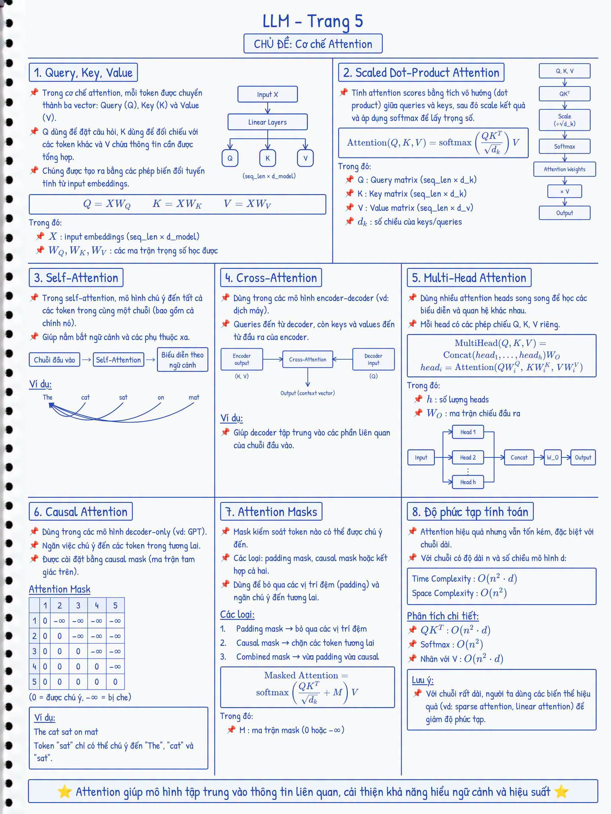

- **Linear Projections Q, K, V:** $Q = XW_Q$, $K = XW_K$, $V = XW_V$ ($X \in \mathbb{R}^{\text{seq\_len} \times d_{\text{model}}}$).
- **Multi-Head Attention:** $\text{MultiHead}(Q,K,V) = \text{Concat}(head_1,\dots,head_h)W_O$, mỗi $head_i = \text{Attention}(QW_i^Q, KW_i^K, VW_i^V)$.
- **Self-Attention vs Cross-Attention vs Causal Attention:** Encoder-Decoder Cross-Attention dùng `Q` từ Decoder và `K, V` từ Encoder output. Causal Attention dùng ma trận mask tam giác (`0` hợp lệ, $-\infty$ bị che tương lai). Masked Attention: $\text{softmax}(\frac{QK^T}{\sqrt{d_k}} + M)V$.
- **Độ phức tạp tính toán (chuỗi dài $n$, chiều $d$):** Time Complexity $O(n^2 \cdot d)$ (`QK^T` và nhân `V`), Space Complexity $O(n^2)$ (`Softmax`) $\implies$ dùng `sparse attention` / `linear attention` cho chuỗi rất dài.

---

### Trang 7 / 15 — LLM Trang 6: Các kiến trúc LLM *(1536x2048)*
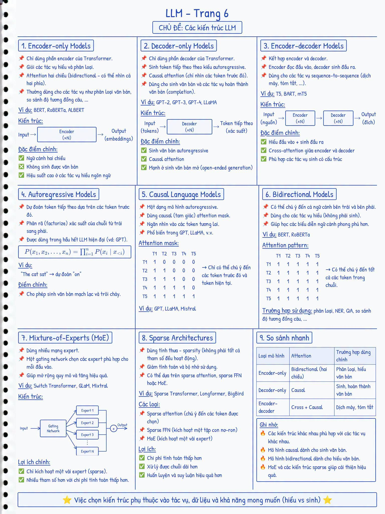

- **3 họ chính:** `Encoder-only` (BERT/RoBERTa/ALBERT — attention `1` toàn ma trận 2 chiều, phân loại/NER/QA); `Decoder-only` (GPT/LLaMA/Mistral — ma trận tam giác causal, sinh văn bản autoregressive $P(x_1,\dots,x_n) = \prod_{i=1}^n P(x_i \mid x_{<i})$); `Encoder-decoder` (T5/BART/mT5 — Cross + Causal, dịch máy/tóm tắt).
- **Mixture-of-Experts (MoE) & Sparse Architectures:** Gating Network kích hoạt thưa một số Expert (`Switch Transformer`, `GLaM`, `Mixtral`). Kiến trúc sparse (`Sparse Transformer`, `Longformer`, `BigBird`) dùng sparse attention/FFN để xử lý chuỗi dài với chi phí thấp hơn.

---

### Trang 8 / 15 — LLM Trang 7: Pretraining LLM *(1536x2048)*
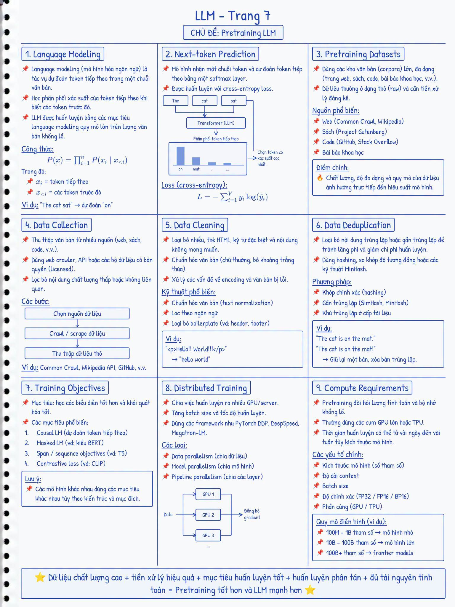

- **Mục tiêu & Loss:** Cross-entropy loss $L = -\sum_{i=1}^V y_i \log(\hat{y}_i)$ dự đoán token tiếp theo; 4 objective (`Causal LM`, `Masked LM` kiểu BERT, `Span/sequence` T5, `Contrastive` CLIP).
- **Pipeline dữ liệu:** Collection (`Common Crawl`, `Wikipedia`, `Project Gutenberg`, `GitHub`, `Stack Overflow`, `Scientific Papers`) $\rightarrow$ Cleaning (text normalization, lọc ngôn ngữ, loại HTML boilerplate) $\rightarrow$ **Data Deduplication** (`Exact hashing`, `Near-duplicate SimHash / MinHash`, document-level dedup).
- **Distributed Training & Quy mô Compute:** `Data parallelism`, `Model parallelism`, `Pipeline parallelism` trên cụm GPU/TPU (`PyTorch DDP`, `DeepSpeed`, `Megatron-LM`). Phân tầng kích thước: `100M–1B` (nhỏ), `10B–100B` (lớn), `100B+` (frontier).

---

### Trang 9 / 15 — LLM Trang 8: Huấn luyện & Tối ưu hóa LLM *(1536x2048)*
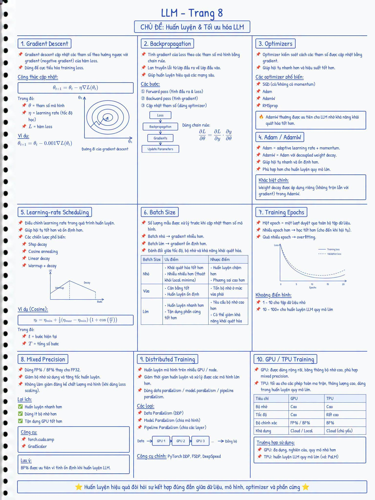

- **Gradient Descent & Backprop:** $\theta_{t+1} = \theta_t - \eta \nabla L(\theta_t)$; chain rule $\frac{\partial L}{\partial \theta} = \frac{\partial L}{\partial y}\cdot\frac{\partial y}{\partial \theta}$.
- **Optimizers:** `SGD`, `Adam`, **`AdamW`** (decoupled weight decay — chuẩn ưu tiên cho LLM), `RMSprop`.
- **LR Scheduling & Cosine Annealing:** Step decay, Linear decay, Warmup + decay; Cosine: $\eta_t = \eta_{\min} + \frac{1}{2}(\eta_{\max} - \eta_{\min})\left(1 + \cos\left(\frac{\pi t}{T}\right)\right)$.
- **Batch Size (Nhỏ/Vừa/Lớn), Epochs, Mixed Precision & Phần cứng:** `FP16 / BF16` (`torch.cuda.amp`, `GradScaler`; ưu tiên **`BF16`** nhờ ổn định số học khi train LLM). Distributed (`DDP, FSDP, DeepSpeed`). GPU (đa dụng, băng thông nhớ cao) vs **TPU** (tối ưu phép toán ma trận BF16 trên Cloud như PaLM).

---

### Trang 10 / 15 — LLM Trang 9: Fine-Tuning LLM *(1536x2048)*
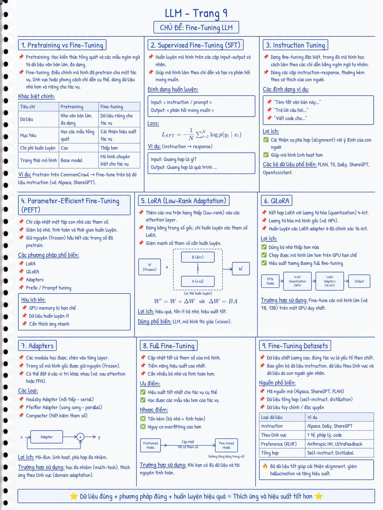

- **SFT & Instruction Tuning:** Loss $L_{\text{SFT}} = -\frac{1}{N} \sum_{i=1}^N \log p(y_i \mid x_i)$. Bộ dữ liệu: `FLAN`, `T0`, `Dolly`, `ShareGPT`, `OpenAssistant`, `Alpaca`, `Anthropic HH`, `UltraFeedback`, `Self-Instruct`, `Distilabel`.
- **PEFT (`LoRA`, `QLoRA`, `Adapters`, `Prefix/Prompt tuning`):**
  - `LoRA`: $W' = W + \Delta W$ với $\Delta W = B A$ ($B \in \mathbb{R}^{d\times r}, A \in \mathbb{R}^{r\times d}$).
  - `QLoRA`: Lượng tử hóa 4-bit (`NF4`) + train LoRA adapters `16-bit`, chạy `7B/13B` trên 1 GPU.
  - `Adapters`: Module chèn vào từng layer gồm `Houlsby Adapter` (nối tiếp — serial), `Pfeiffer Adapter` (song song — parallel), `Compacter` (tiết kiệm tham số).

---

### Trang 11 / 15 — LLM Trang 10: Prompt Engineering *(1536x2048)*
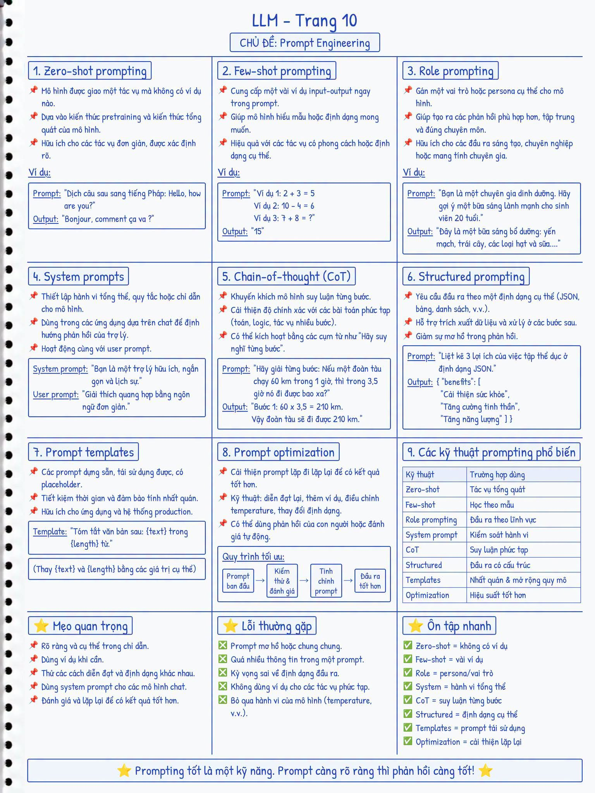

- **8 kỹ thuật:** `Zero-shot`, `Few-shot`, `Role prompting`, `System prompts + User prompt`, `Chain-of-thought (CoT)`, `Structured prompting (JSON)`, `Prompt templates ({text}, {length})`, `Prompt optimization` (lặp: `Prompt ban đầu -> Kiểm thử & đánh giá -> Tinh chỉnh -> Đầu ra tốt hơn`). Kèm mẹo thực hành & 5 lỗi thường gặp.

---

### Trang 12 / 15 — LLM Trang 11: Suy luận & Decoding của LLM *(1536x2048)*
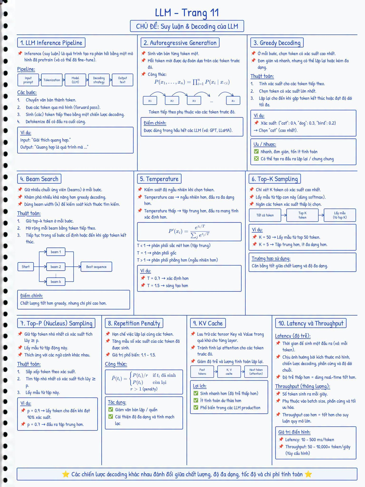

- **6 chiến lược Decoding:**
  - `Greedy Decoding`: Luôn chọn max probability (nhanh nhưng dễ lặp).
  - `Beam Search`: Giữ `k` chuỗi ứng viên song song (`beam width k`).
  - `Temperature`: $P'(x_i) = \frac{e^{z_i/T}}{\sum_j e^{z_j/T}}$ ($T<1$ sắc nét hơn, $T=1$ gốc, $T>1$ phẳng hơn).
  - `Top-K Sampling`: Chỉ lấy mẫu trong top `K` token (`K=50` vs `K=5`).
  - `Top-P (Nucleus) Sampling`: Tập nhỏ nhất có xác suất tích lũy $\ge p$ (`p=0.9` vs `p=0.7`).
  - **`Repetition Penalty`:** $\tilde{P}(t_i) = P(t_i)/r$ nếu $t_i$ đã xuất hiện trước đó ($r \in [1.1, 1.5]$) để chống lặp chữ.
- **KV Cache, Latency & Throughput:** Lưu K/V các token quá khứ tránh tính lại attention. Mức tham khảo: Latency `10–500 ms/token`, Throughput `50–10,000+ token/giây`.

---

### Trang 13 / 15 — LLM Trang 12: RAG & LLM tăng cường tri thức *(1536x2048)*
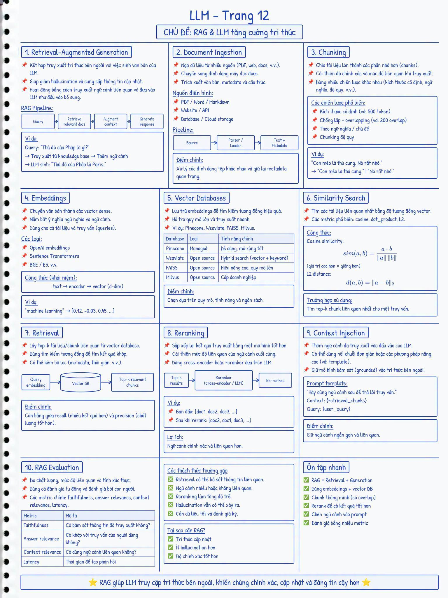

- **Pipeline 10 khối:** Ingestion (`PDF/Web/API/DB`) $\rightarrow$ Chunking (`Fixed 500 + overlap 200`, semantic, recursive) $\rightarrow$ Embeddings (`OpenAI`, `Sentence Transformers`, `BGE/E5`) $\rightarrow$ Vector DB (`Pinecone`, `Weaviate`, `FAISS`, `Milvus`) $\rightarrow$ Similarity Search (`cosine`, `dot_product`, `L2 distance` $\|a-b\|_2$) $\rightarrow$ Retrieval (`top-k` + metadata filter) $\rightarrow$ Reranking (`cross-encoder`) $\rightarrow$ Context Injection $\rightarrow$ **RAG Evaluation** (`Faithfulness`, `Answer relevance`, `Context relevance`, `Latency`).

---

### Trang 14 / 15 — LLM Trang 13: LLM Agents & Sử dụng công cụ *(1536x2048)*
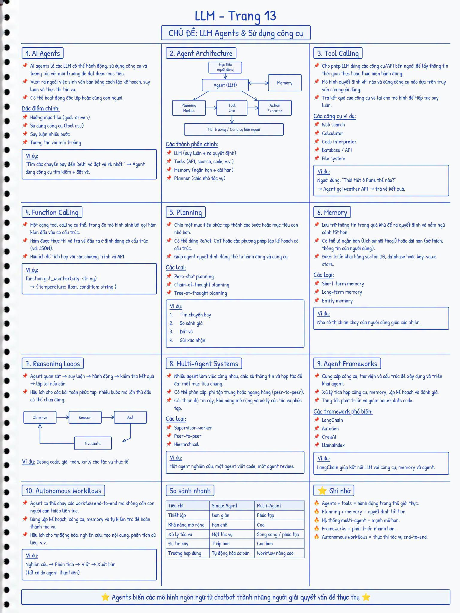

- **Agent Architecture:** `User Goal -> Agent (LLM) <-> [Planning Module | Tool Use | Action Executor] + Memory` tương tác `Môi trường / Công cụ bên ngoài`.
- **Tool & Function Calling:** `function get_weather(city: string) -> {temperature: float, condition: string}`. Tools: Web search, Calculator, Code interpreter, Database/API, File system.
- **Planning & Memory:** Zero-shot / CoT / Tree-of-thought planning; Short-term, Long-term, and **Entity memory** (vector DB / DB / KV store).
- **Reasoning Loops & Multi-Agent:** `Observe -> Reason -> Act -> Evaluate` lặp lại; 3 mô hình Multi-Agent (`Supervisor-worker`, `Peer-to-peer`, `Hierarchical`), `LangChain / AutoGen / CrewAI / LlamaIndex`, bảng so sánh `Single Agent` vs `Multi-Agent`.

---

### Trang 15 / 15 — LLM Trang 14: Đánh giá, An toàn & Alignment của LLM *(1536x2048)*
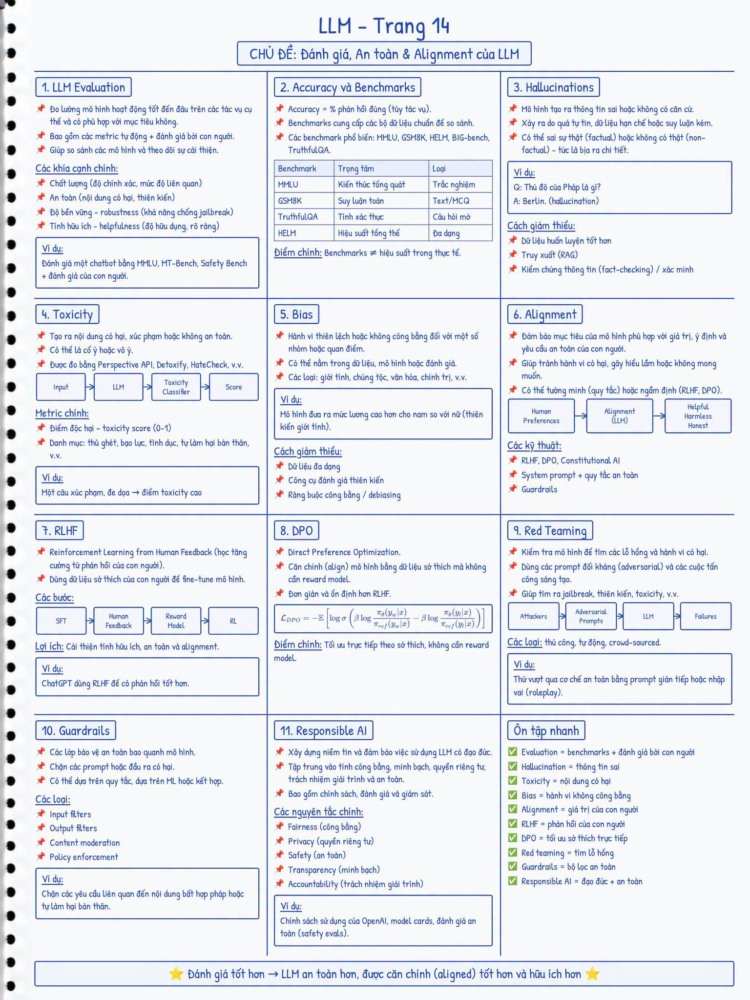

- **Evaluation & Benchmarks:** `MMLU`, `GSM8K`, `TruthfulQA`, `HELM`, `MT-Bench`, `Safety Bench`, `BIG-bench` (*Benchmarks $\neq$ hiệu suất thực tế*).
- **Toxicity, Bias & Red Teaming:** Đánh giá độc hại `0–1` (`Perspective API`, `Detoxify`, `HateCheck`); Bias (giới tính, chủng tộc, văn hóa, chính trị) & debiasing; Adversarial Red Teaming (thủ công, tự động, crowd-sourced).
- **Alignment, RLHF vs DPO:** `3H` (`Helpful, Harmless, Honest`); `RLHF` (`SFT -> Human Feedback -> Reward Model -> RL`) vs công thức **Direct Preference Optimization (DPO)**:
  $$\mathcal{L}_{DPO} = -\mathbb{E}\left[\log \sigma\left(\beta \log \frac{\pi_\theta(y_w|x)}{\pi_{ref}(y_w|x)} - \beta \log \frac{\pi_\theta(y_l|x)}{\pi_{ref}(y_l|x)}\right)\right]$$
- **Guardrails & Responsible AI:** 5 trụ cột (`Fairness, Privacy, Safety, Transparency, Accountability`).
