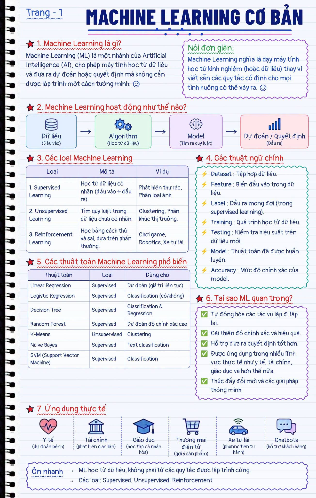
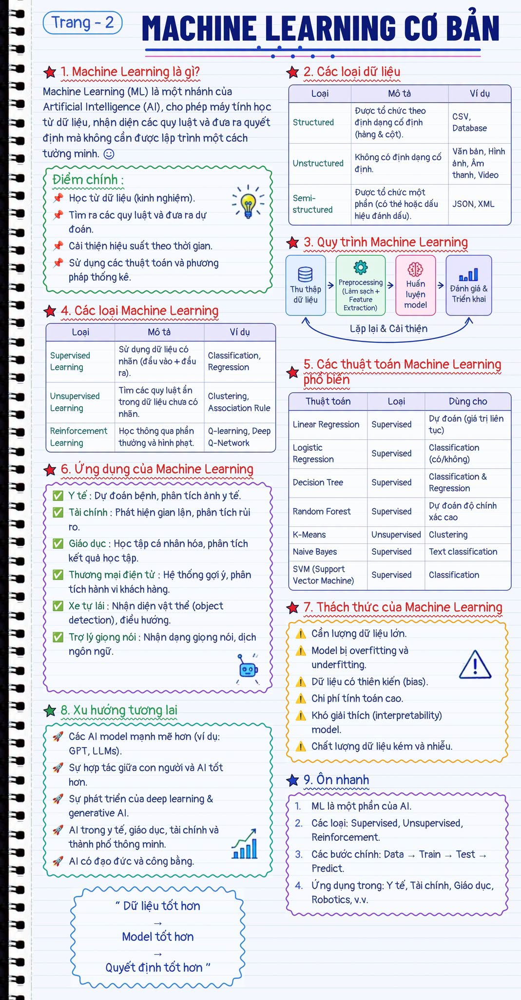
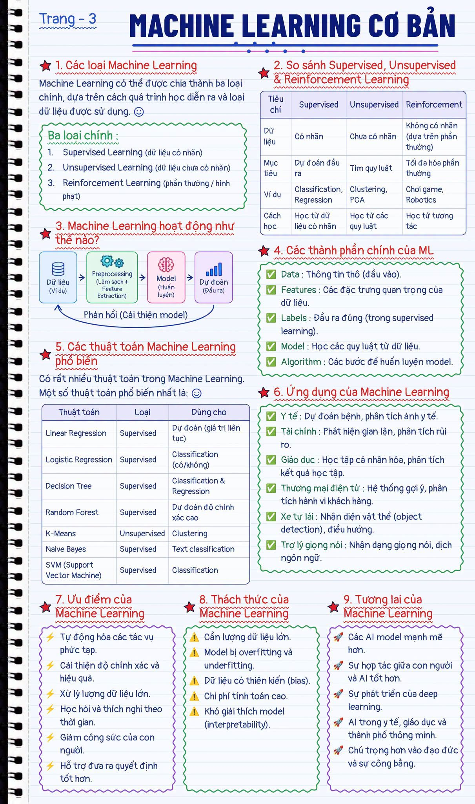
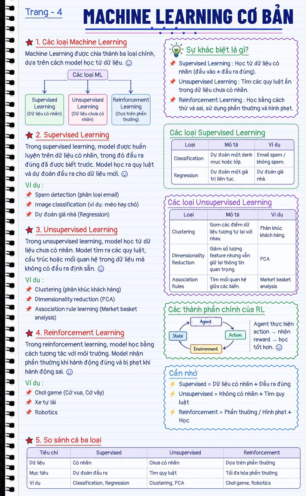
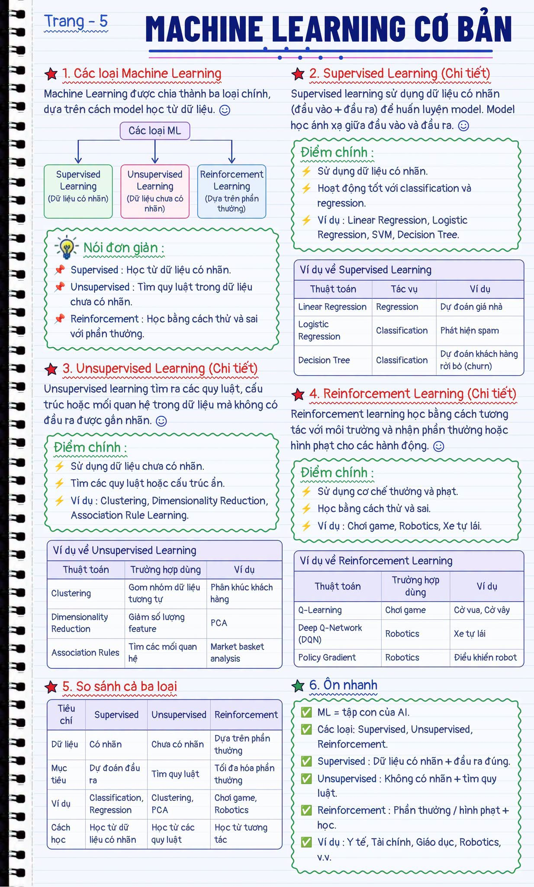
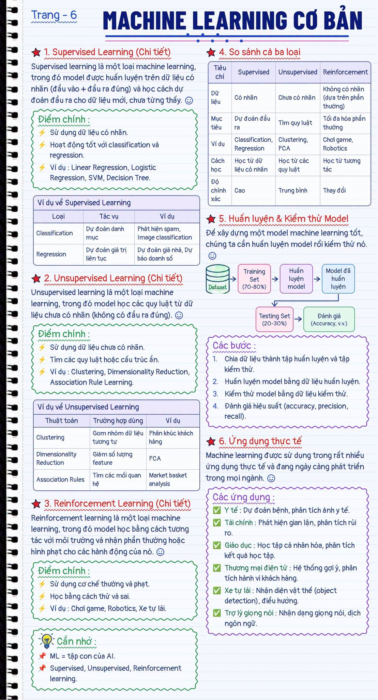
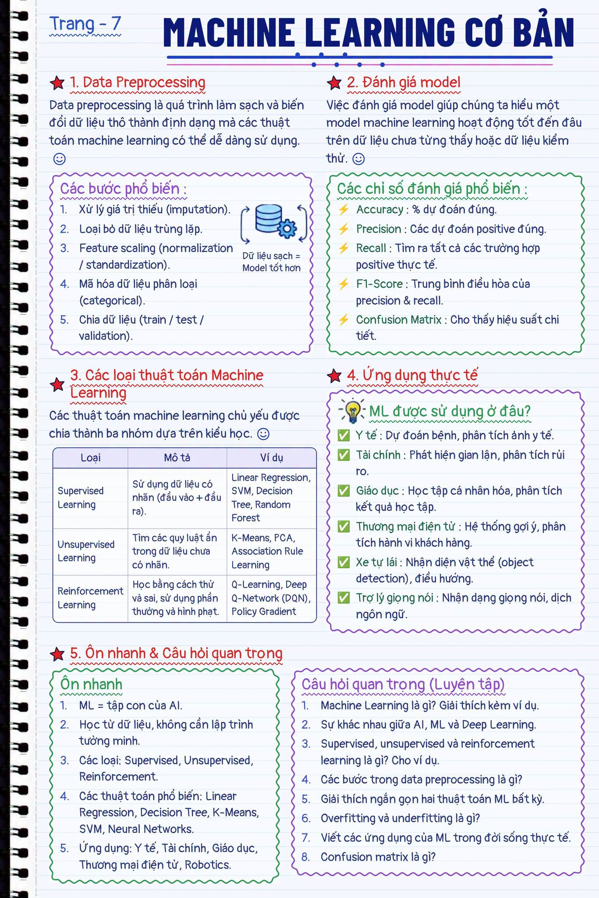
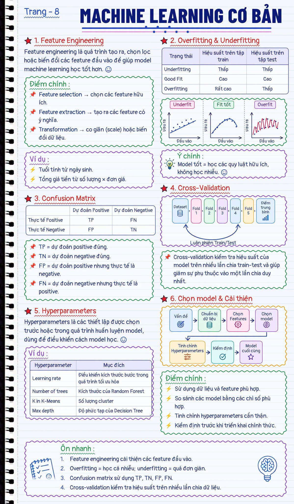
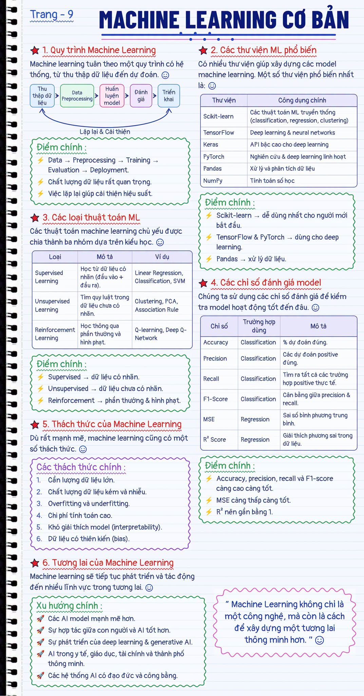

# Machine Learning cơ bản bằng tiếng Việt

- **Nguồn bài viết:** [Facebook — Việt Nguyễn AI](https://web.facebook.com/vietnh1009/posts/pfbid0VjsaAcLhw46M4aEwWgsX4VVAMYVap3tZq4RvNAfU5eHBzWVWPohrAJJoyX3kXPSyl)
- **Thời gian đăng:** 15 November 2026 at 10:00
- **Nguồn gốc tiếng Anh được tác giả trích dẫn:** https://www.instagram.com/p/DdsZBMinyzO/?img_index=1
- **Thư mục hình ảnh gốc (9 trang):** `raw/screenshots/machine-learning-basics-notes/` (`00.jpg` – `08.jpg`)

---

## Nội Dung Nguyên Văn Bài Đăng Facebook

> Machine Learning cơ bản bằng tiếng Việt 🔥
> Mình xin chia sẻ bộ tổng hợp kiến thức Machine Learning cơ bản dưới dạng ghi chú viết tay, gồm 9 trang với bố cục trực quan, dễ theo dõi.
> 📌 Machine Learning là gì và hoạt động như thế nào
> ⚡️ Ba loại ML: Supervised, Unsupervised, Reinforcement Learning
> ✅ Data Preprocessing, Feature Engineering, Confusion Matrix, Cross-Validation
> 🚀 Các thuật toán, thư viện, chỉ số đánh giá, thách thức và xu hướng tương lai
> Tài liệu phù hợp cho bạn nào mới bắt đầu và muốn có một bản tổng quan gọn gàng về Machine Learning.
> Note: Mình sử dụng AI để convert và dịch sang tiếng Việt, nên sẽ có những chỗ làm chưa thực sự tốt về nội dung hay hình ảnh so với bản gốc. Nếu bạn đọc được tiếng Anh thì có thể xem bản gốc tại: https://www.instagram.com/p/DdsZBMinyzO/?img_index=1

---

## Chi Tiết 9 Trang Ghi Chú Viết Tay (Visual Transcription)

### Trang 1 — Tổng quan: Machine Learning là gì, Thuật ngữ & Thuật toán phổ biến

- **1. Machine Learning là gì?** Nhánh của Artificial Intelligence (AI) giúp máy tính học từ dữ liệu/kinh nghiệm và đưa ra dự đoán/quyết định mà không cần lập trình sẵn quy tắc cứng.
- **2. Cách hoạt động:** `Dữ liệu (Đầu vào) → Algorithm (Học từ dữ liệu) → Model (Tìm ra quy luật) → Dự đoán / Quyết định (Đầu ra)`.
- **3. Ba loại ML:** Supervised (dữ liệu có nhãn: thư rác, phân loại ảnh), Unsupervised (chưa có nhãn: clustering, phân khúc thị trường), Reinforcement Learning (thử và sai theo phần thưởng: game, robotics, xe tự lái).
- **4. Thuật ngữ chính:** `Dataset`, `Feature`, `Label`, `Training`, `Testing`, `Model`, `Accuracy`.
- **5. Bảy thuật toán phổ biến:** `Linear Regression`, `Logistic Regression`, `Decision Tree`, `Random Forest`, `K-Means`, `Naive Bayes`, `SVM`.
- **6–7. Tầm quan trọng & Ứng dụng thực tế:** Y tế, Tài chính, Giáo dục, Thương mại điện tử, Xe tự lái, Chatbots.

### Trang 2 — Phân loại dữ liệu, Quy trình ML, Thách thức & Xu hướng

- **2. Các loại dữ liệu:** `Structured` (bảng CSV, Database hàng & cột), `Unstructured` (Văn bản, Hình ảnh, Âm thanh, Video), `Semi-structured` (JSON, XML có thẻ đánh dấu).
- **3. Quy trình ML khép kín:** `Thu thập dữ liệu → Preprocessing (Làm sạch + Feature Extraction) → Huấn luyện model → Đánh giá & Triển khai → (Lặp lại & Cải thiện)`.
- **7. Thách thức của ML:** Cần lượng dữ liệu lớn • Overfitting & underfitting • Thiên kiến dữ liệu (*bias*) • Chi phí tính toán cao • Khó giải thích (*interpretability*) • Dữ liệu kém/nhiễu.
- **8. Xu hướng tương lai:** AI model mạnh hơn (`GPT, LLMs`), cộng tác người-AI, Deep Learning & Generative AI, AI y tế/giáo dục/đô thị thông minh, AI đạo đức và công bằng.
- **Triết lý:** *"Dữ liệu tốt hơn → Model tốt hơn → Quyết định tốt hơn."*

### Trang 3 — So sánh 3 loại ML, Thành phần cốt lõi & Vòng phản hồi

- **Bảng đối chiếu Supervised / Unsupervised / Reinforcement** theo Dữ liệu, Mục tiêu, Ví dụ và Cách học.
- **Sơ đồ vòng phản hồi:** `Dữ liệu → Preprocessing → Model (Huấn luyện) → Dự đoán → Phản hồi cải thiện model`.
- **5 thành phần chính:** `Data` (thông tin thô), `Features` (đặc trưng quan trọng), `Labels` (đầu ra đúng), `Model` (quy luật học được), `Algorithm` (các bước huấn luyện).
- **Ưu điểm, Thách thức & Tương lai ML.**

### Trang 4 — Sơ đồ phân nhánh chi tiết & Vòng lặp Reinforcement Learning

- **Supervised Learning:** `Classification` (email spam, mèo/chó) & `Regression` (giá nhà).
- **Unsupervised Learning:** `Clustering` (phân khúc khách hàng), `Dimensionality Reduction` (`PCA`), `Association Rules` (`Market basket analysis`).
- **Reinforcement Learning Loop:** `Agent → Action → Environment → State / Reward` (chơi cờ vua/cờ vây, xe tự lái, robotics).

### Trang 5 — Chi tiết & Ví dụ Thuật toán từng Nhóm ML

- Bảng ví dụ **Supervised** (`Linear Regression`, `Logistic Regression`, `Decision Tree` dự đoán churn), **Unsupervised** (`Clustering`, `Dimensionality Reduction PCA`, `Association Rules`), và **Reinforcement Learning** (`Q-Learning`, `Deep Q-Network (DQN)`, `Policy Gradient`).

### Trang 6 — So sánh Độ chính xác & Chu trình Huấn luyện – Kiểm thử (70–80% / 20–30%)

- Mở rộng bảng so sánh với dòng **Độ chính xác** (*Supervised: Cao, Unsupervised: Trung bình, RL: Thay đổi*).
- **5. Chu trình Huấn luyện & Kiểm thử Model:** `Dataset` chia `Training Set (70-80%)` + `Testing Set (20-30%)`; 4 bước: (1) Chia dữ liệu → (2) Huấn luyện model → (3) Kiểm thử → (4) Đánh giá hiệu suất (`accuracy`, `precision`, `recall`).

### Trang 7 — Data Preprocessing, Đánh giá Model & Bộ 8 Câu hỏi Ôn tập

- **1. Data Preprocessing (5 bước):**
  1. Xử lý giá trị thiếu (*imputation*)
  2. Loại bỏ dữ liệu trùng lặp
  3. *Feature scaling* (`normalization / standardization`)
  4. Mã hóa dữ liệu phân loại (*categorical encoding*)
  5. Chia dữ liệu (`train / test / validation`)
  - Thông điệp: *"Dữ liệu sạch = Model tốt hơn."*
- **2. Chỉ số đánh giá:** `Accuracy`, `Precision`, `Recall`, `F1-Score`, `Confusion Matrix`.
- **5. 8 câu hỏi ôn tập trọng tâm** (khác biệt AI/ML/DL, 3 loại ML, bước Preprocessing, Overfitting/Underfitting, Confusion Matrix).

### Trang 8 — Feature Engineering, Overfitting/Underfitting, Confusion Matrix, Cross-Validation & Hyperparameters

- **1. Feature Engineering (3 trụ cột):** `Feature selection` (chọn feature hữu ích) • `Feature extraction` (tạo feature mới từ domain, vd: *tuổi từ ngày sinh*, *tổng giá = số lượng × đơn giá*) • `Transformation` (co giãn/biến đổi dữ liệu).
- **2. Overfitting & Underfitting:**
  - `Underfitting`: Train **Thấp**, Test **Thấp** (đường khớp quá đơn giản).
  - `Good Fit`: Train **Cao**, Test **Cao** (học quy luật hữu ích).
  - `Overfitting`: Train **Rất cao**, Test **Thấp** (học vẹt nhiễu).
- **3. Confusion Matrix:** Bảng `2x2` (`TP`, `FN`, `FP`, `TN`) kèm giải nghĩa từng ô.
- **4. Cross-Validation:** Luân phiên 5 Fold (`Fold 1..5` Train/Test) lấy **Điểm trung bình** giảm phụ thuộc vào một lần chia ngẫu nhiên.
- **5. Hyperparameters:** Bảng ví dụ `Learning rate` (bước tối ưu hóa), `Number of trees` (Random Forest), `K` (K-Means), `Max depth` (Decision Tree).
- **6. Chu trình Chọn model & Cải thiện (7 bước):** `Vấn đề → Chuẩn bị dữ liệu → Chọn Features → Chọn model → Tinh chỉnh Hyperparameters → Kiểm định → Model cuối cùng`.

### Trang 9 — Quy trình ML 5 bước, 6 Thư viện Python ML, Chỉ số, Thách thức & Tương lai

- **1. Quy trình 5 bước:** `Thu thập dữ liệu → Data Preprocessing → Huấn luyện model → Đánh giá → Triển khai → (Lặp lại & Cải thiện)`.
- **2. 6 Thư viện ML Python phổ biến:**
  - `Scikit-learn`: Thuật toán ML truyền thống (dễ dùng cho người mới).
  - `TensorFlow`: Deep learning & neural networks.
  - `Keras`: API bậc cao cho deep learning.
  - `PyTorch`: Nghiên cứu & deep learning linh hoạt.
  - `Pandas`: Xử lý và phân tích dữ liệu.
  - `NumPy`: Tính toán số học.
- **4. Bảng chỉ số đánh giá tổng hợp:** `Accuracy`, `Precision`, `Recall`, `F1-Score` (Classification — càng cao càng tốt); `MSE` (Regression — càng thấp càng tốt); `R² Score` (Regression — càng gần `1` càng tốt).
- *"Machine Learning không chỉ là một công nghệ, mà còn là cách để xây dựng một tương lai thông minh hơn."*
