# Cẩm nang Prompt Engineering bằng tiếng Việt

- **Nguồn bài viết:** [Facebook — Việt Nguyễn AI](https://web.facebook.com/vietnh1009/posts/pfbid0K8ah95F9yjbjrNpnaVs8DDXn34E2ZQr9Cf4b1uKGsjGYs21QCGWhYbUt2cLVZ9bml)
- **Thời gian đăng:** 2026-11-12 10:00 (UTC+7)
- **Nguồn gốc tiếng Anh được tác giả trích dẫn:** https://www.instagram.com/p/Ddf156akx9W/?img_index=1
- **Thư mục hình ảnh gốc (11 trang):** `raw/screenshots/prompt-engineering-handbook/` (`00.jpg` – `10.jpg`)

---

## Nội Dung Nguyên Văn Bài Đăng Facebook

> Cẩm nang Prompt Engineering bằng tiếng Việt 🔥
>
> Mình xin chia sẻ bộ cẩm nang Prompt Engineering gồm 11 trang, tổng hợp từ nền tảng đến nâng cao, bao gồm các nội dung chính sau:
>
> 📌 Prompt là gì, cấu trúc của một prompt tốt (vai trò, ngữ cảnh, nhiệm vụ, định dạng, ràng buộc, ví dụ)
> 📌 Các loại prompt: Zero-shot, One-shot, Few-shot, Role-based, Hybrid
> 📌 Framework CO-STAR, R-T-F, CLEAR và cách chọn framework phù hợp
> 📌 Chain-of-Thought, Self-Consistency, ReAct, Tree-of-Thought, Prompt Chaining, Meta-Prompting
> 📌 Prompt mẫu cho từng tác vụ: tóm tắt, dịch, phân loại, trích xuất dữ liệu, lập trình...
> 📌 10 nguyên tắc viết prompt hiệu quả, các lỗi thường gặp và checklist kiểm tra trước khi gửi
>
> Note: Mình sử dụng AI để convert và dịch sang tiếng Việt, nên sẽ có những chỗ làm chưa thực sự tốt về nội dung hay hình ảnh so với bản gốc. Nếu bạn đọc được tiếng Anh thì có thể xem bản gốc tại: https://www.instagram.com/p/Ddf156akx9W/?img_index=1

---

## Chi Tiết 11 Trang Hình Ảnh Đính Kèm (Visual Transcription)

### Trang 0 (Cover) — PROMPT ENGINEERING: Nghệ thuật & khoa học giao tiếp hiệu quả với AI
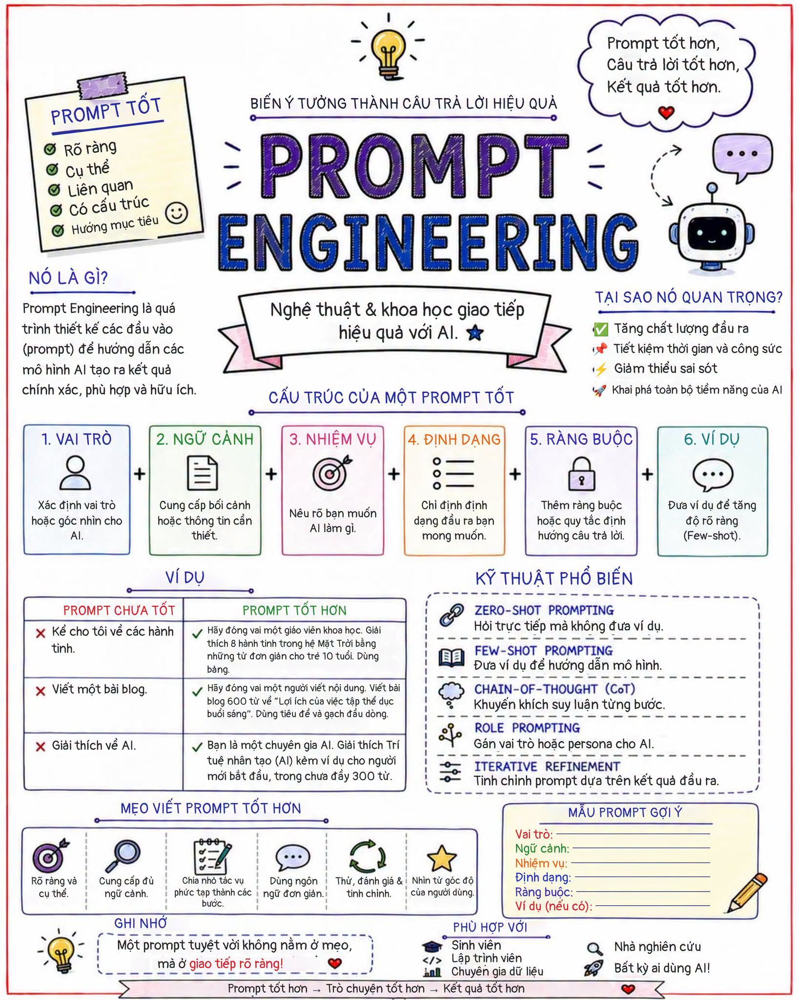

- **Thông điệp chính:** Biến ý tưởng thành câu trả lời hiệu quả — *Prompt tốt hơn, Câu trả lời tốt hơn, Kết quả tốt hơn.*
- **Prompt tốt cần:** Rõ ràng • Cụ thể • Liên quan • Có cấu trúc • Hướng mục tiêu.
- **Nó là gì?** Prompt Engineering là quá trình thiết kế các đầu vào (prompt) để hướng dẫn các mô hình AI tạo ra kết quả chính xác, phù hợp và hữu ích.
- **Tại sao nó quan trọng?** Tăng chất lượng đầu ra • Tiết kiệm thời gian và công sức • Giảm thiểu sai sót • Khai phá toàn bộ tiềm năng của AI.
- **Công thức cấu trúc 6 thành phần:**
  `1. Vai trò` + `2. Ngữ cảnh` + `3. Nhiệm vụ` + `4. Định dạng` + `5. Ràng buộc` + `6. Ví dụ (Few-shot)`
- **So sánh nhanh (Chưa tốt vs Tốt hơn):**
  - *Kể cho tôi về các hành tinh.* → *Hãy đóng vai một giáo viên khoa học. Giải thích 8 hành tinh trong hệ Mặt Trời bằng những từ đơn giản cho trẻ 10 tuổi. Dùng bảng.*
  - *Viết một bài blog.* → *Hãy đóng vai một người viết nội dung. Viết bài blog 600 từ về "Lợi ích của việc tập thể dục buổi sáng". Dùng tiêu đề và gạch đầu dòng.*
  - *Giải thích về AI.* → *Bạn là một chuyên gia AI. Giải thích Trí tuệ nhân tạo (AI) kèm ví dụ cho người mới bắt đầu, trong chưa đầy 300 từ.*
- **Kỹ thuật phổ biến:** Zero-shot Prompting • Few-shot Prompting • Chain-of-Thought (CoT) • Role Prompting • Iterative Refinement.
- **6 mẹo viết prompt tốt hơn:** Rõ ràng và cụ thể • Cung cấp đủ ngữ cảnh • Chia nhỏ tác vụ phức tạp thành các bước • Dùng ngôn ngữ đơn giản • Thử, đánh giá & tinh chỉnh • Nhìn từ góc độ của người dùng.
- **Ghi nhớ:** Một prompt tuyệt vời không nằm ở mẹo, mà ở giao tiếp rõ ràng!

---

### Trang 1/10 — 1. Giới thiệu về Prompt Engineering
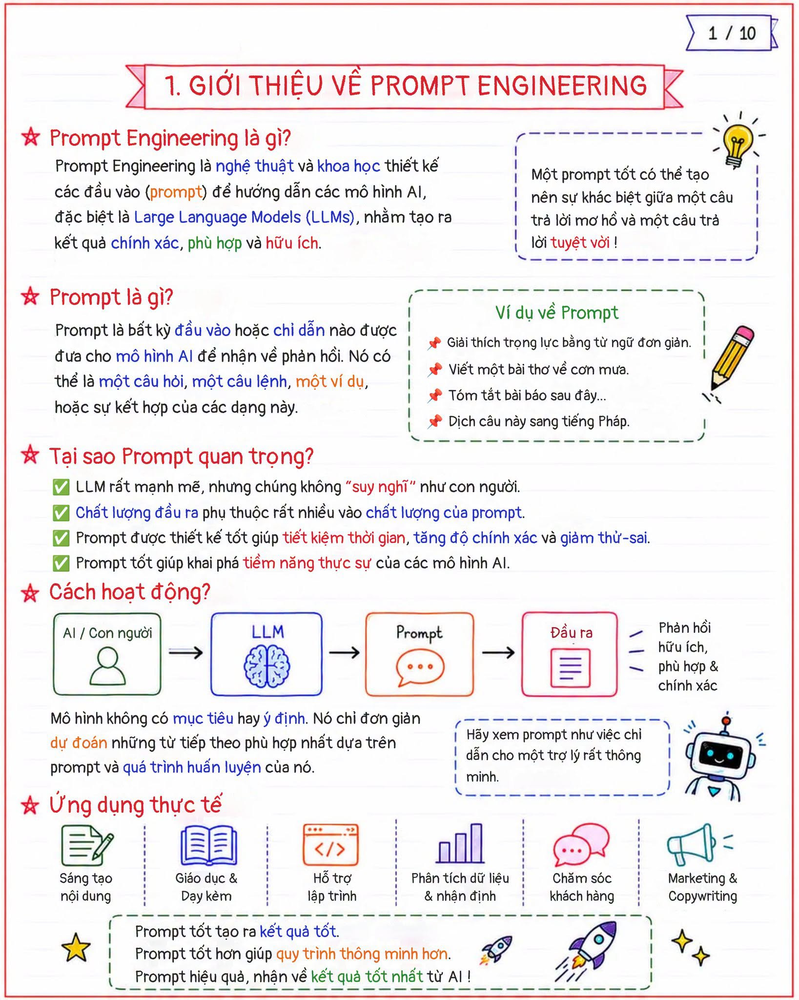

- **Prompt Engineering là gì?** Nghệ thuật và khoa học thiết kế các đầu vào (prompt) để hướng dẫn các mô hình AI, đặc biệt là Large Language Models (LLMs), nhằm tạo ra kết quả chính xác, phù hợp và hữu ích.
- **Prompt là gì?** Bất kỳ đầu vào hoặc chỉ dẫn nào được đưa cho mô hình AI để nhận về phản hồi (câu hỏi, câu lệnh, ví dụ hoặc kết hợp).
- **Cách hoạt động:** `Con người → Prompt → LLM → Đầu ra (Phản hồi hữu ích, phù hợp & chính xác)`. Mô hình không có mục tiêu hay ý định tự thân; nó dự đoán các token/từ tiếp theo phù hợp nhất dựa trên prompt và quá trình huấn luyện.
- **6 ứng dụng thực tế:** Sáng tạo nội dung • Giáo dục & Dạy kèm • Hỗ trợ lập trình • Phân tích dữ liệu & nhận định • Chăm sóc khách hàng • Marketing & Copywriting.

---

### Trang 2/10 — 2. Cấu trúc của một Prompt tốt
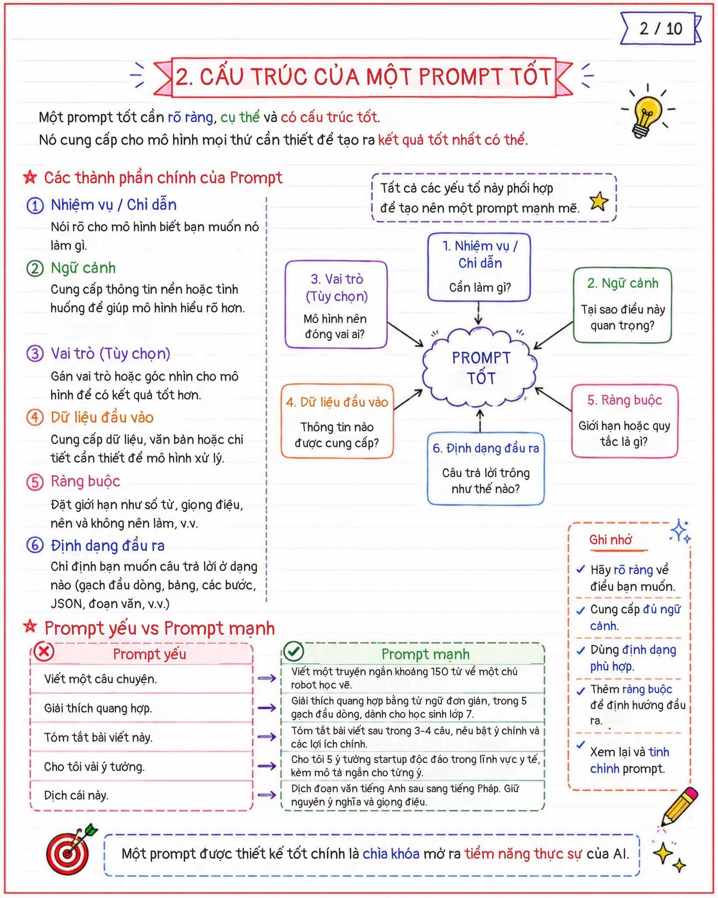

- **6 thành phần cấu tạo `PROMPT TỐT`:**
  1. **Nhiệm vụ / Chỉ dẫn:** Cần làm gì?
  2. **Ngữ cảnh:** Tại sao điều này quan trọng / bối cảnh tình huống?
  3. **Vai trò (Tùy chọn):** Mô hình nên đóng vai ai?
  4. **Dữ liệu đầu vào:** Thông tin nào được cung cấp để xử lý?
  5. **Ràng buộc:** Giới hạn số từ, giọng điệu, quy tắc nên/không nên?
  6. **Định dạng đầu ra:** Câu trả lời trông như thế nào (gạch đầu dòng, bảng, các bước, JSON, đoạn văn)?
- **Chuyển hóa Prompt yếu → Prompt mạnh:**
  - *Viết một câu chuyện.* → *Viết một truyện ngắn khoảng 150 từ về một chú robot học vẽ.*
  - *Giải thích quang hợp.* → *Giải thích quang hợp bằng từ ngữ đơn giản, trong 5 gạch đầu dòng, dành cho học sinh lớp 7.*
  - *Tóm tắt bài viết này.* → *Tóm tắt bài viết sau trong 3-4 câu, nêu bật ý chính và các lợi ích chính.*
  - *Cho tôi vài ý tưởng.* → *Cho tôi 5 ý tưởng startup độc đáo trong lĩnh vực y tế, kèm mô tả ngắn cho từng ý.*
  - *Dịch cái này.* → *Dịch đoạn văn tiếng Anh sau sang tiếng Pháp. Giữ nguyên ý nghĩa và giọng điệu.*

---

### Trang 3/10 — 3. Các loại Prompt
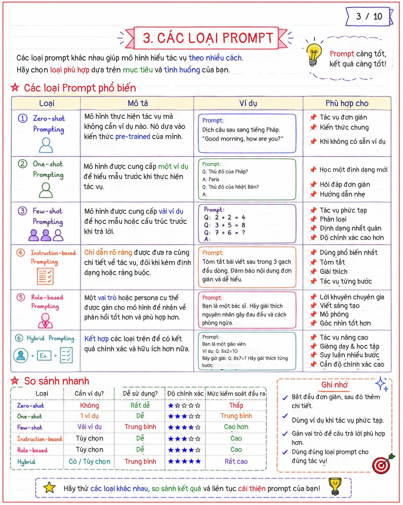

| Loại | Mô tả | Cần ví dụ? | Độ chính xác | Mức kiểm soát đầu ra |
|---|---|---|---|---|
| **Zero-shot Prompting** | Thực hiện tác vụ trực tiếp từ kiến thức pre-trained, không cần ví dụ. | Không | ★☆☆☆☆ (1/5) | Thấp |
| **One-shot Prompting** | Cung cấp 1 ví dụ để học định dạng mẫu trước khi trả lời. | 1 ví dụ | ★★★☆☆ (3/5) | Trung bình |
| **Few-shot Prompting** | Cung cấp vài ví dụ input-output để học mẫu hoặc cấu trúc phức tạp. | Vài ví dụ | ★★★★☆ (4/5) | Cao hơn |
| **Instruction-based Prompting** | Đưa chỉ dẫn rõ ràng kèm định dạng hoặc ràng buộc cụ thể. | Tùy chọn | ★★★★☆ (4/5) | Cao |
| **Role-based Prompting** | Gán một vai trò hoặc persona chuyên môn cụ thể cho mô hình. | Tùy chọn | ★★★★☆ (4/5) | Cao |
| **Hybrid Prompting** | Kết hợp nhiều kỹ thuật (Vai trò + Ví dụ + Chỉ dẫn từng bước). | Có / Tùy chọn | ★★★★★ (5/5) | Rất cao |

---

### Trang 4/10 — 4. Cấu trúc Prompt & Framework
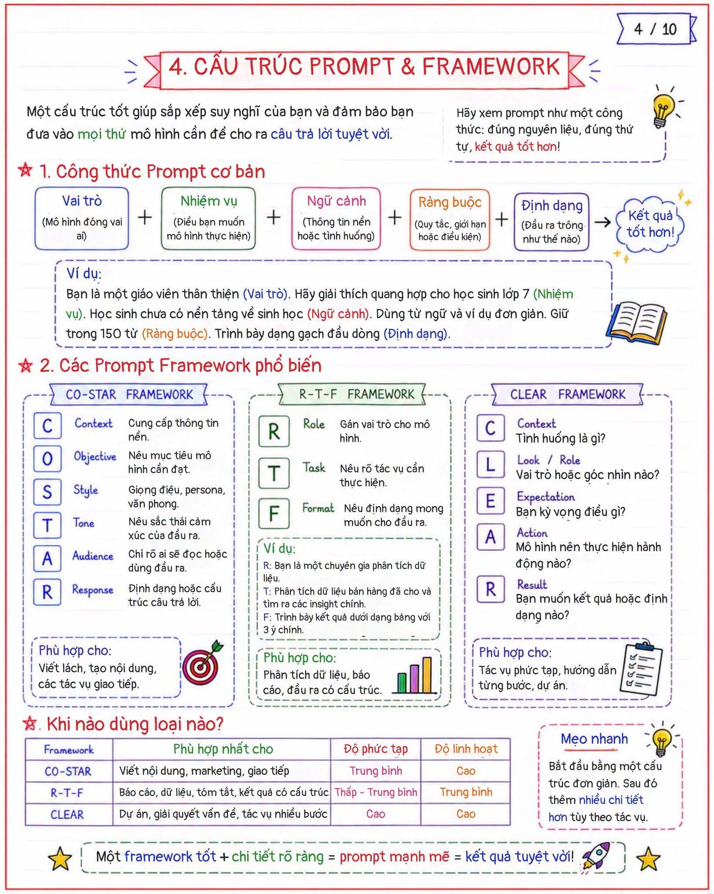

- **Công thức cơ bản:** `Vai trò` + `Nhiệm vụ` + `Ngữ cảnh` + `Ràng buộc` + `Định dạng` → `Kết quả tốt hơn!`
- **3 Framework phổ biến:**
  - **CO-STAR** *(Context – Objective – Style – Tone – Audience – Response)*: Phù hợp viết nội dung, marketing, giao tiếp (Độ phức tạp: Trung bình • Độ linh hoạt: Cao).
  - **R-T-F** *(Role – Task – Format)*: Phù hợp báo cáo, phân tích dữ liệu, tóm tắt có cấu trúc (Độ phức tạp: Thấp–Trung bình • Độ linh hoạt: Trung bình).
  - **CLEAR** *(Context – Look/Role – Expectation – Action – Result)*: Phù hợp dự án, giải quyết vấn đề, tác vụ nhiều bước (Độ phức tạp: Cao • Độ linh hoạt: Cao).

---

### Trang 5/10 — 5. Few-Shot & Prompt dựa trên ví dụ
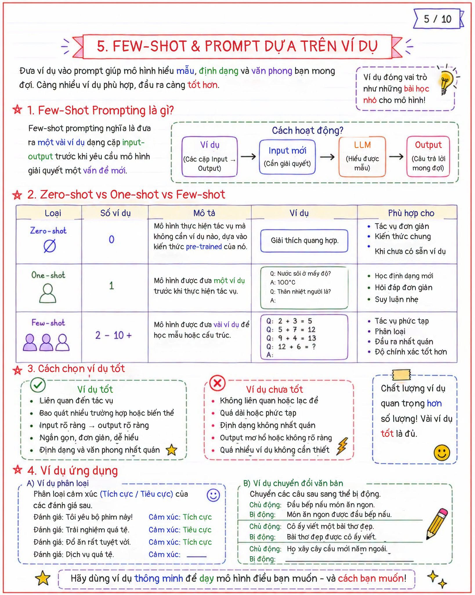

- **Cơ chế hoạt động:** Đưa các cặp `Input → Output` làm bài học nhỏ ngay trong prompt để LLM hiểu mẫu và áp dụng cho input mới.
- **So sánh số lượng ví dụ:** Zero-shot (`0`), One-shot (`1`), Few-shot (`2 – 10+`).
- **Tiêu chuẩn chọn ví dụ:**
  - **✔ Nên:** Liên quan tác vụ • Bao quát biến thể • Input → Output rõ ràng • Ngắn gọn, dễ hiểu • Định dạng & văn phong nhất quán (*chất lượng quan trọng hơn số lượng*).
  - **✘ Tránh:** Lạc đề • Quá dài/rối • Định dạng mâu thuẫn • Output mơ hồ • Nhồi nhét quá nhiều ví dụ thừa.
- **Ví dụ ứng dụng:** Phân loại cảm xúc (Tích cực / Tiêu cực) và chuyển đổi văn bản (Chủ động → Bị động).

---

### Trang 6/10 — 6. Chain-of-Thought & Stepwise Prompting
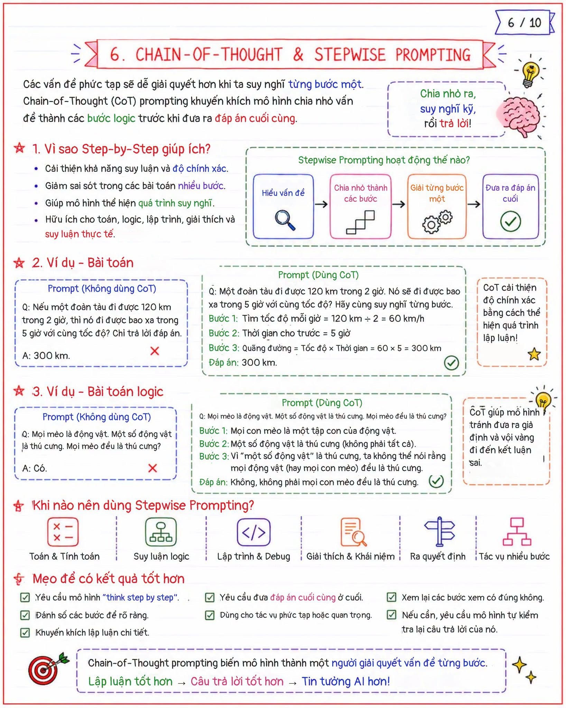

- **Quy trình Stepwise:** `Hiểu vấn đề → Chia nhỏ thành các bước → Giải từng bước một → Đưa ra đáp án cuối`.
- **Ví dụ minh họa (Toán học & Tam đoạn luận Logic):**
  - *Bài toán tốc độ đoàn tàu:* Tách bước `Tốc độ = 120 ÷ 2 = 60 km/h` → `Quãng đường = 60 × 5 = 300 km`.
  - *Bài toán logic ("Mọi mèo là động vật. Một số động vật là thú cưng. Mọi mèo đều là thú cưng?")*: Không CoT dễ trả lời nhầm *"Có"*; dùng CoT suy luận tập hợp (`Mèo ⊂ Động vật`, `Một số động vật ∈ Thú cưng`) giúp kết luận chính xác *"Không"*.
- **Khi nào nên dùng:** Toán & Tính toán • Suy luận logic • Lập trình & Debug • Giải thích & Khái niệm • Ra quyết định • Tác vụ nhiều bước.
- **Mẹo áp dụng:** Yêu cầu *"think step by step"*, đánh số bước, đặt đáp án cuối ở dòng kết, và yêu cầu tự kiểm tra lại kết quả.

---

### Trang 7/10 — 7. Advanced Prompting Techniques
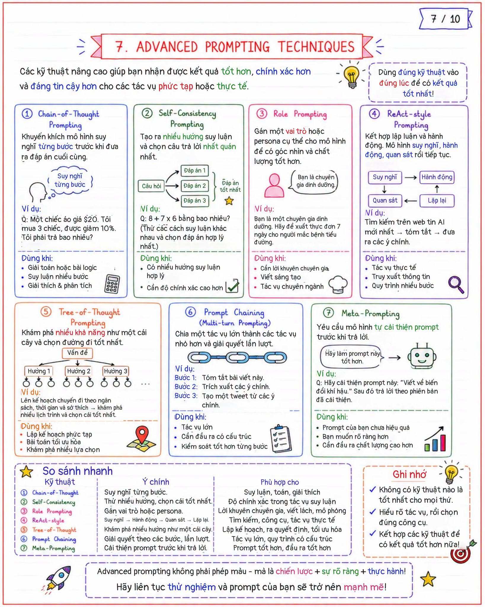

| Kỹ thuật | Ý chính | Ví dụ / Cơ chế | Phù hợp cho |
|---|---|---|---|
| **1. Chain-of-Thought (CoT)** | Suy nghĩ từng bước trước khi kết luận | Tính toán giảm giá qua từng bước trung gian | Suy luận, toán, giải thích |
| **2. Self-Consistency** | Tạo nhiều hướng suy luận, chọn đáp án nhất quán nhất | Chạy nhiều nhánh suy luận độc lập và lấy đồng thuận | Độ chính xác trong tác vụ suy luận |
| **3. Role Prompting** | Gán vai trò / persona chuyên gia | *"Bạn là chuyên gia dinh dưỡng..."* | Lời khuyên chuyên môn, viết lách, mô phỏng |
| **4. ReAct-style** | Chu trình `Suy nghĩ → Hành động → Quan sát → Lặp lại` | Tìm web → tóm tắt → rút trích ý chính | Tìm kiếm, gọi công cụ (tool use), tác vụ thực tế |
| **5. Tree-of-Thought (ToT)** | Khám phá nhiều nhánh hướng đi dạng cây và chọn nhánh tối ưu | Lập nhiều phương án lịch trình theo ngân sách/sở thích | Lập kế hoạch phức tạp, ra quyết định, tối ưu hóa |
| **6. Prompt Chaining** | Chia tác vụ lớn thành chuỗi prompt nhỏ tuần tự | `Tóm tắt → Trích ý chính → Viết tweet` | Tác vụ lớn, quy trình có cấu trúc |
| **7. Meta-Prompting** | Yêu cầu AI tự cải thiện prompt trước khi trả lời | *"Hãy cải thiện prompt này rồi trả lời theo bản mới"* | Nâng cấp prompt mơ hồ thành prompt chuẩn |

---

### Trang 8/10 — 8. Prompt cho các tác vụ khác nhau
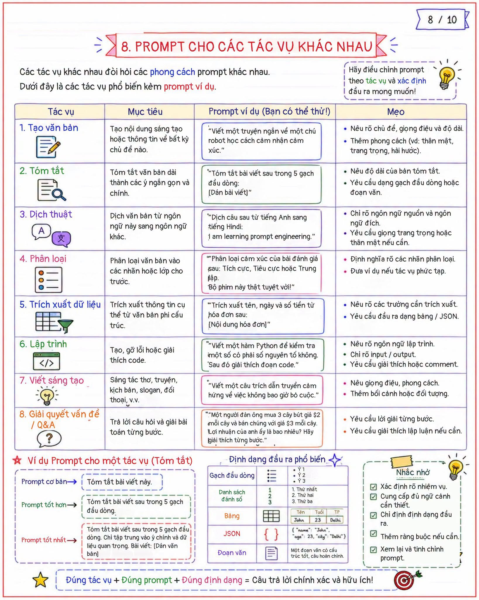

- **8 nhóm tác vụ phổ biến:** Tạo văn bản • Tóm tắt • Dịch thuật • Phân loại • Trích xuất dữ liệu (Table/JSON) • Lập trình (Sinh/Debug/Giải thích code) • Viết sáng tạo • Giải quyết vấn đề / Q&A.
- **Tiến hóa cấp độ Prompt (Ví dụ Tóm tắt):**
  - *Cơ bản:* `Tóm tắt bài viết này.`
  - *Tốt hơn:* `Tóm tắt bài viết sau trong 5 gạch đầu dòng.`
  - *Tốt nhất:* `Tóm tắt bài viết sau trong 5 gạch đầu dòng. Chỉ tập trung vào ý chính và dữ liệu quan trọng. Bài viết: [Dán văn bản]`
- **5 định dạng đầu ra chuẩn:** Gạch đầu dòng • Danh sách đánh số • Bảng • JSON (`{ ... }`) • Đoạn văn.

---

### Trang 9/10 — 9. Nguyên tắc viết Prompt hiệu quả
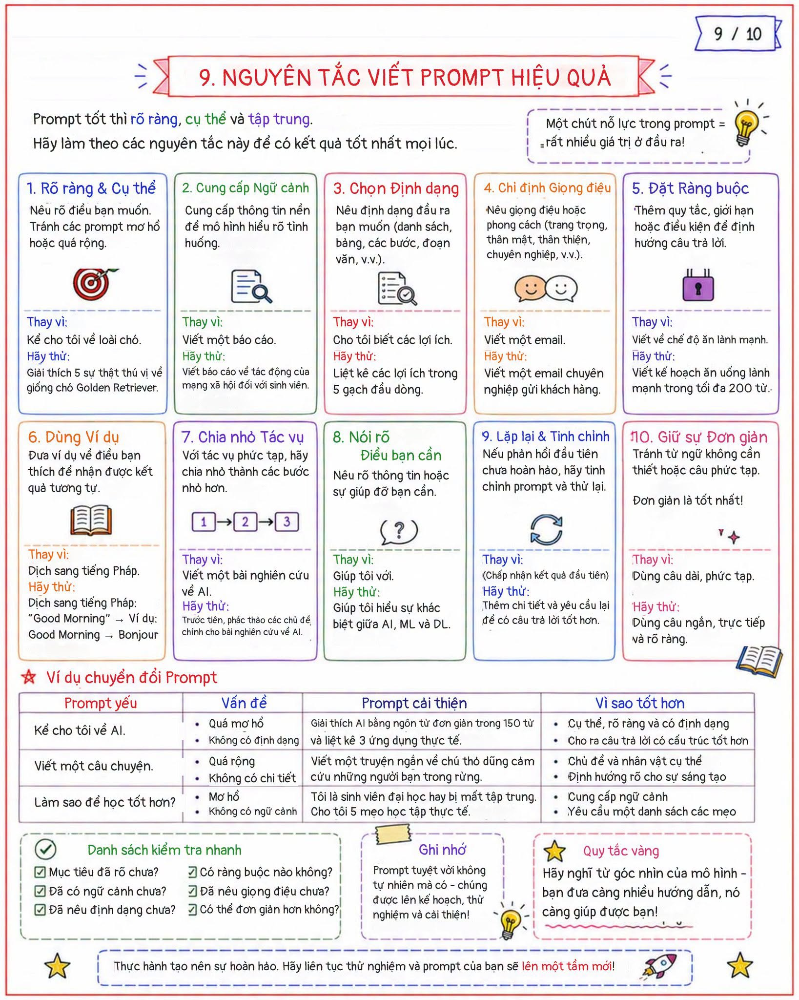

- **10 nguyên tắc cốt lõi:**
  1. **Rõ ràng & Cụ thể:** Tránh prompt mơ hồ/quá rộng.
  2. **Cung cấp Ngữ cảnh:** Đưa thông tin nền đầy đủ.
  3. **Chọn Định dạng:** Chỉ định danh sách, bảng, bước, đoạn văn...
  4. **Chỉ định Giọng điệu:** Trang trọng, thân mật, thân thiện, chuyên nghiệp...
  5. **Đặt Ràng buộc:** Giới hạn số từ, quy tắc định hướng.
  6. **Dùng Ví dụ:** Cung cấp mẫu minh họa mong muốn.
  7. **Chia nhỏ Tác vụ:** Phác thảo/giải từng bước cho việc phức tạp.
  8. **Nói rõ Điều bạn cần:** Nêu cụ thể thông tin hoặc trợ giúp mong muốn.
  9. **Lặp lại & Tinh chỉnh:** Không chấp nhận ngay kết quả đầu nếu chưa đạt; bổ sung chi tiết và thử lại.
  10. **Giữ sự Đơn giản:** Dùng câu ngắn, trực tiếp, tránh từ ngữ phức tạp thừa thãi.
- **Quy tắc vàng:** *Hãy nghĩ từ góc nhìn của mô hình – bạn đưa càng nhiều hướng dẫn, nó càng giúp được bạn!*

---

### Trang 10/10 — 10. Danh sách kiểm tra & Điều cần nhớ
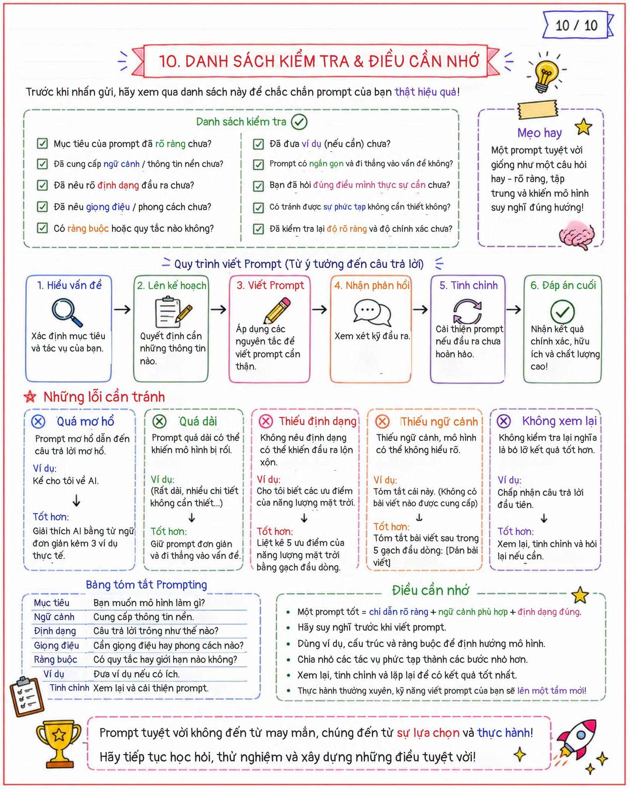

- **Checklist 10 điểm trước khi gửi:** Mục tiêu rõ ràng • Ngữ cảnh/thông tin nền • Định dạng đầu ra • Giọng điệu/phong cách • Ràng buộc/quy tắc • Ví dụ (nếu cần) • Ngắn gọn đi thẳng vào vấn đề • Hỏi đúng điều thực sự cần • Tránh phức tạp không cần thiết • Kiểm tra lại độ rõ ràng & chính xác.
- **Quy trình 6 bước viết Prompt:** `1. Hiểu vấn đề → 2. Lên kế hoạch → 3. Viết Prompt → 4. Nhận phản hồi → 5. Tinh chỉnh → 6. Đáp án cuối`.
- **5 lỗi cần tránh:** Quá mơ hồ • Quá dài gây nhiễu • Thiếu định dạng • Thiếu ngữ cảnh • Không xem lại / không tinh chỉnh.
- **Công thức tổng kết:** `Một prompt tốt = Chỉ dẫn rõ ràng + Ngữ cảnh phù hợp + Định dạng đúng`.
