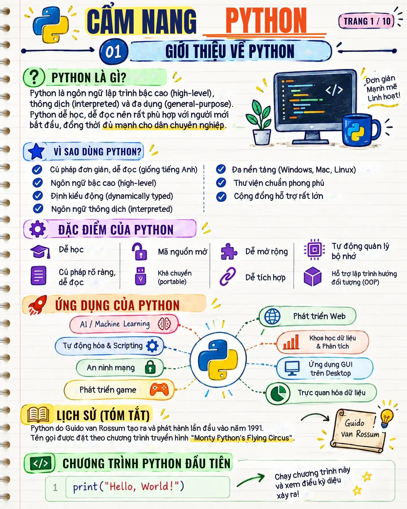
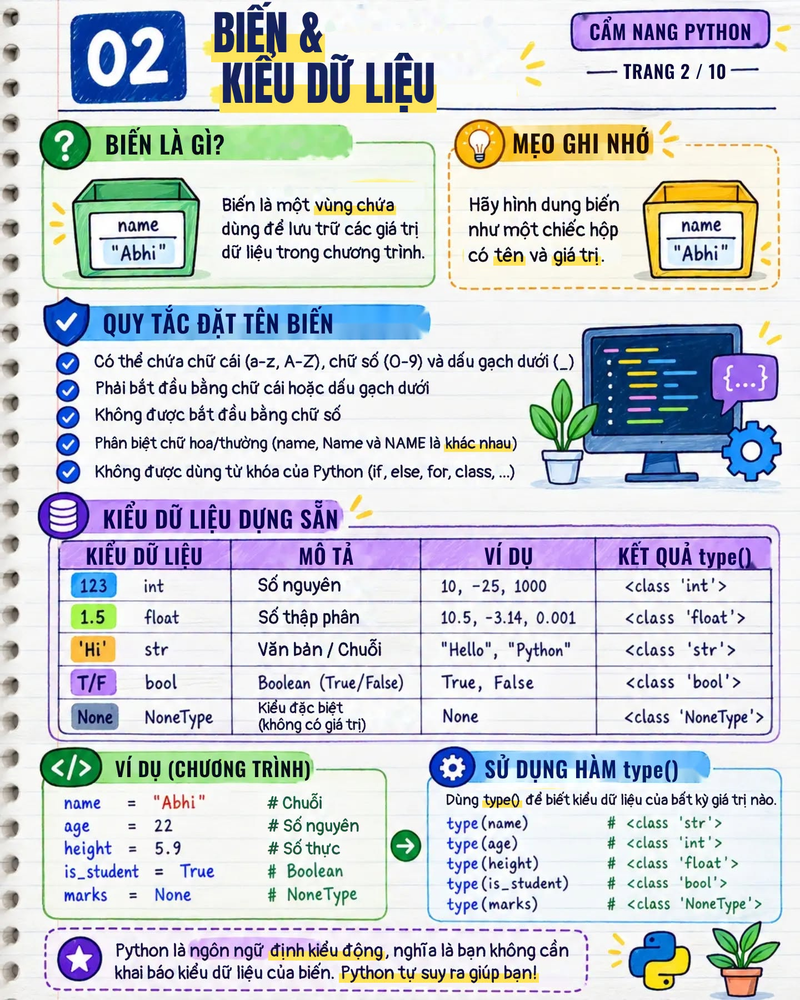
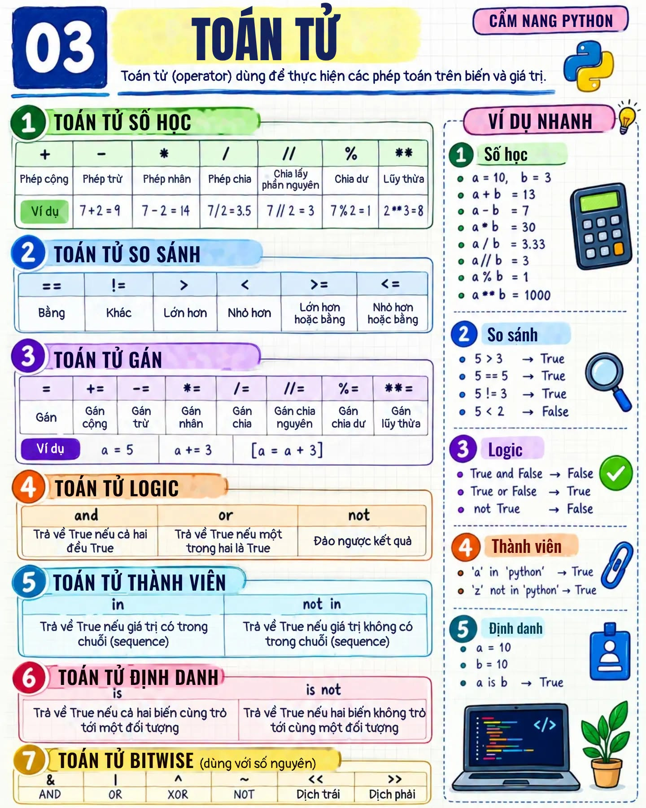
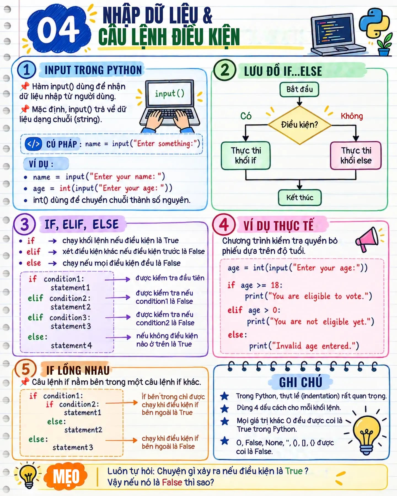
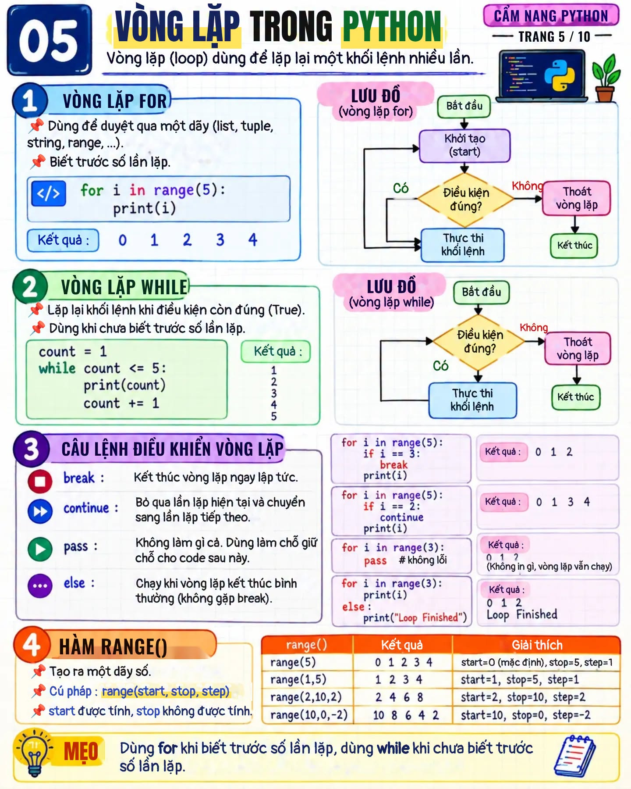
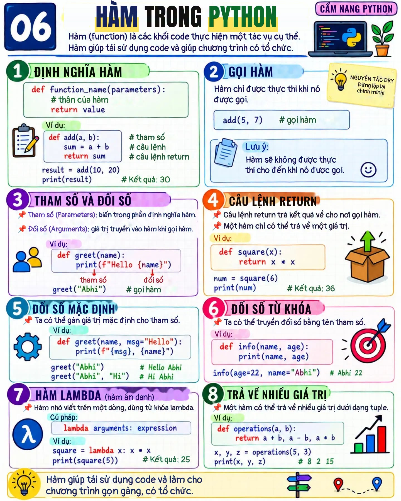
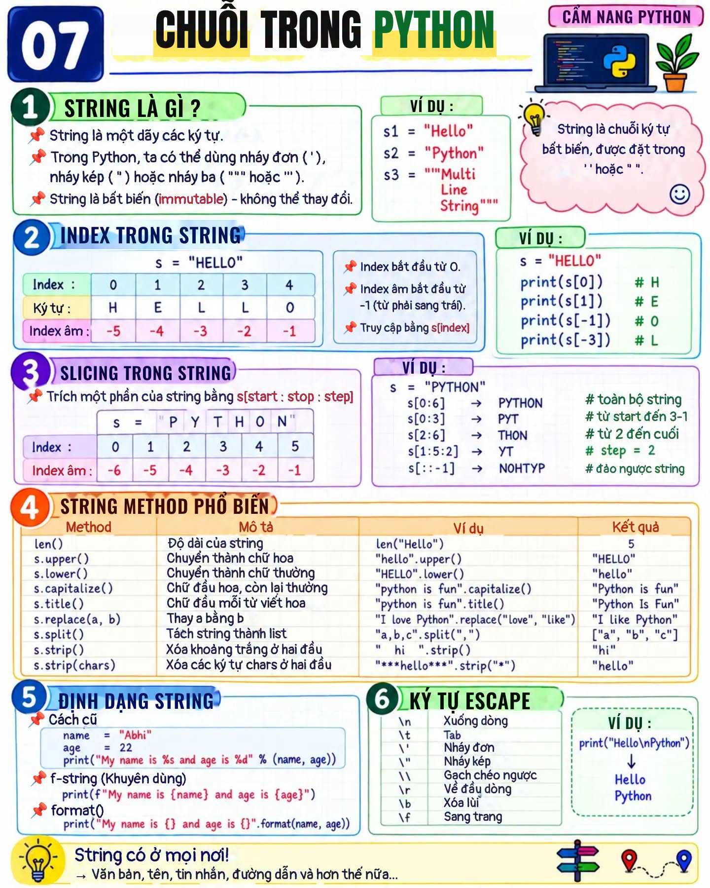
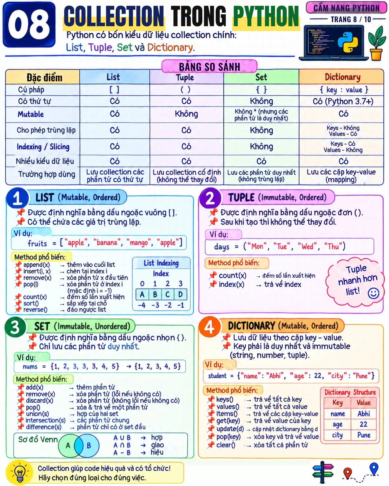
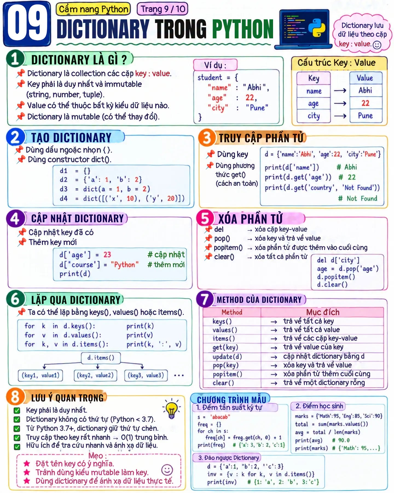
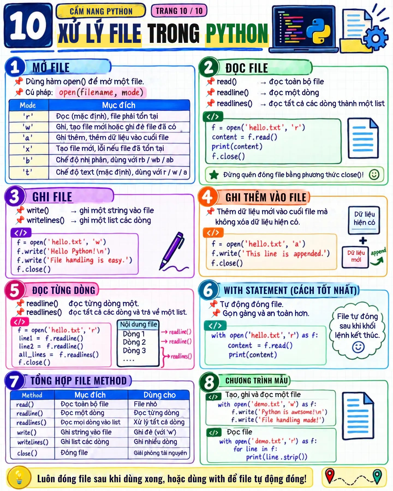

# Cẩm nang Python bằng tiếng Việt

- **Nguồn bài viết:** [Facebook — Việt Nguyễn AI](https://web.facebook.com/vietnh1009/posts/pfbid02wJj6RDERuLsVqGBvCBp71djHx1goEu2TdcUYfyiTzGCXWdMDuSqowFBtfPTPySj2l)
- **Thời gian đăng:** Tuesday 17 November 2026 at 16:00
- **Thư mục hình ảnh gốc (10 trang):** `raw/screenshots/python-handbook/` (`00.jpg` – `09.jpg`)

---

## Nội Dung Nguyên Văn Bài Đăng Facebook

> Cẩm nang Python bằng tiếng Việt 🔥
> Mình xin chia sẻ bộ cẩm nang Python gồm 10 trang, tóm tắt gọn các kiến thức nền tảng: giới thiệu Python, biến và kiểu dữ liệu, toán tử, câu lệnh điều kiện, vòng lặp, hàm, string, các collection (List, Tuple, Set, Dictionary) và xử lý file. 
> Mỗi phần đều có ví dụ code ngắn, bảng so sánh và sơ đồ minh họa, rất phù hợp để tra cứu nhanh hoặc ôn lại kiến thức khi cần.

---

## Chi Tiết 10 Trang Hình Ảnh Đính Kèm (Visual Transcription)

### Trang 1 / 10 — Giới thiệu về Python

- **Python là gì?** Ngôn ngữ lập trình bậc cao (*high-level*), thông dịch (*interpreted*) và đa dụng (*general-purpose*). Dễ học, dễ đọc nên phù hợp với người mới bắt đầu đồng thời đủ mạnh cho dân chuyên nghiệp (*Đơn giản • Mạnh mẽ • Linh hoạt*).
- **Vì sao dùng Python?**
  - Cú pháp đơn giản, dễ đọc (giống tiếng Anh) • Ngôn ngữ bậc cao (*high-level*) • Định kiểu động (*dynamically typed*) • Ngôn ngữ thông dịch (*interpreted*).
  - Đa nền tảng (Windows, Mac, Linux) • Thư viện chuẩn phong phú • Cộng đồng hỗ trợ rất lớn.
- **Đặc điểm của Python (8 điểm):** Dễ học • Cú pháp rõ ràng, dễ đọc • Mã nguồn mở • Khả chuyển (*portable*) • Dễ mở rộng • Dễ tích hợp • Tự động quản lý bộ nhớ • Hỗ trợ lập trình hướng đối tượng (OOP).
- **Ứng dụng của Python:** AI / Machine Learning • Tự động hóa & Scripting • An ninh mạng • Phát triển game • Phát triển Web • Khoa học dữ liệu & Phân tích • Ứng dụng GUI trên Desktop • Trực quan hóa dữ liệu.
- **Lịch sử (tóm tắt):** Do **Guido van Rossum** tạo ra và phát hành lần đầu năm **1991**. Tên gọi đặt theo chương trình truyền hình *"Monty Python's Flying Circus"*.
- **Chương trình Python đầu tiên:** `print("Hello, World!")`

### Trang 2 / 10 — Biến & Kiểu dữ liệu

- **Biến là gì?** Vùng chứa dùng để lưu trữ các giá trị dữ liệu trong chương trình (hình dung như chiếc hộp có tên và giá trị, ví dụ `name` chứa `"Abhi"`).
- **Quy tắc đặt tên biến:**
  - Chứa chữ cái (`a-z`, `A-Z`), chữ số (`0-9`) và dấu gạch dưới (`_`).
  - Phải bắt đầu bằng chữ cái hoặc dấu gạch dưới; không được bắt đầu bằng chữ số.
  - Phân biệt chữ hoa/thường (`name`, `Name`, `NAME` khác nhau).
  - Không dùng từ khóa Python (`if`, `else`, `for`, `class`, ...).
- **Kiểu dữ liệu dựng sẵn & kết quả `type()`:**

| Kiểu dữ liệu | Mô tả | Ví dụ | Kết quả `type()` |
| :--- | :--- | :--- | :--- |
| `int` | Số nguyên | `10, -25, 1000` | `<class 'int'>` |
| `float` | Số thập phân | `10.5, -3.14, 0.001` | `<class 'float'>` |
| `str` | Văn bản / Chuỗi | `"Hello", "Python"` | `<class 'str'>` |
| `bool` | Boolean (`True`/`False`) | `True, False` | `<class 'bool'>` |
| `NoneType` | Kiểu đặc biệt (không có giá trị) | `None` | `<class 'NoneType'>` |

- **Ví dụ chương trình & `type()`:** `name = "Abhi"`, `age = 22`, `height = 5.9`, `is_student = True`, `marks = None`. Python là ngôn ngữ **định kiểu động** — không cần khai báo kiểu dữ liệu trước, Python tự suy ra.

### Trang 3 / 10 — Toán tử (Operators)

1. **Toán tử số học:** `+` (cộng), `-` (trừ), `*` (nhân), `/` (chia thực: `7 / 2 = 3.5`), `//` (chia lấy phần nguyên: `7 // 2 = 3`), `%` (chia dư: `7 % 2 = 1`), `**` (lũy thừa: `2 ** 3 = 8`). *(Ghi chú đính chính bảng gốc: ô ví dụ `-` trên hình in nhầm `7 - 2 = 14`, phép đúng là `7 - 2 = 5` và `7 * 2 = 14`; ví dụ nhanh bên phải `a=10, b=3`: `a+b=13, a-b=7, a*b=30, a/b=3.33, a//b=3, a%b=1, a**b=1000`).*
2. **Toán tử so sánh:** `==` (Bằng), `!=` (Khác), `>` (Lớn hơn), `<` (Nhỏ hơn), `>=`, `<=`.
3. **Toán tử gán:** `=`, `+=`, `-=`, `*=`, `/=`, `//=`, `%=`, `**=` (`a = 5; a += 3` tương đương `a = a + 3`).
4. **Toán tử logic:** `and` (True nếu cả hai đều True), `or` (True nếu một trong hai là True), `not` (Đảo ngược kết quả).
5. **Toán tử thành viên:** `in`, `not in` (kiểm tra giá trị có trong chuỗi/sequence: `'a' in 'python' -> True`, `'z' not in 'python' -> True`).
6. **Toán tử định danh:** `is`, `is not` (kiểm tra hai biến có cùng trỏ tới một đối tượng: `a = 10; b = 10; a is b -> True`).
7. **Toán tử bitwise (dùng với số nguyên):** `&` (AND), `|` (OR), `^` (XOR), `~` (NOT), `<<` (Dịch trái), `>>` (Dịch phải).

### Trang 4 / 10 — Nhập dữ liệu & Câu lệnh điều kiện

- **1. Input trong Python:** `input()` nhận dữ liệu từ người dùng, mặc định trả về `str`. Cú pháp `name = input("Enter something:")`, ép kiểu số nguyên với `age = int(input("Enter your age: "))`.
- **2. Lưu đồ `if...else`:** Bắt đầu → Điều kiện? → Có (`Thực thi khối if`) / Không (`Thực thi khối else`) → Kết thúc.
- **3. `if`, `elif`, `else`:** Kiểm tra tuần tự `condition1` → `elif condition2` → `elif condition3` → `else`.
- **4. Ví dụ thực tế:** Chương trình kiểm tra quyền bỏ phiếu (`age >= 18` → eligible, `age > 0` → not eligible yet, `else` → invalid age).
- **5. `if` lồng nhau (*Nested if*):** `if` bên trong chỉ chạy khi điều kiện `if` bên ngoài là `True`.
- **Ghi chú & Mẹo:**
  - Thụt lề (*indentation*) bắt buộc, dùng **4 dấu cách** cho mỗi khối lệnh.
  - **Truthiness:** Mọi giá trị khác `0` đều coi là `True`; các giá trị `0, False, None, '', (), [], {}` được coi là `False`.

### Trang 5 / 10 — Vòng lặp trong Python

1. **Vòng lặp `for`:** Duyệt qua dãy (`list, tuple, string, range, ...`), dùng khi biết trước số lần lặp (`for i in range(5): print(i)` → `0 1 2 3 4`). Lưu đồ: Bắt đầu → Khởi tạo (start) → Điều kiện đúng? → Thực thi / Thoát.
2. **Vòng lặp `while`:** Lặp lại khi điều kiện còn `True`, dùng khi chưa biết trước số lần lặp (`count = 1; while count <= 5: ...` → `1..5`).
3. **Câu lệnh điều khiển vòng lặp:**
   - `break`: Kết thúc vòng lặp ngay lập tức (`0 1 2`).
   - `continue`: Bỏ qua lần lặp hiện tại, chuyển sang lần lặp tiếp theo (`0 1 3 4`).
   - `pass`: Không làm gì cả, giữ chỗ cho code sau (`# không lỗi`).
   - `else`: Chạy khi vòng lặp kết thúc bình thường mà **không gặp `break`** (`0 1 2 Loop Finished`).
4. **Hàm `range(start, stop, step)`:** `start` được tính, `stop` không được tính:
   - `range(5)` → `0 1 2 3 4` (`start=0, stop=5, step=1`)
   - `range(1,5)` → `1 2 3 4`
   - `range(2,10,2)` → `2 4 6 8`
   - `range(10,0,-2)` → `10 8 6 4 2`

### Trang 6 / 10 — Hàm trong Python

1. **Định nghĩa hàm:** `def function_name(parameters): ... return value`.
2. **Gọi hàm & Nguyên tắc DRY:** *Đừng lặp lại chính mình (Don't Repeat Yourself)*; hàm chỉ thực thi khi được gọi (`add(5, 7)`).
3. **Tham số (Parameters) vs. Đối số (Arguments):** Parameters là biến trong định nghĩa hàm (`def greet(name):`); Arguments là giá trị truyền vào khi gọi (`greet("Abhi")`).
4. **Câu lệnh `return`:** Trả kết quả về nơi gọi (khái niệm trả về một đối tượng đơn lẻ hoặc đóng gói nhiều giá trị thành tuple).
5. **Đối số mặc định:** `def greet(name, msg="Hello"):` (`greet("Abhi")` → `Hello Abhi`; `greet("Abhi", "Hi")` → `Hi Abhi`).
6. **Đối số từ khóa (*Keyword arguments*):** Truyền theo tên tham số (`info(age=22, name="Abhi")`).
7. **Hàm Lambda (hàm ẩn danh):** Viết trên một dòng `lambda arguments: expression` (`square = lambda x: x * x`).
8. **Trả về nhiều giá trị:** Dưới dạng tuple (`def operations(a, b): return a + b, a - b, a * b` → unpacking `x, y, z = operations(5, 3)`).

### Trang 7 / 10 — Chuỗi trong Python (Strings)

1. **String là gì?** Dãy ký tự đặt trong `'...'`, `"..."` hoặc `"""..."""` (multi-line). **String là bất biến (*immutable*)** — không thể thay đổi tại chỗ.
2. **Index:** Bắt đầu từ `0` từ trái sang phải (`0..4` cho `"HELLO"`) và index âm từ `-1` từ phải sang trái (`-5..-1`).
3. **Slicing (`s[start : stop : step]`):** Ví dụ `s = "PYTHON"`: `s[0:6] -> PYTHON`, `s[0:3] -> PYT`, `s[2:6] -> THON`, `s[1:5:2] -> YT`, `s[::-1] -> NOHTYP` (đảo ngược chuỗi).
4. **String Methods phổ biến:**
   - `len("Hello")` → `5`
   - `s.upper()` / `s.lower()` / `s.capitalize()` / `s.title()`
   - `s.replace(a, b)` (`"I love Python".replace("love", "like")`)
   - `s.split(",")` (`"a,b,c".split(",")` → `["a", "b", "c"]`)
   - `s.strip()` / `s.strip("*")`
5. **Định dạng String:** Cách cũ `%` (`"%s ... %d" % (name, age)`), `.format()`, và **f-string (khuyên dùng):** `f"My name is {name} and age is {age}"`.
6. **Ký tự Escape:** `\n` (xuống dòng), `\t` (tab), `\'`, `\"`, `\\`, `\r` (về đầu dòng), `\b` (xóa lùi), `\f` (sang trang).

### Trang 8 / 10 — Collection trong Python (List, Tuple, Set, Dictionary)

| Đặc điểm | List `[ ]` | Tuple `( )` | Set `{ }` | Dictionary `{ key : value }` |
| :--- | :--- | :--- | :--- | :--- |
| **Có thứ tự** | Có | Có | Không | Có (Python 3.7+) |
| **Mutable** | Có | Không | Không \* *(xem chú thích bên dưới)* | Có |
| **Cho phép trùng lặp** | Có | Có | Không | Keys: Không / Values: Có |
| **Indexing / Slicing** | Có | Có | Không | Keys: Có / Values: Không |
| **Nhiều kiểu dữ liệu** | Có | Có | Có | Có |
| **Trường hợp dùng** | Lưu collection có thứ tự | Lưu collection cố định | Lưu phần tử duy nhất | Lưu cặp key-value (mapping) |

- **1. List (Mutable, Ordered):** `append(x)`, `insert(i, x)`, `remove(x)` (xóa lần đầu), `pop(i=-1)`, `count(x)`, `sort()`, `reverse()`. Indexing dương `0..3`, âm `-4..-1`.
- **2. Tuple (Immutable, Ordered):** Nhanh hơn list! Methods: `count(x)`, `index(x)`.
- **3. Set (Unordered, Unique Elements):** Sơ đồ Venn (`A ∪ B` hợp, `A ∩ B` giao, `A - B` hiệu). Methods: `add(x)`, `remove(x)` *(lỗi nếu không có)*, `discard(x)` *(không lỗi)*, `pop()`, `union(s)`, `intersection(s)`, `difference(s)`. *(Lưu ý kỹ thuật: trên slide ghi nhãn card "SET (Immutable, Unordered)" và bảng ghi "Không \*" — thực tế trong Python, bản thân container `set` là **mutable** cho phép `add/remove`, chỉ các **phần tử** bên trong set mới bắt buộc phải immutable/hashable; đối chiếu `frozenset` cho bất biến hoàn toàn).*
- **4. Dictionary (Mutable, Ordered từ 3.7+):** Key phải duy nhất và immutable (`string`, `number`, `tuple`). Methods: `keys()`, `values()`, `items()`, `get(key)`, `update(d)`, `pop(key)`, `clear()`.

### Trang 9 / 10 — Dictionary trong Python

1. **Dictionary là gì?** Collection các cặp `key: value`; key duy nhất và immutable; value thuộc bất kỳ kiểu dữ liệu nào; dictionary là mutable.
2. **Tạo Dictionary:** `d1 = {}`, `d2 = {'a': 1, 'b': 2}`, `d3 = dict(a=1, b=2)`, `d4 = dict([('x', 10), ('y', 20)])`.
3. **Truy cập phần tử:** `d['name']` hoặc an toàn hơn với **`d.get('country', 'Not Found')`**.
4. **Cập nhật:** `d['age'] = 23` (cập nhật) / `d['course'] = 'Python'` (thêm mới).
5. **Xóa phần tử:** `del d['city']`, `age = d.pop('age')`, `d.popitem()` (xóa cặp thêm sau cùng), `d.clear()`.
6. **Lặp qua Dictionary:** `d.keys()`, `d.values()`, `d.items()` trả về từng `(key, value)`.
7. **Bảng Method:** `keys()`, `values()`, `items()`, `get(key)`, `update(d)`, `pop(key)`, `popitem()`, `clear()`.
8. **Lưu ý quan trọng & Độ phức tạp:** Không có thứ tự trước Python 3.7; **Python 3.7+ giữ thứ tự chèn**; truy cập theo key rất nhanh **O(1) trung bình**. Tránh dùng kiểu mutable làm key.
9. **3 Chương trình mẫu:**
   - Đếm tần suất ký tự dùng `freq.get(ch, 0) + 1`.
   - Tính điểm trung bình học sinh qua `sum(marks.values()) / len(marks)`.
   - Đảo ngược Dictionary qua dict comprehension `{v: k for k, v in d.items()}`.

### Trang 10 / 10 — Xử lý File trong Python (File Handling)

1. **Mở File (`open(filename, mode)`):**
   - `'r'`: Đọc (mặc định, file phải tồn tại)
   - `'w'`: Ghi (tạo mới hoặc ghi đè file đã có)
   - `'a'`: Ghi thêm (*append* vào cuối file)
   - `'x'`: Tạo file mới (báo lỗi nếu file đã tồn tại)
   - `'b'`: Chế độ nhị phân (`rb / wb / ab`)
   - `'t'`: Chế độ text (mặc định, `r / w / a`)
2. **Đọc File:** `read()` (toàn bộ file — dùng cho file nhỏ), `readline()` (một dòng), `readlines()` (tất cả các dòng thành một `list`). Nhớ gọi `f.close()`.
3. **Ghi File:** `write()` (ghi chuỗi, ghi đè với `'w'`), `writelines()` (ghi list các dòng).
4. **Ghi thêm (`'a'`):** Thêm dữ liệu mới vào cuối mà giữ nguyên dữ liệu cũ.
5. **Đọc từng dòng:** So sánh `readline()` lấy `Dòng 1`, `Dòng 2` vs `readlines()` trả về toàn bộ danh sách dòng.
6. **`with` statement (Cách tốt nhất):** Context manager tự động đóng file ngay khi khối lệnh kết thúc (`with open('hello.txt', 'r') as f:`).
7. **Tổng hợp Method & Chương trình mẫu:** Tạo/ghi `demo.txt` và duyệt từng dòng tối ưu bộ nhớ bằng `for line in f: print(line.strip())`.
