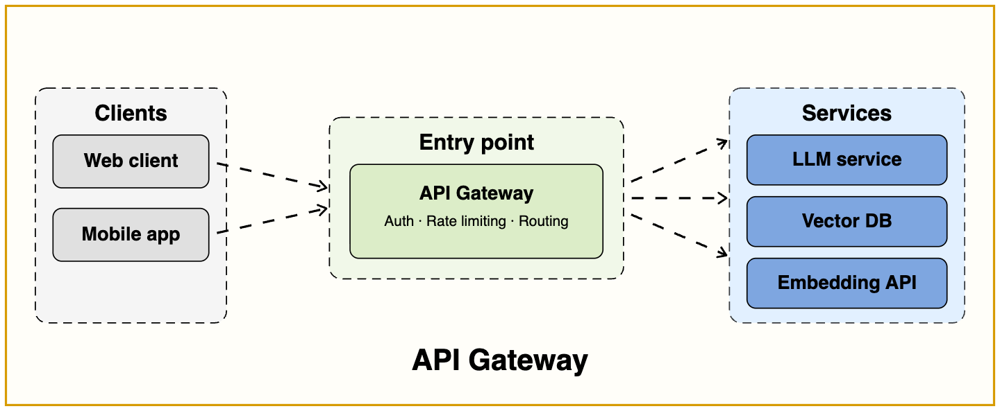
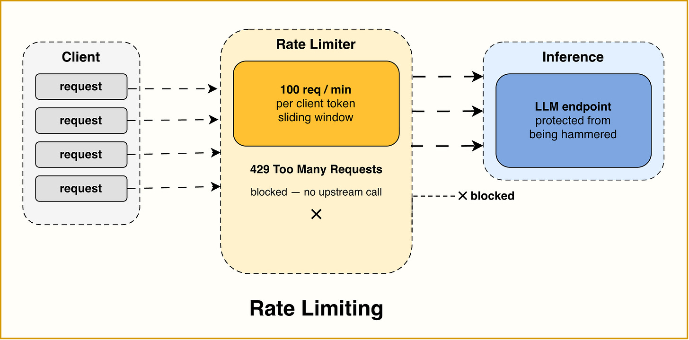
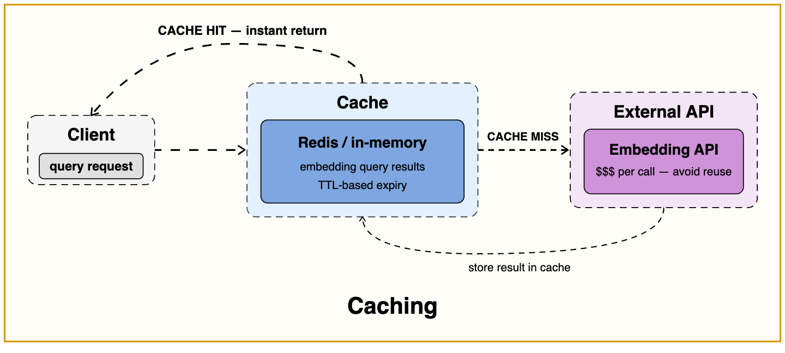
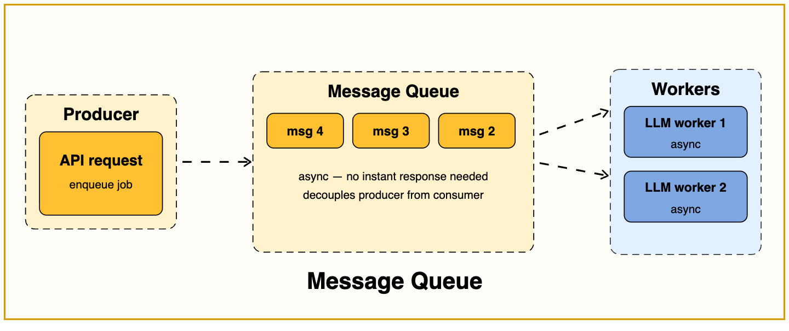
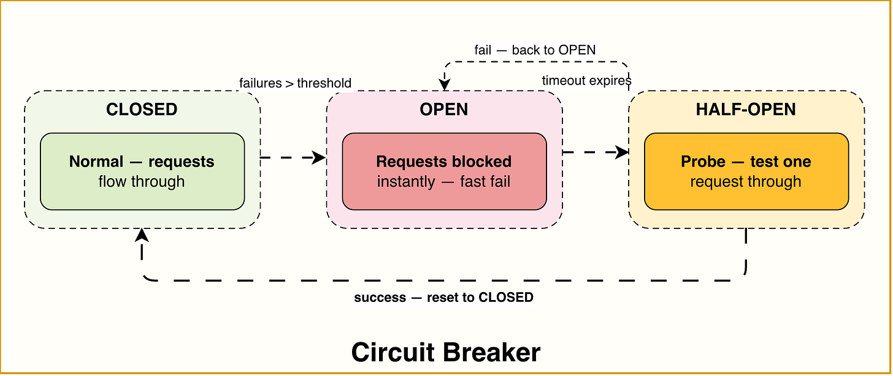
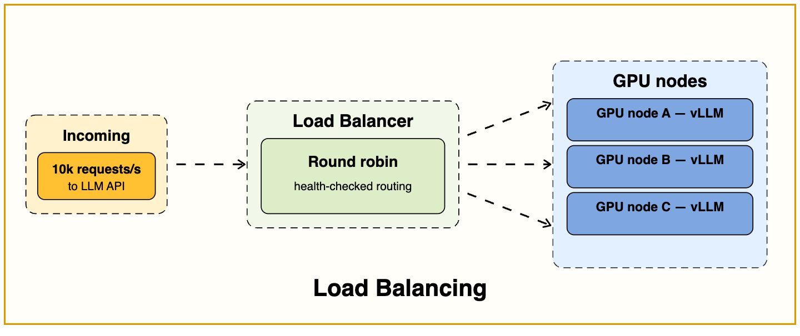
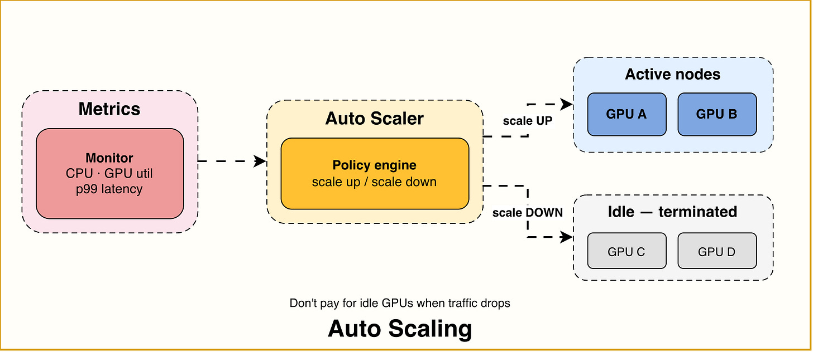

# System Design for AI Engineers: 7 patterns you should know in your interviews

- **Nguồn bài viết:** https://jamwithai.substack.com/p/system-design-for-ai-engineers-7
- **Thời gian đăng:** 2026-04-09T20:33:54+07:00
- **Thư mục hình ảnh gốc (7 trang):** `raw/screenshots/system-design-for-ai-engineers-7-patterns/`

---

## Nội Dung Nguyên Văn Bài Viết

# System Design for AI Engineers: 7 patterns you should know in your interviews

### You know transformers. You know RAG. But can you explain what happens when your LLM API gets 10,000 concurrent requests?

There is a question that separates AI engineers who get offers from those who don’t, and it has nothing to do with model architectures.

It sounds like this: “How would you deploy and scale this system in production?”

Most ML engineers freeze. They can explain attention mechanisms in detail but cannot answer what happens when their vector database goes down mid-query. They can fine-tune a model but cannot explain how to protect an inference endpoint from a traffic spike.

This is the gap interviewers are testing for. Not whether you can build a model, but whether you can keep it alive in production. The good news is, for AI engineering roles specifically, seven system design pattern architectures cover the vast majority of what you will be asked.

Here are those seven, why they matter for AI systems, and how they typically come up in interviews.

Jam with AI is a reader-supported publication. To receive new posts and support my work, consider becoming a free or paid subscriber.

## Important: Learning Agentic RAG?

Check below:

✅ Live walkthrough of that week’s code✅ Deeper insights into design tradeoffs, infra, and architecture✅ Debugging support on your implementation✅ How to go beyond and deploy these solutions in production

Course → https://learn.jamwithai.dev/b/ATaKy

Use Coupon code - JMJCAWJ64E to get 30% discount.

## 1. API Gateway

What it does: Acts as the single entry point for all client requests, handling authentication, routing, rate limiting, and protocol translation before anything reaches your model.

Why it matters for AI systems: In a typical LLM-powered application, you might have separate services for embedding generation, retrieval, inference, and post-processing. Without a gateway, every client needs to know the address of every service. An API Gateway abstracts that complexity. It authenticates the request once, routes it to the right backend, and enforces policies like rate limiting and request validation before a single GPU cycle is spent.

Interview signal: When an interviewer asks “Walk me through how a request flows through your system,” they want to hear that you start with a gateway, not that you jump straight to the model.

## 2. Rate Limiting

What it does: Controls how many requests a client can make within a given time window.

Why it matters for AI systems: LLM inference is expensive. A single completion call can cost cents, and a bad actor or a misconfigured client can rack up thousands of dollars in minutes. Rate limiting is your first financial defense. It also protects model availability. If one tenant sends a burst of heavy prompts, rate limiting prevents them from starving other users of GPU time.

Interview signal: “How would you prevent a denial-of-wallet attack on your inference API?” If you don’t mention rate limiting within the first 30 seconds, you have already lost points.

## 3. Caching

What it does: Stores the results of previous computations so identical requests don’t trigger redundant work.

Why it matters for AI systems: Embedding generation is the most cacheable layer in any RAG pipeline. If 200 users search for “how to reset my password,” you do not need to compute that embedding 200 times. A Redis or Memcached layer in front of your embedding service can cut latency from hundreds of milliseconds to single-digit milliseconds and dramatically reduce your compute bill. Semantic caching takes this further by matching queries that are similar, not just identical.

Interview signal: “Your embedding API is getting the same queries repeatedly. How do you optimize it?” The answer is caching, and bonus points if you bring up semantic similarity thresholds for near-duplicate detection.

## 4. Message Queues

What it does: Decouples producers (the services sending work) from consumers (the services doing the work) by placing an asynchronous buffer between them.

Why it matters for AI systems: Not every LLM call needs a synchronous response. Batch summarization, document processing, and offline evaluation jobs are better served by dropping requests into a queue (RabbitMQ, SQS, Kafka) and letting workers pull them at their own pace. This absorbs traffic spikes without overloading your inference servers and gives you natural retry semantics when a model call fails.

Interview signal: “You need to process 50,000 documents through your summarization pipeline. How would you architect it?” If you describe a synchronous loop hitting an LLM endpoint 50,000 times, the interview is effectively over. The answer is a queue-backed worker pool.

## 5. Circuit Breakers

What it does: Monitors calls to a downstream service and trips open when failures exceed a threshold, temporarily stopping all traffic to that service to give it time to recover.

Why it matters for AI systems: AI pipelines have cascading failure risk. Your RAG system calls an embedding service, a vector store, and an LLM in sequence. If the vector store starts timing out, without a circuit breaker, every request backs up waiting for a response that is never coming. That backlog exhausts your connection pool, which takes down the embedding service, which takes down everything. A circuit breaker detects the vector store failures early, trips open, and returns a fast fallback response instead of propagating the failure.

Interview signal: “What happens when your vector database goes down mid-query?” This is where the circuit breaker shines. Describe the three states: closed (normal traffic), open (all calls blocked, return fallback), half-open (test a few requests to see if the service has recovered). Interviewers love hearing that you think about failure modes, not just the happy path.

## 6. Load Balancing

What it does: Distributes incoming requests across multiple server instances so no single node gets overwhelmed.

Why it matters for AI systems: GPU-backed inference servers are the bottleneck in any AI system. A single A100 can only handle so many concurrent requests before latency degrades. Load balancing across multiple GPU nodes is not optional at scale, it is the baseline. For AI workloads specifically, you often want weighted or least-connections balancing rather than simple round-robin, because inference request costs vary wildly. A 50-token completion is not the same load as a 4,000-token generation.

Interview signal: “How would you handle 10,000 concurrent requests to your LLM API?” Load balancing is part of the answer (alongside rate limiting and auto scaling). Mention that you would use health checks to route around degraded nodes and explain why round-robin is often insufficient for variable-cost inference.

## 7. Auto Scaling

What it does: Automatically adds or removes compute resources based on real-time metrics like CPU utilization, request queue depth, or GPU memory usage.

Why it matters for AI systems: GPU nodes are expensive. Running four A100 instances 24/7 when your traffic only justifies them for six hours a day is a fast way to burn budget. Auto scaling ties your infrastructure cost directly to actual demand. Scale up when request latency crosses a threshold. Scale down when utilization drops. For AI workloads, the metrics you scale on matter more than in traditional systems. CPU utilization alone is often misleading because a GPU node can be at 10% CPU and 95% GPU. You need to scale on GPU utilization, inference queue depth, or custom latency percentiles.

Interview signal: “Your LLM API gets 10x traffic at 9am and almost nothing at 3am. How do you manage cost?” The answer is auto scaling with GPU-aware metrics, and you should mention that cold-start latency for model loading means you need predictive scaling in addition to reactive scaling.

## How to Use This in Your Next Interview

When you get a system design question in an AI engineering interview, start from the outside and work inward:

Traffic enters through the API Gateway. Mention auth, routing, provider failover, and token-aware rate limiting. Rate limiting protects your budget and availability. Call out the denial-of-wallet risk and distinguish between RPM and TPM limits. Caching sits in front of your most expensive operations. Embedding generation and repeated queries are the first targets. Bring up semantic caching. Message queues decouple synchronous requests from heavy async work. Document processing, batch jobs, evaluations. Circuit breakers protect against cascading failures. Name the three states and propose a fallback strategy. Load balancing distributes across GPU nodes. Mention inference-aware health checks and why round-robin fails for variable-cost requests. Auto scaling ties cost to demand. Bring up GPU-aware metrics and cold-start latency.

Walk through this flow on the whiteboard and you will cover 90% of what system design questions in AI interviews are probing for. The interviewer is not expecting a distributed systems PhD. They are checking that you think beyond the model.

## Resources to Go Deeper
- System Design Interview - An Insider’s Guide (Vol. 1 & 2) by Alex Xu. The standard reference for system design interviews. Clear visual diagrams and step-by-step frameworks.
- Designing Data-Intensive Applications by Martin Kleppmann. The deeper engineering reference covering distributed systems fundamentals that underpin every pattern in this post.
- Building Generative AI Services with FastAPI by Alireza Parandeh (O’Reilly, 2025). Specifically covers concurrency, rate limiting, and security patterns for AI-serving backends.Jam with AI is a reader-supported publication. To receive new posts and support my work, consider becoming a free or paid subscriber.

---

## Thư Viện 7 Trang Hình Ảnh Đính Kèm

### Trang 1 / 7 *(1440x606)*

### Trang 2 / 7 *(1456x719)*

### Trang 3 / 7 *(1440x648)*

### Trang 4 / 7 *(1440x606)*

### Trang 5 / 7 *(1456x614)*

### Trang 6 / 7 *(1440x606)*

### Trang 7 / 7 *(1456x632)*

## Liên Kết Tham Khảo

- https://substack.com/@shirinkjam
- https://learn.jamwithai.dev/b/ATaKy
- https://substackcdn.com/image/fetch/$s_!yTfq!,f_auto,q_auto:good,fl_progressive:steep/https%3A%2F%2Fsubstack-post-media.s3.amazonaws.com%2Fpublic%2Fimages%2F8c1ebcf3-af21-4ce8-a015-75a1734314c2_1440x606.png
- https://substackcdn.com/image/fetch/$s_!oHnM!,f_auto,q_auto:good,fl_progressive:steep/https%3A%2F%2Fsubstack-post-media.s3.amazonaws.com%2Fpublic%2Fimages%2Fd8f7754d-4f6f-4d65-94f7-efe95f939cc0_2592x1280.png
- https://substackcdn.com/image/fetch/$s_!kkcl!,f_auto,q_auto:good,fl_progressive:steep/https%3A%2F%2Fsubstack-post-media.s3.amazonaws.com%2Fpublic%2Fimages%2F6b20a9f1-72cf-4227-bc4f-dcf81fb77084_1440x648.png
- https://substackcdn.com/image/fetch/$s_!-THo!,f_auto,q_auto:good,fl_progressive:steep/https%3A%2F%2Fsubstack-post-media.s3.amazonaws.com%2Fpublic%2Fimages%2Fcb95127a-0969-4816-81fe-f4ba6f8b23e9_1440x606.png
- https://substackcdn.com/image/fetch/$s_!48WE!,f_auto,q_auto:good,fl_progressive:steep/https%3A%2F%2Fsubstack-post-media.s3.amazonaws.com%2Fpublic%2Fimages%2F0d6f34ec-6fcb-4cee-97eb-794ea598ef6d_2696x1136.png
- https://substackcdn.com/image/fetch/$s_!Gx7x!,f_auto,q_auto:good,fl_progressive:steep/https%3A%2F%2Fsubstack-post-media.s3.amazonaws.com%2Fpublic%2Fimages%2Fd8c4f877-2755-4ab0-a074-ca6f924f59c4_1440x606.png
- https://substackcdn.com/image/fetch/$s_!r4za!,f_auto,q_auto:good,fl_progressive:steep/https%3A%2F%2Fsubstack-post-media.s3.amazonaws.com%2Fpublic%2Fimages%2F52d352d3-ac17-4c86-8f26-805137dc045d_2736x1188.png
- https://substack.com/profile/19659448-sonjia-tekla
- https://substack.com/profile/85835292-mehul
- https://substack.com/profile/17460082-daryl-luna-ray
- https://substack.com/profile/111863193-kolumam
- https://substack.com/profile/18488959-arsalan-akhter
- https://substack.com/note/p-193572800/restacks?utm_source=substack&utm_content=facepile-restacks
