# Transformers: Detailed Notes & Revision Guide

- **Tác giả:** [[Abhinav Gupta]] (`@techyy_bandaa` / `@techyy_bandaa2.0`)
- **Nguồn gốc Instagram:** https://www.instagram.com/techyy_bandaa/p/DdQPCJoEuaU/
- **Thời gian đăng:** `2026-09-14T04:04:20.000Z` (September 14, 2026)
- **Tương tác tại thời điểm thu thập:** 910 likes, 1,103 comments, 71 shares/sends
- **Thư mục hình ảnh gốc (16 trang `.webp`, `1440x1920`, giữ nguyên tiếng Anh):** `raw/screenshots/transformers-detailed-notes-revision-guide/` (`00.webp` – `15.webp`)

---

## Caption Nguyên Văn Bài Đăng Instagram

> 👇 Comment “PDF” below 👇
> 📩 I’ll send the PDF directly to your DM!

---

## Chi Tiết 16 Trang Ghi Chú (Phân tích song ngữ Anh–Việt)

### Slide 1 / 16 — Cover: TRANSFORMERS — Detailed Notes & Revision Guide *(1440x1920)*
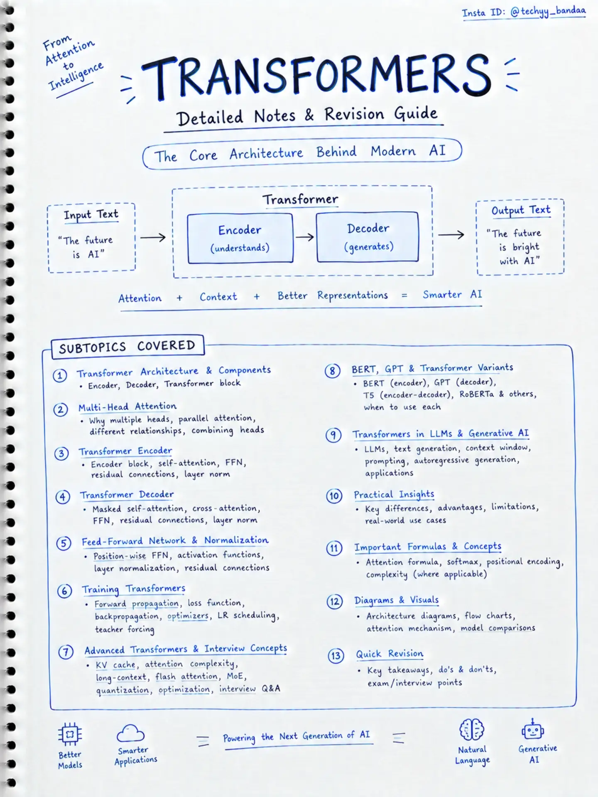

- **Thông điệp bìa:** *"From Attention to Intelligence — The Core Architecture Behind Modern AI"* · *"Attention + Context + Better Representations = Smarter AI"* · *"Better Models + Smarter Applications = Powering the Next Generation of AI"*.
- **Lưu đồ khái quát:** `Input Text ("The future is AI")` $\rightarrow$ `Transformer [Encoder (understands) -> Decoder (generates)]` $\rightarrow$ `Output Text ("The future is bright with AI")`.
- **Mục lục 13 chủ đề trên bìa (`SUBTOPICS COVERED`):** (1) Transformer Architecture & Components, (2) Multi-Head Attention, (3) Transformer Encoder, (4) Transformer Decoder, (5) FFN & Normalization, (6) Training Transformers, (7) Advanced Transformers & Interview Concepts, (8) BERT/GPT & Variants, (9) Transformers in LLMs & Generative AI, (10) Practical Insights, (11) Important Formulas, (12) Diagrams & Visuals, (13) Quick Revision *(trong đó các phần 10–13 được tích hợp trực tiếp vào từng trang chuyên đề 1–15).*

---

### Slide 2 / 16 — Page 1: Introduction to Transformers *(1440x1920)*
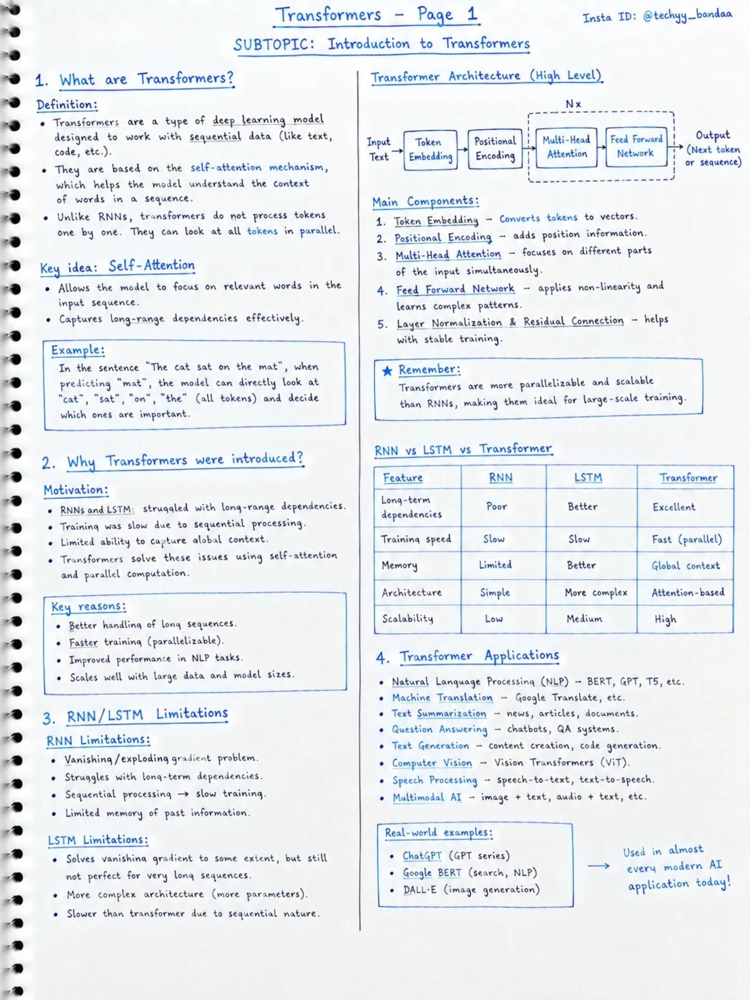

- **Transformer là gì?:** Mô hình Deep Learning cho dữ liệu chuỗi dùng **Self-Attention** để nhìn tất cả token song song thay vì xử lý tuần tự như RNN. Ví dụ *"The cat sat on the mat"*: khi dự đoán *"mat"*, mô hình chú ý trực tiếp tới mọi token trước đó.
- **5 thành phần chính trong `N ×` block:** Token Embedding, Positional Encoding, Multi-Head Attention, Feed Forward Network, Layer Normalization & Residual Connection.
- **So sánh RNN vs LSTM vs Transformer:** Transformer vượt trội ở khả năng học phụ thuộc xa (*Excellent*), huấn luyện song song (*Fast*), ngữ cảnh toàn cục (*Global context*) và khả năng mở rộng (*High scalability*) so với hạn chế vanishing gradient & xử lý tuần tự của RNN/LSTM.
- **Ứng dụng thực tế:** NLP (`BERT, GPT, T5`), Dịch máy (`Google Translate`), Tóm tắt, QA, Sinh code, Computer Vision (`ViT`), Speech, Multimodal (`DALL·E`).

---

### Slide 3 / 16 — Page 2: Transformer Architecture *(1440x1920)*
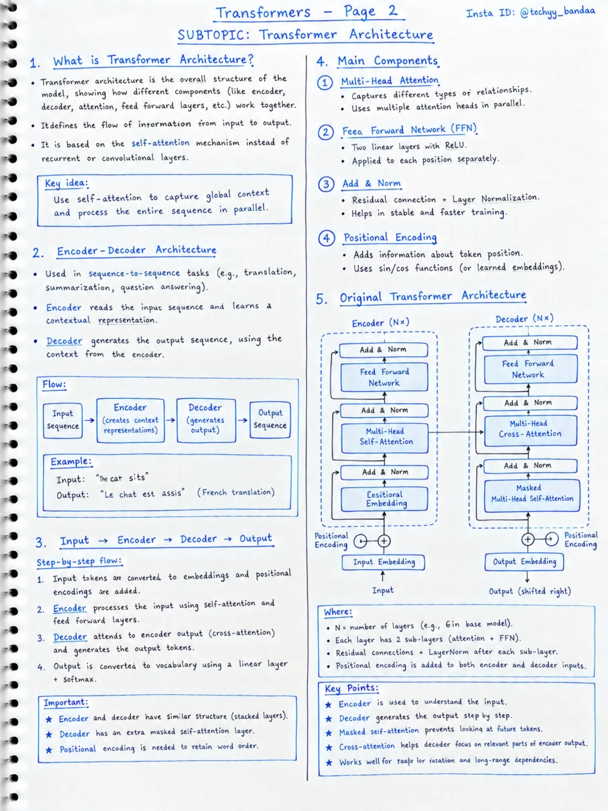

- **Kiến trúc gốc Encoder–Decoder (`Vaswani et al., 2017`, `N = 6` ở bản base):**
  - **Encoder (`N ×`)**: Input Embedding + Positional Encoding $\rightarrow$ `Multi-Head Self-Attention` $\rightarrow$ `Add & Norm` $\rightarrow$ `Feed Forward Network` $\rightarrow$ `Add & Norm`.
  - **Decoder (`N ×`)**: Output Embedding (shifted right) + Positional Encoding $\rightarrow$ `Masked Multi-Head Self-Attention` $\rightarrow$ `Add & Norm` $\rightarrow$ `Multi-Head Cross-Attention` (lấy `K, V` từ Encoder) $\rightarrow$ `Add & Norm` $\rightarrow$ `Feed Forward Network` $\rightarrow$ `Add & Norm`.
  - Đầu ra Decoder qua lớp Linear + Softmax để sinh phân phối xác suất trên vocabulary.

---

### Slide 4 / 16 — Page 3: Tokenization & Input Representation *(1440x1920)*
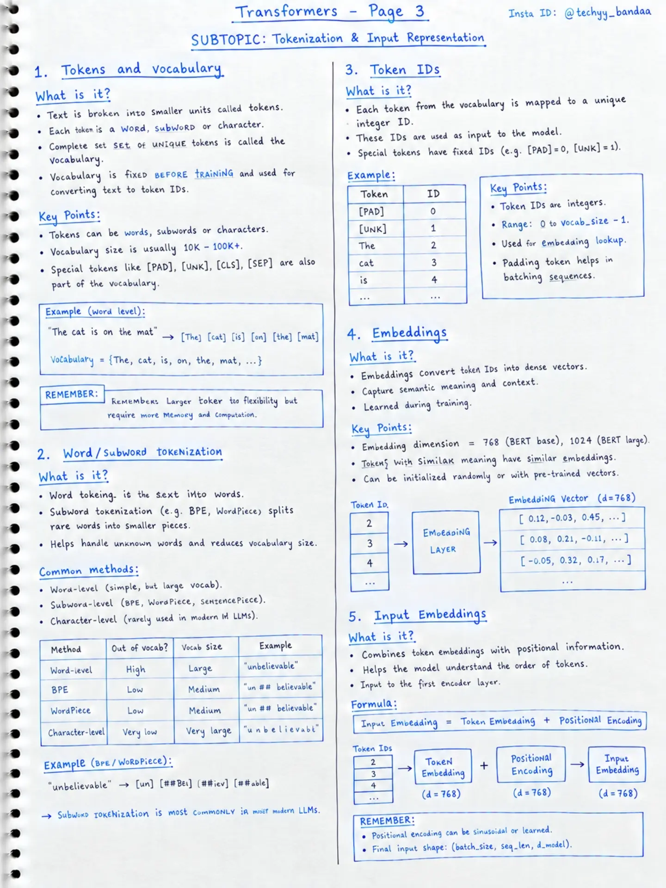

- **Tokens, Vocabulary & Token IDs:** Vocabulary (`10K–100K+`) được cố định **trước khi train**; gồm special tokens `[PAD]=0`, `[UNK]=1`, `[CLS]`, `[SEP]`. Token ID (`0` đến `vocab_size - 1`) tra cứu bảng Embedding ra dense vectors (`d=768` BERT base, `d=1024` BERT large).
- **Word vs Subword vs Character Tokenization:** Subword (`BPE`, `WordPiece`, `SentencePiece`) cho tỷ lệ Out-of-Vocabulary (*OOV*) thấp và kích thước từ vựng vừa phải (VD: `"unbelievable"` $\rightarrow$ `[un] [##bel] [##iev] [##able]`).
- **Công thức Input Embedding:** $\text{Input Embedding} = \text{Token Embedding} + \text{Positional Encoding}$, tensor kích thước `(batch_size, seq_len, d_model)`.

---

### Slide 5 / 16 — Page 4: Positional Encoding *(1440x1920)*
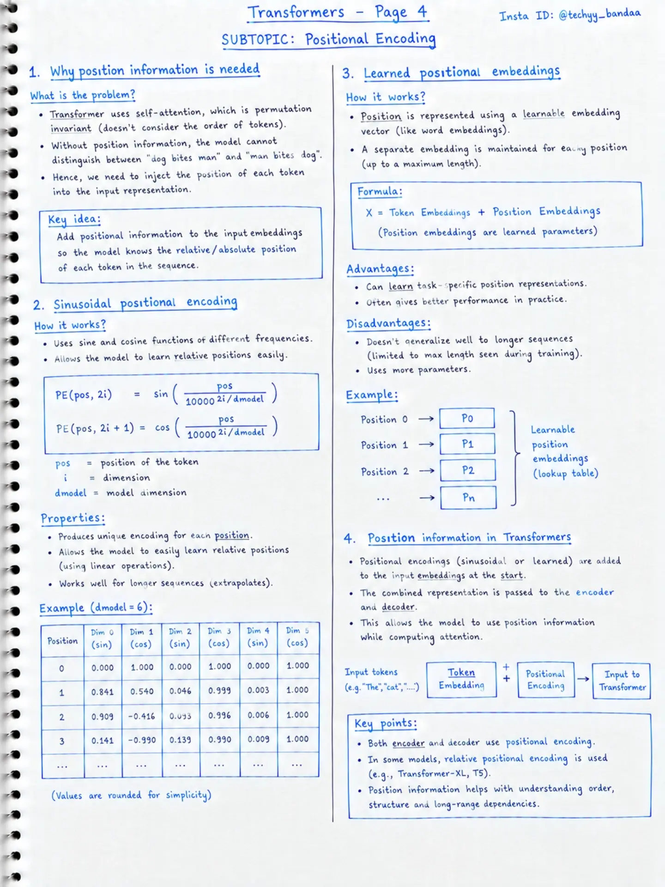

- **Bài toán Permutation Invariance:** Self-Attention không phân biệt thứ tự từ (`"dog bites man"` vs `"man bites dog"`), do đó cần nhúng thông tin vị trí.
- **Sinusoidal Positional Encoding:** Dùng các hàm $\sin$ / $\cos$ đa tần số giúp biểu diễn duy nhất từng vị trí và cho phép học quan hệ tương đối qua phép biến đổi tuyến tính, ngoại suy được tới chuỗi dài hơn:
  $$PE(pos, 2i) = \sin\left(\frac{pos}{10000^{2i/d_{\text{model}}}}\right), \qquad PE(pos, 2i+1) = \cos\left(\frac{pos}{10000^{2i/d_{\text{model}}}}\right)$$
  *(Kèm bảng số minh họa cho $d_{\text{model}} = 6$, vị trí `0..3`: `[0.000, 1.000, 0.000, 1.000, 0.000, 1.000]`, `[0.841, 0.540, 0.046, 0.999, 0.003, 1.000]`, v.v.)*
- **Learned Positional Embeddings vs Relative PE:** Learned cho kết quả thực nghiệm tốt theo tác vụ nhưng khó ngoại suy vượt độ dài train; một số mô hình dùng **Relative Positional Encoding** như `Transformer-XL`, `T5`.

---

### Slide 6 / 16 — Page 5: Self-Attention Mechanism *(1440x1920)*
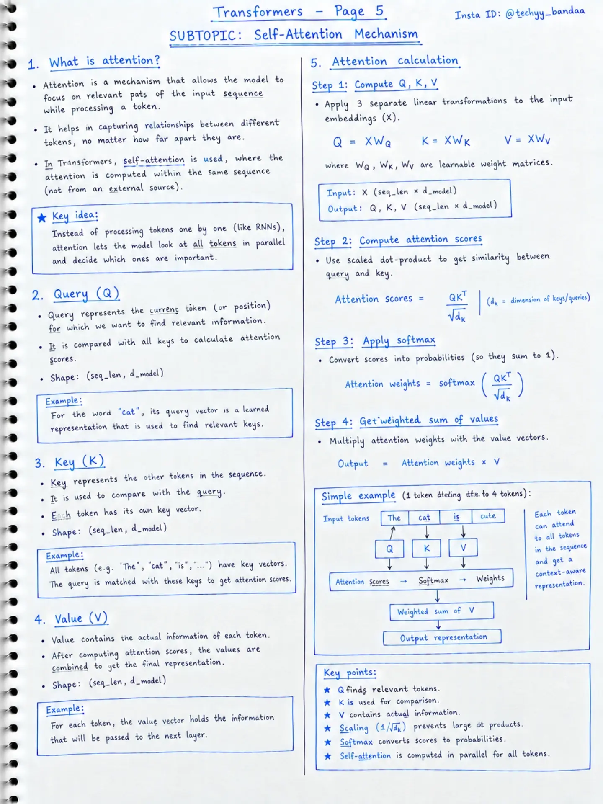

- **Trực giác Q, K, V (`shape: seq_len × d_model`):**
  - `Query (Q)`: Vector đại diện cho token đang cần tìm thông tin liên quan.
  - `Key (K)`: Vector đại diện để so khớp với Query.
  - `Value (V)`: Vector chứa thông tin thực sự sẽ được tổng hợp có trọng số.
- **4 bước tính Self-Attention:** (1) Phép chiếu tuyến tính $Q = XW_Q, K = XW_K, V = XW_V$ $\rightarrow$ (2) `Attention scores` = $\frac{QK^T}{\sqrt{d_k}}$ $\rightarrow$ (3) `Attention weights` = $\text{softmax}\left(\frac{QK^T}{\sqrt{d_k}}\right)$ $\rightarrow$ (4) `Output` = $\text{Attention weights} \times V$.

---

### Slide 7 / 16 — Page 6: Scaled Dot-Product Attention *(1440x1920)*
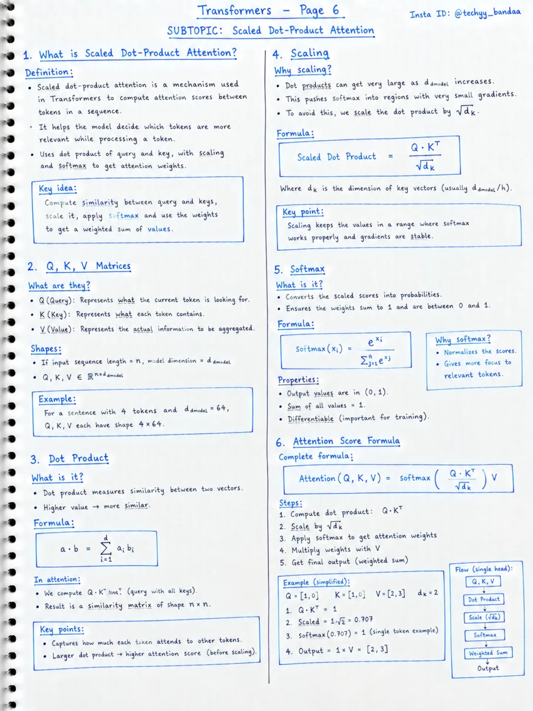

- **Vì sao phải chia cho $\sqrt{d_k}$?:** Khi $d_{\text{model}}$ lớn, tích vô hướng $Q \cdot K^T = \sum_{i=1}^d a_i b_i$ tăng phương sai mạnh, đẩy hàm Softmax vào vùng bão hòa có gradient cực nhỏ; chia cho $\sqrt{d_k}$ ($d_k = d_{\text{model}}/h$) giữ gradient ổn định.
- **Ví dụ tính tay:** $Q=[1,0], K=[1,0], V=[2,3], d_k=2 \implies Q\cdot K^T=1 \implies \text{Scaled}=1/\sqrt{2}=0.707 \implies \text{Softmax}(0.707)=1 \implies \text{Output}=[2,3]$.

---

### Slide 8 / 16 — Page 7: Multi-Head Attention *(1440x1920)*
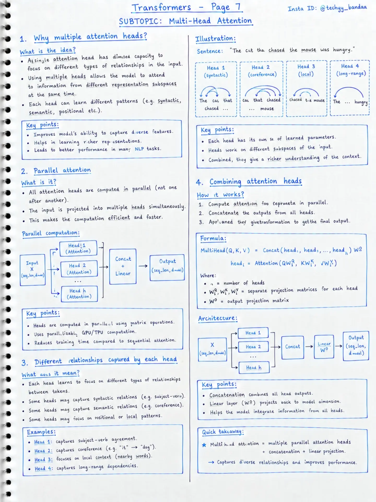

- **Chuyên môn hóa theo nhiều subspace song song:** 1 head đơn bị giới hạn dung lượng; nhiều heads học đồng thời các quan hệ khác nhau (*Head 1: cú pháp chủ–vị*, *Head 2: đồng tham chiếu coreference `"it" -> "cat"`*, *Head 3: ngữ cảnh cục bộ*, *Head 4: phụ thuộc xa*).
- **Công thức:** $\text{MultiHead}(Q,K,V) = \text{Concat}(\text{head}_1, \dots, \text{head}_h)W^O$ với $\text{head}_i = \text{Attention}(QW_i^Q, KW_i^K, VW_i^V)$.

---

### Slide 9 / 16 — Page 8: Transformer Encoder *(1440x1920)*
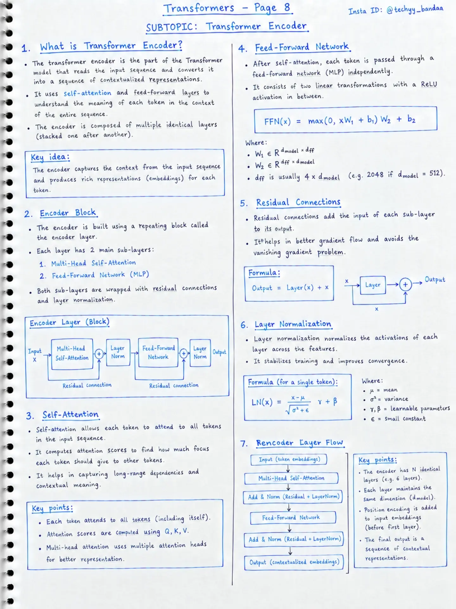

- **Cấu trúc khối Encoder (`N ×`, VD `6 layers`):** Gồm `Multi-Head Self-Attention` $\rightarrow$ `Add & Norm` $\rightarrow$ `FFN (MLP)` $\rightarrow$ `Add & Norm`, duy trì kích thước $d_{\text{model}}$ xuyên suốt.
- **FFN:** $\text{FFN}(x) = \max(0, xW_1 + b_1)W_2 + b_2$ với $W_1 \in \mathbb{R}^{d_{\text{model}} \times d_{\text{ff}}}$, $W_2 \in \mathbb{R}^{d_{\text{ff}} \times d_{\text{model}}}$ ($d_{\text{ff}} = 4 \times d_{\text{model}}$, VD `2048` khi $d_{\text{model}}=512$).
- **Residual Connection & LayerNorm:** $\text{Output} = \text{Layer}(x) + x$; $LN(x) = \frac{x-\mu}{\sqrt{\sigma^2+\epsilon}}\cdot\gamma + \beta$ giúp dòng gradient truyền ổn định vào mạng sâu.

---

### Slide 10 / 16 — Page 9: Transformer Decoder *(1440x1920)*
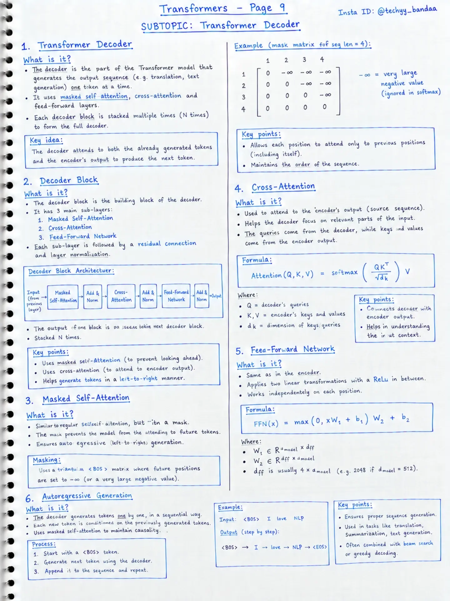

- **Decoder Block gồm 3 sublayers:** `Masked Self-Attention` $\rightarrow$ `Cross-Attention` $\rightarrow$ `Feed-Forward Network` (mỗi lớp đều có Residual + LayerNorm).
- **Causal Mask (`seq_len=4`):** Ma trận tam giác trên gán $-\infty$ cho các vị trí tương lai $j > i$ để ngăn nhìn trước (*auto-regressive left-to-right*), trong Softmax $e^{-\infty} \rightarrow 0$.
- **Cross-Attention:** Decoder tạo `Q` (queries), còn Encoder output cung cấp `K` và `V` (keys & values) để Decoder tập trung đúng vùng ngữ cảnh nguồn.
- **Sinh tự hồi quy (*Autoregressive Generation*):** Bắt đầu từ `<BOS>`, dự đoán từng token (`<BOS> -> I -> love -> NLP -> <EOS>`) kết hợp Greedy hoặc Beam Search.

---

### Slide 11 / 16 — Page 10: Feed-Forward Neural Network & Normalization *(1440x1920)*
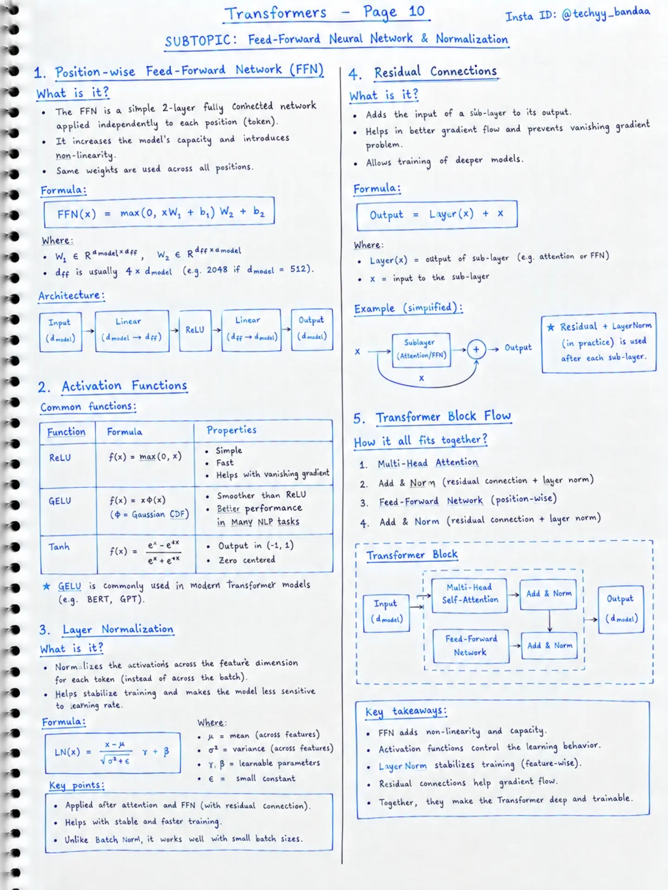

- **So sánh Activation Functions trong FFN:**
  - `ReLU`: $f(x) = \max(0, x)$ (đơn giản, nhanh).
  - `GELU`: $f(x) = x\,\Phi(x)$ với $\Phi$ là Gaussian CDF (mượt hơn ReLU, phổ biến nhất trong `BERT` và `GPT` hiện đại).
  - `Tanh`: $f(x) = \frac{e^x - e^{-x}}{e^x + e^{-x}} \in (-1, 1)$ (zero-centered).
- **LayerNorm vs BatchNorm:** LayerNorm chuẩn hóa theo chiều feature cho từng token độc lập nên hoạt động tốt ngay cả khi **batch size nhỏ**.

---

### Slide 12 / 16 — Page 11: Training Transformers *(1440x1920)*
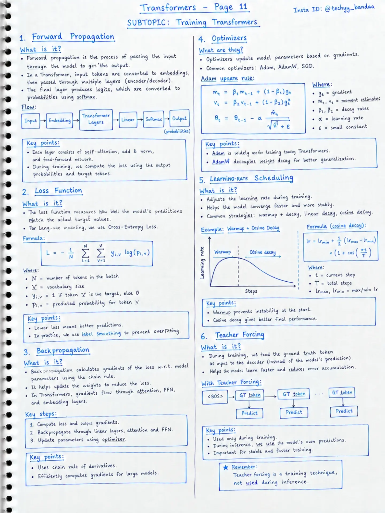

- **Cross-Entropy Loss & Label Smoothing:**
  $$L = -\frac{1}{N}\sum_{i=1}^N \sum_{v=1}^V y_{i,v} \log(p_{i,v})$$
  Dùng thêm **label smoothing** trong thực tế để chống overfitting.
- **Adam / AdamW Update Rule:**
  $$m_t = \beta_1 m_{t-1} + (1 - \beta_1)g_t, \quad v_t = \beta_2 v_{t-1} + (1 - \beta_2)g_t^2, \quad \theta_t = \theta_{t-1} - \alpha \frac{\hat{m}_t}{\sqrt{\hat{v}_t} + \epsilon}$$
  `AdamW` tách riêng weight decay để tổng quát hóa tốt hơn.
- **Warmup + Cosine Decay LR Schedule:** $\text{lr} = \text{lr}_{\min} + \frac{1}{2}(\text{lr}_{\max} - \text{lr}_{\min})\left(1 + \cos\left(\frac{\pi t}{T}\right)\right)$.
- **Teacher Forcing (Chỉ dùng khi Train!):** Trong lúc huấn luyện Decoder, đưa token đáp án chuẩn (*ground truth token*) vào làm đầu vào cho bước tiếp theo thay vì output tự dự đoán của model—giúp học nhanh và tránh tích tụ sai số (*during inference, we use model's own predictions*).

---

### Slide 13 / 16 — Page 12: Pre-training & Fine-Tuning *(1440x1920)*
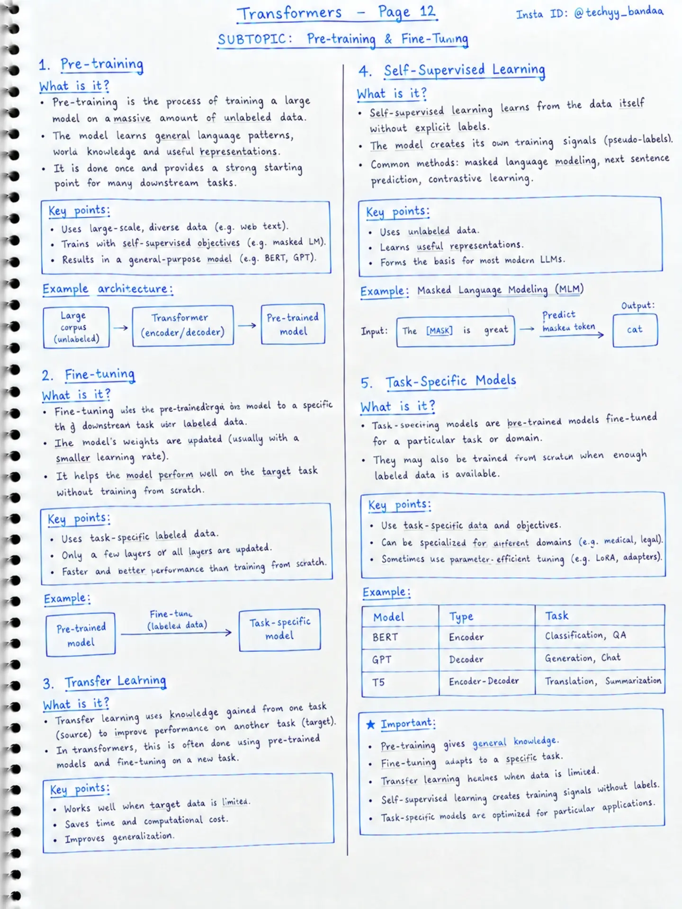

- **Pre-training (Self-Supervised trên tập lớn không nhãn):** Học tri thức tổng quát thông qua **Masked Language Modeling (`MLM`)** (*"The `[MASK]` is great" $\rightarrow$ cat*), Next Sentence Prediction, hoặc Contrastive learning.
- **Fine-Tuning & Transfer Learning:** Cập nhật trọng số với learning rate nhỏ hơn hoặc PEFT (`LoRA`, adapters) cho từng tác vụ đích (`BERT -> Classification/QA`, `GPT -> Generation/Chat`, `T5 -> Translation/Summarization`) khi dữ liệu nhãn hạn chế.

---

### Slide 14 / 16 — Page 13: BERT, GPT & Transformer Variants *(1440x1920)*
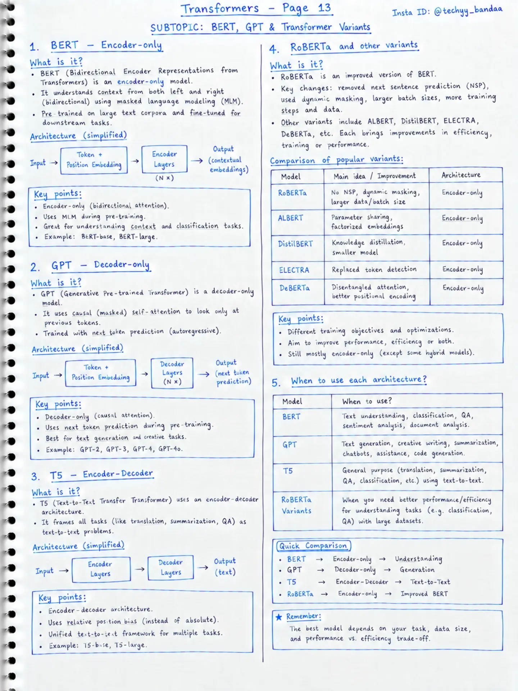

- **3 kiến trúc chủ đạo:** `BERT` (Encoder-only, bidirectional MLM), `GPT` (Decoder-only, causal autoregressive), `T5` (Text-to-Text Encoder-Decoder dùng **relative position bias**).
- **Bảng so sánh 5 biến thể BERT kinh điển:**
  | Model | Cải tiến chính | Kiến trúc |
  | :--- | :--- | :--- |
  | `RoBERTa` | Bỏ NSP, dùng dynamic masking, batch & dữ liệu lớn hơn | Encoder-only |
  | `ALBERT` | Chia sẻ tham số (parameter sharing), factorized embeddings | Encoder-only |
  | `DistilBERT` | Chưng cất tri thức (knowledge distillation), mô hình nhỏ gọn | Encoder-only |
  | `ELECTRA` | Nhiệm vụ Replaced Token Detection thay vì MLM | Encoder-only |
  | `DeBERTa` | Disentangled attention + biểu diễn vị trí tốt hơn | Encoder-only |

---

### Slide 15 / 16 — Page 14: Transformers in LLMs & Generative AI *(1440x1920)*
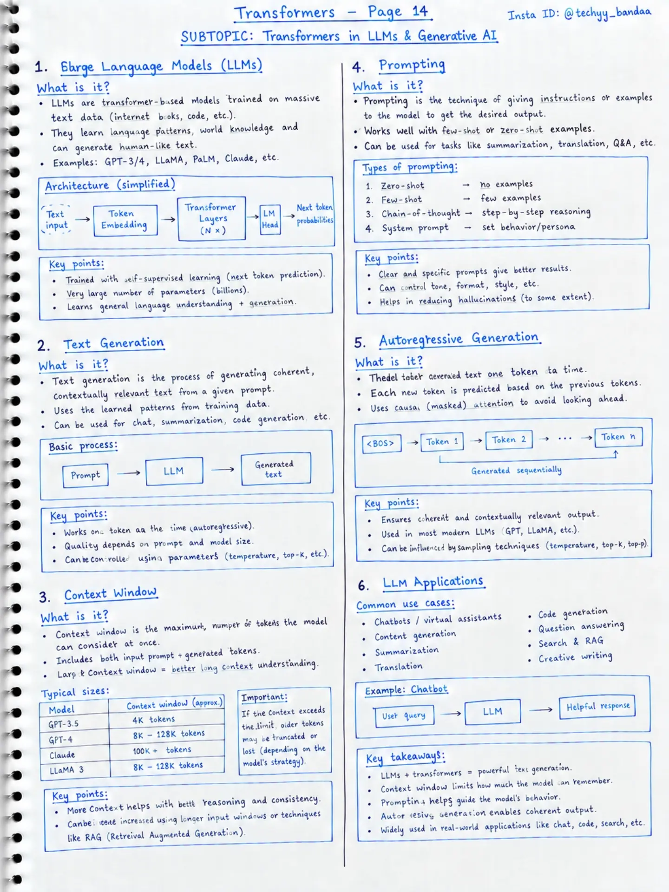

- **LLMs & Generative AI:** `Text Input -> Token Embedding -> Transformer Layers (N×) -> LM Head -> Next token probabilities`. Khả năng context window tiêu biểu: `GPT-3.5 (4K)`, `GPT-4 (8K–128K)`, `Claude (100K+)`, `LLaMA 3 (8K–128K)`. Khi vượt context window, các token cũ bị cắt bớt (*truncated/lost*); khắc phục bằng tăng cửa sổ hoặc **RAG**. Kết hợp 4 kỹ thuật Prompting (*Zero-shot, Few-shot, CoT, System prompt*) + Sampling (*temperature, top-k, top-p*).

---

### Slide 16 / 16 — Page 15: Advanced Transformers & Interview Concepts *(1440x1920)*
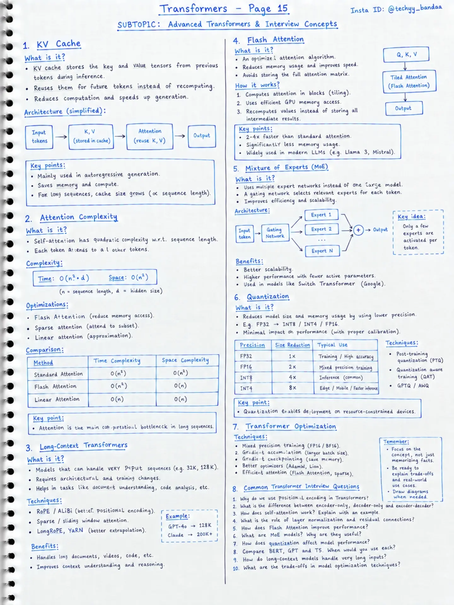

- **KV Cache & Attention Complexity:** Standard Attention tốn $O(n^2 \cdot d)$ Time và $O(n^2)$ Space. So sánh 3 phương pháp:
  | Method | Time Complexity | Space Complexity |
  | :--- | :--- | :--- |
  | Standard Attention | $O(n^2)$ | $O(n^2)$ |
  | Flash Attention *(tiling + recompute, `2–4×` faster)* | $O(n^2)$ | $O(n)$ |
  | Linear Attention *(approximation)* | $O(n)$ | $O(n)$ |
- **Long-Context Transformers (`32K–200K+`):** **`RoPE`**, **`ALiBi`**, Sparse / Sliding window attention, **`LongRoPE`**, **`YaRN`** (ngoại suy độ dài tốt hơn).
- **MoE & Quantization:** MoE Gating Network kích hoạt thưa vài expert (`Switch Transformer`). Quantization `FP32` (1×) $\rightarrow$ `FP16` (2× mixed precision) $\rightarrow$ `INT8` (4× inference) $\rightarrow$ `INT4` (8× edge/mobile) qua **PTQ (Post-Training Quantization)**, **QAT (Quantization-Aware Training)**, `GPTQ / AWQ`.
- **Transformer Optimization Toolbox:** Mixed precision (`FP16/BF16`), **Gradient accumulation**, **Gradient checkpointing**, Optimizers (`AdamW`, **`Lion`**), Flash/Sparse Attention.
- **10 Câu Hỏi Phỏng Vấn Kinh Điển Về Transformer:** (1) Vì sao cần Positional Encoding; (2) Encoder-only vs Decoder-only vs Encoder-Decoder; (3) Self-attention & ví dụ; (4) Vai trò LayerNorm & Residual; (5) Cách Flash Attention tăng tốc/giảm bộ nhớ; (6) MoE; (7) Tác động Quantization lên hiệu năng; (8) Khi nào chọn BERT vs GPT vs T5; (9) Kỹ thuật Long-context; (10) Đánh đổi giữa các kỹ thuật tối ưu.
