# Các loại Machine Learning bằng tiếng Việt: Hướng dẫn toàn diện

- **Nguồn bài viết:** [Facebook — Việt Nguyễn AI](https://web.facebook.com/vietnh1009/posts/pfbid0bwih5AZ151LaZ4FsCS1RmChKDqkCdGGuWYkUseiQNi5qv5s9qkV4PVvJbJNfjmzXl)
- **Thời gian đăng:** 2026-11-16 16:00 (UTC+7)
- **Nguồn gốc tiếng Anh được tác giả trích dẫn:** https://www.instagram.com/p/Dddnl_eDcj6/?img_index=1
- **Thư mục hình ảnh gốc (13 trang):** `raw/screenshots/types-of-machine-learning-handbook/` (`00.jpg` – `12.jpg`)

---

## Nội Dung Nguyên Văn Bài Đăng Facebook

> Các loại Machine Learning bằng tiếng Việt: Hướng dẫn toàn diện 🔥
>
> Mình xin chia sẻ bộ tài liệu tổng hợp về các loại Machine Learning, trình bày dưới dạng infographic dễ nhìn, dễ nhớ.
>
> 📌 Tổng quan các loại: Supervised, Unsupervised, Semi-Supervised, Self-Supervised và Reinforcement Learning
> 📌 Các thuật toán theo từng nhóm: Regression, Classification, Clustering, Dimensionality Reduction
> 📌 Cách đánh giá và so sánh mô hình: Accuracy, Precision, Recall, F1 Score, ROC-AUC, Cross-Validation
> 📌 Cheat sheet tổng hợp kèm các nhóm câu hỏi phỏng vấn thường gặp
>
> Tài liệu phù hợp cho bạn đang bắt đầu với Machine Learning hoặc cần hệ thống lại kiến thức trước khi đi phỏng vấn.
>
> Note: Mình sử dụng AI để convert và dịch sang tiếng Việt, nên sẽ có những chỗ làm chưa thực sự tốt về nội dung hay hình ảnh so với bản gốc. Nếu bạn đọc được tiếng Anh thì có thể xem bản gốc tại: https://www.instagram.com/p/Dddnl_eDcj6/?img_index=1

---

## Chi Tiết 13 Trang Hình Ảnh Đính Kèm (Visual Transcription)

### Trang 00 (Cover) — CÁC LOẠI MACHINE LEARNING: Hướng dẫn toàn diện
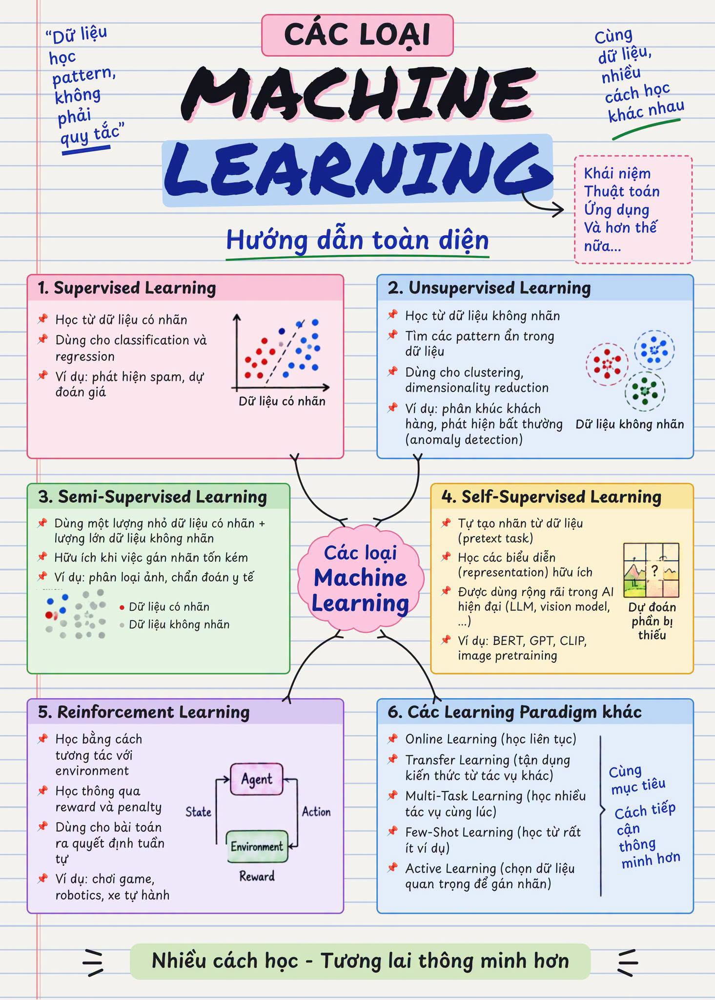

- **Ghi chú góc:** *"Dữ liệu học pattern, không phải quy tắc"* • *"Cùng dữ liệu, nhiều cách học khác nhau"* • *"Khái niệm, Thuật toán, Ứng dụng và hơn thế nữa..."*
- **6 nhánh tổng quan quanh trung tâm `Các loại Machine Learning`:**
  1. **Supervised Learning:** Học từ dữ liệu có nhãn • Dùng cho classification và regression • Ví dụ: phát hiện spam, dự đoán giá.
  2. **Unsupervised Learning:** Học từ dữ liệu không nhãn • Tìm các pattern ẩn trong dữ liệu • Dùng cho clustering, dimensionality reduction • Ví dụ: phân khúc khách hàng, phát hiện bất thường (anomaly detection).
  3. **Semi-Supervised Learning:** Dùng một lượng nhỏ dữ liệu có nhãn + lượng lớn dữ liệu không nhãn • Hữu ích khi việc gán nhãn tốn kém • Ví dụ: phân loại ảnh, chẩn đoán y tế.
  4. **Self-Supervised Learning:** Tự tạo nhãn từ dữ liệu (pretext task) • Học các biểu diễn (representation) hữu ích • Được dùng rộng rãi trong AI hiện đại (LLM, vision model, ...) • Ví dụ: BERT, GPT, CLIP, image pretraining (minh họa dự đoán phần bị thiếu).
  5. **Reinforcement Learning:** Học bằng cách tương tác với environment • Học thông qua reward và penalty • Dùng cho bài toán ra quyết định tuần tự • Sơ đồ vòng lặp `Agent → Action → Environment → State / Reward → Agent` • Ví dụ: chơi game, robotics, xe tự hành.
  6. **Các Learning Paradigm khác:** Online Learning (học liên tục) • Transfer Learning (tận dụng kiến thức từ tác vụ khác) • Multi-Task Learning (học nhiều tác vụ cùng lúc) • Few-Shot Learning (học từ rất ít ví dụ) • Active Learning (chọn dữ liệu quan trọng để gán nhãn).
- **Thông điệp kết:** *"Nhiều cách học - Tương lai thông minh hơn"*.

---

### Trang 01 — 1. Cơ bản về Machine Learning + Tổng quan các loại
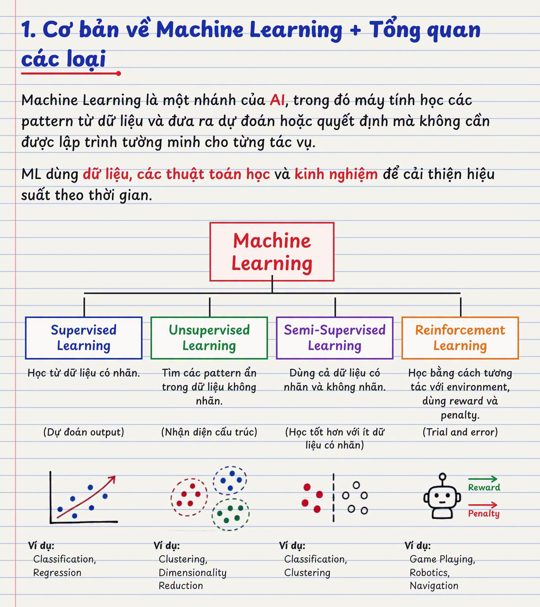

- **Định nghĩa:** Machine Learning là một nhánh của AI, trong đó máy tính học các pattern từ dữ liệu và đưa ra dự đoán hoặc quyết định mà không cần được lập trình tường minh cho từng tác vụ.
- **Cơ chế:** ML dùng **dữ liệu, các thuật toán toán học và kinh nghiệm** để cải thiện hiệu suất theo thời gian.
- **Sơ đồ phân loại 4 nhóm kinh điển:**
  - **Supervised Learning:** Học từ dữ liệu có nhãn (Dự đoán output) — Ví dụ: Classification, Regression.
  - **Unsupervised Learning:** Tìm các pattern ẩn trong dữ liệu không nhãn (Nhận diện cấu trúc) — Ví dụ: Clustering, Dimensionality Reduction.
  - **Semi-Supervised Learning:** Dùng cả dữ liệu có nhãn và không nhãn (Học tốt hơn với ít dữ liệu có nhãn) — Ví dụ: Classification, Clustering.
  - **Reinforcement Learning:** Học bằng cách tương tác với environment, dùng reward và penalty (Trial and error) — Ví dụ: Game Playing, Robotics, Navigation.

---

### Trang 02 — Supervised Learning
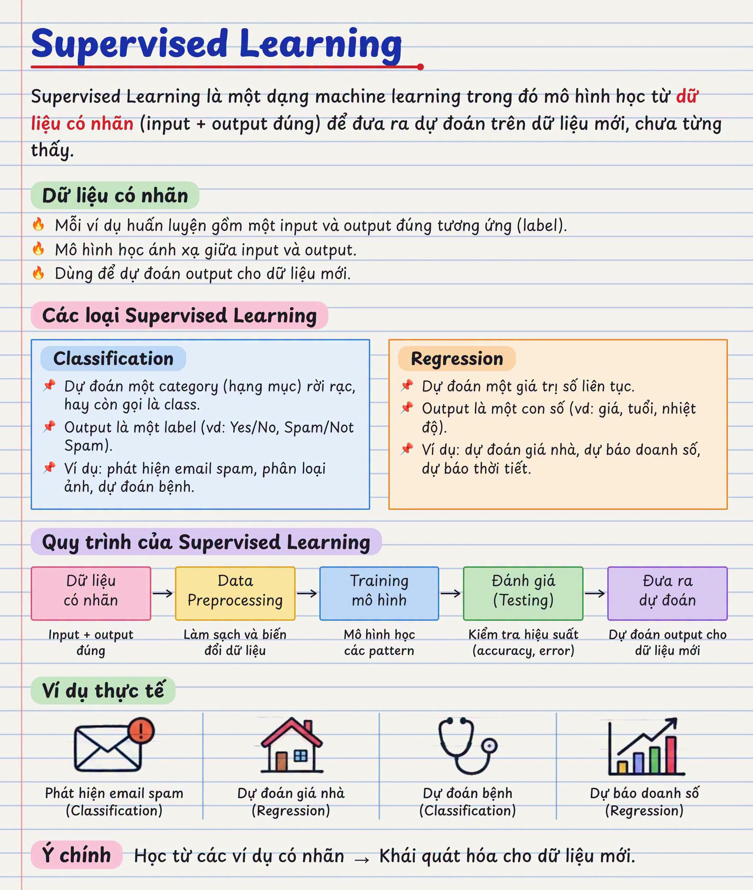

- **Định nghĩa:** Supervised Learning là một dạng Machine Learning trong đó mô hình học từ **dữ liệu có nhãn** (`input + output đúng`) để đưa ra dự đoán trên dữ liệu mới, chưa từng thấy.
- **Dữ liệu có nhãn:** Mỗi ví dụ huấn luyện gồm một input và output đúng tương ứng (label); mô hình học ánh xạ giữa input và output.
- **2 loại chính:**
  - **Classification:** Dự đoán một category (hạng mục) rời rạc / class; output là một label (vd: Yes/No, Spam/Not Spam). Ví dụ: phát hiện email spam, phân loại ảnh, dự đoán bệnh.
  - **Regression:** Dự đoán một giá trị số liên tục (vd: giá, tuổi, nhiệt độ). Ví dụ: dự đoán giá nhà, dự báo doanh số, dự báo thời tiết.
- **Quy trình 5 bước:**
  `Dữ liệu có nhãn (Input + output đúng)` $\rightarrow$ `Data Preprocessing (Làm sạch và biến đổi dữ liệu)` $\rightarrow$ `Training mô hình (Mô hình học các pattern)` $\rightarrow$ `Đánh giá Testing (Kiểm tra hiệu suất accuracy, error)` $\rightarrow$ `Đưa ra dự đoán (Dự đoán output cho dữ liệu mới)`.
- **Ý chính:** Học từ các ví dụ có nhãn $\rightarrow$ Khái quát hóa cho dữ liệu mới.

---

### Trang 03 — Unsupervised Learning
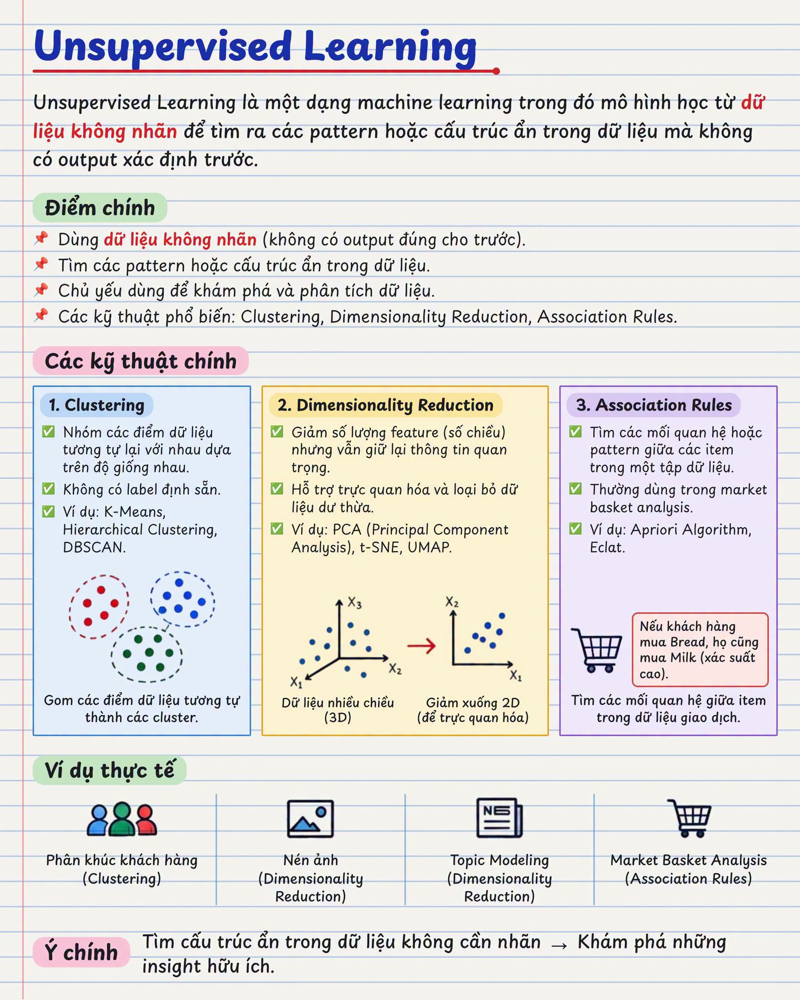

- **Định nghĩa:** Unsupervised Learning là một dạng Machine Learning trong đó mô hình học từ **dữ liệu không nhãn** để tìm ra các pattern hoặc cấu trúc ẩn trong dữ liệu mà không có output xác định trước. Chủ yếu dùng để khám phá và phân tích dữ liệu.
- **3 kỹ thuật chính:**
  1. **Clustering:** Nhóm các điểm dữ liệu tương tự lại dựa trên độ giống nhau mà không có label định sẵn (K-Means, Hierarchical Clustering, DBSCAN).
  2. **Dimensionality Reduction:** Giảm số lượng feature (số chiều) nhưng vẫn giữ lại thông tin quan trọng; hỗ trợ trực quan hóa (3D $\rightarrow$ 2D) và loại bỏ dữ liệu dư thừa (PCA, t-SNE, UMAP).
  3. **Association Rules:** Tìm mối quan hệ hoặc pattern giữa các item trong tập dữ liệu giao dịch — Market Basket Analysis (Apriori Algorithm, Eclat; ví dụ mua Bread $\rightarrow$ mua Milk).
- **Ví dụ thực tế:** Phân khúc khách hàng (Clustering) • Nén ảnh (Dimensionality Reduction) • Topic Modeling (Dimensionality Reduction) • Market Basket Analysis (Association Rules).
- **Ý chính:** Tìm cấu trúc ẩn trong dữ liệu không cần nhãn $\rightarrow$ Khám phá những insight hữu ích.

---

### Trang 04 — Semi-Supervised Learning
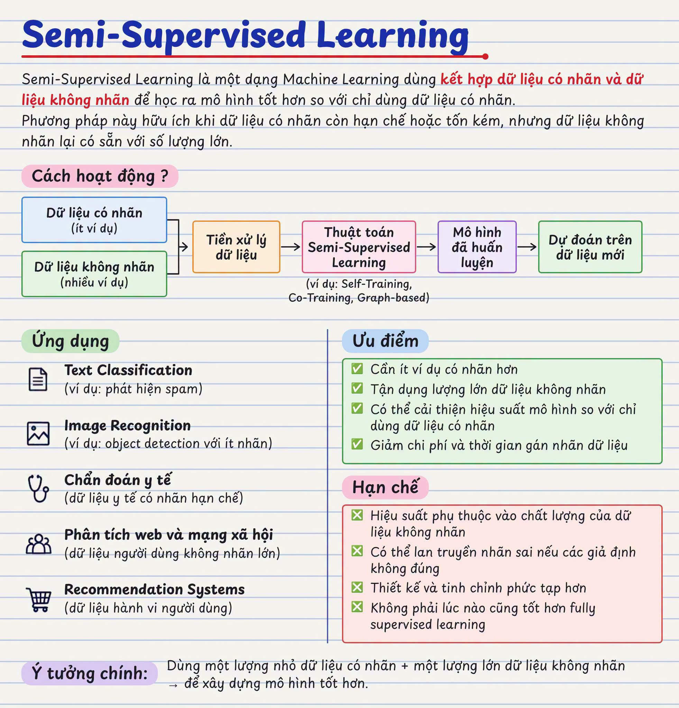

- **Định nghĩa:** Dùng **kết hợp dữ liệu có nhãn (ít ví dụ) và dữ liệu không nhãn (nhiều ví dụ)** để học ra mô hình tốt hơn so với chỉ dùng dữ liệu có nhãn. Hữu ích khi gán nhãn tốn kém hoặc hạn chế.
- **Quy trình hoạt động:** `(Dữ liệu có nhãn ít + Dữ liệu không nhãn nhiều)` $\rightarrow$ `Tiền xử lý dữ liệu` $\rightarrow$ `Thuật toán Semi-Supervised Learning (Self-Training, Co-Training, Graph-based)` $\rightarrow$ `Mô hình đã huấn luyện` $\rightarrow$ `Dự đoán trên dữ liệu mới`.
- **Ứng dụng:** Text Classification (phát hiện spam) • Image Recognition (object detection với ít nhãn) • Chẩn đoán y tế • Phân tích web và mạng xã hội • Recommendation Systems (dữ liệu hành vi người dùng).
- **Ưu điểm:** Cần ít ví dụ có nhãn hơn • Tận dụng lượng lớn dữ liệu không nhãn • Cải thiện hiệu suất so với chỉ dùng dữ liệu có nhãn • Giảm chi phí và thời gian gán nhãn.
- **Hạn chế:** Hiệu suất phụ thuộc chất lượng dữ liệu không nhãn • Có thể lan truyền nhãn sai nếu giả định sai • Thiết kế và tinh chỉnh phức tạp hơn • Không phải lúc nào cũng tốt hơn fully supervised learning.

---

### Trang 05 — Self-Supervised Learning
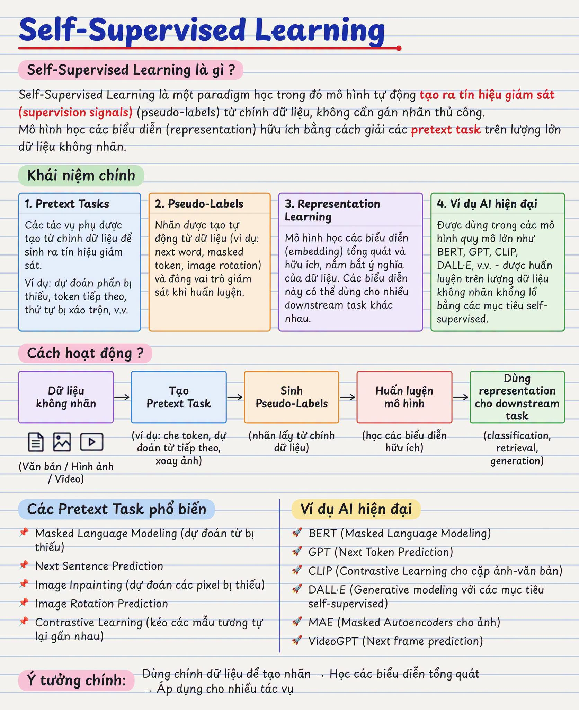

- **Định nghĩa:** Paradigm học trong đó mô hình tự động **tạo ra tín hiệu giám sát (supervision signals / pseudo-labels)** từ chính dữ liệu thông qua các **pretext task** trên lượng lớn dữ liệu không nhãn.
- **4 khái niệm chính:**
  1. **Pretext Tasks:** Tác vụ phụ tạo từ chính dữ liệu (dự đoán phần thiếu, token tiếp theo, thứ tự bị xáo trộn).
  2. **Pseudo-Labels:** Nhãn tạo tự động từ dữ liệu (next word, masked token, image rotation).
  3. **Representation Learning:** Học biểu diễn (embedding) tổng quát nắm bắt ý nghĩa dữ liệu, tái sử dụng cho nhiều downstream task.
  4. **Ví dụ AI hiện đại:** BERT, GPT, CLIP, DALL·E, MAE, VideoGPT.
- **Quy trình hoạt động:** `Dữ liệu không nhãn (Văn bản/Hình ảnh/Video)` $\rightarrow$ `Tạo Pretext Task` $\rightarrow$ `Sinh Pseudo-Labels` $\rightarrow$ `Huấn luyện mô hình` $\rightarrow$ `Dùng representation cho downstream task (classification, retrieval, generation)`.
- **Pretext Task phổ biến:** Masked Language Modeling (BERT) • Next Sentence Prediction • Image Inpainting • Image Rotation Prediction • Contrastive Learning (CLIP) • Next Token Prediction (GPT) • Masked Autoencoders (MAE) • Next frame prediction (VideoGPT).

---

### Trang 06 — Reinforcement Learning
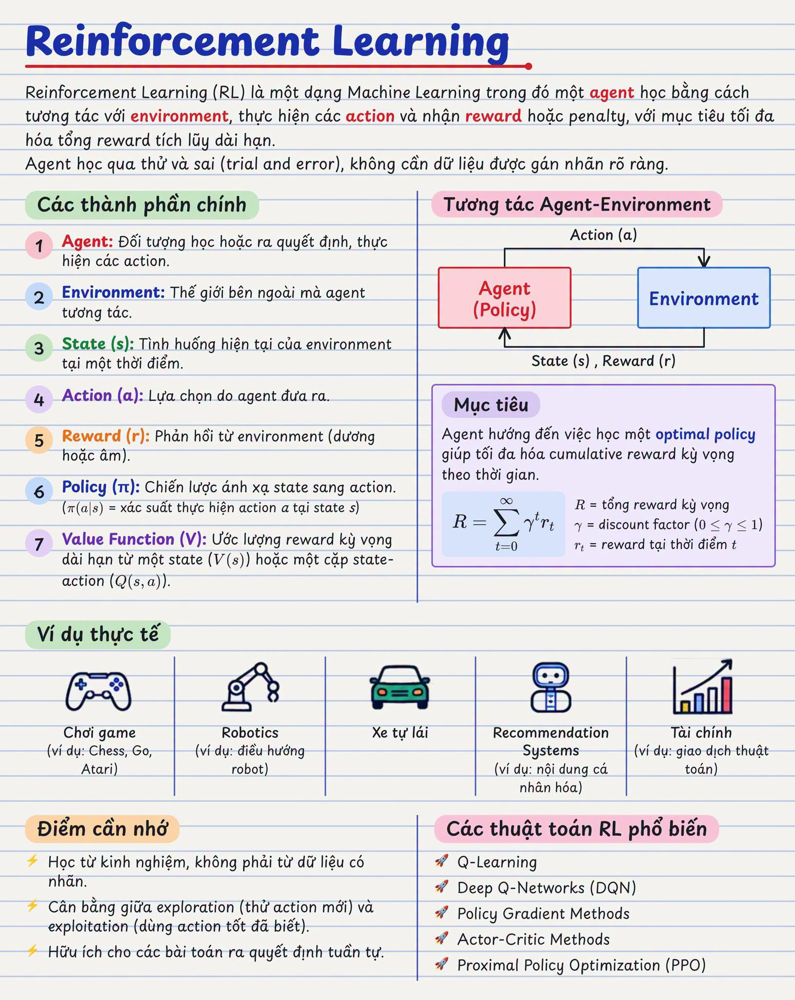

- **Định nghĩa:** Agent học bằng cách tương tác với environment, thực hiện action và nhận reward hoặc penalty qua thử-và-sai (trial and error) để tối đa hóa tổng reward tích lũy dài hạn.
- **7 thành phần chính:**
  1. **Agent:** Đối tượng học hoặc ra quyết định.
  2. **Environment:** Thế giới bên ngoài mà agent tương tác.
  3. **State ($s$):** Tình huống hiện tại của environment tại một thời điểm.
  4. **Action ($a$):** Lựa chọn do agent đưa ra.
  5. **Reward ($r$):** Phản hồi từ environment (dương hoặc âm).
  6. **Policy ($\pi$):** Chiến lược ánh xạ state sang action ($\pi(a|s)$ = xác suất thực hiện action $a$ tại state $s$).
  7. **Value Function ($V$):** Ước lượng reward kỳ vọng dài hạn từ một state $V(s)$ hoặc cặp state-action $Q(s,a)$.
- **Mục tiêu tối ưu (Optimal Policy):**
  $$R = \sum_{t=0}^{\infty} \gamma^t r_t$$
  *(với $R$: tổng reward kỳ vọng, $\gamma$: discount factor $0 \le \gamma \le 1$, $r_t$: reward tại thời điểm $t$)*
- **Ví dụ thực tế:** Chơi game (Chess, Go, Atari) • Robotics • Xe tự lái • Recommendation Systems • Tài chính (giao dịch thuật toán).
- **Điểm cần nhớ & Thuật toán phổ biến:** Cân bằng **exploration** (thử action mới) và **exploitation** (dùng action tốt đã biết). Thuật toán: Q-Learning, Deep Q-Networks (DQN), Policy Gradient Methods, Actor-Critic Methods, Proximal Policy Optimization (PPO).

---

### Trang 07 — Các thuật toán Regression
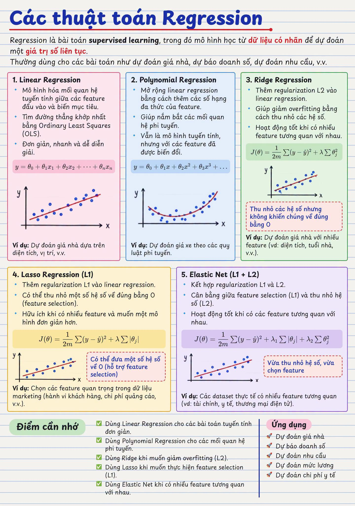

1. **Linear Regression:** Mô hình hóa quan hệ tuyến tính bằng Ordinary Least Squares (OLS):
   $$y = \theta_0 + \theta_1 x_1 + \theta_2 x_2 + \dots + \theta_n x_n$$
2. **Polynomial Regression:** Mở rộng Linear Regression bằng các số hạng đa thức để nắm bắt quan hệ phi tuyến:
   $$y = \theta_0 + \theta_1 x + \theta_2 x^2 + \theta_3 x^3 + \dots$$
3. **Ridge Regression (L2):** Thêm regularization L2 giúp giảm overfitting bằng cách thu nhỏ hệ số (không về đúng 0), hiệu quả khi các feature tương quan:
   $$J(\theta) = \frac{1}{2m} \sum (y - \hat{y})^2 + \lambda \sum \theta_j^2$$
4. **Lasso Regression (L1):** Thêm regularization L1 có thể đưa một số hệ số về đúng 0 để thực hiện feature selection:
   $$J(\theta) = \frac{1}{2m} \sum (y - \hat{y})^2 + \lambda \sum |\theta_j|$$
5. **Elastic Net (L1 + L2):** Kết hợp L1 (feature selection) và L2 (thu nhỏ hệ số khi có nhiều feature tương quan):
   $$J(\theta) = \frac{1}{2m} \sum (y - \hat{y})^2 + \lambda_1 \sum |\theta_j| + \lambda_2 \sum \theta_j^2$$

---

### Trang 08 — Các thuật toán Classification
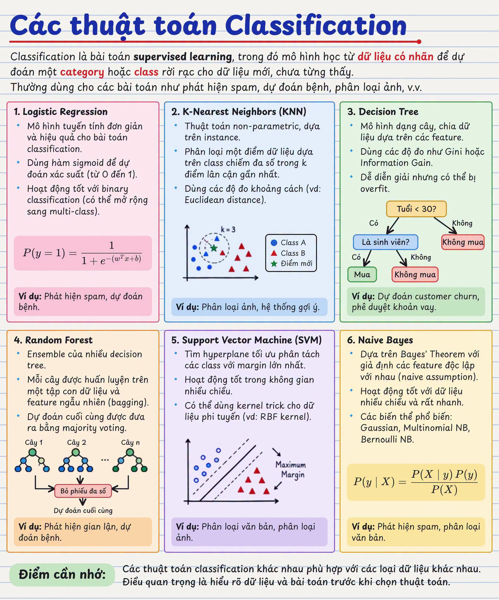

1. **Logistic Regression:** Mô hình tuyến tính dùng hàm sigmoid dự đoán xác suất từ $0$ đến $1$ (binary hoặc multi-class):
   $$P(y = 1) = \frac{1}{1 + e^{-(w^T x + b)}}$$
2. **K-Nearest Neighbors (KNN):** Thuật toán non-parametric dựa trên instance; phân loại theo đa số trong $k$ lân cận gần nhất dùng khoảng cách (vd: Euclidean distance).
3. **Decision Tree:** Mô hình dạng cây chia dữ liệu theo feature dùng độ đo Gini hoặc Information Gain; dễ diễn giải nhưng dễ overfit.
4. **Random Forest:** Ensemble gồm nhiều decision tree huấn luyện trên các tập con dữ liệu và feature ngẫu nhiên (bagging), kết hợp bằng majority voting.
5. **Support Vector Machine (SVM):** Tìm hyperplane tối ưu phân tách các class với **maximum margin**; dùng kernel trick (vd: RBF kernel) cho dữ liệu phi tuyến.
6. **Naive Bayes:** Dựa trên Bayes' Theorem với giả định các feature độc lập có điều kiện (Gaussian, Multinomial, Bernoulli NB); nhanh trên dữ liệu nhiều chiều:
   $$P(y \mid X) = \frac{P(X \mid y) P(y)}{P(X)}$$

---

### Trang 09 — Các thuật toán Clustering
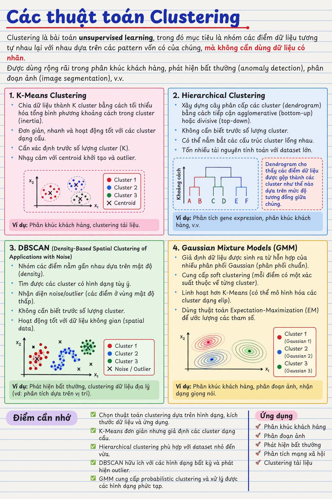

1. **K-Means Clustering:** Chia dữ liệu thành $K$ cluster bằng cách tối thiểu hóa tổng bình phương khoảng cách trong cluster (inertia). Đơn giản, nhanh với cluster dạng cầu, nhưng cần biết trước $K$ và nhạy với centroid khởi tạo & outlier.
2. **Hierarchical Clustering:** Xây dựng cây phân cấp (**dendrogram**) theo hướng agglomerative (bottom-up) hoặc divisive (top-down); không cần biết trước số cluster, nắm bắt cấu trúc lồng nhau nhưng tốn tài nguyên với dataset lớn.
3. **DBSCAN (Density-Based Spatial Clustering of Applications with Noise):** Nhóm điểm dựa trên mật độ; tìm được cluster hình dạng bất kỳ, tự nhận diện noise/outlier, không cần biết trước $K$, tốt cho dữ liệu không gian.
4. **Gaussian Mixture Models (GMM):** Giả định dữ liệu sinh từ hỗn hợp các phân phối Gaussian; cung cấp **soft clustering** (xác suất thuộc từng cluster), mô hình hóa được cluster dạng elip, ước lượng tham số bằng thuật toán Expectation-Maximization (EM).

---

### Trang 10 — Dimensionality Reduction
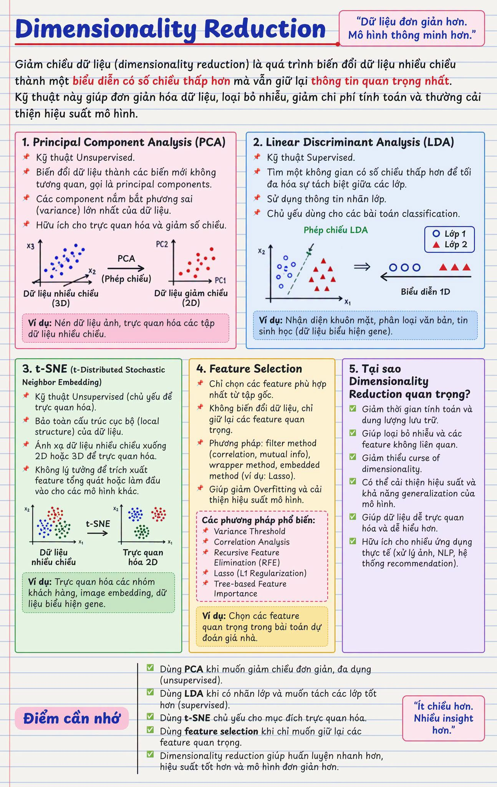

- **Thông điệp:** *"Dữ liệu đơn giản hơn. Mô hình thông minh hơn."* • *"Ít chiều hơn. Nhiều insight hơn."*
- **4 kỹ thuật chính:**
  1. **Principal Component Analysis (PCA):** Unsupervised; biến đổi dữ liệu thành các biến mới không tương quan (principal components) nắm bắt phương sai (variance) lớn nhất.
  2. **Linear Discriminant Analysis (LDA):** Supervised; dùng thông tin nhãn lớp để tìm không gian thấp chiều tối đa hóa sự tách biệt giữa các lớp.
  3. **t-SNE (t-Distributed Stochastic Neighbor Embedding):** Unsupervised; bảo toàn cấu trúc cục bộ để trực quan hóa dữ liệu nhiều chiều xuống 2D/3D (không lý tưởng để trích xuất feature cho mô hình khác).
  4. **Feature Selection:** Giữ lại các feature quan trọng nhất từ tập gốc mà không biến đổi dữ liệu, gồm filter method (correlation, mutual info, variance threshold), wrapper method (RFE) và embedded method (Lasso, Tree-based Feature Importance).
- **Lợi ích:** Giảm thời gian tính toán & lưu trữ • Loại bỏ nhiễu • Giảm thiểu **curse of dimensionality** • Cải thiện khả năng generalization & giảm overfitting • Dễ trực quan hóa.

---

### Trang 11 — Đánh giá + So sánh mô hình ML
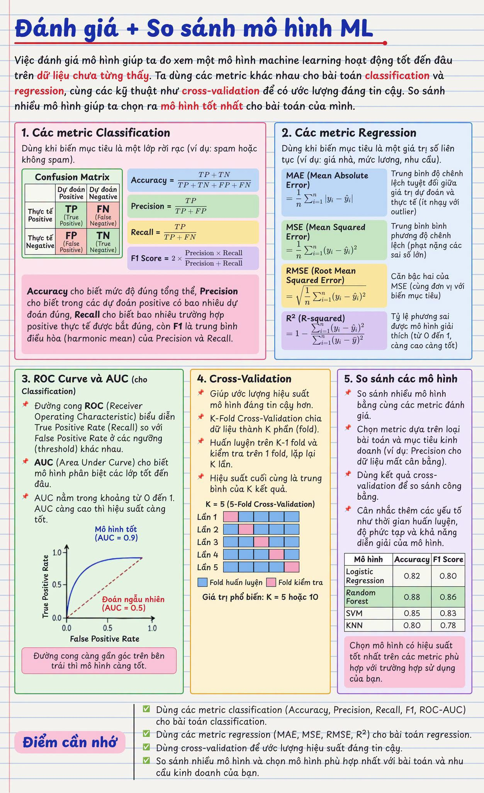

- **1. Metric Classification (từ Confusion Matrix: TP, FN, FP, TN):**
  - $\text{Accuracy} = \frac{TP + TN}{TP + TN + FP + FN}$
  - $\text{Precision} = \frac{TP}{TP + FP}$
  - $\text{Recall} = \frac{TP}{TP + FN}$
  - $\text{F1 Score} = 2 \times \frac{\text{Precision} \times \text{Recall}}{\text{Precision} + \text{Recall}}$
- **2. Metric Regression:**
  - $\text{MAE} = \frac{1}{n}\sum_{i=1}^n |y_i - \hat{y}_i|$ *(ít nhạy với outlier)*
  - $\text{MSE} = \frac{1}{n}\sum_{i=1}^n (y_i - \hat{y}_i)^2$ *(phạt nặng sai số lớn)*
  - $\text{RMSE} = \sqrt{\frac{1}{n}\sum_{i=1}^n (y_i - \hat{y}_i)^2}$ *(cùng đơn vị với biến mục tiêu)*
  - $R^2 = 1 - \frac{\sum_{i=1}^n (y_i - \hat{y}_i)^2}{\sum_{i=1}^n (y_i - \bar{y})^2}$ *(tỷ lệ phương sai giải thích được, từ $-\infty$ đến $1$, càng cao càng tốt)*
- **3. ROC Curve & AUC:** Đường cong ROC biểu diễn True Positive Rate (Recall) theo False Positive Rate qua các threshold; $\text{AUC} \in [0, 1]$ (đoán ngẫu nhiên $\text{AUC} = 0.5$, mô hình tốt $\text{AUC} \to 1$, đường cong càng sát góc trên bên trái càng tốt).
- **4. Cross-Validation:** K-Fold Cross-Validation ($K = 5$ hoặc $10$) chia dữ liệu thành $K$ phần, huấn luyện trên $K-1$ fold và kiểm tra trên 1 fold lặp lại $K$ lần, lấy trung bình hiệu suất để ước lượng đáng tin cậy.
- **5. So sánh mô hình (ví dụ minh họa):** Logistic Regression (Acc 0.82, F1 0.80), Random Forest (Acc 0.88, F1 0.86), SVM (Acc 0.85, F1 0.83), KNN (Acc 0.80, F1 0.78) — cần cân nhắc cả thời gian huấn luyện, độ phức tạp và khả năng diễn giải.

---

### Trang 12 — Cheat Sheet Machine Learning + Top 100 câu hỏi phỏng vấn
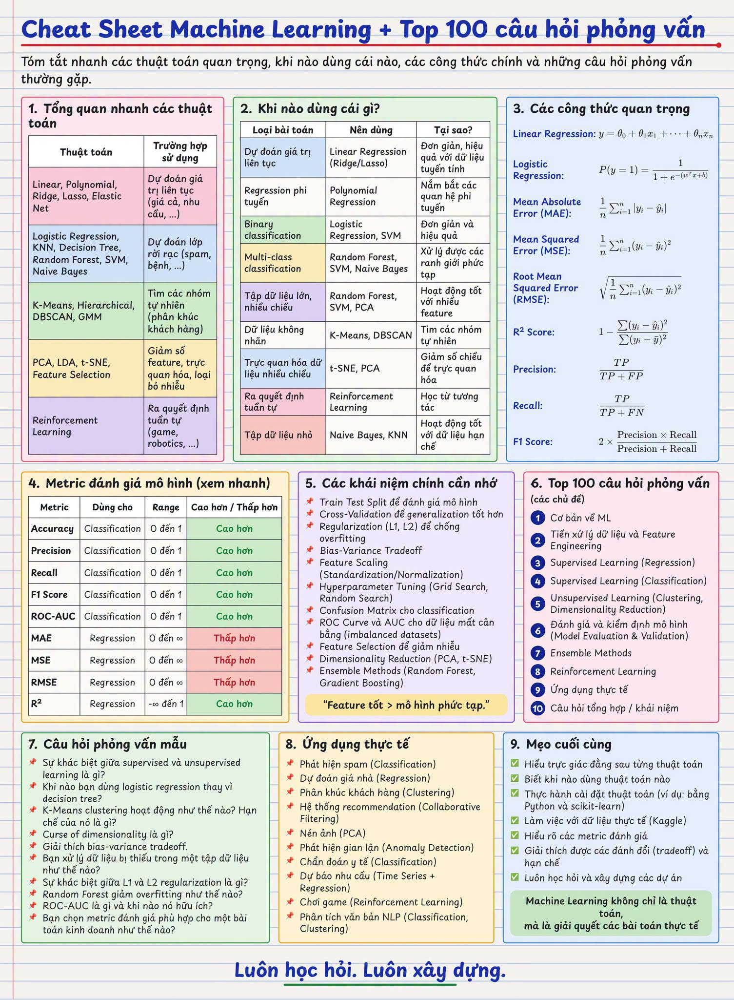

- **Bảng lựa chọn nhanh theo bài toán:**
  - Dự đoán giá trị liên tục $\rightarrow$ Linear Regression (Ridge/Lasso) • Phi tuyến $\rightarrow$ Polynomial Regression.
  - Binary classification $\rightarrow$ Logistic Regression, SVM • Multi-class $\rightarrow$ Random Forest, SVM, Naive Bayes.
  - Tập dữ liệu lớn, nhiều chiều $\rightarrow$ Random Forest, SVM, PCA • Tập dữ liệu nhỏ $\rightarrow$ Naive Bayes, KNN.
  - Dữ liệu không nhãn $\rightarrow$ K-Means, DBSCAN • Trực quan hóa nhiều chiều $\rightarrow$ t-SNE, PCA • Ra quyết định tuần tự $\rightarrow$ Reinforcement Learning.
- **Các khái niệm chính cần nhớ:** Train/Test Split • Cross-Validation • Regularization (L1, L2) • Bias-Variance Tradeoff • Feature Scaling (Standardization/Normalization) • Hyperparameter Tuning (Grid Search, Random Search) • Confusion Matrix • ROC/AUC cho dữ liệu mất cân bằng (imbalanced datasets) • Feature Selection • Dimensionality Reduction • Ensemble Methods (Random Forest, Gradient Boosting).
- **Châm ngôn:** *"Feature tốt > mô hình phức tạp."* • *"Machine Learning không chỉ là thuật toán, mà là giải quyết các bài toán thực tế."* • *"Luôn học hỏi. Luôn xây dựng."*
- **10 nhóm chủ đề phỏng vấn ML:** (1) Cơ bản về ML, (2) Tiền xử lý dữ liệu & Feature Engineering, (3) Supervised Regression, (4) Supervised Classification, (5) Unsupervised (Clustering & Dimensionality Reduction), (6) Model Evaluation & Validation, (7) Ensemble Methods, (8) Reinforcement Learning, (9) Ứng dụng thực tế, (10) Câu hỏi tổng hợp/khái niệm.
- **9 câu hỏi phỏng vấn mẫu tiêu biểu:** Phân biệt supervised vs unsupervised; Khi nào chọn logistic regression thay vì decision tree; Hạn chế của K-Means; Curse of dimensionality; Bias-variance tradeoff; Xử lý missing values; L1 vs L2 regularization; Cách Random Forest giảm overfitting; Chọn metric phù hợp bài toán kinh doanh & ROC-AUC.
