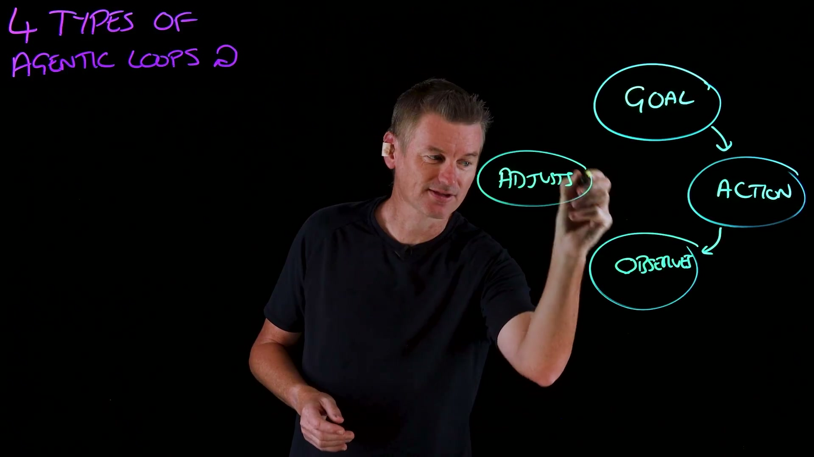
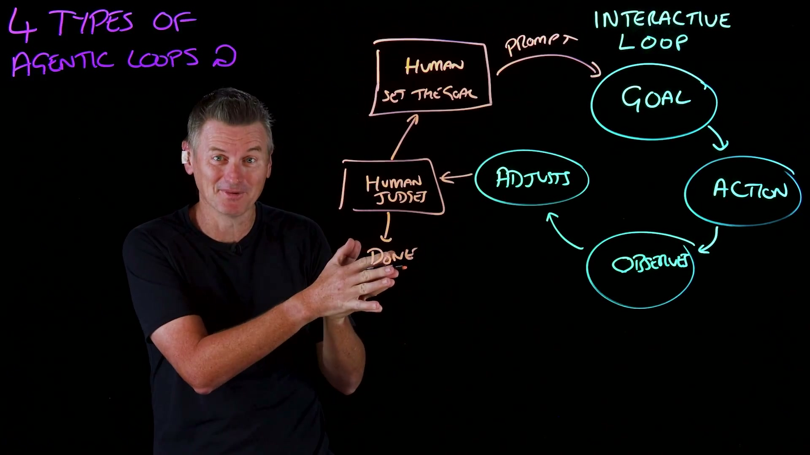
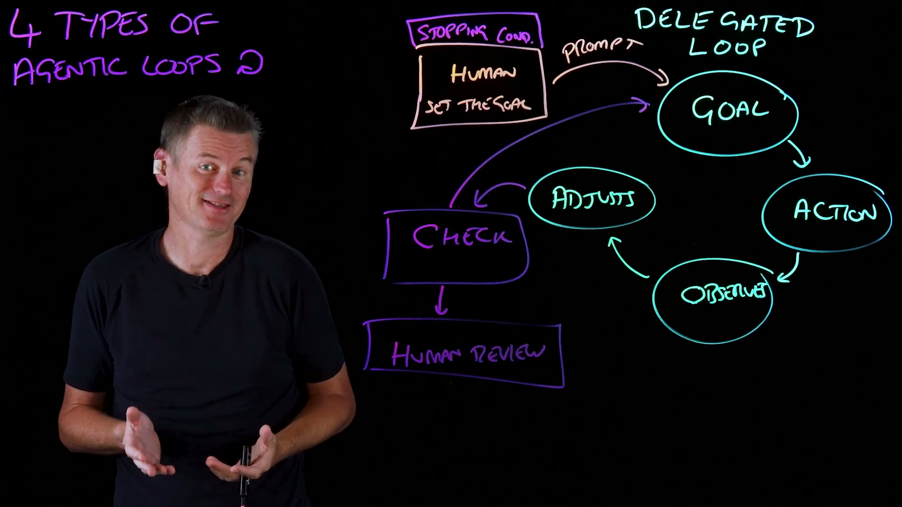
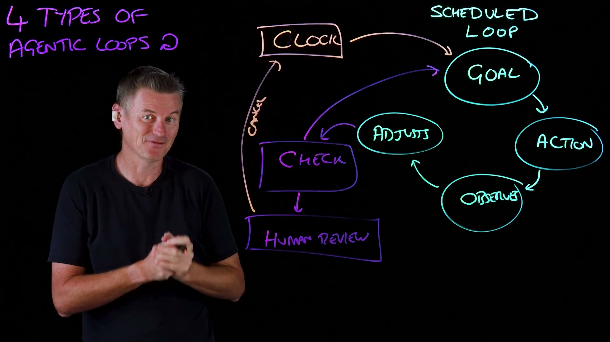
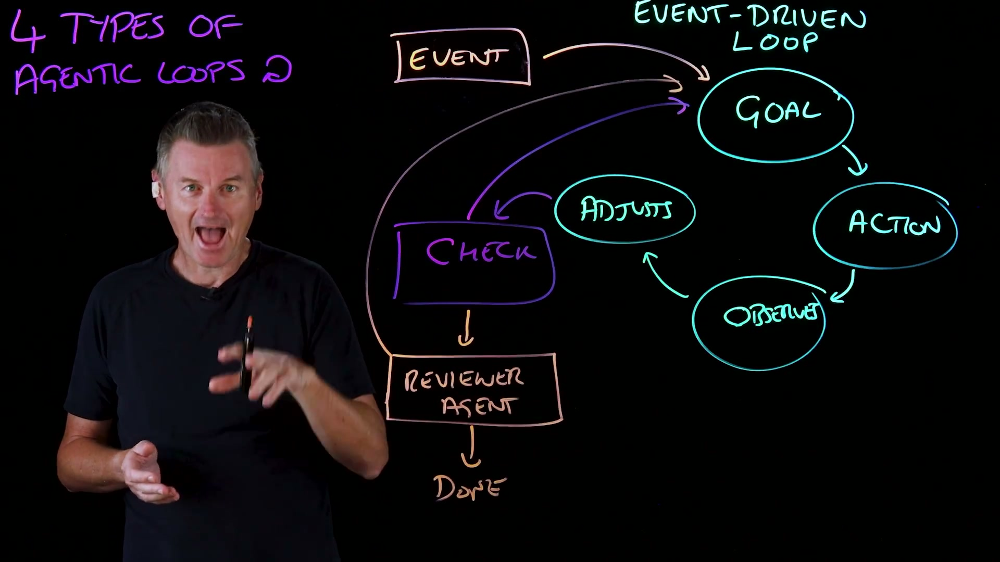
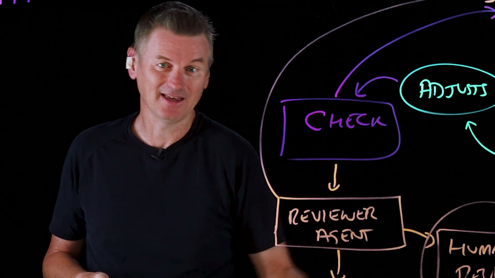

# 4 Types of AI Agent Loops: From Human-Led to Autonomous

**Channel**: IBM Technology
**URL**: https://www.youtube.com/watch?v=4LINhsEZEDI
**Upload Date**: 2026-11-19
**Duration**: 9m 8s
**Transcript extracted**: 2026-11-22

---

## Chapters

| # | Timestamp | Chapter |
| :--- | :--- | :--- |
| 1 | `00:00 - 00:19` | Understand How AI Agent Loops Work |
| 2 | `00:19 - 01:12` | Follow the Goal, Act, Observe & Adjust Cycle |
| 3 | `01:12 - 01:31` | Decide Who Controls the AI Agent Loop |
| 4 | `01:31 - 03:30` | Use Interactive Loops for Human-Led Tasks |
| 5 | `03:30 - 05:17` | Delegate Stopping Conditions to AI |
| 6 | `05:17 - 06:40` | Schedule Recurring AI Agent Workflows |
| 7 | `06:40 - 07:15` | Trigger AI Agent Loops with Events |
| 8 | `07:15 - 08:01` | Review AI Work with a Second Agent |
| 9 | `08:01 - 08:32` | Escalate Agent Exceptions to Humans |
| 10 | `08:32 - 09:08` | Compare the 4 Types of AI Agent Loops |

## Suggested Keyframe Timestamps

- `00:15` (15s, `chapter`): Understand How AI Agent Loops Work
- `01:00` (60s, `chapter`): Follow the Goal, Act, Observe & Adjust Cycle
- `01:27` (87s, `chapter`): Decide Who Controls the AI Agent Loop
- `02:25` (145s, `visual_cue`): And they look at this to see. Is the job done? What came back? Is the goal achie
- `03:18` (198s, `chapter`): Use Interactive Loops for Human-Led Tasks
- `05:05` (305s, `chapter`): Delegate Stopping Conditions to AI
- `06:28` (388s, `chapter`): Schedule Recurring AI Agent Workflows
- `07:07` (427s, `chapter`): Trigger AI Agent Loops with Events
- `07:51` (471s, `chapter`): Review AI Work with a Second Agent
- `08:25` (505s, `chapter`): Escalate Agent Exceptions to Humans
- `09:00` (540s, `chapter`): Compare the 4 Types of AI Agent Loops

## Key Visual Frames

## Transcript

### [00:00 - 00:19] Understand How AI Agent Loops Work
**[00:01]** AI agents work autonomously, and they do so using loops. But the level of autonomy and the form of the loop, well they can differ. So let's take a look at four types of agentic loop and why you might opt for each one. So at a high level, all agentic loops, they share the same basic patterns.

### [00:19 - 01:12] Follow the Goal, Act, Observe & Adjust Cycle
**[00:22]** So we have an agent and the agent takes in a goal. That is the goal it's going to meet. Then, it performs an action to help it achieve that goal. It might be something like editing a file, or maybe running a command.
**[00:44]** But next stage in the loop is really that it observes what comes back from the action, so what happened? Maybe like reading some of the output. And then, the next stage in the loop is that it adjusts based upon what it has observed,
**[01:06]** and it kind of goes round and round again until the job is done. So two things about that. Who sets the goal? And who decides when the loop's done?

### [01:12 - 01:31] Decide Who Controls the AI Agent Loop
**[01:21]** When the goal is achieved? Well, it's often a human, a human in the loop, so to speak. Not always, but often. So let me introduce the first of the agentic loops I want to cover,

### [01:31 - 03:30] Use Interactive Loops for Human-Led Tasks
**[01:36]** the interactive loop. So, the interactive loop is this loop cycle, where human involvement is going to be added in, in two places. So first of all, we have a human here at the start, and the human's job at the start is to set the goal.
**[01:58]** What do we want the loop to achieve? So the human sets the goal. Now, in practice, what this means is the human types in a prompt specifying what they want, and the human judges at the end as well.
**[02:18]** So we've got another human step here, where the human judges what has been produced. And they look at this to see. Is the job done? What came back? Is the goal achieved? So if the goal was to upgrade library X, then if the upgrade happened then, well,
**[02:43]** the human would judge the loop as being done. If it wasn't, or if there's more to do, the human is going type the next prompt and round we go again. So the agent runs inside of the loop, and a person controls when the loop starts, and when the loop ends.
**[03:04]** So if the task is a bit fuzzy, or there's not really a measurable finish line, an interactive loop with a person controlling start and stop conditions is probably a good idea. but, the interactive loop is hard to scale when the job is basically doing the same thing over and over again.
**[03:26]** Well, these poor humans will have a lot of judgments to make.

### [03:30 - 05:17] Delegate Stopping Conditions to AI
**[03:31]** So what if we handed that judging job off to the AI? Well, that's the second type of loop, the delegated loop. The human still sets the goal, but the goal comes with a little extra here. The goal comes with a stopping condition.
**[03:51]** Simply when should the loop actually be done. So, a goal isn't going be upgrade library X, it's going to be something a bit more specific, like upgrade the out of date libraries and stop when the build turns green.
**[04:10]** Now, at the end of the loop, we now have a check that we go to after adjust and the check is going to judge this stopping condition. And it's an AI check. So every time the agent thinks it's finished after this adjust stage, the check is run. And if it fails,
**[04:32]** then the agent will go round the loop again. And if it passes, the loop now exits comes out of the check because we think the goal has been completed, and now it goes to another stage. Basically, the result comes back and it's provided for a human to review the result of that job.
**[04:56]** So the delegated loop here delegates the judging away from a human until it's time to review the finished work. So like go off and do that task I sent you Mr. Agent, and, uh, let me know when you're done, then I'll see how well you did.

### [05:17 - 06:40] Schedule Recurring AI Agent Workflows
**[05:18]** But a delegated loop still has a human setting the goal and starting the loop. So what if we handed that off as well? Well, that's the third loop. The scheduled loop. Most everything from the delegated loop stays the same in the, there's a check that's going to judge the stopping condition. And the result comes back to a human to review. But what does change here, is how this loop gets started.
**[05:42]** Because the thing that starts it now is not a person, it's a clock, basically. It's a human writing a goal once, something like find any out-of-date libraries and upgrade them, and then a schedule is going to run it, say, every night.
**[06:01]** So a scheduled loop suits work that goes stale over time, like libraries going out of date. But it's also really good for work that needs doing recurrently. The human's job is to read what comes back, and when this loop stops being useful to then,
**[06:20]** we'll cancel the loop when we don't need to keep scheduling it anymore, or to adjust the schedule as needed. So now the clock starts in place of a person having to kick the loop off, but there's still a human reviewing every result.
**[06:38]** Yeah, what if we handed that one off as well? Well then we have the fourth type of loop, the event-driven loop. And a couple of things change here.

### [06:40 - 07:15] Trigger AI Agent Loops with Events
**[06:48]** So first, the clock is replaced with something else, it's replaced with an event. So the loop only runs when something happens. An event, like a pull request has been opened. And each event is going to kick off its own run of the loop with the goal tailored to whatever the event was about.
**[07:09]** Now there's still an AI-powered check to decide when that run is done, but now the

### [07:15 - 08:01] Review AI Work with a Second Agent
**[07:18]** human review at the end has gone away, and it's replaced with an AI option. Basically another agent, a reviewer agent that now does the checking. Now this is a second agent with its own fresh context, maybe powered by a different AI model, and it looks over the finished work before it moves on.
**[07:40]** Now, if it approves, the work is done, so we can say the loop is complete, and if there's still more to do, we're in the not done stage and we would go back around the loop again. The loop gets restarted. And if the reviewer
**[07:59]** agent isn't sure what to do, if it doesn't know if it's done or not done, well, then that's when

### [08:01 - 08:32] Escalate Agent Exceptions to Humans
**[08:06]** we go to a human review stage. So at this point, the human will only see certain cases to review. They will effectively only see exceptions at this point. So this is the most autonomous of the four. It's still got a review step,
**[08:25]** but it's usually an agent doing most of the reviews that are not the exception cases. So that's for agentic loops, an interactive loop, a human starts the loop and judges every turn.

### [08:32 - 09:08] Compare the 4 Types of AI Agent Loops
**[08:38]** A delegated loop keeps the human at the start, but a check does the judging. A scheduled loop has a clock to start it, and an event-driven loop is started by whatever just happened with an agent reviewing the result. Which agentic loops you running today? Let me know in the comments!
