# AI Agent Memory: 7 Types Explained in 12 Minutes

**Channel**: Jam With AI | Shirin Khosravi Jam
**URL**: https://www.youtube.com/watch?v=bK1clrG-boc
**Upload Date**: 2026-08-28
**Duration**: 12m 6s
**Transcript extracted**: 2026-11-22

---

## Chapters

| # | Timestamp | Chapter |
| :--- | :--- | :--- |
| 1 | `00:00 - 00:23` | How Agent Memory Is Formed |
| 2 | `00:23 - 00:59` | Memory as Part of Context Engineering |
| 3 | `00:59 - 01:28` | Saving Information vs Remembering It |
| 4 | `01:28 - 02:54` | Working Memory and the Context Window |
| 5 | `02:54 - 04:32` | Semantic Memory: Facts and Preferences |
| 6 | `04:32 - 05:27` | Episodic Memory: Past Experiences |
| 7 | `05:27 - 06:10` | Procedural Memory: Rules and Workflows |
| 8 | `06:10 - 07:40` | External Memory and Retrieval |
| 9 | `07:40 - 08:34` | Parametric Memory: Knowledge in Model Weights |
| 10 | `08:34 - 09:36` | Prospective Memory: Future Tasks and Triggers |
| 11 | `09:36 - 11:32` | All Seven Types in One Email Agent |
| 12 | `11:32 - 12:06` | How to Design Agent Memory |

## Suggested Keyframe Timestamps

- `00:18` (18s, `chapter`): How Agent Memory Is Formed
- `00:51` (51s, `chapter`): Memory as Part of Context Engineering
- `01:22` (82s, `chapter`): Saving Information vs Remembering It
- `02:42` (162s, `chapter`): Working Memory and the Context Window
- `04:20` (260s, `chapter`): Semantic Memory: Facts and Preferences
- `05:15` (315s, `chapter`): Episodic Memory: Past Experiences
- `06:01` (361s, `chapter`): Procedural Memory: Rules and Workflows
- `07:28` (448s, `chapter`): External Memory and Retrieval
- `08:22` (502s, `chapter`): Parametric Memory: Knowledge in Model Weights
- `09:24` (564s, `chapter`): Prospective Memory: Future Tasks and Triggers
- `10:05` (605s, `visual_cue`): Now, watch the diagram built here.
- `11:20` (680s, `chapter`): All Seven Types in One Email Agent
- `11:59` (719s, `chapter`): How to Design Agent Memory

## Key Visual Frames

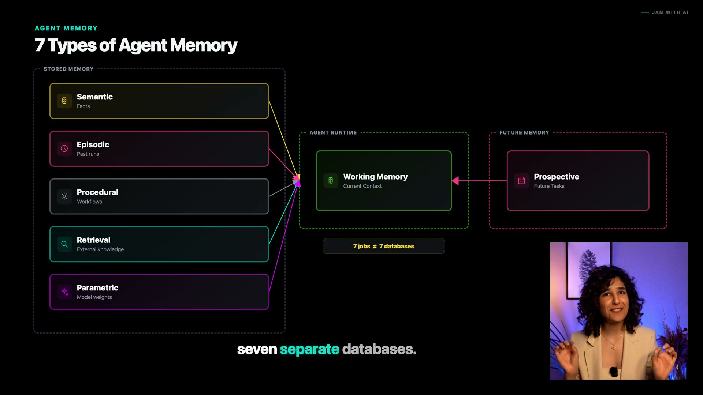
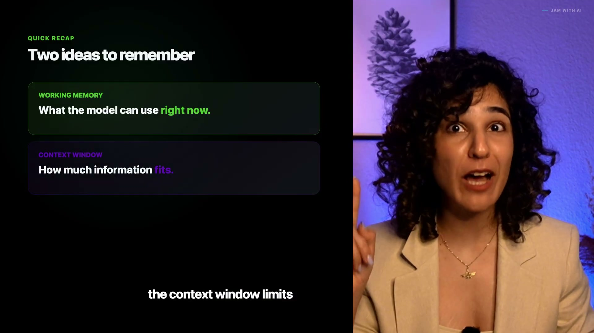
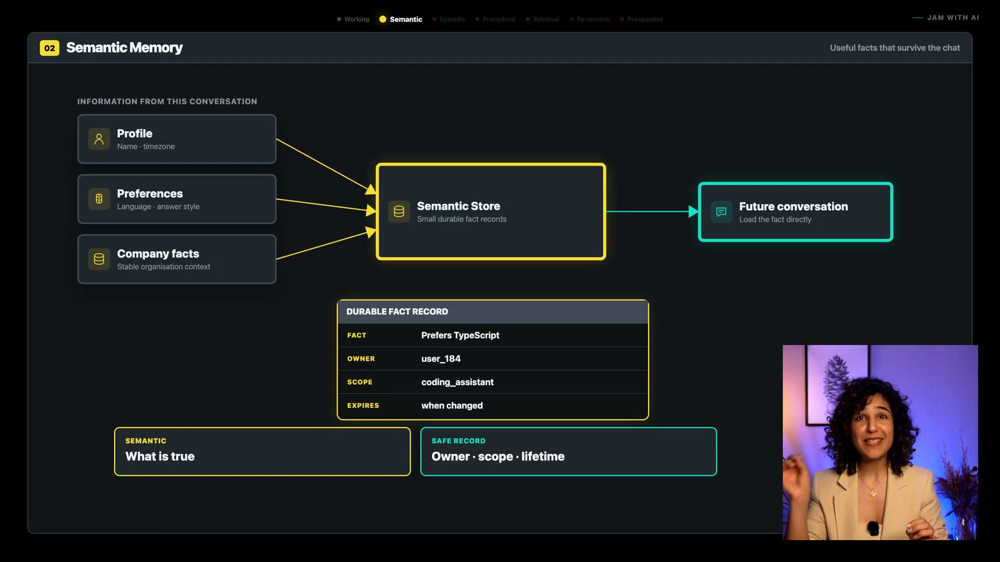
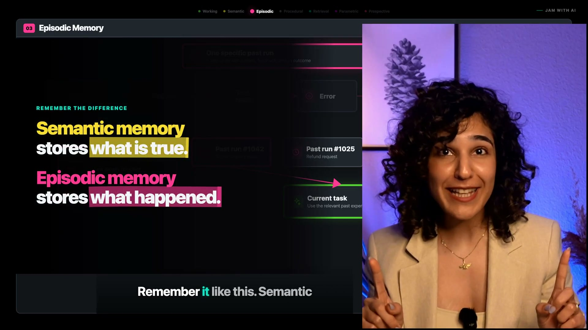
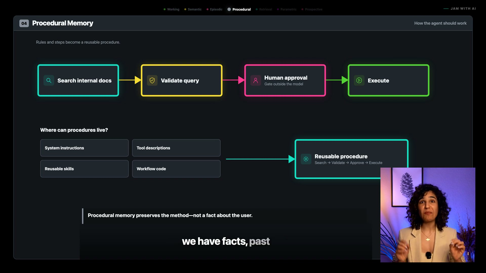
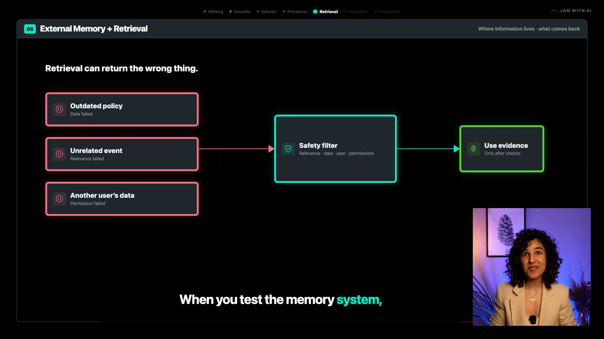
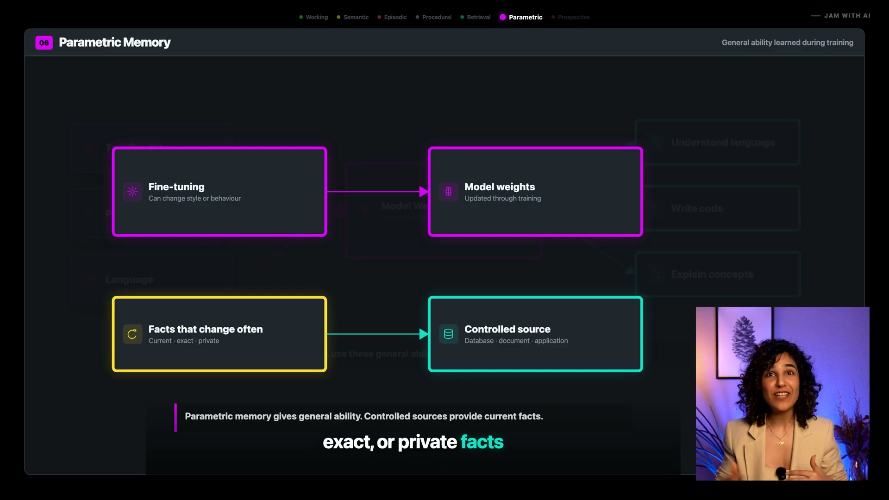
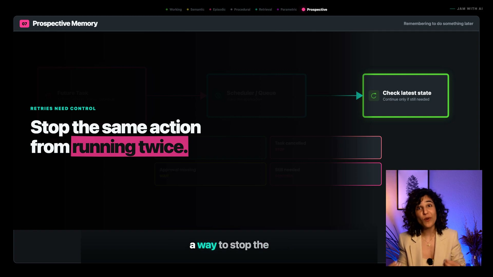
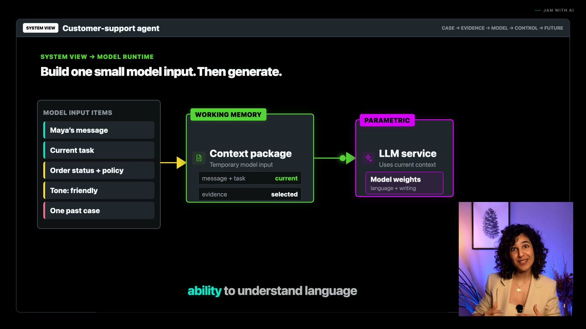
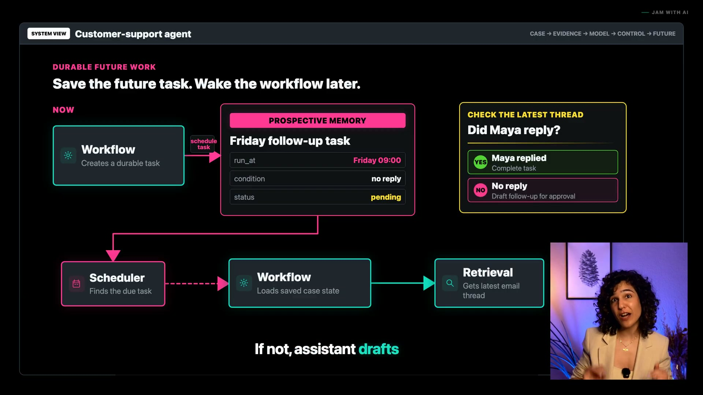
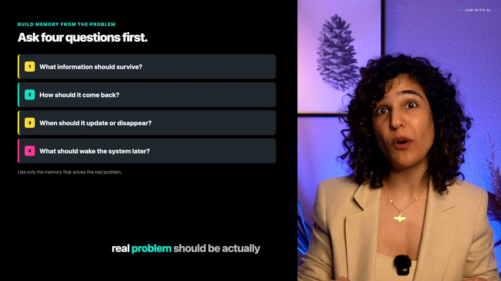

## Transcript

### [00:00 - 00:23] How Agent Memory Is Formed
**[00:02]** Have you ever opened Chat GPT and noticed that it remembers your name, your work, or something you told it in another conversation? This is memory, but behind the scenes, several different things may be happening. The application may keep the recent messages, save a useful fact, search old information, or even schedule something for later. These
**[00:21]** are different jobs, and memory is also

### [00:23 - 00:59] Memory as Part of Context Engineering
**[00:24]** one part of context engineering. And context engineering simply means deciding what information the model receives before it answers or takes an action. In this video, I will explain seven types of agent memory in simple language. Then we will connect all seven inside one example. And if you're new
**[00:43]** here, I'm Shirin. I'm an engineering manager working in AI. I have spent nearly a decade building machine learning and AI systems, and more than 2 years building production AI agents. Some of these systems serve millions of users. Before we begin, remember this:

### [00:59 - 01:28] Saving Information vs Remembering It
**[01:01]** Saving information is not the same as remembering it. An application may store thousands of messages, but that information is useful only when the right part comes back at the right time. There is no single universal list of memory types. In this video, we use seven practical memory types because
**[01:21]** they are useful when building agents, and they can overlap, and you do not need seven separate databases. The first

### [01:28 - 02:54] Working Memory and the Context Window
**[01:28]** type is working memory. Working memory is the information the model can use right now while you are chatting. It may include the system instructions, your current question, the recent messages, your selected documents, and even some latest tool results. All of this information is sent to the model as the
**[01:48]** current context. Now imagine that you ask another question. The AI assistant can answer it because the application sends your recent messages to the model again. These messages are added to the current context. That is how the model knows what you were talking about, but
**[02:07]** we cannot keep adding messages forever. Every model has a context window. This is the maximum amount of information the model can read in one call. When a conversation becomes long, the application must decide what to keep, what to summarize, and what to remove.
**[02:25]** More context also means more cost and latency. It can make important details harder to find. Working memory is what the model can use right now, and the context window limits how much fits. But what if one small fact should remain available in a completely new conversation? We should not reload
**[02:45]** months of messages just to find a name, a time zone, or preference. We should save that fact completely separately. This is where semantic memory helps.

### [02:54 - 04:32] Semantic Memory: Facts and Preferences
**[02:57]** Semantic memory stores facts and preference that should remain useful after the current conversation ends. This can include your name, time zone, preferred programming language, or a stable fact about your company. The application stores each useful fact as a small record. It can save the fact
**[03:17]** during conversation or extract it later in a background task. A saved fact needs an owner who it belongs to and a scope where the agent can use it. Some facts should also expire. When the user returns, the application can load the fact directly, but the application
**[03:37]** should not save every sentence as a permanent fact. For example, keep this answer short may apply only to the current task, but I always prefer short answers may be worth saving for future conversations. Anything saved here can affect future conversations, so
**[03:55]** information from emails, websites, or tool results should be checked before it becomes a trusted memory. Remember, facts can change, so if the user moves from Python to TypeScript, the old preference should be replaced. Users should also be able to correct or delete important memories themselves.
**[04:15]** The takeaway is super simple. Semantic memory saves a useful fact beyond the current chat with the correct owner, the scope, and lifetime. But, a fact only tells the agent what is true. It does not show what happened during a specific past task. For that, we need

### [04:32 - 05:27] Episodic Memory: Past Experiences
**[04:34]** episodic memory. Episodic memory stores one specific event or one past agent run. It can include the goal, the steps the agent took, the tool results, errors, even feedback, and the final outcome. For example, semantic memory may store a simple fact, "This customer prefers
**[04:53]** email." Episodic memory stores what happened during the last support case, what went wrong, and what the agent tried, and even what finally worked. The application can save a short episode with the task, the actions, outcome, and a date. When a similar task appears, it
**[05:13]** retrieves the most relevant episode. Remember it like this, semantic memory saves what is true, while episodic memory saves what happened. If a lesson from past events becomes a standard way of working, we move to procedural

### [05:27 - 06:10] Procedural Memory: Rules and Workflows
**[05:29]** memory. Procedural memory is the method the agent follows, the steps, rules, and habits for doing a particular task. For example, search internal documents before searching the web, validate a database query before running it, or ask a human before issuing a refund. It is
**[05:48]** called memory because it preserves how the agent should actually work rather than what it knows about the user. These procedures can live in the system instructions, the tool descriptions, reusable skills, or the workflow code. Now we have facts, past events, and procedures. The next problem is finding
**[06:07]** the right information at the right time.

### [06:10 - 07:40] External Memory and Retrieval
**[06:10]** External memory is information stored outside the model, perhaps in a database, a document store, email inbox, or even another application. Retrieval is how the application finds the useful part and brings it into the current context. Different questions need different search methods. So you can use
**[06:29]** an exact lookup when you know the ID or use keyword search for exact words or even use embedding search to find similar meaning. You should combine them only when necessary. Then use filters to keep the current user, the team, and time period. You may also hear embedding
**[06:48]** search as sometimes called semantic search, so do not confuse it with semantic memory. Semantic memory stores facts, whereas semantic search finds similar meaning. There is no single best method. RAG is one common pattern, but not every lookup needs a vector database. Retrieval can also return an
**[07:07]** old policy, an unrelated event, or even another user's data. So the application must check the results' relevance to date and their permissions. When you test the memory system, test retrieval separately from the final answer. A confident answer does not prove that the correct memory was found, so keep this
**[07:27]** distinction clear. External memory is where information lives, and retrieval decides what returns. But even before the application retrieves anything, the model already knows many general things.

### [07:40 - 08:34] Parametric Memory: Knowledge in Model Weights
**[07:40]** This knowledge comes from parametric memory. Parametric memory is the general knowledge learned during the model's training and stored inside the weights. In simple words, the weights are the learned settings inside the model. This is why the model can understand language, write code, or even explain a
**[07:59]** common concept without having to search a database first. But this knowledge may be out of date and it cannot know private information unless the application provides it. A normal model call does not update the model's weights. Fine-tuning can change style or behavior, but it is a poor place for
**[08:18]** facts that change quite often. Parametric memory gives the model its general abilities. Current, exact, or private facts should come from a source the application actually controls. But what if the agent needs to do something tomorrow or next week? For that, we need

### [08:34 - 09:36] Prospective Memory: Future Tasks and Triggers
**[08:35]** prospective memory. The agent says, "I'll check again on Friday." Friday arrives, but the model is not running, so nothing happens. Prospective memory means remembering to do something in the future. It needs a safe future task and a trigger. The trigger may be a time, an event, or a
**[08:56]** condition. The task should store what must happen, the context needed to continue, its status, and any approval requirement. A scheduler wakes the application at the correct time. The application then checks the latest situation. Perhaps the user already replied. The task was maybe canceled or
**[09:16]** approver is even still missing. Schedulers can retry, so the application needs a way to stop the same action from running twice with a clear status such as pending or completed. Prospective memory saves future work and a reliable trigger wakes the application when it is
**[09:36]** time to continue. We now have all seven

### [09:36 - 11:32] All Seven Types in One Email Agent
**[09:39]** memory types, so let's place them inside one simple email workflow and see how they work together. A customer named Maya writes, "My order is late. Can you tell me what happened?" You ask the assistant, "Check Maya's order and draft a short, friendly reply.
**[09:57]** Do not send it until I approve it, and if Maya has not replied by Friday, prepare a follow-up for me to approve." Now, watch the diagram built here. Maya's email arrives first. Her email, order record, shipping status, and the company policy all live outside the model. This is external memory. The
**[10:17]** application uses her order ID to retrieve the latest status and the relevant policy. It also retrieves the company's tone and Maya's confirmed language preferences. These facts come from semantic memory. If it is useful, the application retrieves one similar
**[10:35]** delivery case from episodic memory. Now, it places Maya's message, the selected information, and the current task into the context. This becomes working memory. The model combines that context with its existing ability to understand language and write an email. That
**[10:54]** existing ability is parametric memory. Next, procedural memory provides the steps. Check the order, check the policy, draft a reply, and wait for approval. A separate approval gate prevents the email from being sent too early. Finally, prospective memory
**[11:13]** stores the Friday follow-up. On Friday, the scheduler checks the latest email thread. If Maya replied, the task ends. If not, assistant drafts a follow-up for approval. And as you can see, these are not seven databases. These are seven jobs working together.
**[11:32]** So, when you build memory for an AI

### [11:32 - 12:06] How to Design Agent Memory
**[11:34]** agent, do not begin by asking which database to use. First, ask four questions. What information should survive? How should it come back? When should it be updated or forgotten? And does anything need to wake the system up later? You may not need every type, and only the memory that solves the real
**[11:54]** problem should be actually used. The goal is not to remember everything. It is to give the agent the right information for the right decision at the right time. I hope this was helpful.
