# AI Eval Concepts Explained in 15 Minutes

**Channel**: Hamel Husain
**URL**: https://www.youtube.com/watch?v=3rlYBCDK0K4
**Upload Date**: 2026-11-10
**Duration**: 14m 23s
**Transcript extracted**: 2026-11-17

---

## Chapters

| # | Timestamp | Chapter |
| :--- | :--- | :--- |
| 1 | `00:00 - 00:19` | Intro |
| 2 | `00:19 - 01:53` | Product evals vs. model benchmarks |
| 3 | `01:53 - 02:57` | Traces |
| 4 | `02:57 - 04:06` | Error analysis |
| 5 | `04:06 - 06:55` | Sampling traces |
| 6 | `06:55 - 10:18` | Automated evals |
| 7 | `10:18 - 12:14` | Common eval traps |
| 8 | `12:14 - 14:23` | Improving your AI product |

## Suggested Keyframe Timestamps

- `00:15` (15s, `chapter`): Intro
- `01:18` (78s, `visual_cue`): chart. And the Pareto chart has
- `01:41` (101s, `chapter`): Product evals vs. model benchmarks
- `02:45` (165s, `chapter`): Traces
- `03:54` (234s, `chapter`): Error analysis
- `06:43` (403s, `chapter`): Sampling traces
- `10:06` (606s, `chapter`): Automated evals
- `12:02` (722s, `chapter`): Common eval traps
- `13:45` (825s): Can a Smaller Model Do the Job? (Cost vs Quality Pareto shift)

## Key Visual Frames

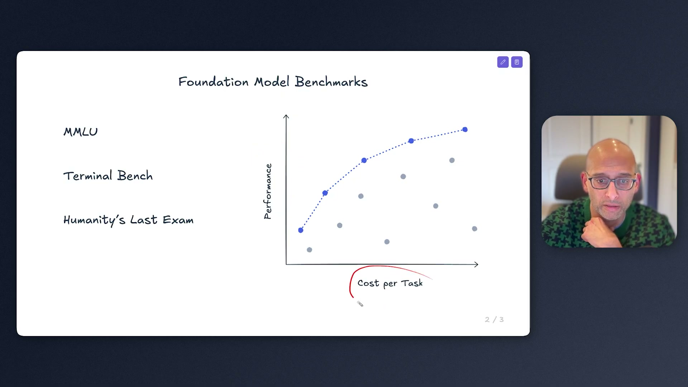
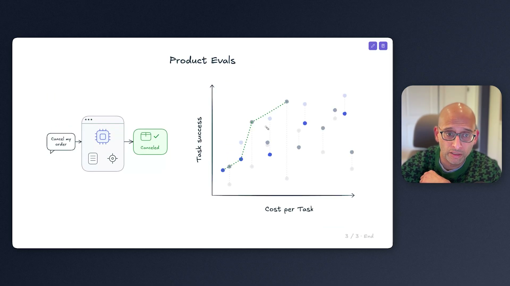
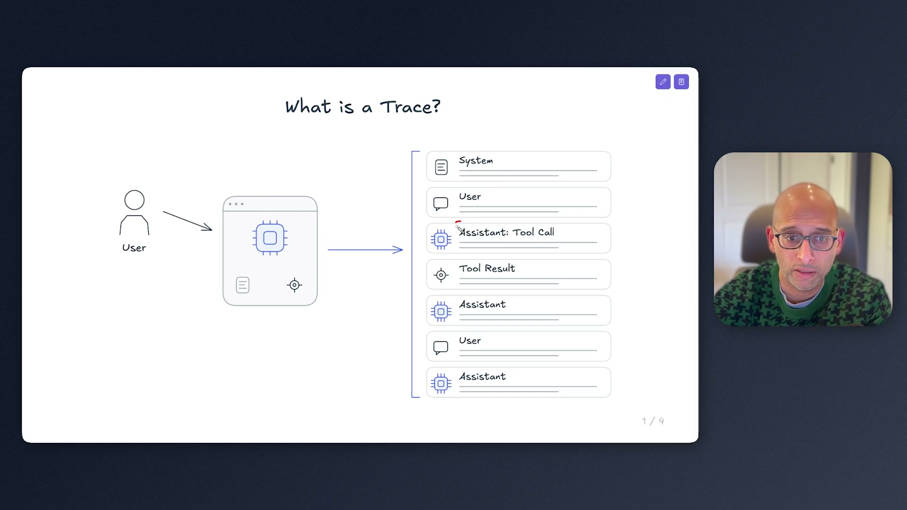
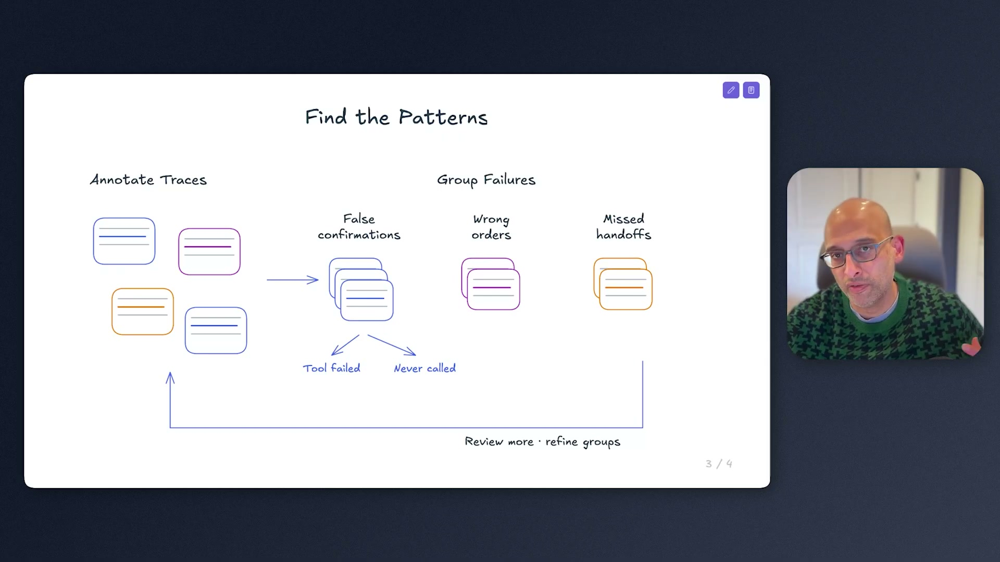
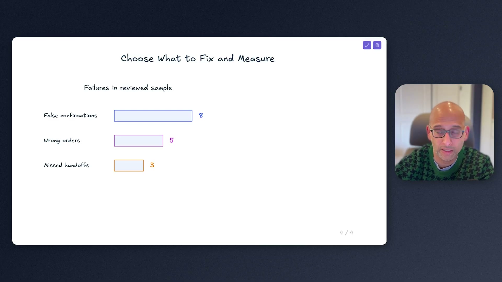
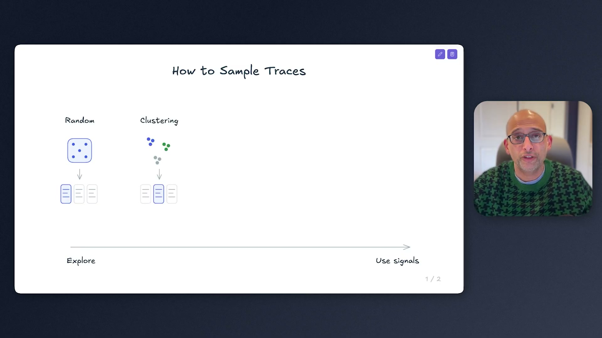
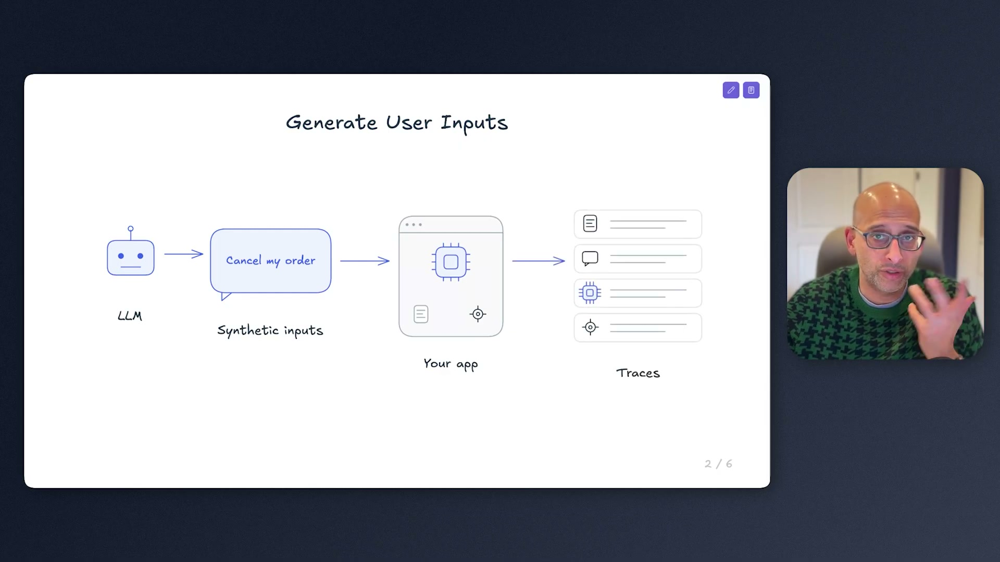
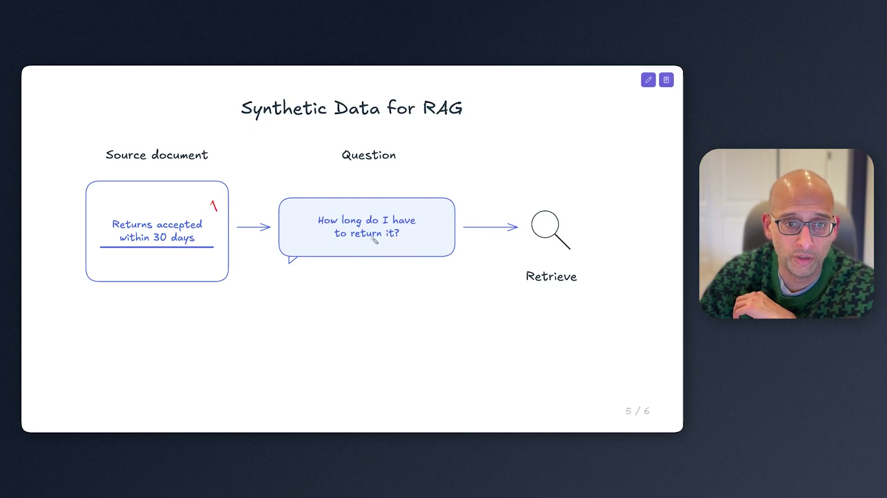
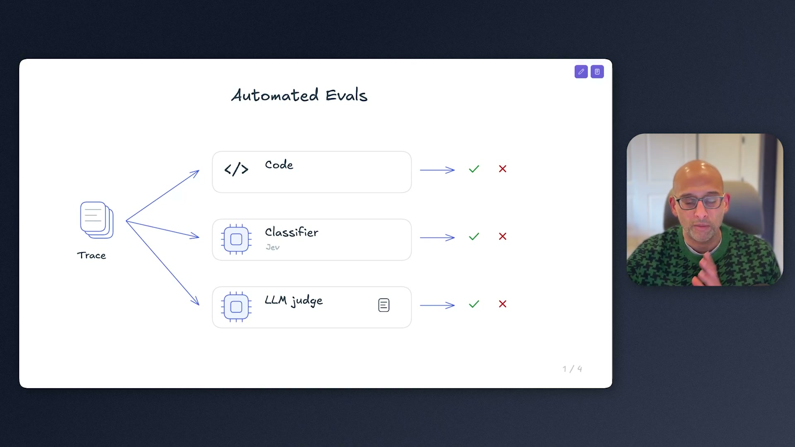
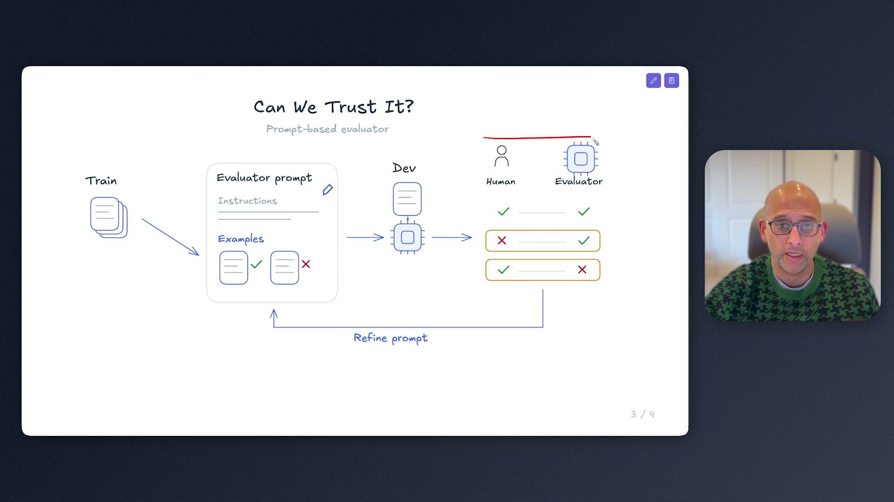
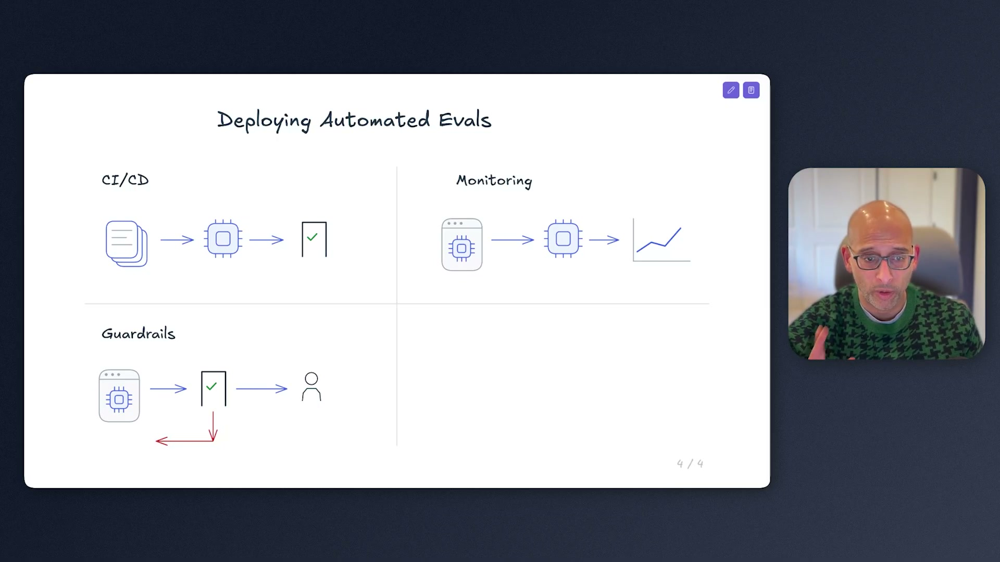
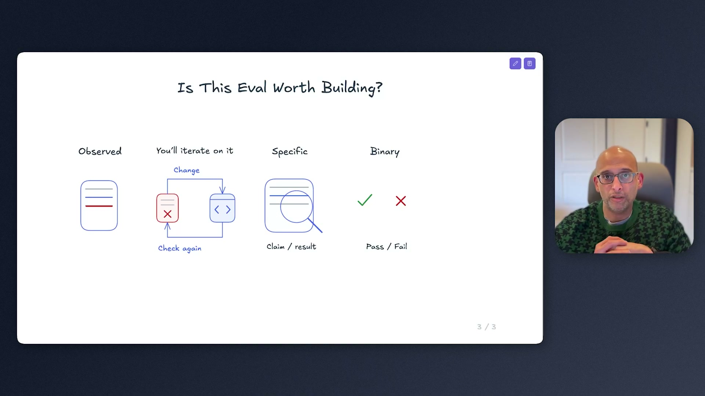
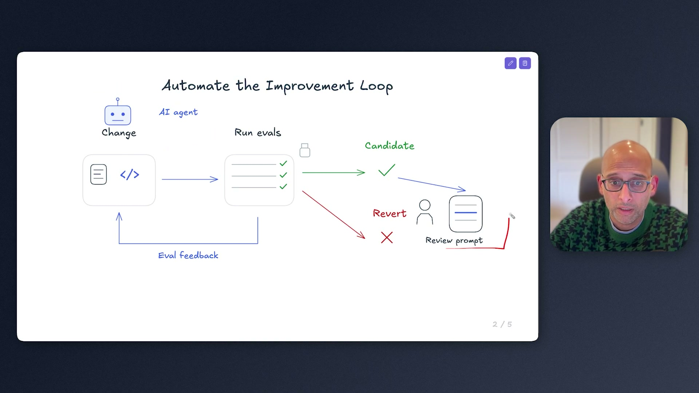
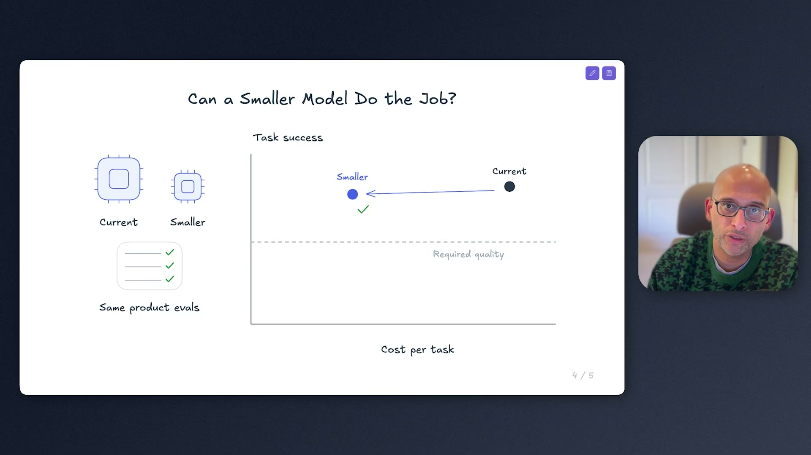

## Transcript

### [00:00 - 00:19] Intro
**[00:01]** You probably know if you're building an AI product, you need a way to measure if the thing is good or not. And on this channel, we talk a lot about evals, but I realize a lot of people don't know what evals are, and they're very new to the subject. And I want to do a very gentle introduction that just goes over some of the important concepts in evals. So let's dive in. First, we'll discuss

### [00:19 - 01:53] Product evals vs. model benchmarks
**[00:20]** the difference between product-specific evals and foundation model benchmarks. Now, foundation model benchmarks are basically general intelligence tests. Think about the SAT or an IQ test, and it's just trying to test the model's general intelligence, whereas product-specific evals are very specific to your product or task that you want to
**[00:40]** achieve. So let's say you have some kind of AI assistant whose job is to help people with orders. Let's say for e-commerce, you want to have an eval for specific tasks like ability to cancel orders correctly. You can see a user might ask, cancel my order. It goes through your agent. There might be context that needs to be pulled. There
**[00:58]** might be multiple calls to the LLM, and then you have an outcome that you can measure. Has the order been canceled? That's a very different exercise than foundation model benchmarks. So examples of foundation model benchmarks are things like MMLU, terminal bench, humanities last exam, and usually see these foundation model benchmarks presented like this with the Pareto
**[01:18]** chart. And the Pareto chart has performance on the Y axis and cost on the X axis. And this can be flipped, but the idea is the same. Basically, with AI, there's usually a cost-performance tradeoff, meaning the longer you spend thinking or the more tokens you spend, the better you can often perform on a task. So there's a tradeoff. When it
**[01:38]** comes to product-specific evals, you'll find that the Pareto frontier becomes very different. Those gray dots, some of them that were at the bottom below, they will rise to the top because your task-specific performance is usually very different than this general intelligence test. So when a user

### [01:53 - 02:57] Traces
**[01:54]** interacts with your application, for example, for a chatbot, there's a number of things that happen in context the LLM sees. And a conversation can often look like this where a user asks a question, the agent looks at the system prompt, it might make a tool call, there might be a tool call result, and the assistant may
**[02:12]** reply, and there might be follow-up questions, and it goes on and on. You'll see this in chatbots all the time. Basically, a trace is a comprehensive record of everything that happened in a user session. Now, it doesn't have to be a chatbot, it can be any AI workflow, but you are capturing everything, you're capturing all the prompts, all the context, tool calls, tool calls results,
**[02:32]** anything that the AI sees in order to solve the problem, including any sub-agents. You need to instrument your code, you want to store those traces somewhere, usually in a database, and then you also want to have some kind of trace viewer that allows you to see these traces in a human-readable way so that you can review them. You'll use traces to find issues in your
**[02:51]** application. You'll use these same traces to also test changes that you may want to make and then debug failures. So

### [02:57 - 04:06] Error analysis
**[02:58]** again, here is a trace. It might look something like this. And what you want to do when you annotate a trace is just describe what went wrong. So in this case, there was a tool call where the cancellation failed, but the assistant still gave the user a message of your order is canceled. So you would want to write some notes like, hey, we said it was canceled, but it's not. Then you can
**[03:16]** ask AI to help you group failures. And what you're looking for is themes of failures or categories or a taxonomy, whatever you want to call it, but you want to group your failures. For example, you might have false confirmations, like we just saw, or you might have wrong orders or missed handoffs. You want to get an idea of the patterns that exist in your data. Those
**[03:34]** false confirmations, they might actually have two different distinct groups in there, like a tool call has failed or the tool is never called. And you might want to break that out, but you need to review these groups and refine them a bit until you're satisfied with these groups. After you have created these groups, the next thing you want to do is do some very simple analysis. My recommendation is to start with
**[03:52]** counting. You can just count the failures in each of the groups. You can let that guide you towards what you should work on next. The next natural question is, how do you know what traces to even look at? Should you just keep annotating them randomly? How do you make good use of your time here? And

### [04:06 - 06:55] Sampling traces
**[04:07]** that's when we get into sampling traces. And there's lots of different ways to do this. There's a spectrum from exploring your traces, so using random sampling, and that's where you are going to learn the most because you're trying to explore unknown unknowns. You're trying to look for new problems. There's also clustering where you can group your traces into similar themes and explore
**[04:27]** what might be going wrong in a more structured way. You can also use data analysis, which is you can compute statistics about your traces like number of turns, latency, number of tool calls, so on and so forth. And you can see if there's any outliers, and that could give you clues on promising things to explore. When you're starting out, you should do more exploration. As you gain
**[04:46]** more experience in the data set or in the problem, you can use more signals. But you always want to do some level of exploration at all times. Synthetic data is very limited and you shouldn't reach for it first, but it is a good tool to have in your tool belt. So how does synthetic data work? You get an AI to generate user inputs. You don't want to
**[05:05]** generate an entire trace synthetically. What you want to do is generate the input to your system that can be a user message or if it's an AI workflow that's not a chatbot, it can be whatever the input to your system is the AI is receiving. For example, cancel my order. And put that synthetic input into your application and then log the trace. And then of course, after you have this
**[05:24]** trace, then you can go on to human review. One good way to generate higher quality synthetic data is to think about the various scenarios that you want to simulate. For example, when it comes to canceling your order, let's say you want to fill in that scenario with more data. There might be different scenarios that apply here. For example, what does canceling your order look like before
**[05:42]** shipping or after shipping or what if the order is unclear or what if the order number is unclear? These are all different scenarios that might actually happen. And what you want to do again is you want to review all of these to make sure they make sense. AI will gladly produce synthetic inputs that are very clear like cancel order number 42, but
**[06:01]** users they'll say stuff like please cancel the blue one. And you know, the problem is there's no order number here. So you might want to think about what kind of synthetic queries you want to generate. You want to generate synthetic queries or synthetic inputs that match what users are going to do in production or that's going to match the messiness of the real world. Another place where
**[06:21]** synthetic data is really useful is retrieval or RAG. And so the way it works is you start with your corpus of documents. So let's say, for example, this is a return policy. And what you do is you have an LLM generate a plausible question that can be answered by that document. So for example, how long do you have to return items? And your task
**[06:40]** is to retrieve this document given this question. So you're going in reverse. Look, I know we're going through this stuff really fast. If you want more details about how to validate your product with Evals, I'll leave a link in the comments. I'll give you a lot more detail into these concepts. Now you're

### [06:55 - 10:18] Automated evals
**[06:55]** ready to create automated Evals. Automated Evals can take many forms, but essentially what you're doing is grading traces. And those grading of traces can be done offline or you can stream production data through an Eval and have it be graded. And so there's many ways to grade a trace. So you can write code to assert something about a trace. Let's
**[07:16]** say like it shouldn't contain a certain user ID or it shouldn't contain a certain tool call. You can check to see whether that trace has some kind of failure mode. The other kinds of ways of grading a trace, one is a classifier. So you can use something like a decision model or a normal classifier to classify if a trace is good or bad. Or you can
**[07:35]** use an LLM as a judge. Now I recommend using an LLM as a judge as a classifier too to say if some trace is either pass or fail. Highly recommend binary scores because if you try to output a more complicated score like something on a range of 1 to 5 or 0 to 100, nobody knows what that means and that gets very complicated later on when it comes time
**[07:55]** to validating these automated Evals. So you don't want to do that. You want these binary pass and fail. So when it comes to trusting these automated Evals, you have some kind of ground truth. And the ground truth is usually coming from a human. And you want to have labeled some data. And you might have done this during error analysis, you might have labeled data elsewhere, but you want to
**[08:14]** go through an exercise of labeling some data. An AI can help you label this data. There's techniques that you can use to quickly label data, have AI propose labels, and you accept them. And you'll have different kinds of errors. You'll have missed failures. So these are things you didn't catch, and then you'll have false alarms, the things that are marked as a failure, but
**[08:34]** they're really not. So you can split your data set into three pieces. The first piece is a train set. And the train set can be used as examples in your prompts. Your LLM as a judge or decision model will have a prompt with instructions saying what is good and bad. And in that prompt, you also want to show some examples. And you can pull
**[08:52]** these examples from this training set. Another segment of your data that you want to hold aside is your dev set. Now this dev set is where you're going to tune your model. This can be roughly 40% of your data set. What you can do here is observe the agreement or disagreement between the human and the evaluator. And what you want to do is then keep
**[09:10]** refining your prompt until this gets better. And keep hill climbing towards making these two as aligned as possible. And AI is really good at this. There's algorithms that can help you with this. Now the only trick is you don't want to overfit. It's very easy to overfit and make your automated eval really good on this dev set. And you don't want to do
**[09:29]** that. You want to make sure that this eval works outside the dev set. And so that 's why you set aside this final test set. And on the final test set, what you do is you take your finished prompt, and then you do a final check on how well the human and the evaluator agree with each other. And if this is good, then you know that you haven't overfit. If this is bad, then you know
**[09:48]** you've overfitted, and then you need to do this whole thing again. So after you create these automated evals and you trust them, now you can deploy them in different places. So you can put automated evals in CI/CD. You can have your automated evals monitor production traffic and tell you in real time or near real time where errors are occurring. Or you can also make some of
**[10:07]** these evals guard rails. So guard rails are just things that sit in the request response path and block things from reaching the user. They usually are blocking unsafe things from reaching the user. So, now that you've learned about

### [10:18 - 12:14] Common eval traps
**[10:19]** automated evals, the next thing I want to do is cover some big traps that you're likely to fall into if you're dealing with evals or even if someone else on your team is writing the evals. And the first trap is using generic metrics. You don't want to ever use generic metrics. You'll see scores on a range of 1 to 5. They don't really make
**[10:38]** sense. If you think about it, what is 4.2 versus 4.5 versus 3.9? Like what does that even mean? It's not actionable. What you want to do instead is measure specific failures to your product that are actionable. And so, back to the order cancellation example, what you want to do is have evals that
**[10:56]** capture whether or not this task is happening successfully. Now, evals are expensive. They take time and resources to build and maintain. And you can't build an eval for everything. If you try to do that, you would run out of time and money really fast. There are some rules of thumb you should think about when it comes time to deciding whether or not you should build an eval for a
**[11:15]** problem you are observing. One is try to observe the problem. So, either you found the problem in your traces or you're able to reproduce the problem. It's also okay to brainstorm potential things that can go wrong. And it's okay to worry about problems that haven't happened yet. If you are worried about those problems, you need to be able to
**[11:33]** reproduce it in your system. Another thing you want to think about is is this problem something you're going to iterate on? Evals are best for things where you'll need to iterate and you don't know how to fix off the bat. That eval is going to give you a lot of value because it'll give you signal so that you can do a lot of experiments to try out things in order to fix a problem.
**[11:51]** Evals should help you guide product decision making. There should be some threshold over which something is good enough to ship and you need to encode that into your evals. It takes some discipline to have binary outputs in your evals to say something passes or fails, but you need to figure out what is good enough to ship and you need to
**[12:10]** be very clear on what constitutes a pass versus a fail. The most important thing

### [12:14 - 14:23] Improving your AI product
**[12:15]** to know about evals is you should be using evals to make your product better. That's the whole point. You're not making evals for eval's sake. Whenever you make a change to let's say your prompt or code, you can run your evals and then you can decide whether those changes are good or not. Now, you don't have to do this manually. You can also automate this process and a lot of people have done this. You can have your
**[12:35]** agent automatically try to hill climb by running evals and seeing what fails and then iterating on your system. Now, you have to be careful when you do this. You have to have a pretty good set of evals that are comprehensive and span the space of things that can go wrong so that your agent doesn't try to hack this
**[12:53]** metric, do really well on evals at the expense of something else. I recommend not just letting an agent go at it by themselves. What happens in a lot of these self-improving systems is that this agent will try to improve the prompt. What I recommend is having a human review the prompt that the agent comes up with and then simplifying or
**[13:12]** cleaning up the prompt and getting ideas from the prompt rather than just adopting whatever the agent proposes here blindly. One thing you're going to want to do here is make sure you check your system's behavior on unseen test cases. Another way to make your product better by using evals is to explore different models, especially using a
**[13:31]** smaller model for a specific task. And what you can do is measure your tasks on both cost and quality using your evals to measure quality. You can take important tasks and set a minimum quality bar and then you can see if for current tasks when moving to a smaller model, can you keep the same or higher quality but just decrease the cost? And
**[13:50]** this is a very common thing to do, often a low-hanging fruit after you have evals. There's a lot of things I haven't covered here. For example, how to evaluate retrieval, which is a deep subject on its own, as well as a whole bunch of other stuff. But these are the concepts I think that you should pay attention to if you're first learning about evals. If you're just getting started with the evals and you made it
**[14:09]** all the way through this video and you want to learn more, a good next video to watch is AI Evals Tier List. I go through a bunch of common pitfalls people make with Evals and I rank them. And it's a good way to quickly learn how you can not waste time when doing Evals.
