# AI System Design: 7 Patterns Explained in 17 Minutes

**Channel**: Jam With AI | Shirin Khosravi Jam
**URL**: https://www.youtube.com/watch?v=0jCss9xfOiw
**Upload Date**: 2026-09-10
**Duration**: 17m 11s
**Transcript extracted**: 2026-11-22

---

## Chapters

| # | Timestamp | Chapter |
| :--- | :--- | :--- |
| 1 | `00:00 - 01:00` | Why working AI apps fail under load |
| 2 | `01:00 - 01:40` | From the core AI service to system design |
| 3 | `01:40 - 03:20` | API Gateway |
| 4 | `03:20 - 04:51` | Rate Limiting and Admission Control |
| 5 | `04:51 - 06:23` | Caching |
| 6 | `06:23 - 08:42` | Message Queue |
| 7 | `08:42 - 11:11` | Timeouts, Retries, and Circuit Breakers |
| 8 | `11:11 - 12:52` | Load Balancing and Shared State |
| 9 | `12:52 - 14:40` | Autoscaling and Cold Starts |
| 10 | `14:40 - 15:37` | Revisiting the Seven Patterns |
| 11 | `15:37 - 16:02` | Inside the Core AI Service |
| 12 | `16:02 - 16:20` | Metrics, Tracing, and AI Evaluations |
| 13 | `16:20 - 17:11` | How to Approach AI System Design Questions |

## Suggested Keyframe Timestamps

- `00:48` (48s, `chapter`): Why working AI apps fail under load
- `01:31` (91s, `chapter`): From the core AI service to system design
- `03:08` (188s, `chapter`): API Gateway
- `04:39` (279s, `chapter`): Rate Limiting and Admission Control
- `06:11` (371s, `chapter`): Caching
- `08:30` (510s, `chapter`): Message Queue
- `10:59` (659s, `chapter`): Timeouts, Retries, and Circuit Breakers
- `12:40` (760s, `chapter`): Load Balancing and Shared State
- `14:28` (868s, `chapter`): Autoscaling and Cold Starts
- `15:25` (925s, `chapter`): Revisiting the Seven Patterns
- `15:56` (956s, `chapter`): Inside the Core AI Service
- `16:16` (976s, `chapter`): Metrics, Tracing, and AI Evaluations
- `17:00` (1020s, `chapter`): How to Approach AI System Design Questions

## Key Visual Frames

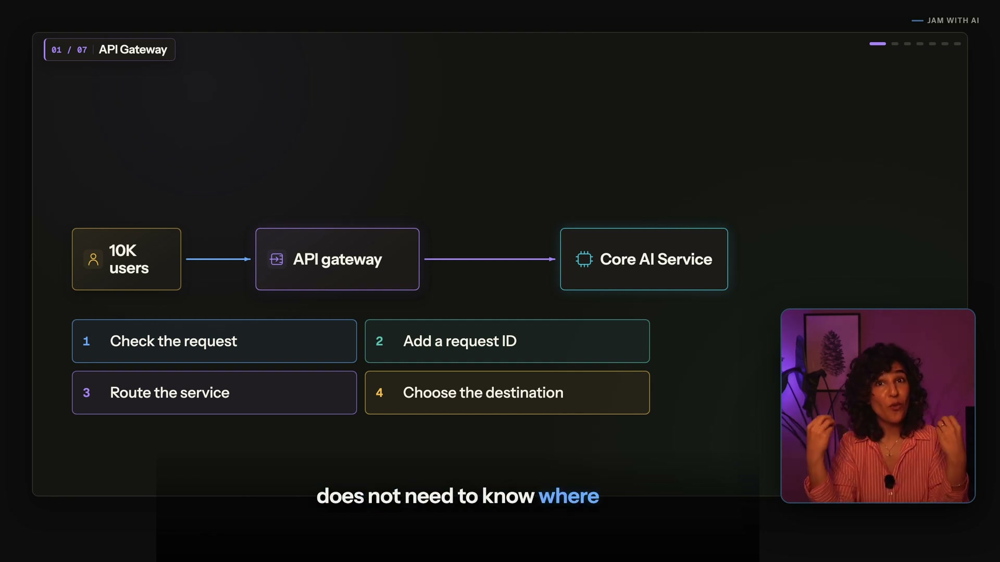
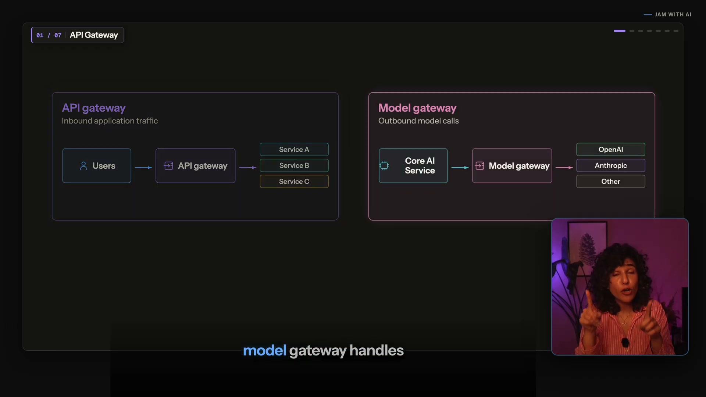
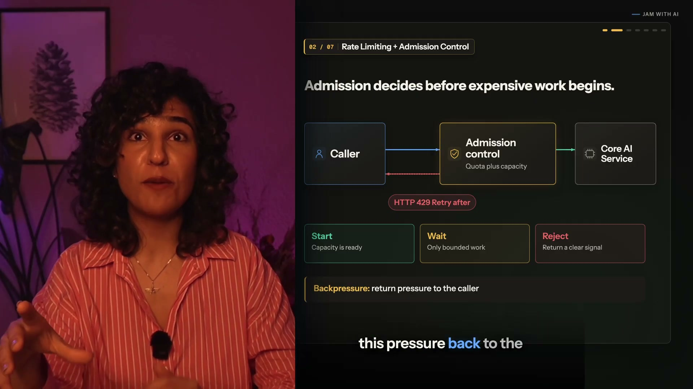
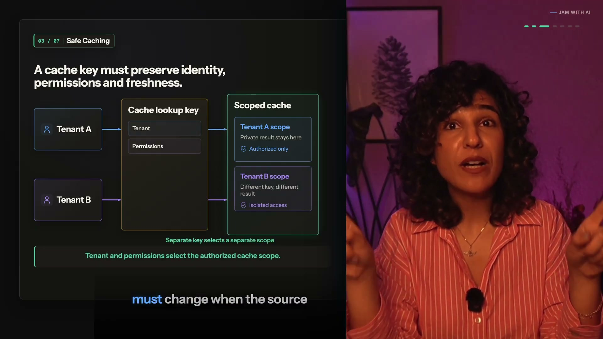
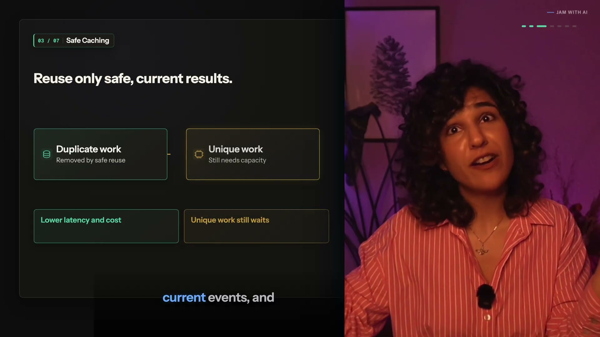
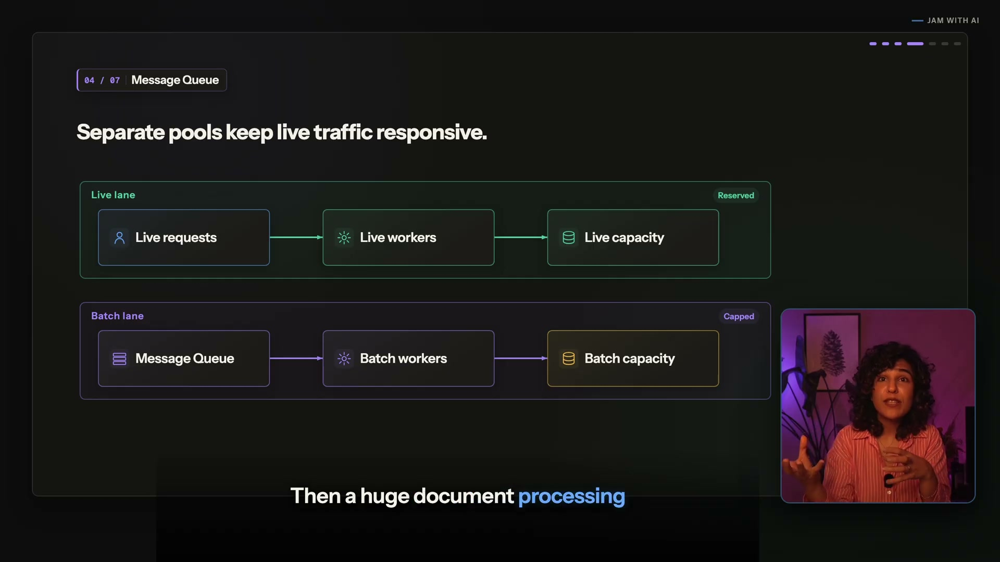
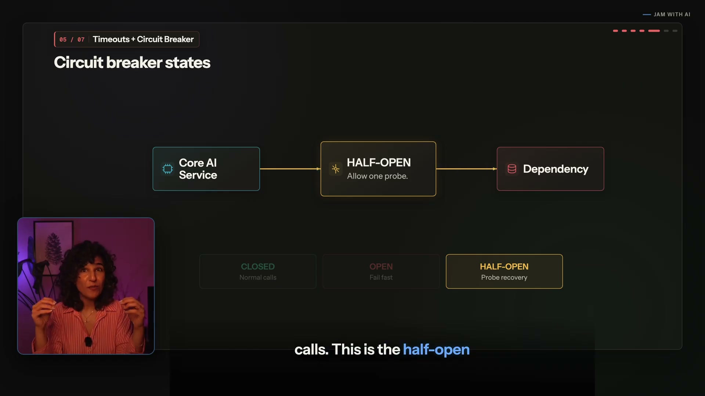
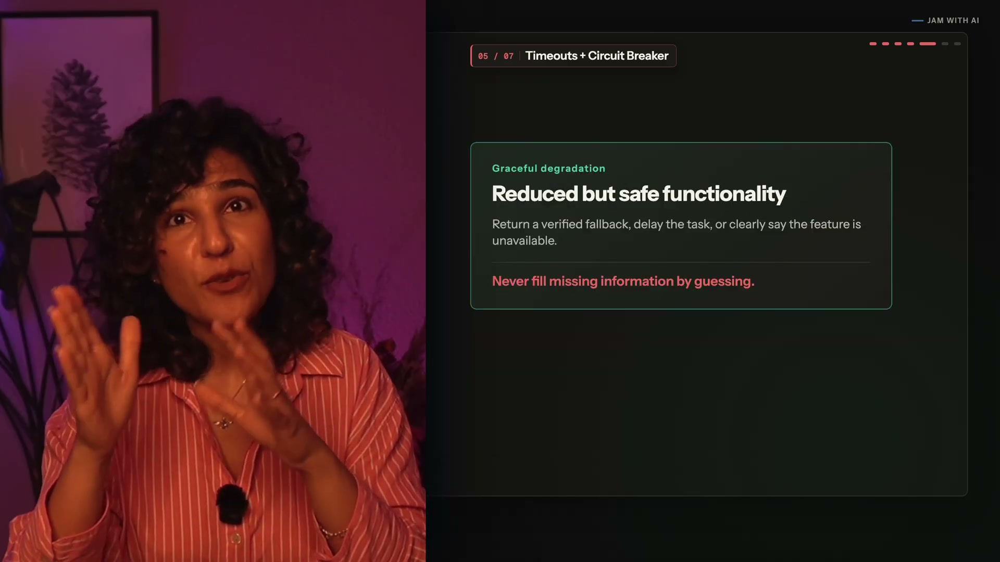
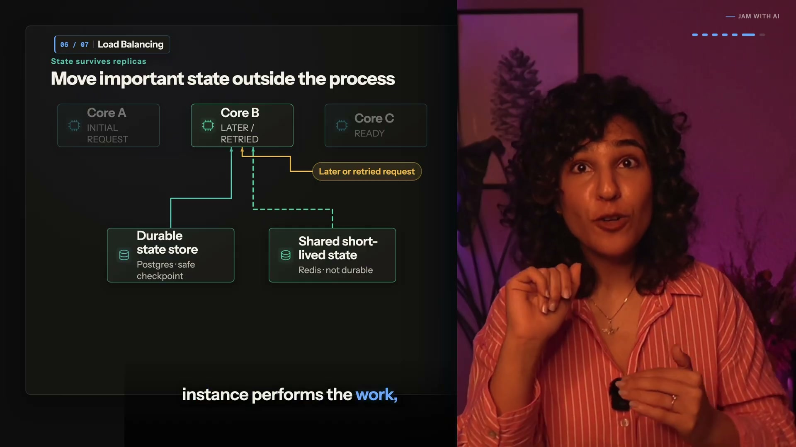
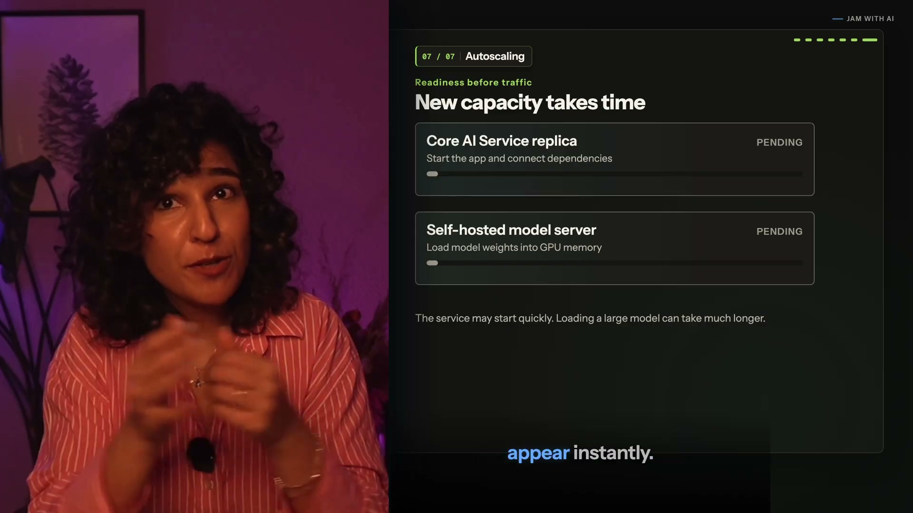
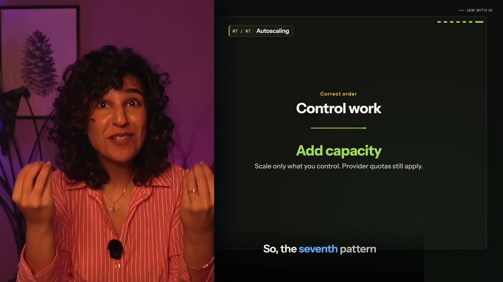
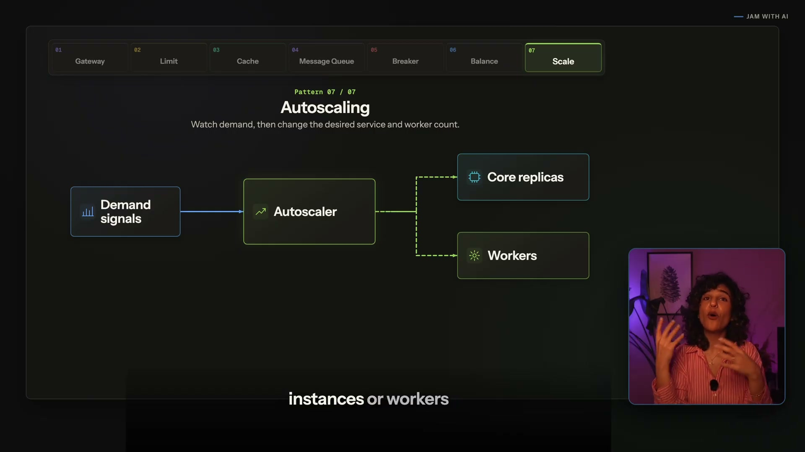
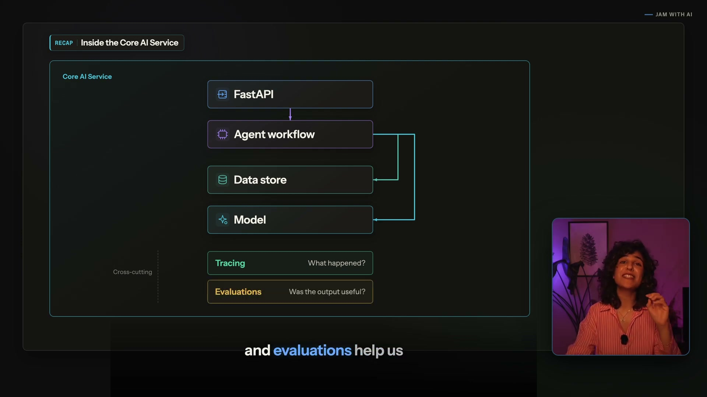
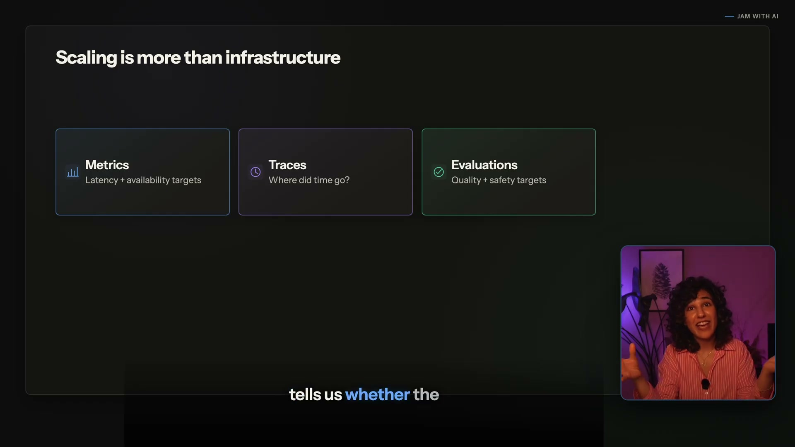

## Transcript

### [00:00 - 01:00] Why working AI apps fail under load
**[00:03]** An AI application can work perfectly for a few users and still fail for 10,000 users. One user sends a request, fast API receives it and invokes the agent. The model returns an answer and everything works. Now imagine 10,000 users sending requests within a short period of time. What if one service
**[00:22]** becomes slow or breaks? Where are the blockers and how do we avoid these issues? The model may be fine, the fast API code may be also, but the system around them is now the problem. These are system design questions. How requests enter, how they wait, fail and
**[00:41]** scale. If these terms are new, do not worry. You are in the right place. I will explain each term and each pattern in simple English, one problem at a time. And if you're new here, I am Shireen. I have worked in AI and machine learning for 10 years and I'm currently an engineering manager working in AI. In

### [01:00 - 01:40] From the core AI service to system design
**[01:01]** another video, we already built the first part, the inside of a production AI service including fast API, the agent workflow, tracing and evaluations. I will link that video here so you can check it out later. Today we are moving one level higher. That complete architecture becomes one small core AI
**[01:22]** service. Nothing disappears. We simply zoom out. Just remember the core AI service receives a request, performs the AI work and returns a response. Fast API can use waiting time efficiently. But it cannot create unlimited capacity. So

### [01:40 - 03:20] API Gateway
**[01:40]** when thousands arrive, we first need a controlled entrance. That entrance is an API gateway. An API gateway sits in front of the application and manages incoming traffic before it reaches our application code. It can check who is making the request, reject obviously
**[02:00]** invalid or oversized request, attach a request identifier, and send the request to the correct service. The gateway sends each request toward the correct internal service. The client does not need to know where every service lives. It only needs to communicate with the
**[02:19]** gateway. You can think of the gateway like the reception desk of a large building. It gives everyone one entrance, checks where they need to go and directs them to the correct place. But the gateway does not replace fast API. Fast API still defines and handles
**[02:38]** our application routes. The gateway controls traffic before these routes are reached. This is also different from a model gateway. The API gateway handles user traffic coming into our application. A model gateway handles model calls going out from our application to providers such as OpenAI
**[02:58]** or Antropic. So the first idea is super simple. The API gateway controls the entrance. One quick note, these seven patterns describe seven responsibilities and not necessarily seven separate products. One cloud service may provide several of them, but what matters is
**[03:18]** understanding which problem each pattern

### [03:20 - 04:51] Rate Limiting and Admission Control
**[03:20]** solves, but one control entrance can still receive more valid traffic than the application can actually handle. The next question is not only who can enter, it is also how much work should we allow inside this. This brings us to rate limiting. A rate limiter controls how
**[03:40]** many requests a user, customer or application can make during a period of time. For example, we might allow 100 requests per minute. If one user sends thousands, the rate limiter can reject the excess requests or ask the client to try later before they consume all of our
**[04:00]** capacity. For AI systems, request count is not always enough. One request may classify a short sentence. Another may contain thousands of tokens, retrieve several documents or call many tools and generate a super long answer. So an AI application may limit requests, input
**[04:20]** and output tokens and active model calls. The broader idea is admission control. Decide what starts now, waits or is rejected. A live request may receive an HTTP 429 response which means too many requests together with a retry after value. Sending this pressure back
**[04:41]** to the caller is called back pressure. The system tells the caller to slow down instead of collecting more work. So the second pattern limits how much work actually begins. Now we have controlled

### [04:51 - 06:23] Caching
**[04:54]** amount of traffic but many accepted requests may still ask for the same information. Our application may create the same embedding, retrieve the same document or generate the same safe answer again and again. This is where caching is super helpful. A cache stores
**[05:13]** the results so the application can reuse it instead of calculating it again. Imagine that hundreds of users ask a question about the same public document. The first request retrieves and processes that information. Later requests may be able to reuse part of the result. In an AI application, we had
**[05:34]** cache and embedding a retrieval result, a common document, or even sometimes a model response. A fast cache such as radius could be used for this, but we should not blindly c everything. A private answer created for one user must not be returned to another user. The
**[05:53]** cache must separate users and permissions and it must change when the source or configuration changes. Cached information also needs an expiry time or another way to be updated. Questions that sound similar are not automatically safe to be shared. So the third pattern
**[06:12]** reuses safe work. Caching can reduce latency and cost, but only when the result is still correct, reflects current events, and it is safe for that user. Caching also removes repeated

### [06:23 - 08:42] Message Queue
**[06:26]** work. But after removing the duplicates, we may still have hundreds or thousands of different tasks. Some of those tasks do not need to finish while the user keeps the request open. This is where a message cube becomes really helpful. A durable message cue records work now so
**[06:45]** a worker can process it when capacity is actually available. You can think of your order in a restaurant. The person at the counter accepts an order and places the ticket in a queue. The kitchen takes the next ticket when it is actually ready. It does not need to prepare every order at the exact moment
**[07:04]** it is placed. In the same way, our application can record a task in a durable queue. A controlled group of workers takes tasks from the queue and processes them at a rate the system can handle. This does not mean every chat response should wait in a long queue.
**[07:23]** Work that needs an immediate or streaming response can start on the live path. But longer or background work such as document ingestion, embedding generation, long reports, emails, name it. All of these can move through a que. A Q absolves a temporary spike but it
**[07:44]** does not remove the work. So the system should define a maximum backlog or a maximum acceptable waiting time. Important jobs may need higher priority and a task that keeps failing can move into a dead letter queue so somebody can investigate it instead of retrying
**[08:04]** forever. A worker may also receive the same job more than once. This is why important actions should be item potent. That simply means that processing the same job again should not create the same external action twice. We may also keep different kinds of work in separate
**[08:22]** cues and worker pools. Then a huge document processing job cannot consume all the database connections or compute needed by the customerf facing traffic. So the fourth pattern lets work wait safely. We accept a bounded amount of work, process it at a controlled rate and make repeated delivery safe. But a Q

### [08:42 - 11:11] Timeouts, Retries, and Circuit Breakers
**[08:44]** only controls when work happens. It cannot repair a dependency that is actually broken. Now imagine that our model provider, a vector database or external tool becomes very slow. Every request waits longer, more request arrives and clients are retrying again
**[09:03]** and again. Once slow dependency begins to consume connections and workers across the entire application, the first protection is a timeout. We decide how long we are willing to wait for that dependency. If the problem looks temporary, we may try again a small
**[09:21]** number of times with a longer delay and a little randomness before each retry. The randomness stops every request from trying again together. But retries must be limited. Otherwise, one,000 failing requests can create several thousand downstream calls. When the failure
**[09:40]** continues, we need a circuit breaker. A circuit breaker watches calls to one dependency. When too many calls fail, the circuit opens and temporarily stops sending more traffic to that dependency. It works like the electrical breaker in a house. When something becomes unsafe,
**[09:59]** the circuit opens to stop the problem from spreading. When the dependency is healthy, the circuit is closed and requests flow normally. When failures cross the limit, the circuit opens and calls stop. After some time, it allows a small number of test calls. This is the
**[10:18]** halfopen state. If those calls succeed, normal traffic can begin again. When the circuit is opened, the application also needs a safe alternative. It may use a tested fallback model, return verified cached information, for example, or delayed a task or even explain that one
**[10:37]** feature is temporarily unavailable. It should not replace missing information just by guessing. Graceful degradation means providing reduced but safe functionality instead of a wrong unreliable answer. We can also isolate important resources. For example, separate connection pools or worker
**[10:58]** pools can stop one failing provider from consuming everything needed by the other parts of the system. This supporting idea is called a bulkhead. So the fifth pattern stops failure from spreading. At

### [11:11 - 12:52] Load Balancing and Shared State
**[11:11]** this point we can control traffic, reuse work, let some work wait and protect the system from a broken dependency. But every live request is still reaching one copy of our core AI service. One healthy server still has a limit. So we can run
**[11:30]** several copies of the core AI service and add a load balancer. A load balancer distributes incoming requests across multiple healthy service instances. Instead of one instance receiving everything, the work is shared. The API gateway and load balancer are related,
**[11:49]** but they solve different problems. The gateway controls how traffic enters and which service it should reach. The load balancer chooses which healthy copy of that service should receive the request. Some cloud products can perform both jobs, but the responsibilities are still different. for multiple copies to work
**[12:10]** safely. Important state should not live only inside one fast API process. Durable conversation state, workflow checkpoints and job status can also live in Postgress. Shortlive shared state may live in something like Reddis. Then a later or retried request can reach
**[12:30]** another healthy instance and a workflow can resume from a safe checkpoint instead of starting again. This is why application servers are often defined as stateless. The instance performs the work but important state survives outside that individual instance. So the
**[12:49]** sixth pattern distributes the capacity we already have. But what happens when

### [12:52 - 14:40] Autoscaling and Cold Starts
**[12:54]** every available instant becomes busy? Distributing the work is no longer enough. We need more capacity. This brings us to autoscaling. Autoscaling automatically adds or removes service instances as demand changes. If traffic grows, the system can start more copies
**[13:14]** of the core AI service or more background workers. When traffic falls, it can reduce them again so that we do not keep paying for capacity that we no longer need. The important question is now what should the autoscaler measure? We should scale using the signal that
**[13:34]** shows where work is waiting. An API may use active requests or response times. Workers may use QEP or how long the oldest task has been actually waiting. A self-hosted model may use waiting requests or GPU usage and CPU alone may
**[13:52]** miss a full GPU. New capacity also does not appear instantly. A normal service may take seconds to start. A larger model server may take much longer because it has to load the model into the GPU memory. If traffic is predictable, we may keep some capacity warm before the spike begins. While the
**[14:13]** new capacity is starting, rate limiting and admission control protect the instance we already have. So autoscaling comes last for a reason. More servers do not fix duplicated work or unlimited retries or a broken dependency or even an unbounded queue. First control the
**[14:33]** work then add capacity. So the seven pattern changes how much capacity actually exists. Let us follow one

### [14:40 - 15:37] Revisiting the Seven Patterns
**[14:41]** request through the completed system. A user sends a request and the API gateway gives the application one controlled entrance and sends the request toward the correct service. Rate limiting checks whether this user and this type of request are within the allowed
**[15:00]** capacity. The load balancer selects a healthy core AI service instance. Now the service checks whether any safe work can be reused from the cache. If the request needs an immediate answer, it stays on the live path. If it starts longer background work, that work is
**[15:19]** saved in a queue and processed by a worker. Timeouts and circuit breakers protect calls to the databases, model providers, and external tools. The autoscaler watches demand and changes the number [clears throat] of service instances or workers whenever necessary.

### [15:37 - 16:02] Inside the Core AI Service
**[15:37]** And inside the core AI service, the internal components are still doing the actual AI work. Fast API handles the request. The workflow coordinates the agent. The data store provides information. The model creates the output. Tracing tells us what happened
**[15:57]** and evaluations help us check whether the answer was good or not. That final

### [16:02 - 16:20] Metrics, Tracing, and AI Evaluations
**[16:03]** point matters. Metrics tell us whether the system is fast and available. Traces show where one request spends its time. Evaluation tells us whether the AI output remained useful or not. And scaling a wrong answer faster is not success. If you do get a system design

### [16:20 - 17:11] How to Approach AI System Design Questions
**[16:23]** question in an interview, do not begin by naming seven technologies. Start with the user request. Ask how much traffic we expect. which work needs an immediate response or what can wait and which dependency is likely to become the bottleneck. Then add each pattern only
**[16:41]** when it solves the actual problem. And I also hope that you notice that we did not make any changes to the model itself. The fast API application inside our core AI service is still doing the same job. What changed is now the requests that enter the ones that wait fail and scale around it. That is the
**[17:01]** difference between an AI application that works for a few users and an application that is designed for thousands of users. I hope this was helpful.
