# All Code Is Slop (Except Mine) — Lauren Tan, SpaceXSI

**Channel**: AI Engineer
**URL**: https://www.youtube.com/watch?v=O_zcc6Xl12g
**Upload Date**: 2026-11-14
**Duration**: 17m 31s
**Transcript extracted**: 2026-11-17

---

## Chapters

| # | Timestamp | Chapter |
| :--- | :--- | :--- |
| 1 | `00:00 - 02:03` | Turning slop into gold |
| 2 | `02:03 - 05:00` | The trust pyramid and codebase quality |
| 3 | `05:00 - 06:56` | Dune and enforceable architecture |
| 4 | `06:56 - 09:40` | Replacing comments with lint rules |
| 5 | `09:40 - 10:50` | Runtime verification and feature maps |
| 6 | `10:50 - 11:51` | Formal verification and UI testing |
| 7 | `11:51 - 13:32` | Spending tokens on verification |
| 8 | `13:32 - 15:11` | 11,000 PRs and a 0.5% revert rate |
| 9 | `15:11 - 17:31` | Foundations before software factories |

## Suggested Keyframe Timestamps

- `01:51` (111s, `chapter`): Turning slop into gold
- `02:15` (135s, `visual_cue`): like good API design, architecture,
- `04:48` (288s, `chapter`): The trust pyramid and codebase quality
- `06:44` (404s, `chapter`): Dune and enforceable architecture
- `07:37` (457s, `visual_cue`): architecture clash between
- `09:28` (568s, `chapter`): Replacing comments with lint rules
- `10:38` (638s, `chapter`): Runtime verification and feature maps
- `11:39` (699s, `chapter`): Formal verification and UI testing
- `13:20` (800s, `chapter`): Spending tokens on verification
- `14:37` (877s, `visual_cue`): is that the performance of Graph Bot has
- `14:59` (899s, `chapter`): 11,000 PRs and a 0.5% revert rate
- `16:07` (967s, `visual_cue`): And when you're ready, Graph Bot is a
- `17:19` (1039s, `chapter`): Foundations before software factories

## Key Visual Slides & Diagrams

- `00:25` — **Title Slide & Speaker**:
  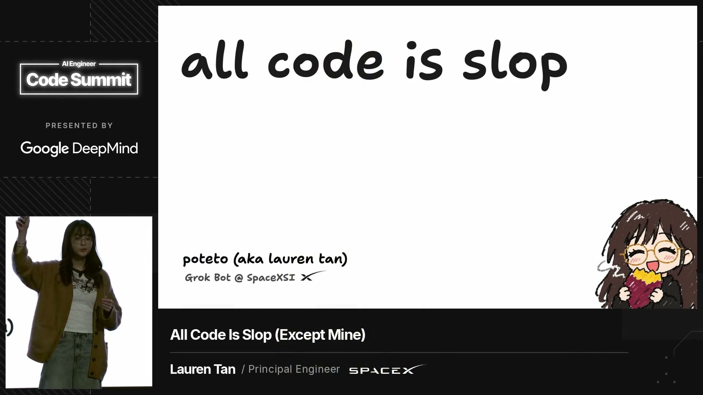
  > Visual content: AI Engineer Code Summit (presented by Google DeepMind). Title: **"all code is slop"** — **poteto (aka lauren tan)**, **Grok Bot @ SpaceXSI / SpaceX** (Principal Engineer).
- `02:14` — **The Poteto Pyramid (Inverse Trust Hierarchy)**:
  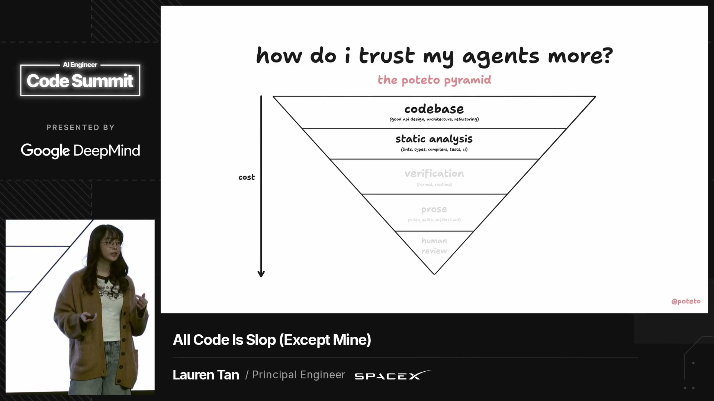
  > Visual content: **"how do i trust my agents more? — the poteto pyramid"** with downward `cost` arrow across 5 layers (top = widest foundational leverage, bottom = narrowest/highest cost): 1) `codebase (good api design, architecture, refactoring)`, 2) `static analysis (lints, types, compilers, tests, ci)`, 3) `verification (formal, runtime)`, 4) `prose (rules, skills, AGENTS.md)`, 5) `human review`.
- `04:10` — **Organic Architecture & Codebase as a Garden**:
  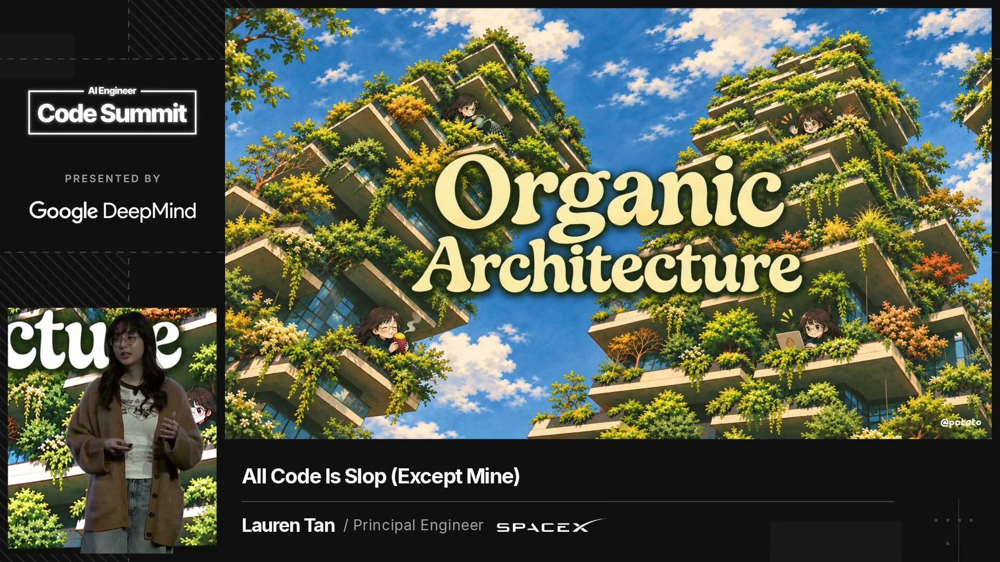
  > Visual content: **"Organic Architecture"** illustration showing lush greenery growing around solid concrete building foundations (representing strict code guardrails anchoring rapid AI code growth).
- `05:45` — **API Design Eliminates Slop-Prone Nuance**:
  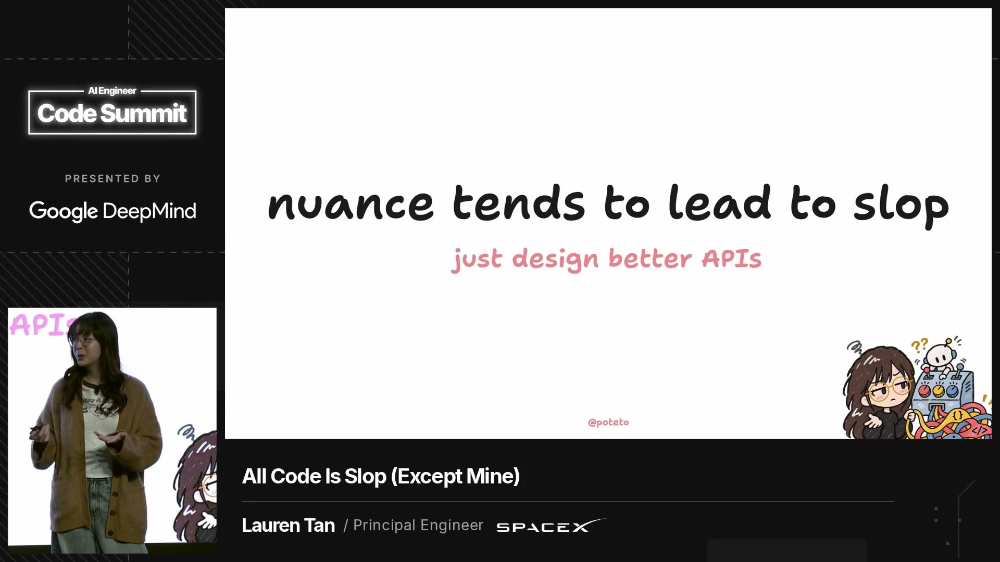
  > Visual content: **"nuance tends to lead to slop — just design better APIs"** (referencing banning `useEffect` in Dune product code).
- `06:36` — **Directory Structure as Context & Architectural Boundaries**:
  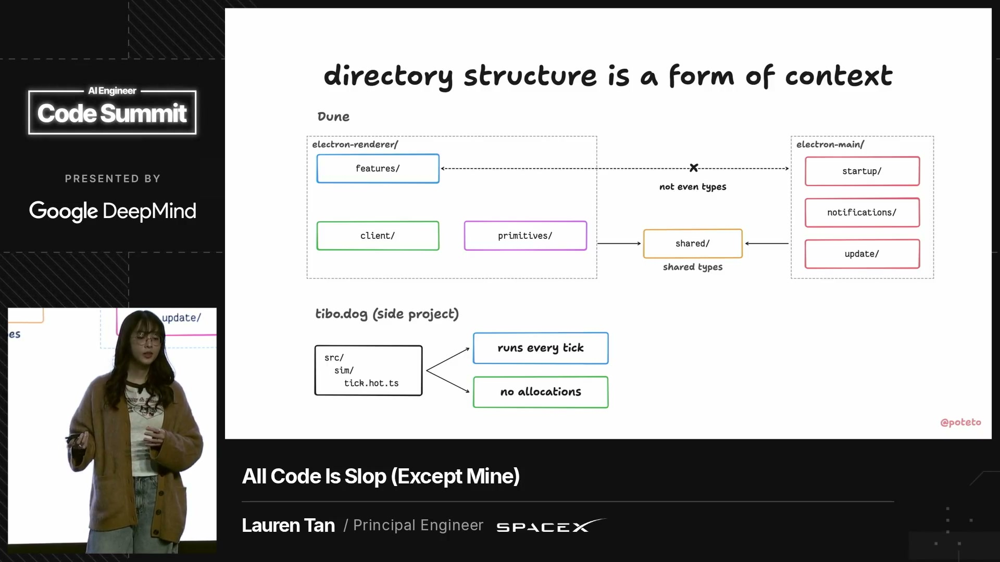
  > Visual content: **"directory structure is a form of context"**. Top (**Dune**): `electron-renderer/` (`features/`, `client/`, `primitives/`) blocked (`--X--> not even types`) from `electron-main/` (`startup/`, `notifications/`, `update/`), sharing types only through `shared/`. Bottom (**tibo.dog** side project): `src/sim/tick.hot.ts` enforcing `runs every tick` & `no allocations`.
- `08:01` — **Why Quick Fixes & Comments Multiply Slop**:
  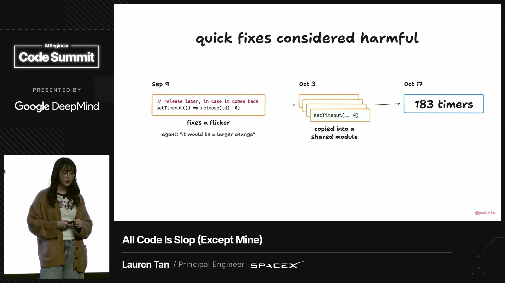
  > Visual content: **"quick fixes considered harmful"**: `Sep 9`: `// release later, in case it comes back` + `setTimeout(() => release(id), 0)` (`fixes a flicker`, agent: *"it would be a larger change"*) → `Oct 3`: `copied into a shared module` (`setTimeout(..., 0)`) → `Oct 17`: `183 timers`.
- `09:15` — **Converting Every Correction Into Lint Rules**:
  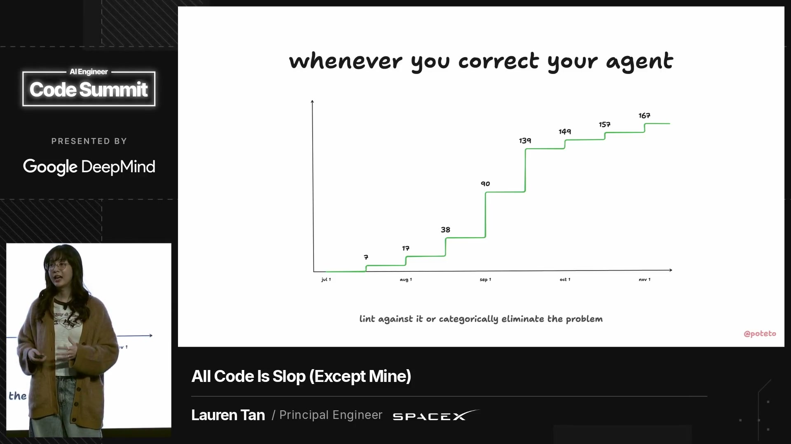
  > Visual content: **"whenever you correct your agent"** step chart growing custom deterministic rules from `Jul 1` (`7` -> `17` -> `38` -> `90` -> `139` -> `149` -> `157` -> `167` by `Nov 1`). Caption: *"lint against it or categorically eliminate the problem"*.
- `10:39` — **Runtime Verification: Feature Map + Custom CLI**:
  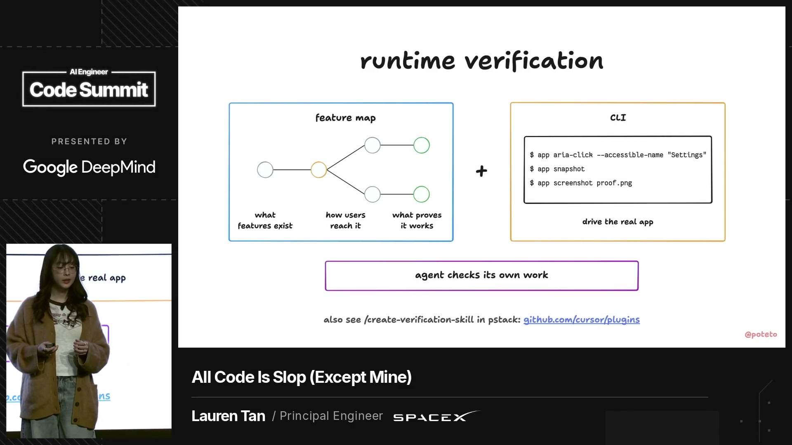
  > Visual content: **"runtime verification"**: **feature map** (`what features exist` -> `how users reach it` -> `what proves it works`) + **CLI** (`$ app aria-click --accessible-name "Settings"`, `$ app snapshot`, `$ app screenshot proof.png` -> `drive the real app`) ⇒ `agent checks its own work`. References `/create-verification-skill` in `pstack: github.com/cursor/plugins`.
- `11:42` — **UI Property-Based Testing with Bombadil**:
  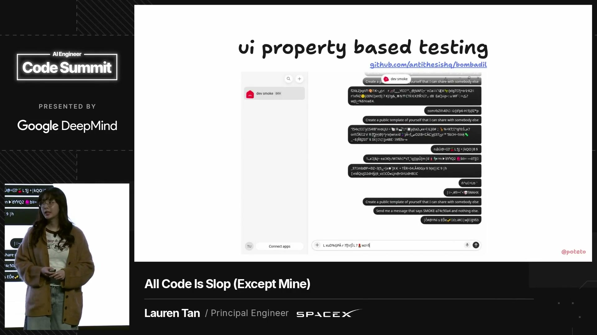
  > Visual content: **"ui property based testing"** (`github.com/antithesishq/bombadil`) showing automated property-based UI fuzzing (`dev smoke`) sending adversarial prompts/inputs across the desktop chat client.
- `12:22` — **Comprehensive Verification Matrix (Pre-Prod & Production)**:
  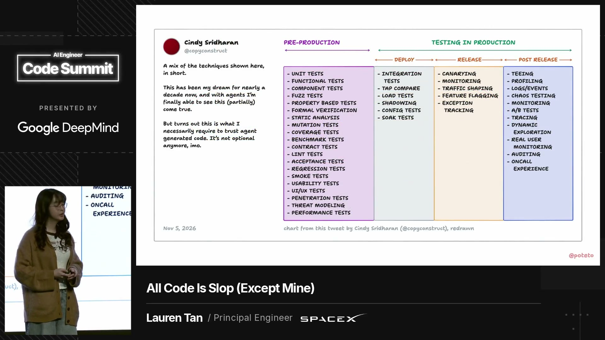
  > Visual content: Redrawn diagram from Cindy Sridharan (`@copyconstruct`, Nov 5, 2026) mapping **PRE-PRODUCTION** (20 test techniques: unit, fuzz, property-based, formal verification, static analysis, mutation, contract, lint, penetration, performance...) and **TESTING IN PRODUCTION** (`Deploy`, `Release`, `Post Release`: integration, load, shadowing, canarying, chaos testing, profiling, tracing, RUM).
- `14:39` — **Velocity Without Compromise (Performance Metrics)**:
  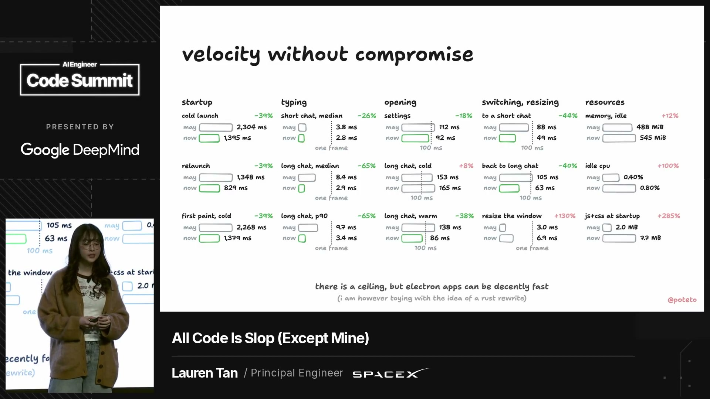
  > Visual content: **"velocity without compromise"** (`May` vs `Now` benchmark improvements across 11,000 PRs/mo): startup cold launch `-39%` (`2,304 ms` → `1,395 ms`), relaunch `-39%` (`829 ms`), first paint `-39%` (`1,379 ms`), long-chat typing median `-65%` (`8.4 ms` → `2.9 ms`) & p90 `-65%` (`9.7 ms` → `3.4 ms`), switching chats `-44%` (`88 ms` → `49 ms`), warm open `-38%` (`138 ms` → `86 ms`), alongside resource shifts (idle memory `+12%` to `545 MiB`, startup bundle `+285%` to `7.7 MB`).
- `16:40` — **Grok Bot as the Autonomous Outer Loop**:
  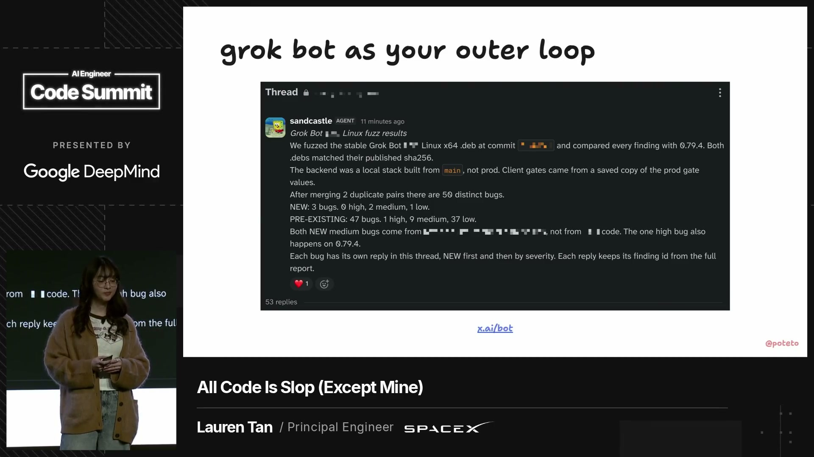
  > Visual content: **"grok bot as your outer loop"** (`x.ai/bot`) showing autonomous `sandcastle` agent release-fuzzing thread finding `50 distinct bugs` (`NEW: 3`, `PRE-EXISTING: 47`) on `Grok Bot Linux x64 .deb` before opening and auto-merging fix PRs.

## Transcript

### [00:00 - 02:03] Turning slop into gold
**[00:16]** >> All right. Um so again I'm my name is Potato. Uh I work on Grokbot at SpaceX SI. And can I just get a quick show of hands? How many of you have ever looked at code that somebody else wrote and you thought that's all slop. Well, I have too.
**[00:35]** But today I'm going to convince you that you can turn that slop into gold. Uh and so I did something crazy last month and I shipped 3,000 pull requests to production. Now before agents we never really cared about volume uh except for the outliers.
**[00:54]** And at my previous company we called these people coding machines. People like Brett Taylor who famously rewrote all of Google Maps uh in a weekend. Just an insanely productive engineer. Uh and well with agents anyone can now be a coding machine. And my thesis is that the job of the software engineer,
**[01:13]** the meta of being a software engineer is figuring out how to maintain or even improve the quality of your code while massively increasing your productivity. To get there some people like to call this a software factory. Uh but I like to keep it simple and I think of it as all about trust.
**[01:33]** Not blind trust but investing in your agents environment so you can trust that your agents are going to do the right thing. Now it takes quite a lot of effort to get there um and it took me six months to get to a point where I could ship thousands of pull requests, a lot of them in my sleep.
**[01:52]** But it's certainly possible and it will take you much less time than I did. So let's start by talking about how we move from a low trust to a high-trust one.

### [02:03 - 05:00] The trust pyramid and codebase quality
**[02:05]** So, this inverse pyramid is how I think about where to spend time on your agent's environment. The first two layers are deterministic, so using your code itself. So, things like good API design, architecture, refactoring, or using lint rules, type systems, compilers, or you know, different kinds of testing.
**[02:24]** And you can use both of these layers together to constrain what agents can do and force them to do the right thing by default. Verification, both runtime and formal, are great tools to layer on to find bugs and check properties and the invariance in your system that you want to hold true
**[02:43]** and also help you check whether or not the agent understood your goals and your intent. And then finally, you want to layer with a little bit of prose. So, things like rules, skills, agents.md, things that require judgment. But let's start with your codebase.
**[03:01]** Agents generate their outputs based on their inputs. And so the the quality of the input really matters, and it just so happens that your codebase is one of the largest inputs. So, whenever you're correcting your agent, think about how you can make that a deterministic check instead of adding another line to your rules or your
**[03:20]** agents.md because it's far more reproducible when it's in code and it lets you trust it more. And the analogy that I like to use is that your codebase is kind of like a garden. You know, code used to arrive a few pull requests at a time. And uh I remember going into work in
**[03:39]** 2024 and reviewing the three pull requests that my colleagues wrote colleagues wrote. And today, that number is more like 300. So, you know, every engineer is now a team of hundreds or even thousands of agents, and code is arriving so rapidly that it almost feels like a continuous
**[03:58]** stream, and it almost feels organic, like a living thing. And in this analogy, your codebase, the constraints that you impose, the guardrails that you put up are the concrete foundations that the new code that your agents write grow around, just like uh the building in this picture.
**[04:18]** And so in many ways, the job of being a software engineer is kind of becoming like gardening. Because code is the biggest input for agents, it means that any workarounds, um anti-patterns, deprecated code, tech debt, it's now likely to be just copied by the next agent since it looks like
**[04:37]** the established pattern in your codebase. And uh it's like you have some weeds or pests growing in your garden, and then they spread everywhere before you know it. So you want to make your codebase as pristine as possible so that agents are
**[04:55]** always copying the good stuff. All right, let's look at some real examples.

### [05:00 - 06:56] Dune and enforceable architecture
**[05:01]** Uh so Dune is a client framework that we created for Graph Bot to implement this idea for organic architecture. It's not really that interesting technically. Uh you can kind of think of Dune as um kind of like Next.js for Electron apps. But the interesting part of Dune is that it has a lot of constraints and lint
**[05:19]** rules that we've encoded uh a lot of the lessons that we've learned building desktop applications. And one such lesson is that anything that requires nuance to use well often leads to slop. Uh you know your classic example is uh you know use effect in React, right? It
**[05:38]** has its use cases, uh but it's often misused. You know some people joke that you need a PhD to use use effect. Um and in in other words, it really requires a lot of nuance to use well. And agents are not good at using it. Um so our solution has been to just ban it in product code, and it's really only
**[05:58]** allowed in some places inside of Dune APIs. And effectively, this problem has now been categorically eliminated, and we never need to catch that during code review again. Another interesting pattern that we use is context through directory structure. Uh so one anti-pattern that we saw with
**[06:17]** Cursor, which is an Electron app, is that agents would often import main thread code into the renderer thread, which would cause long tasks and jank. So in uh Gulp bot and in Dunanaps, we've made this very very conventional. Uh we have these two top-level directories literally called Electron
**[06:36]** renderer and Electron main, and imports between them are forbidden or banned by our dependency graph analyzer and some lint rules. And again, you know, these are simple lint rules to set up, but it means one less thing that we need to review and think about uh you know, during code review.

### [06:56 - 09:40] Replacing comments with lint rules
**[06:58]** And then one more surprising thing that I've seen is agents using Markdown. So things like documentation, uh code comments, rules or skills, and they use this as a place to write down their justifications for not doing the right thing. Or I don't know if you've ever seen this, but they'll over rotate on some small
**[07:16]** correction that you made, and they treat it like a hard rule that can never be broken ever again. And here's another example from Cursor. So agents really loved using imperative timers, so things like set timeout, request animation frame, request idle callback. And they were using these as quick fixes because
**[07:35]** they were really patching over an architecture clash between uh VS Code's imperative style and React's declarative style. So our choice of architecture actually made both the client and the agent performance much worse. And if you've ever done any performance work in JavaScript, you'll know that
**[07:54]** when you have tons of timers being rapidly created and destroyed, causes a lot of uh major garbage collection, which causes a lot of lag and jank. Uh but the worst part is that agents wrote a a of code comments, like you can see in red here, explaining why this quick fix was justified.
**[08:12]** And before you know it, we had timers spreading everywhere and the you know the performance of the app really suffered. Now in Grabot, uh we learned our lesson there and we decided to just ban 99% of comments uh because they go stale easily. Uh you know humans just really don't bother
**[08:31]** reading the comment slot anyway. And again it gives an agent the an escape hatch to justify not doing the right thing because it's hard. Um and the worst part about comments though is that they're not enforceable. So what seems well intentioned, you know like I'm going to tell the the next
**[08:49]** agent not to do something, never ends up actually being anything that you can trust. So in Grabot and Dune and in Dune uh we now have lint rules that give uh good and very helpful error messages telling the agent to fix the root cause, the real problem uh rather than just
**[09:08]** patch around it. And so our general principle is that every time we correct our agents, it turns into one of these deterministic checks or we think about how to categorically eliminate that problem in the code through better API design, through better architecture. And if you do this enough times, you'll
**[09:26]** find that you have just less things to look out for in code review. And at some point you'll realize there's there's nothing left to review. And you can just let agents merge their most of their own pull requests.

### [09:40 - 10:50] Runtime verification and feature maps
**[09:43]** All right. Uh moving on, verification is also a really big part of how we make our agent more autonomous and also increase our confidence and trust in their work. And our code review process has now really shrunk into looking at verification artifacts instead. So things like videos, screenshots, diagrams, formal verification.
**[10:02]** Um and the most basic example of this is runtime verification uh which is just a fancy way of saying giving your agent a way to run the code for itself and use debugging tools that, you know, human developers use as well, like the Chrome DevTools protocol. Um, in our runtime verification skills, we have this thing that we call a
**[10:20]** feature map. And that's basically kind of like a site map of all of the features that are available in your application from the user's point of view. And so with this, agents don't need to guess when you say, you know, the thingy in the left sidebar, it gives you some shared vocabulary. And we also make use of custom CLIs
**[10:40]** inside these skills so that agents can reuse the the CLI and the driver every time, which cuts down on token usage and is also testable.

### [10:50 - 11:51] Formal verification and UI testing
**[10:52]** Um, and then recently we've also started looking at formal verification. Uh, so we now use TLA Plus to do some model checking of major user flows such as notifications across multiple devices and platforms. Uh, we use a lean as well for proving certain algorithms. Uh, for example, we have our own we wrote our own custom virtualization library and we use lean there to check
**[11:12]** that we don't have, you know, flickering or jittering problems. Um, and we're still experimenting with this approach overall. It seems very promising. Uh, we've already found quite a few bugs with formal verification. Uh, but it's certainly not a silver bullet and we're treating it as another
**[11:30]** tool, another layer in our agents' environment. Uh, and then this is a very fast video, but another thing that we just started looking at is property-based testing as well for UIs. Uh, so we use this library called Bombadil. Um, and this has also caught a few UI bugs for us already.

### [11:51 - 13:32] Spending tokens on verification
**[11:54]** Okay, so zooming out, I saw this tweet from Cindy and 6 months ago she she said that she was oh, she was talking about not being able to trust her agents because of subtle bugs that were getting merged. And really what was missing for her in being able to trust her agents was the verification process. And now, 6 months later, she says that 70% of her daily
**[12:14]** tokens go into verification. And I'd say that that tracks with what I see as well, that most of my token usage goes to verification. And if you really look closely at her process, none of these things here are new or novel techniques that we've never had before. These are just good software engineering
**[12:32]** tools, but ones that might have been prohibitively expensive to use before as they were hard to understand or write or maintain. But agents drastically cut this cost down. And really, we are entering a golden age of software testing and verification because agents let us test everything to a much greater degree than used to be
**[12:52]** economical. And then formal verification can also help you better reason about how your product should work and whether your agents really understand your intent and goals. Uh I made this new skill called state chart uh in my plugin P stack, potato stack, uh which helps you visualize state machines from uh
**[13:11]** from the user's point of view. Uh and it's I find this much easier to review alongside the videos and screenshots that we provide. Um and so that's been great. Sorry for the flashback. Uh okay, now let's look at what the promised land looks like. What do you get in return for all of this uh you
**[13:30]** know investment?

### [13:32 - 15:11] 11,000 PRs and a 0.5% revert rate
**[13:32]** So on the Growth Bot team, our velocity is uh taking off and rapidly increasing. And last month, our team shipped a ridiculous 11,000 pull requests to production, which is a wild number. And our pace of releasing the client has also increased. And we cut a new stable
**[13:51]** version about once a day. And then the core team is also shipping much more. And we also have uh a lot more casual or drive-by contributors who don't always have a lot of context, uh but they're also contributing. Um and in October, we had about 227 people who
**[14:11]** contributed at least one pull request. So So this velocity accelerating, you might be thinking to yourself like isn't this going to be chaos? You know, isn't this going to be a bunch of slop? But actually, the number of PRs that get reverted has actually gotten lower on a relative basis and is steady at about half a percent.
**[14:32]** But I think the really interesting thing about this shipping pace and this volume of pull requests is that the performance of Graph Bot has stayed not just stable, but has improved on multiple dimensions compared to when we launched. So startup, typing, opening new chats, switching chats, all of this has gotten faster.
**[14:51]** And keep in mind, Graph Bot is still an Electron app for now. So there is a ceiling, right? But it's already much faster than many other agent UIs out there. And for an Electron app with this high velocity and this many people contributing, I'd say that's pretty good.

### [15:11 - 17:31] Foundations before software factories
**[15:11]** So before you jump into building out a software factory and you know, automating everything that you can, whenever you correct your agent, try and do it by improving your codebase first. You know, start with a lint rule to prevent new occurrences of anti-patterns and then clean up those old patterns as well. And then make sure that your
**[15:29]** verification story is really strong. A lot of this work is a prerequisite to automation anyway. And if your inner coding loop produces slop, then automating that loop just produces more slop and you need to throw more and more and more tokens at the problem, which we all know is very expensive.
**[15:50]** And once you meet these investments into, you know, code into your codebase, static analysis, runtime informal verification, you'll start to find that many things become possible with these foundations and that you can really easily build your own factory on top of these foundations. And when you're ready, Graph Bot is a
**[16:09]** great way to build that outer loop. We have tons of connectors, routines that can kick off cursor, cloud agents, and projects uh which let you orchestrate thousands of uh hundreds or even thousands of agents. And as a quick example, you know, whenever we cut a new release now, Grokbot will automatically spin up a new
**[16:27]** cursor project for us that will fuzz the entire application, the entire build, and it will find bugs uh by running the app and using it like a real user. And then it's going to open fixed PRs for each of those bugs that it finds and it's going to auto merge it as uh crazy as that sounds. And that's because
**[16:45]** our codebase is good enough that pull requests tend to just be good by default and most product code that we land no longer really requires deep human review. So when you have solid foundations and good organic architecture, you can turn slop into gold and you can ship with high
**[17:05]** quality uh high velocity without compromising on quality. My name is Potato, also known as Lauren. Thanks to you again for listening to my talk. >> [applause]
