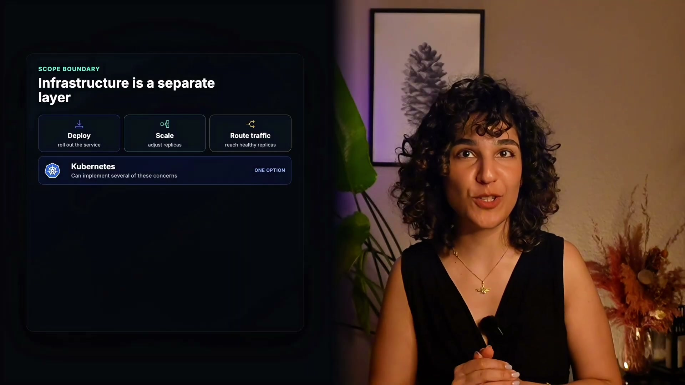
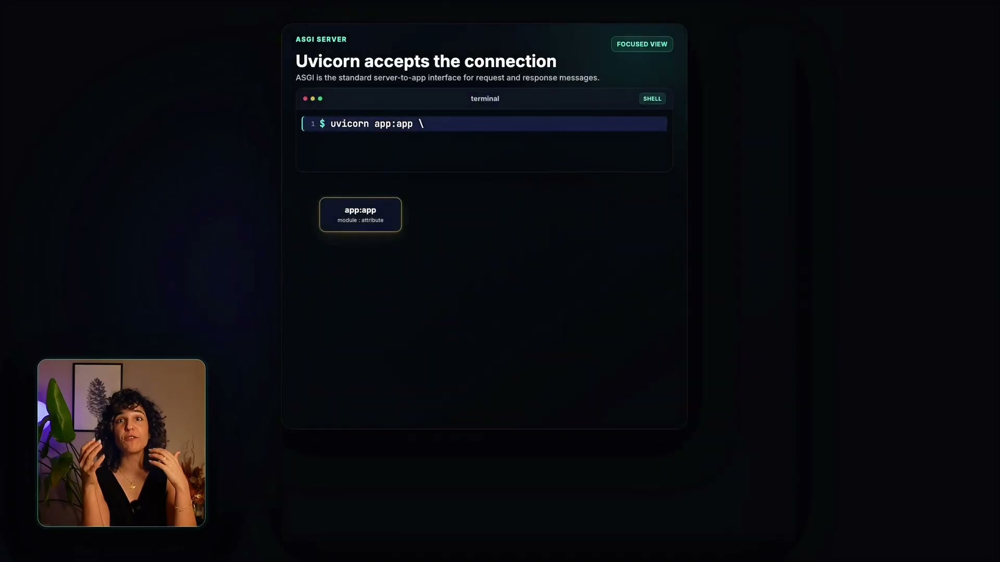
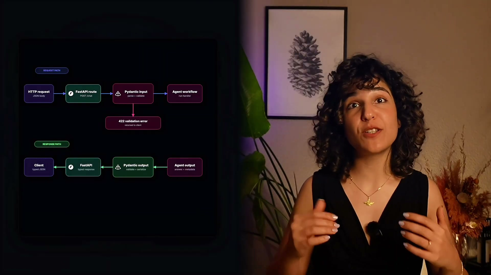
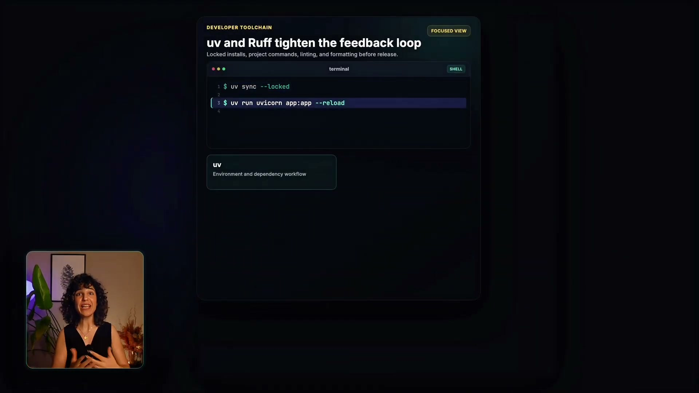
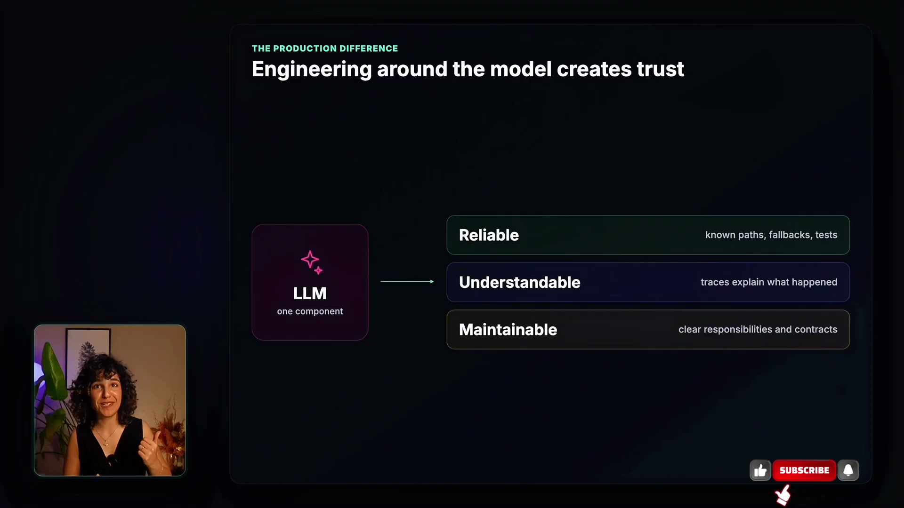
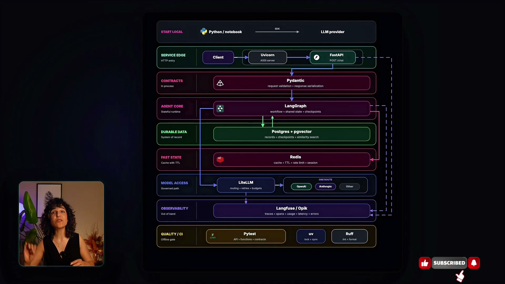

# How a Production AI Agent System Actually Works

**Channel**: Jam With AI | Shirin Khosravi Jam
**URL**: https://www.youtube.com/watch?v=sKzL0wSN9vQ
**Upload Date**: 2026-08-21
**Duration**: 11m 41s
**Transcript extracted**: 2026-11-22

---

## Chapters

| # | Timestamp | Chapter |
| :--- | :--- | :--- |
| 1 | `00:00 - 00:39` | From a local AI demo to production |
| 2 | `00:39 - 01:02` | Why the tools are replaceable |
| 3 | `01:02 - 01:19` | Deployment, cloud, and Kubernetes scope |
| 4 | `01:19 - 02:33` | FastAPI and Uvicorn |
| 5 | `02:33 - 02:58` | Async Python and concurrent requests |
| 6 | `02:58 - 03:58` | Pydantic request and response contracts |
| 7 | `03:58 - 05:00` | When LangGraph becomes useful |
| 8 | `05:00 - 05:50` | Postgres and pgvector for semantic retrieval and RAG |
| 9 | `05:50 - 06:24` | Redis caching and fast state |
| 10 | `06:24 - 07:39` | Model providers and LiteLLM |
| 11 | `07:39 - 07:55` | A successful request can still be wrong |
| 12 | `07:55 - 08:39` | Observability with Langfuse and Opik |
| 13 | `08:39 - 10:04` | Pytest, tracing, and AI evaluations |
| 14 | `10:04 - 10:26` | uv and Ruff |
| 15 | `10:26 - 11:17` | Complete production AI stack recap |
| 16 | `11:17 - 11:41` | What sits beyond the core stack |

## Suggested Keyframe Timestamps

- `00:30` (30s, `chapter`): From a local AI demo to production
- `00:57` (57s, `chapter`): Why the tools are replaceable
- `01:15` (75s, `chapter`): Deployment, cloud, and Kubernetes scope
- `02:21` (141s, `chapter`): FastAPI and Uvicorn
- `02:52` (172s, `chapter`): Async Python and concurrent requests
- `03:46` (226s, `chapter`): Pydantic request and response contracts
- `04:48` (288s, `chapter`): When LangGraph becomes useful
- `05:39` (339s, `chapter`): Postgres and pgvector for semantic retrieval and RAG
- `06:17` (377s, `chapter`): Redis caching and fast state
- `07:27` (447s, `chapter`): Model providers and LiteLLM
- `07:51` (471s, `chapter`): A successful request can still be wrong
- `08:29` (509s, `chapter`): Observability with Langfuse and Opik
- `09:52` (592s, `chapter`): Pytest, tracing, and AI evaluations
- `10:21` (621s, `chapter`): uv and Ruff
- `11:06` (666s, `chapter`): Complete production AI stack recap
- `11:36` (696s, `chapter`): What sits beyond the core stack

## Key Visual Frames

## Transcript

### [00:00 - 00:39] From a local AI demo to production
**[00:03]** Most AI applications probably start very simply. You have a Python file or a notebook. Maybe you use LangChain or LangGraph connected to an LLM like OpenAI or Anthropic, ask something and get an answer back. And locally, this is completely fine. But then you want other people to actually use it. Maybe you
**[00:21]** want to connect it to a front end, another back end service, or an actual product. And suddenly, you need more than just a model. So in this video, I want to take this simple AI application and slowly build a practical production stack around it, step by step. And just

### [00:39 - 01:02] Why the tools are replaceable
**[00:39]** to be clear, there is no one production AI stack that every company uses. You can replace almost every tool I'm going to show you. But these are established tools and patterns that are already used in real production systems. More importantly, each of them solves a problem that you are very likely to face
**[00:58]** when taking an AI application beyond your laptop. Also, I am deliberately

### [01:02 - 01:19] Deployment, cloud, and Kubernetes scope
**[01:04]** focusing on the core application stack in this video. I'm not going too deep into deployment, auto scaling, load balancing, Kubernetes, and cloud infrastructure. That is another layer and probably deserves another video. So let's start with our local application.

### [01:19 - 02:33] FastAPI and Uvicorn
**[01:21]** Right now, my Python code can talk to the agent, but maybe my front end needs to talk to it as well. For that, I need to expose my Python application as a service. And one very common choice in Python is FastAPI. FastAPI basically gives us an HTTP API around our
**[01:41]** application. A front end can send a request to something like /chat endpoint. FastAPI receives that request, passes it to our AI application, and sends the response back. So now our agent is not just something I can run locally. Other applications can also
**[02:01]** communicate with it. You might have also seen Uvicorn wherever you run a fast API application. The easiest way to remember differences in this is fast API defines what our API should do and Uvicorn is the server that actually runs it and
**[02:19]** listens for incoming requests. There is more happening underneath, but for now that is enough to understand it. Fast API is also nice for AI applications because these applications spend a lot of time waiting. We wait for an LLM,

### [02:33 - 02:58] Async Python and concurrent requests
**[02:34]** wait for a database, wait for another API, or wait for a tool. Fast API works very well with asynchronous Python, which helps us handle this type of work efficiently. Now we have another problem. People can send data into our application, but what happens if they send wrong data? Maybe I expect a user
**[02:56]** ID and a message, but the message is

### [02:58 - 03:58] Pydantic request and response contracts
**[02:58]** missing, arrives in completely the wrong format. This is where Pydantic comes useful. Pydantic basically defines the contract for our data. What fields should exist, which one should be a string, what is the required, and what is optional. So before bad data moves through our entire
**[03:18]** application, we can validate it. The same idea is also useful for LLM outputs. Maybe instead of allowing the model to return random text, I want an answer, a category, and a list of sources. I can define that structure, use structured output from the model where supported, and use Pydantic to
**[03:37]** validate what comes back. It's very simple. Fast API handles the request and Pydantic makes sure our data has the shape we expect it to be. Now let's come to the actual agent. If your application is simply one prompt, one model call, and one answer, you may not need an
**[03:56]** orchestration framework at all. Keep it

### [03:58 - 05:00] When LangGraph becomes useful
**[03:59]** simple. But, imagine the workflow becomes understand the question, retrieve some information, decide which tool to use, call that tool, maybe call another model, and then produce the final answer. Now, we have multiple steps and decisions. This is where something like LangGraph becomes
**[04:18]** actually super useful. LangGraph helps us control how this workflow runs. We can have different steps, keep state between those steps, and decide where the agent should go next. It also supports checkpointing, so we can save the state of a workflow and continue later. That becomes useful when
**[04:37]** something fails or when we want to pause the agent and wait for human approval. So, I would think about LangGraph simply like this. It manages the workflow and state of our agent. Now, our agent probably needs data. For that, I would start with something very familiar, PostgreSQL.
**[04:56]** Users, conversations, application data, and other information that we want to

### [05:00 - 05:50] Postgres and pgvector for semantic retrieval and RAG
**[05:01]** keep reliably can live there. And if our application also has rag or semantic search, we can add pgvector. pgvector lets PostgreSQL store embeddings and search through them based on similarity. So, our normal application data and our vector data can live inside the same
**[05:20]** database. This is important because sometimes people think that as soon as they build rag, they automatically need a completely separate vector database. You don't dedicated vector databases absolutely have their place, but for many applications, PostgreSQL plus pgvector is a very practical starting
**[05:38]** point. Then, besides PostgreSQL, we might have Redis. And don't think of Redis as another database doing the same thing. PostgreSQL is where I normally keep durable information. Redis is useful when I need something extremely

### [05:50 - 06:24] Redis caching and fast state
**[05:52]** fast and often temporary. For example, maybe I want to cache a result so I don't calculate it again. Keep short-lived session information or implement things like rate limiting. It's very simple. PostgreSQL stores important long-term data, whereas Redis gives us a very fast
**[06:11]** temporary layer. Eventually, our agent has to call an actual model, maybe OpenAI, Anthropic, Gemini, or something else. If I use only one provider, I can absolutely call that provider directly.

### [06:24 - 07:39] Model providers and LiteLLM
**[06:24]** But imagine I start using multiple models. Maybe I use a cheaper model for a simple classification task and stronger model for a difficult reasoning task. Maybe I also want retries or a fallback when one provider has a temporary problem. This is where a model gateway like Light LLM can become very
**[06:43]** useful. Instead of putting OpenAI specific or Anthropic specific and Gemini specific logic throughout my application, I can put a common layer in front of them. Light LLM gives my application one interface to work with different model providers and can also help with things like routing, retries,
**[07:03]** and fallbacks. But important, a fallback model still needs to be tested. You cannot simply replace one model with another and assume your agent will behave exactly the same way. This point, our application looks pretty good. A user sends a request, our agent runs the model, responds, and fast API returns a
**[07:23]** successful response. Everything worked. Or did it? Maybe technically everything worked, but the agent gave the user a completely wrong answer. Maybe retrieval found the wrong document. Maybe the agent selected the wrong tool. Or maybe one model call suddenly became extremely

### [07:39 - 07:55] A successful request can still be wrong
**[07:41]** slow. And this is where LangFuse or Opaque become very important. With an AI application, I don't only want to know whether my server crashed, I also want to understand what did the agent actually do, what did the user ask, what

### [07:55 - 08:39] Observability with Langfuse and Opik
**[07:56]** context did retrieval return, and which model was called. This is where tracing comes in. With something like LangFuse or Opaque, one user request can become a trace where I can follow what happened across the agent. Retrieval happened here, model called here, tool called here, and another model called here, and
**[08:16]** finally the response. So, when somebody says your agent gave me a bad answer, I don't have to blindly guess what happened. I can actually investigate it. But tracing creates another question. We can now see what happened, but was the answer actually good? And this is where testing an AI system becomes slightly
**[08:36]** different from testing normal software. For the predictable parts of our Python

### [08:39 - 10:04] Pytest, tracing, and AI evaluations
**[08:40]** application, I can use something like pytest. Does this function work? Does this API reject invalid input? Or does this tool return the structure I expect? These are normal software tests. But imagine all of those tests pass, and I change one sentence in my system prompt. The application still works, but
**[09:00]** suddenly the answers are much worse. Normal unit tests may not catch that. This is where AI evals become important. We can keep a set of representative questions, run our agent against them, and measure whatever matters for our application. Maybe answer the quality
**[09:19]** Maybe answer quality, retrieval quality, correct tool selection, or hallucination. Then, whenever we change the prompt, model, tools, or retrieval system, we can run those evals again and see whether the system became better or worse. Tools like LangFuse and Opaque can also help us run and manage these
**[09:37]** evaluations. So, this distinction is really important. Tracing tells us what happened and evals tell us whether it was good and Pytest checks the predictable software around it. Finally, around the Python project itself, I would keep the tooling simple. I like Uvic for managing Python dependencies
**[09:56]** and keeping the environment reproducible and rough for linting and formatting the Python code. These are developer tools, so the users request does not actually

### [10:04 - 10:26] uv and Ruff
**[10:05]** flow through them. They simply help us keep the code base clean and predictable. Now, zoom out and look at what we built. We started with a Python application calling an LLM, then FastAPI exposed it to other applications. Uvicorn ran our API, Pydantic validated
**[10:23]** the data, LangChain managed our agent workflow, Postgres and PGVector handled

### [10:26 - 11:17] Complete production AI stack recap
**[10:28]** data and retrieval, Redis gave us a fast temporary layer, Light LLM could sit between us and multiple model providers, LangFuse or Open gave us tracing and evals, and Pytest helped us test the normal software. And now look at the actual LLM, it is only one small part of
**[10:48]** this entire system. This is really the point of this video. Calling an LLM is not the difficult part anymore. The engineering around the model is what makes an AI application reliable, understandable, and maintainable. And obviously, this is still not every single thing you could add depending on the application, you may need
**[11:07]** authentication, security, secret management, background jobs, and many other things. But I deliberately want to keep this track core and practical instead of giving you a diagram with 50

### [11:17 - 11:41] What sits beyond the core stack
**[11:19]** boxes. So, don't memorize the logos, understand why every box exists because once you understand the problem each layer solves, you can replace almost any technology here and still understand how the entire system fits together. That is the difference between knowing a list of AI tools and actually understanding how
**[11:38]** a production AI application is built.
