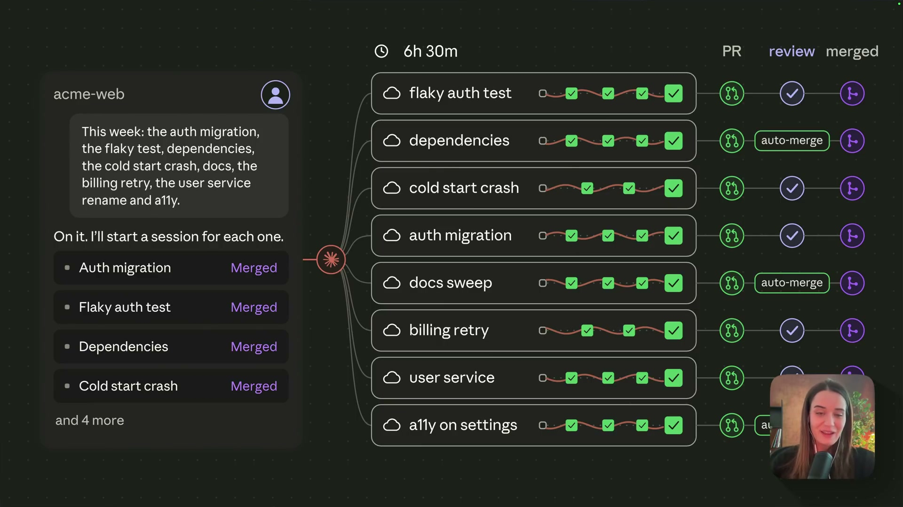
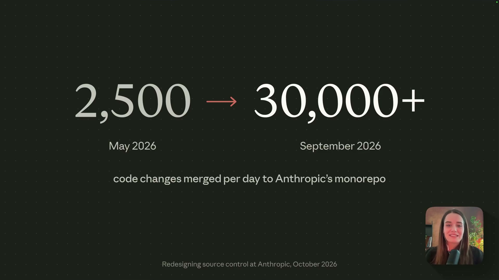
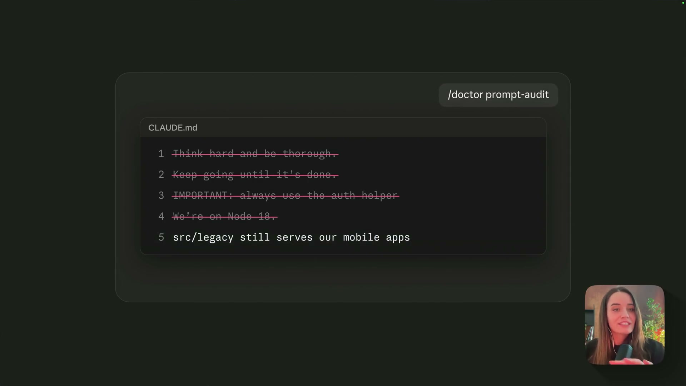
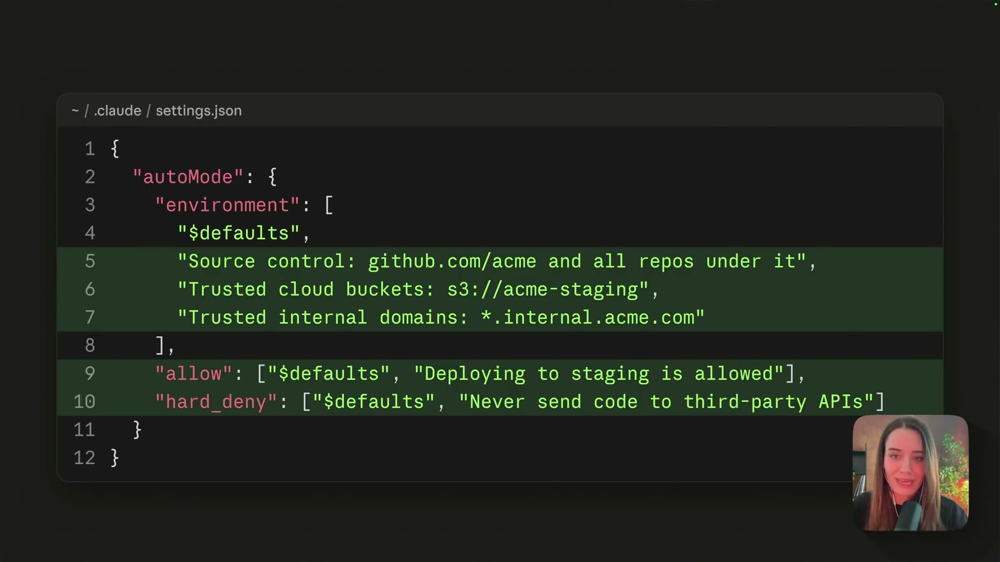
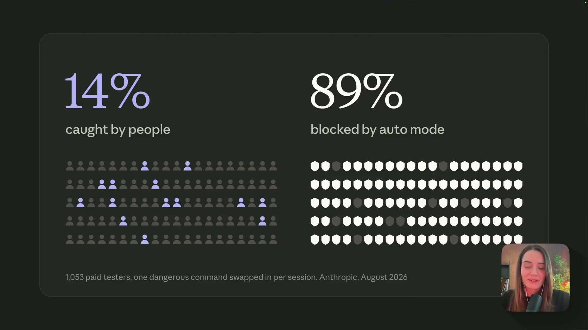
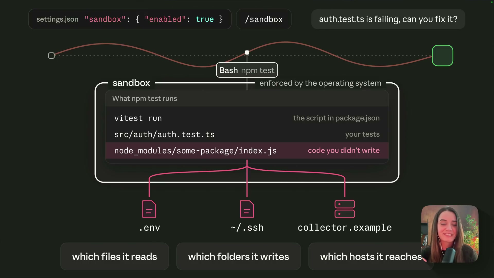
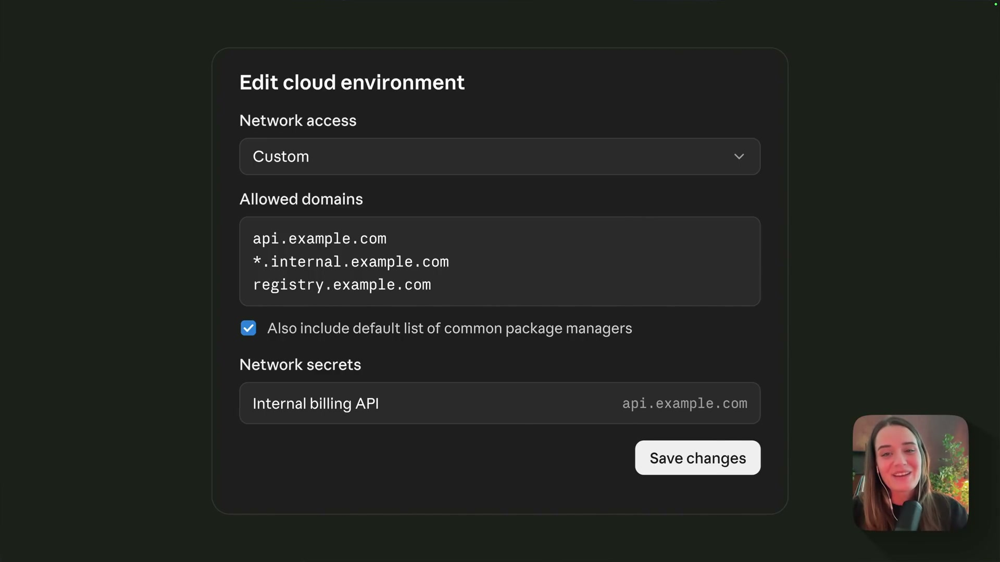
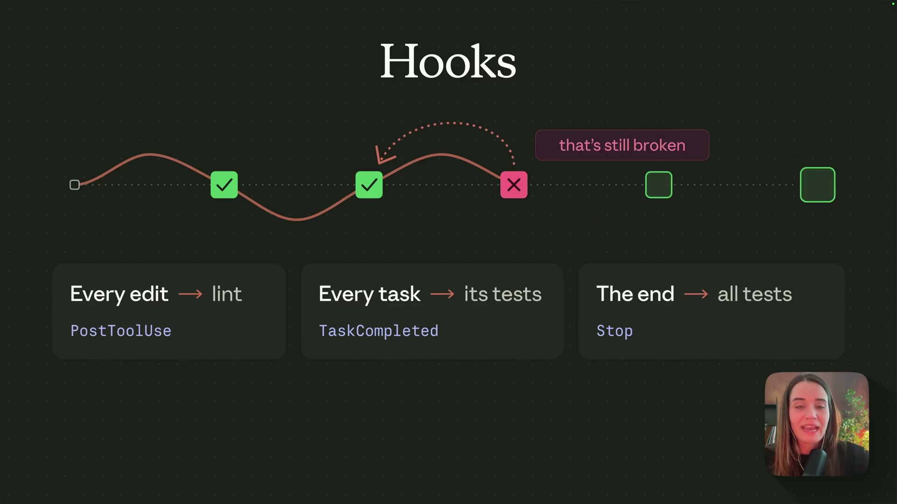
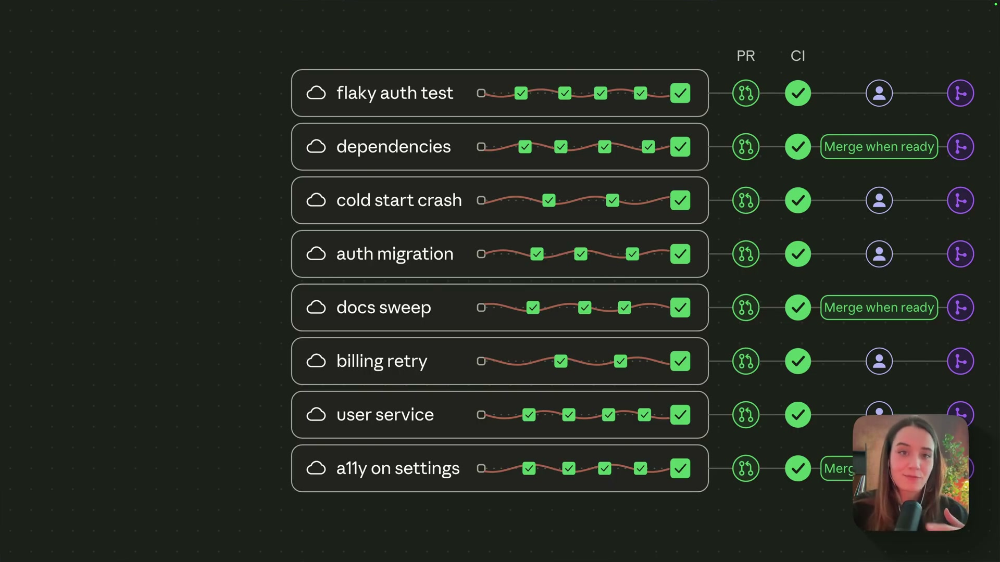
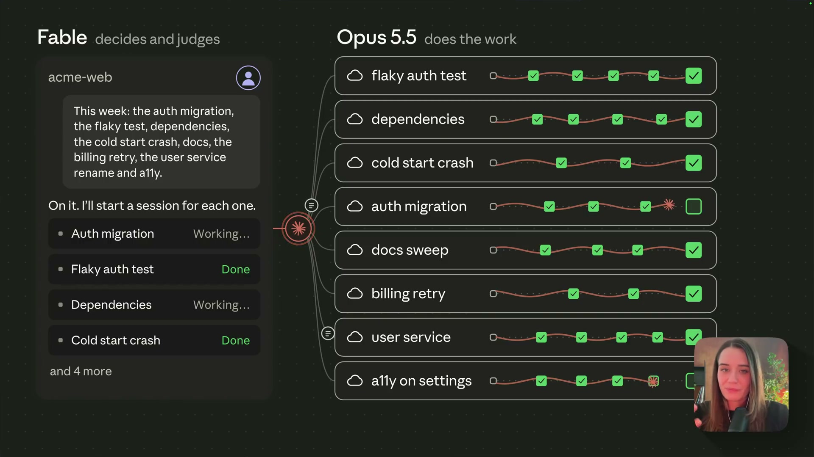

# Rethinking Claude Code Best Practices — Lydia Hallie, Anthropic

**Channel**: AI Engineer
**URL**: https://www.youtube.com/watch?v=vlfCjWuv4es
**Upload Date**: 2026-11-12
**Duration**: 17m 31s
**Transcript extracted**: 2026-11-18

---

## Chapters

| # | Timestamp | Chapter |
| :--- | :--- | :--- |
| 1 | `00:00 - 02:14` | Evolution of workflow |
| 2 | `02:14 - 04:11` | Rethinking best practices |
| 3 | `04:11 - 05:30` | Managing auto mode |
| 4 | `05:30 - 08:16` | Safety and environment |
| 5 | `08:16 - 10:53` | Cloud-based environments |
| 6 | `10:53 - 14:00` | Verification strategies |
| 7 | `14:00 - 15:10` | Scaling with CI and PRs |
| 8 | `15:10 - 17:31` | Orchestration and conclusion |

## Suggested Keyframe Timestamps

- `02:02` (122s, `chapter`): Evolution of workflow
- `03:59` (239s, `chapter`): Rethinking best practices
- `05:18` (318s, `chapter`): Managing auto mode
- `08:04` (484s, `chapter`): Safety and environment
- `10:41` (641s, `chapter`): Cloud-based environments
- `11:47` (707s, `visual_cue`): a build, a screenshot, whatever you
- `13:48` (828s, `chapter`): Verification strategies
- `14:58` (898s, `chapter`): Scaling with CI and PRs
- `17:19` (1039s, `chapter`): Orchestration and conclusion

## Key Visual Frames

## Transcript

### [00:00 - 02:14] Evolution of workflow
**[00:03]** I had some technical difficulties during my talk this morning, so I ran back home and I'm just going to record it from my computer instead. So, hi everyone. I'm Lydia. I work on the Cloud Code team at Anthropic. And the models have gotten really good lately. So we have Opus 55, which is my favorite daily driver. And earlier this week, we also launched Fable 52. And these models are extremely
**[00:24]** good at long-running tasks and understanding your codebase. And especially Fable is also really good at verifying its own output. But as these models get better, the way that we work with them in Cloud Code also changes. So earlier this year, I don't know if you remember, but sessions kind of used to look like this. So we'd use a model like Opus 45, which honestly for its
**[00:44]** time was really good. I really enjoyed working with Opus 45. But compared to today, it would just stop a lot earlier. So it would just run for shorter amounts of time. And we'd also keep correcting it. We'd keep reminding it to do things, add things like important, exclamation mark, all these things to our Cloud MD file. And also features like auto mode didn't
**[01:03]** exist yet. So we were either approving everything manually or taking the riskier approach with dangerously skip permission. So we were still very much in the loop as humans. But as these models got better at taking on bigger tasks, our sessions also changed. So nowadays, at least at
**[01:21]** Anthropic, our sessions look more like this. So we're running dozens of sessions at the same time, running for hours, verifying their own results along the way, and we even have sessions orchestrate other sessions. So whereas we used to be in the loop for almost every step and running one or just a couple sessions at a time, we've now
**[01:40]** essentially become managers for dozens of sessions. We also got a lot more done though. Now you may have seen our blog post in October about how Anthropic went from about 2,500 changes a day in May to more than 30,000 a day in September. But this also means that we as developers just have to rethink on what we're focused on
**[01:59]** instead. So, if you think about our best practices from earlier this year, it was mainly about steering sessions, approving commands, saying no to certain things or restricting what Claude could do, the output, and also starting the sessions. So, everywhere that we now

### [02:14 - 04:11] Rethinking best practices
**[02:15]** step out of that loop, something else has to take over. And this is either the model, the harness, or the environment that it's running in. So, if we are not in the loop to approve every command and we're running so many sessions at the same time, how can we make sure that the code it's writing is still high quality? And most importantly, if these sessions
**[02:35]** are running for hours without our supervision, how can we make sure that they're running safely? So, let's go through that by taking this old session and seeing what we have to change to get to that end result that I showed earlier. Well, first of all, let's use the actual defaults we start sessions in nowadays. So, that's not really something you should think about. So, let's update the
**[02:53]** model here from Opus 4 5 to Opus 5 5 and change the manual permission to auto mode. And Opus 5 5 is a lot better at understanding your intent and understanding your code base. So, we really don't have to steer it as much anymore mid session. And you also no longer have to approve every command because we started making auto mode the default permission mode back in August.
**[03:13]** Now, being better at understanding your intent and your code base also means that we have to rethink the instructions we have in our code base. So, if you followed our best practices from earlier this year, you may still have things like important or never do this, exclamation mark, all these things in your cloud MD file. But with today's models, you really don't need that and
**[03:31]** it can actually make the model go off track. So, you end up with more tool calls and overall a worse results. So, nowadays your cloud MD file should only include the things the Claude cannot see from your code. So, for example, maybe you have a service that's still using some legacy source somewhere, but it's not directly referenced in the code. That's still
**[03:49]** good to keep in there. But everything else, like what stack you're on or where to look, you really don't need that anymore. And we actually have a command for this called doctor prompt audit, which makes it really easy to optimize your environment for a specific model. So, if on Opus 55 here and you run this command, it will automatically check your cloud MD and your skills to see
**[04:09]** what the new model no longer needs.

### [04:11 - 05:30] Managing auto mode
**[04:11]** Now, auto mode is a permission mode that runs a separate classifier on pretty much everything that isn't just reading or editing files in your project. So, it automatically allows commands that it knows are safe, like running tests or installing dependencies, but it still blocks commands where it's unsure whether they're safe.
**[04:30]** And normally that's pretty good. Uh normally that's kind of, you know, what we want. But for example here, if we ask it to ship something to staging, we would have just, you know, approved the push to our deploy repo. But by default, auto mode only trusts this folder and this repo, so it would block that command. So, we're back in the loop.
**[04:48]** Now, the defaults should be good in most cases, but if you still notice that you have to approve a lot of uh commands even in auto mode, the first thing to look at is settings here because you can configure auto mode in your own settings just in plain English, and this is what gets sent to the classifier, which then decides whether to reject or allow certain commands.
**[05:07]** So, here we can just write which repos, buckets, domains we trust um and what it should always allow or never do. Okay, so honestly this was pretty easy by just using today's defaults. We've already gotten rid of most of our in-the-loop stuff um because the model took over the steering and auto mode took over all the approving, so getting out of the loop is
**[05:26]** easy. But the harder question now is how do we make sure it's okay that we're not there anymore? So, first is keeping it

### [05:30 - 08:16] Safety and environment
**[05:32]** safe and then also verification. So, let's start with keeping it safe because everything so far, so upgrading the model and using auto mode is just working with a model. And in most cases it does what you tell it to do, but that's not a guarantee. So, in a study we published back in August, we tested auto mode versus real
**[05:51]** people in the loop, and only about 14% of people caught a clearly dangerous command. Auto mode blocked 89% of them, so it is a lot better at it than we were. But about one in 10 of those commands still went through. So, if do want the guarantee, you can only enforce that in the harness. And this is where some of
**[06:10]** our older best practices still matters, and that's permissions. So, for example, if you have a deny rule for a specific tool called in your project, Cloud Code looks at this rule before the automo classifier even looks at it. In fact, if a tool called matches a deny rule, the classifier never even sees it. So, having deny rules is still the best way
**[06:29]** to make sure Cloud actually never does something. But then how do you know what needs to be a rule in your project versus what the model can just know because they've gotten so good at it? Um I think it kind of just comes down to if Cloud gets this wrong once, can I take it back? So, if it writes the wrong code, you can still revert that. Um so, you can still leave
**[06:48]** that to the model. But if it throws away our uncommitted changes or it reads a key that's now in your transcript and you don't don't want that, that should still be a rule. So, for example, let's say that we just never want Cloud reading our .env file. Now, by default, automo is fine with this, so it would have just approved it. So so, if you want to make sure that
**[07:07]** Cloud can never read this file, you should just add a deny rule. And then commands like cat cannot open this file either. But it's not always that straightforward cuz sometimes certain commands can have side effects. So, for example, let's say that npm test here, a very normal command, it's just a test, so automo runs it, that's fine.
**[07:25]** But when the script is running, it runs code that you didn't write, like your dependencies. Or maybe Cloud runs a script real quick that it wrote just to quickly check something. So, if one of those scripts is compromised, it could just open that same .env file or your SSH keys and send those to a server you've never heard of,
**[07:43]** right? And even if we were still there as humans approving everything, honestly, we would have just clicked allow cuz there's nothing to say no to. It's just part of the script that in this example case npm test runs. And permissions only decide if a tool call runs, but they cannot limit what it can reach once it's running. So, we want to
**[08:03]** make sure that these kinds of scripts can still run because this is just part of, you know, how Cloud can check its own work running tests. So we cannot just block npm tests, but we want to limit its side effects. So really, we just want to limit the environment that it's running in.

### [08:16 - 10:53] Cloud-based environments
**[08:18]** So if you're running it locally or on your own machine, you can run commands like that in a sandbox. So then you have control over which files in a command it can read, which folders it can write to, which hosts it can reach. And the operating system enforces that. Also, this also applies to everything that command then starts, so any child
**[08:38]** processes. So on its own, that deny rule gets checked by Cloud before the command runs, but all it sees there is npm tests. So it doesn't see which files that script ends up opening. But with the sandbox on, that same rule gets passed on to the operating system. So now when when that dependency tries to
**[08:56]** open or end file, the operating system just doesn't let it. And by default, it can still read most of your machine, so you'd want to add another rule for your SSH keys if you care about that. And it also cannot reach a host that wasn't approved. But the sandbox only covers the shell commands that Cloud runs and whatever
**[09:14]** those start. But Cloud's own files, your MCP servers, and all of your hooks still run outside of it. So the rest of your session still runs on your own machine and everything that's on there. So ideally, you want this whole thing to run somewhere where none of that is even there in the first place. And that is a Cloud session because there it gets its
**[09:33]** own machine with a fresh copy of a repo. And this runs even when we close our laptop, which is definitely something you want for these longer running sessions that run for hours. So in this case, this automatically gets rid of the end file issue because it's not in Git, and neither are my SSH keys or our GitHub token.
**[09:52]** And if it still needs an API key, you can add that as a network secret where it will it will tell you like, hey, I'm missing an API key mid-session, so it can use it without actually ever sending it to the model. And by default, also in the Cloud session, network access is limited to things like package registries in GitHub. So you have to
**[10:10]** explicitly add those domains to your environment for Cloud to to reach other hosts. Okay, so with a Cloud session we can run these long-running sessions even with our laptop closed and it keeps us safe because it runs in its own environment. Now it's still good to remember that this machine is disposable, but the
**[10:30]** things that leave it aren't. So a commit pushed or a message it sent through a connector. So we still run it in auto mode with our deny rules just commit it into the repo so they come along. Uh so it it could still catch things like a forced push or a secret in a commit, all that kind of stuff. And beyond just safety um we also need
**[10:50]** to make sure that Cloud is actually working on the right thing. So next is

### [10:53 - 14:00] Verification strategies
**[10:54]** verification. And the nice thing about being in a loop uh like we kind of knew the work was good because we'd already kind of seen every change, we'd approved everything. But now if Cloud works for hours in the background, we don't have that anymore. Um and we're not really going to read every file at the end either.
**[11:12]** So you know, say that we ask you to move our auth to a new API. Well Cloud is very good at understanding what we want, but there are still a lot of small decisions that it has to make along the way. So with the exact same prompt, you know, one run might move it over but leave the old API in there or one might move it but only for new logins and
**[11:31]** another one might move it but log everyone out. And these all look pretty reasonable, but it really helps to set up these verification points along the way. So Cloud keeps verifying its own results. And those can be anything that comes back as a pass or fail. So tests, a build, a screenshot, whatever you have.
**[11:50]** So now we just want to make sure that we review these verification points. Uh there are a lot shorter to review than if we just had to you know, review the whole change at the end. So so that's pretty reasonable. So if one of these runs would still log everyone out, it doesn't get past that first check and then it just has to find another way. And there's a couple ways to set this up. Um the easiest one is of
**[12:10]** course just in your prompt. So you know, you say what done looks like and ask it to split that into tasks so they have their own tests. Um, and I also like to ask it to show the actual output because you weren't there to see it. But again, prompting is not a guarantee that a model will do it. So for the ones that have to run guaranteed run, I would use hooks, um,
**[12:29]** which are just, you know, scripts that Cloud Code runs at a specific point. And those give you a lot of control because you decide when they run and what they run and what they check. So for example, every time it edits a file, we can run our linter. Every time it wants to mark a task as complete, we can run the tests for what it changed.
**[12:48]** Um, so you know, if it touched our auth code or something, it has to pass the auth auth tests. And when it wants to finish the whole session, we can just run the entire test suite. And if one of those fails, it goes, oh, that's still broken. It goes back until it passes, so it fixes it. Now, just one thing, um, when a test fails, by default, most
**[13:07]** tools that exit with a one exit code, um, but with a one, that task by Cloud Code just gets marked as completed anyway. So make sure that your scripts exit with a two exit code because that's what actually sends Cloud back to fix it. So okay, now we have one session that I'm
**[13:26]** pretty comfortable with leaving alone. So now we can start with a few more of those because they've all got their own machines, so they're, you know, not all working in the same folder and we don't really have to think about work trees too much ourselves anymore. But then we still start every session ourselves and we review every one of
**[13:44]** them. And honestly, this is already a pretty good place to be. We are still fully in control over what gets started and when we call a task done. But even there, um, you know, we're still the ones kicking off every session and we're still in the loop for all of them. So I think the most important

### [14:00 - 15:10] Scaling with CI and PRs
**[14:01]** thing to have in place here now is your CI because all of these sessions eventually open a PR and your CI runs the same checks on every one of them, no matter how that session was set up or, you know, what Cloud decided to do along the way. And And you turn on auto fix, we have like CI auto-fix, Claude can also see when one of those checks fails and then go back to fix it.
**[14:21]** So you're not the one spending your review on things that, you know, a check could have already caught. And for some of them, you can even turn on merge when ready. So then GitHub merges the PR once all of the checks have passed. So you're not in the loop to review. Um but again, that that's not the default and that really depends on how risky the change is. So for example,
**[14:41]** on our team, every PR gets reviewed by Claude first. So not by the session that wrote it. So it comes with a fresh context and also a separate group of agents to just double check every bug it finds. And then how much we review ourselves just depends on the risk. So smaller changes like docs or copy, they don't
**[14:59]** need a person. So once the automated checks are green, we're pretty good to go. Um maybe ordinary product changes just need one reviewer and then risky changes might need two.

### [15:10 - 17:31] Orchestration and conclusion
**[15:10]** Now ultimately, kind of where we see things going um and we're already kind of doing more of that at Anthropic is that you're not really starting all of those sessions yourself either. Because if you're anything like me, I'm terrible at context switching. So having to manage so many sessions at the at the same time doesn't always go well. So instead, you just have one main
**[15:30]** session that's your orchestrator and you can already see this in things like Claude Code projects, which is still in beta, but you just tell it what it needs to be done and the orchestrator splits that up and then starts other sessions for each task and it keeps track of what comes back. So it automatically starts and verifies these threads which are just
**[15:50]** new sessions. So instead of talking to eight sessions, you're just talking to one. And the main session doesn't write the code itself. So there you want a model that's really good at deciding what to do and judging what comes back, a model like Fable. And if something comes back that isn't actually done, it just, you know, sends it back so until it's
**[16:08]** actually done and passes everything. And the threads need a model that's good at actually doing the work like Opus 55. And you can set those separately. So, you know, one model for the main session and then another one for the threads. And another benefit is that with this setup with CloakCode projects specifically, we don't manage context
**[16:26]** anymore. That's all done automatically for us. no longer have to think about, you know, when to compact or clear all of that stuff. Okay, so if you look back at those old best practices, they're all still there, but they've just moved. So, the model steers it now, um auto mode approves your deny rules and the
**[16:45]** environment restricts what's possible, um your tests, your hooks, and your CI checks it. And then ultimately, Cloud can just start them as well. So, almost everything we used to do ourselves is now either the model, the harness, or the environment. And we're really just here to start that first one and to just review what comes out.
**[17:03]** So, if you want to try this in your own setup, I would say just take one thing that's way bigger than you normally give Cloud. Make sure your CI actually catches the things you care about, and then spend a bit of time just configuring your environment, like its network access, its secret, and its, you know, setup script. And then start in the cloud and see where your sessions get stuck and where
**[17:22]** you're still in the loop because that's the next thing to hand over to Cloud. I also highly recommend checking out our best practices in the docs as well. Thank you so much.
