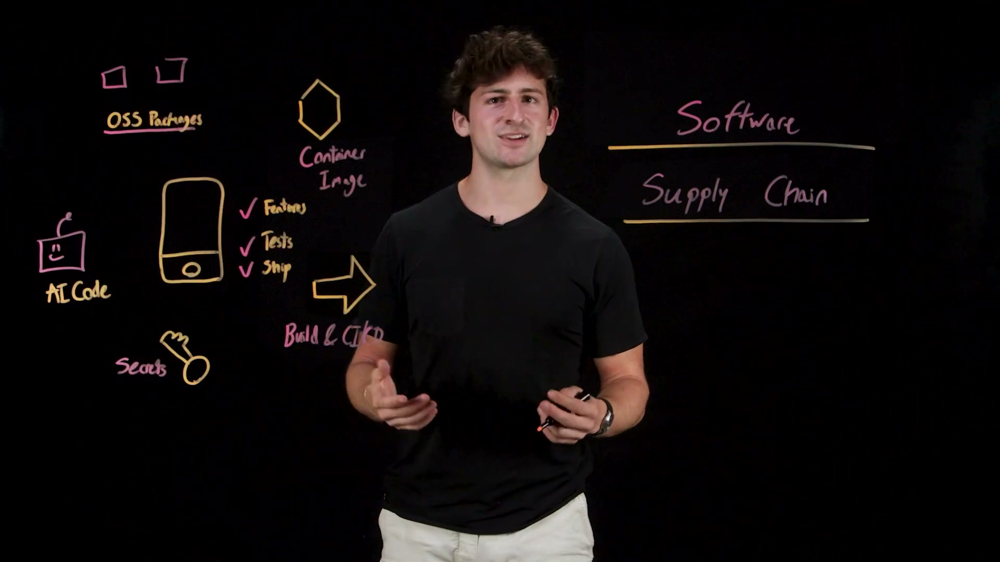
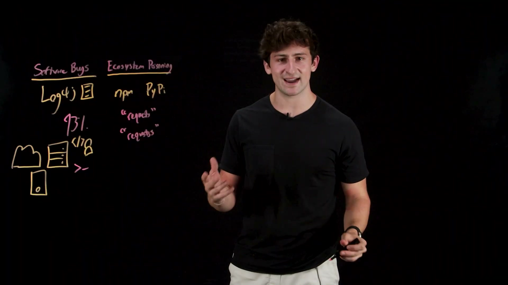
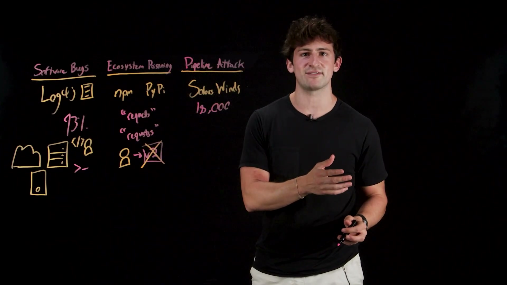
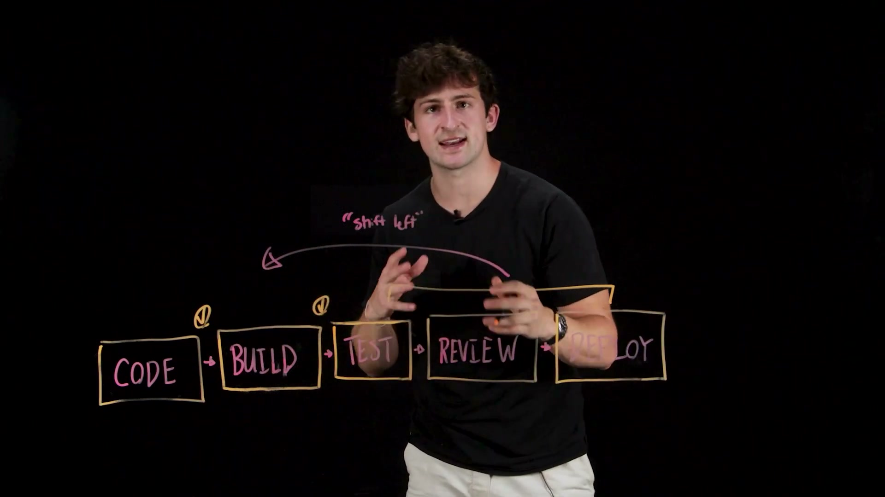
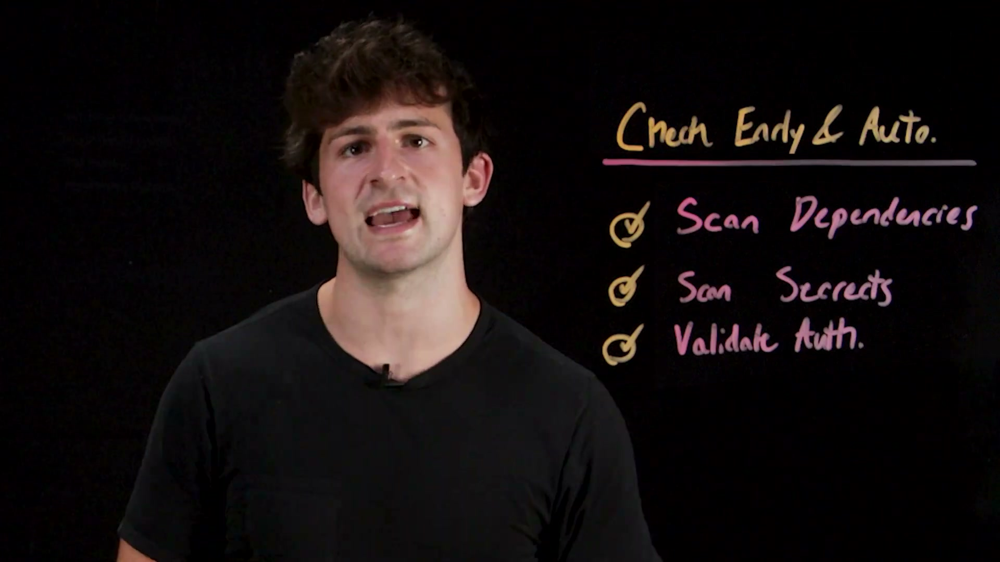
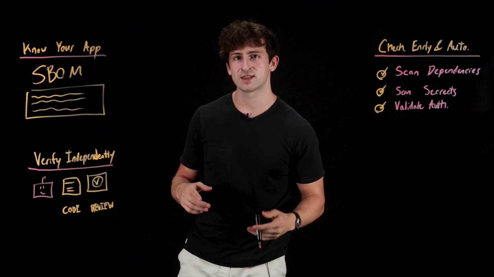
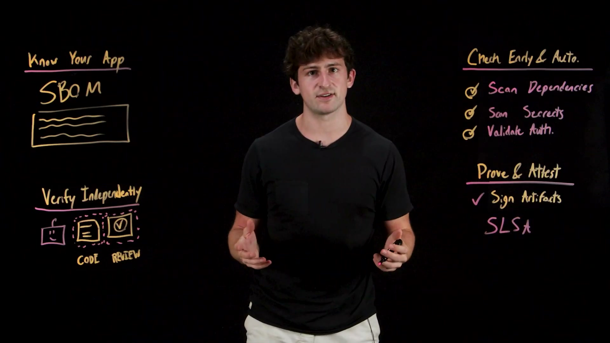
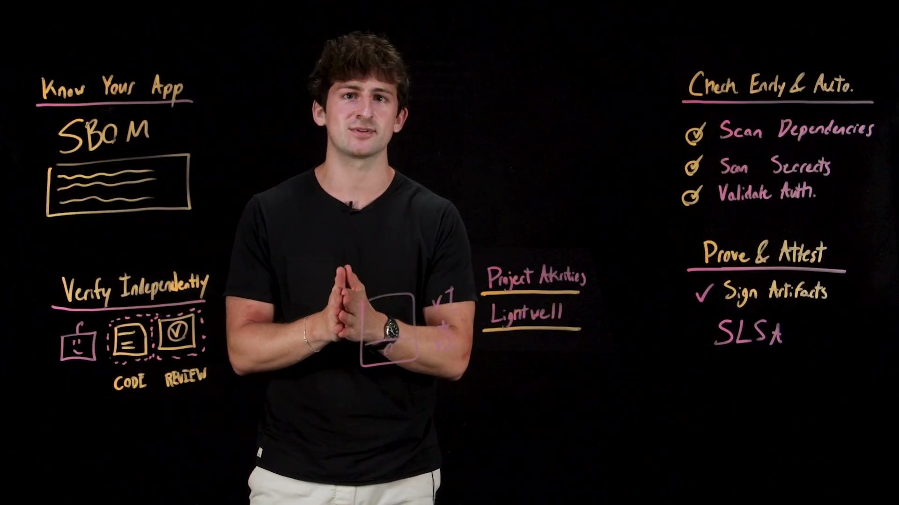

# Software Supply Chain Security: What AI Coding Changes

**Channel**: IBM Technology
**URL**: https://www.youtube.com/watch?v=iv32wI3MBpw
**Upload Date**: 2026-11-16
**Duration**: 9m 38s
**Transcript extracted**: 2026-11-17

---

## Chapters

| # | Timestamp | Chapter |
| :--- | :--- | :--- |
| 1 | `00:00 - 01:00` | See What Really Enters Your Application |
| 2 | `01:00 - 02:02` | Define the Modern Software Supply Chain |
| 3 | `02:02 - 03:03` | Understand Dependency Risk with Log4j |
| 4 | `03:03 - 04:00` | Protect Package Registries from Ecosystem Poisoning |
| 5 | `04:00 - 04:47` | See How Build Pipelines Become Attack Vectors |
| 6 | `04:47 - 06:01` | Treat AI Coding Agents as Software Suppliers |
| 7 | `06:01 - 06:31` | Shift Software Supply Chain Security Left |
| 8 | `06:31 - 07:04` | Build an SBOM for Every Application |
| 9 | `07:04 - 08:08` | Automate Security Checks and Verify AI Code |
| 10 | `08:08 - 09:38` | Prove Software Provenance Before Production |

## Suggested Keyframe Timestamps

- `00:12` (12s, `chapter`): See What Really Enters Your Application
- `01:12` (72s, `chapter`): Define the Modern Software Supply Chain
- `02:14` (134s, `chapter`): Understand Dependency Risk with Log4j
- `03:15` (195s, `chapter`): Protect Package Registries from Ecosystem Poisoning
- `04:12` (252s, `chapter`): See How Build Pipelines Become Attack Vectors
- `04:59` (299s, `chapter`): Treat AI Coding Agents as Software Suppliers
- `06:08` (368s, `chapter`): Shift Software Supply Chain Security Left
- `06:39` (399s, `chapter`): Build an SBOM for Every Application
- `07:16` (436s, `chapter`): Automate Security Checks and Verify AI Code
- `08:20` (500s, `chapter`): Prove Software Provenance Before Production

## Key Visual Slides & Diagrams

- `01:38` — **Modern Software Supply Chain Overview**:
  
  > Visual content: Depicts the core ingredients entering a shipped app (`✓ Features`, `✓ Tests`, `✓ Ship`) under heading **Software Supply Chain**: `OSS Packages`, `Container Image`, `AI Code` (robot icon), `Secrets` (key icon), and `Build & CI/CD`.
- `03:25` — **Software Bugs & Package Registry Ecosystem Poisoning**:
  
  > Visual content: Two-column breakdown of supply chain vulnerabilities: **Software Bugs** (`Log4j`, `93%` footprint across cloud/server/device environments, RCE `</>` `>-`) and **Ecosystem Poisoning** (`npm`, `PyPi`, typo-squatting `"requests"` vs `"requestss"`).
- `04:14` — **Three Classic Supply Chain Attack Vectors**:
  
  > Visual content: Completes the three threat columns: **Software Bugs** (`Log4j` `93%`), **Ecosystem Poisoning** (`npm`/`PyPi` typo-squatting plus compromised maintainer account icon `[person] -> [crossed package]`), and **Pipeline Attack** (`SolarWinds`, `18,000` downstream customers).
- `05:57` — **Shift Left Across the AI-Accelerated SDLC**:
  
  > Visual content: Horizontal pipeline `CODE -> BUILD -> TEST -> REVIEW -> DEPLOY` with verification gates marked early (`CODE`/`BUILD`/`TEST`) and a curved `"shift left"` arrow moving security validation earlier from late `REVIEW`/`DEPLOY` stages.
- `06:58` — **Check Early & Automatically Checklist**:
  
  > Visual content: Under heading **Check Early & Auto.**: three checkmarks (`Scan Dependencies`, `Scan Secrets`, `Validate Auth.`).
- `07:35` — **SBOM & Independent AI Code Verification**:
  
  > Visual content: Pairs **Know Your App** (`SBOM` document card) and **Verify Independently** (`[agent]` `CODE` `REVIEW [check]` separation of concerns) on the left with **Check Early & Auto.** on the right.
- `08:05` — **Four Defense Pillars & SLSA Provenance**:
  
  > Visual content: Completes all four quadrants by adding **Prove & Attest** (`✓ Sign Artifacts`, `SLSA`) bottom-right and highlighting dotted separation boxes around `CODE` and `REVIEW`.
- `09:08` — **Complete Supply Chain Defense & Remediation Initiatives**:
  
  > Visual content: Full board uniting the 4 pillars (**Know Your App / SBOM**, **Verify Independently**, **Check Early & Auto.**, **Prove & Attest / SLSA**) with center remediation diagram (`v1 -> v2` breaking upgrade challenge, **Project Akrites**, and **Lightwell** pre-patched OSS packages).

## Transcript

### [00:00 - 01:00] See What Really Enters Your Application
**[00:00]** Let's say that you're building an awesome new app. You've built out the features, the tests are passing and you're ready to ship. Woohoo! But how much of what's about to run in production did you actually write? Well, for most apps, it's actually not a lot. Most software today isn't written from scratch, but put together from a whole bunch of pieces that came from somewhere else.
**[00:22]** So, let's fill in the rest of the picture, because you're likely to have open-source software packages, and each of those packages are pulling in their own dependencies. You've also got a container base image. This allows you to run that software in a variety of environments. My computer. Your computer.
**[00:41]** Somewhere in the cloud. You've also got a build pipeline. This is your continuous integration and deployment that allows you to constantly make updates and changes in real time. You've also got, for example, secrets that might be used to connect your application to data sources, and much more.

### [01:00 - 02:02] Define the Modern Software Supply Chain
**[01:01]** And more and more, you also have the idea and concept of AI-generated code that a model is creating and writing. So every one of these is something that your software is depending on. And most of them you didn't write and some of them you probably never even looked at. I'm guilty of that one too.
**[01:21]** But this whole picture is what's known as the software supply chain. It includes the application itself, but on the other hand, everything else around it, as well.
**[01:46]** In fact, you've probably heard of popular examples of supply chain security attacks, for example, with software bugs like the incident of log4j. Now, Log4j is a popular logging library that was in almost every piece of software in order to collect metrics and logs,

### [02:02 - 03:03] Understand Dependency Risk with Log4j
**[02:03]** and almost 93% of enterprise environments had it installed as a dependency in the software they use, or maybe we're using as a service. And a security flaw left teams vulnerable to remote code execution. That means if I have my server here and a malicious attacker was to use a specific command, they could get access to our environment to exfiltrate data,
**[02:30]** to sabotage things, and remediating this issue was quite difficult because it was in not just servers, but applications that you and I use every day. And it was in the hybrid cloud, uh, deployed on thousands of different machines. So that's an example of software bugs where remediation of a dependency can be quite difficult.
**[02:48]** There's also issues of ecosystem poisoning. So you might have heard of attacks on different package registries like NPM for JavaScript developers or PyPI for Python developers, where attackers intentionally upload malicious packages either in typo squatting,

### [03:03 - 04:00] Protect Package Registries from Ecosystem Poisoning
**[03:06]** where let's say I'm looking for a specific package called request in order to make requests from my app to another, and someone has taken a name of request, but with a small typo, maybe two S's. And if I type this in, it's in my application. I could get hacked. There's also the idea of hacking a legitimate account of a contributor to a popular project,
**[03:31]** and using their account to upload a new version of software that might be downloaded automatically on your or I's application, hich could be vulnerable. Andfinally, there's attacks through the build pipeline, ah, of software. So there's a popular example of SolarWinds, which is a distributor of software where they had attackers that breached their environment
**[03:56]** to covertly, um, hack about 18,000 of their customers with a backdoor. And even though

### [04:00 - 04:47] See How Build Pipelines Become Attack Vectors
**[04:03]** it was a trusted software provider for these different customers, well, that backdoor got in because of a code build process and was updated automatically on all those different environments. So, these are different entry points for your software supply chain. Some are through a dependency or an ecosystem. Some are through the build process.
**[04:23]** But this is really why we have to care about the whole picture. So none of this is necessarily brand new. But what has changed? Well, AI has changed things from both sides actually, where on one side, the models and agents are now producing much more code that we're actually using in applications and senior engineers now get dozens of different review requests per day.
**[04:45]** And trust me, people were already struggling to keep up before AI.

### [04:47 - 06:01] Treat AI Coding Agents as Software Suppliers
**[04:49]** On the other side, though, AI is finding vulnerabilities and helping us test and validate our applications as we deploy them. And these frontier models can scan open-source code and dependency chains at machine speed. And that means the time between a bug being disclosed and someone using it in attack, or you having to prevent that, is getting a lot shorter.
**[05:12]** So I like to think of AI and agents as a new supplier in our supply chain. It's a really fast one, and just like any other supplier, you need a way to check what it ships. A lot of teams are still finding vulnerabilities way over here near the end, and by then fixing it can be quite disruptive because
**[05:30]** you have to reload all the context, rework something that's maybe already been merged, and hold up a new release. It's like when you're deep in a problem and you get pulled into a meeting and you come back an hour later with no idea where you were. Except now the code is weeks or months old. And so that's why you hear this term of shift left. And what does this really mean?
**[05:50]** Well, this means checks as you're building out new features before and after you push code, signing off on those artifacts in the continuous integration pipeline before you get to production

### [06:01 - 06:31] Shift Software Supply Chain Security Left
**[06:02]** And really as many checks as possible that can be automated and done up front so that the real attention from a person or an AI reviewer goes to the activities that really need judgment. So what can you start doing today Well, there are four simple things. And first is to know what's in your application.
**[06:22]** This is exactly what an SBOM is for. It's a software bill of materials, and you can think of it as the ingredient list for your application or software. That means when the next Log4j or big critical vulnerability shows up,

### [06:31 - 07:04] Build an SBOM for Every Application
**[06:35]** all you have to do is check the list to see what's in your application and which version instead of going hunting in those applications that you might manage. And second is to check early and check automatically. This means to scan the dependencies that you're using for critical vulnerabilities, to scan for secrets that might be exposed,
**[06:55]** and to validate authenticity of those dependencies and code that comes in. So, speaking of code, keep those changes small. A giant change that mixes a dependency bump,

### [07:04 - 08:08] Automate Security Checks and Verify AI Code
**[07:05]** a refactor of code and new behavior for your application is hard for anybody to review, whether it be human or AI. And speaking of AI, verify independently. So if you're using an AI agent for code generation or code review, this means that if you're using the agent to
**[07:25]** both write the code that is going into the application and review the code to make sure that it's functional, well, it's likely to miss the same thing twice. So, a good review should use a separate model or a separate session so that you have this kind of separation of concern and zero trust.
**[07:45]** And this is a proven idea that we already use in a lot of other fashions. But, finally is to prove where your application came from. So this means to sign your artifacts and code so that you can show provenance. And there's actually already a framework for this called SLSA
**[08:04]** from the Linux Foundation, which is really good to follow here because it gives you a way to record

### [08:08 - 09:38] Prove Software Provenance Before Production
**[08:10]** what was checked in your application and document why it was approved. As your application grows larger and larger, this gets more and more important. So even if you do all four of these, something will get through eventually, and maybe you'll fix it by patching or upgrading the software in your application from,
**[08:29]** say for example, version one to version two. But in a lot of situations, maybe it'll break your application and you just can't do it So that's where initiatives to combat open-source vulnerabilities come in. So there's two of them I want to mention Project Akrites from the Linux Foundation and Lightwell from Red Hat and IBM,
**[08:50]** which have fixed packages of software ready to go so that you don't have to automatically upgrade, which might break your application. So the thing is, software supply chain security, it's not about slowing things down, but catching these issues before they get to production so that you're able to go ship faster
**[09:10]** and feel confident about it. You want to be able to think that, hey, if something were wrong, how would we know? And I believe that after watching this video, you can answer that question. So, thanks so much for watching. If you learned something today, be sure to like the video and subscribe to the channel. We'll see you in the next one.
