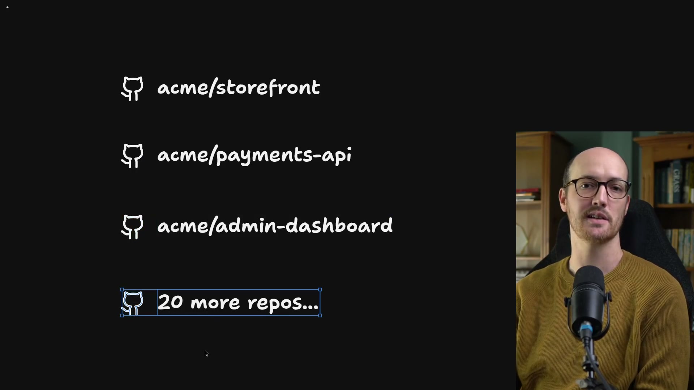
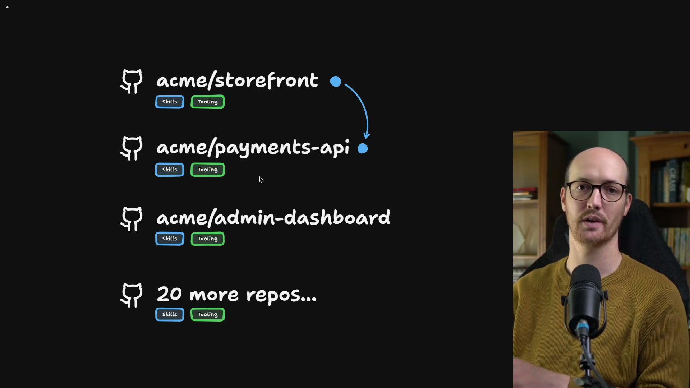
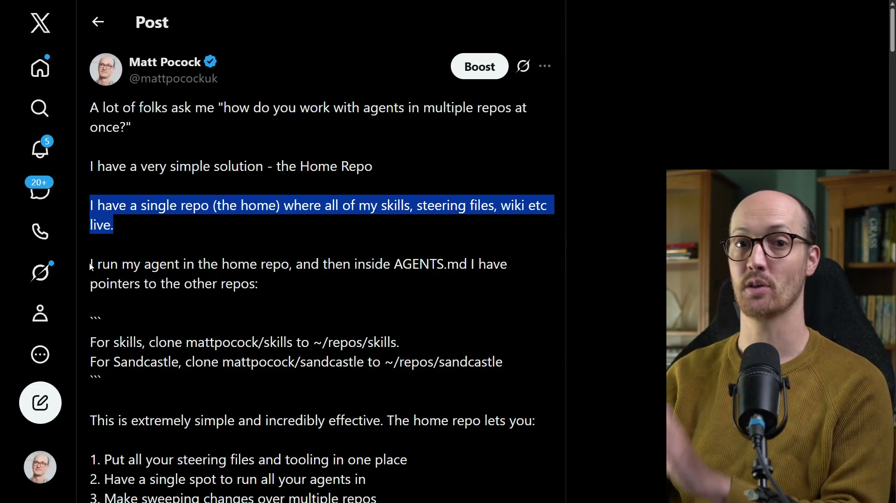
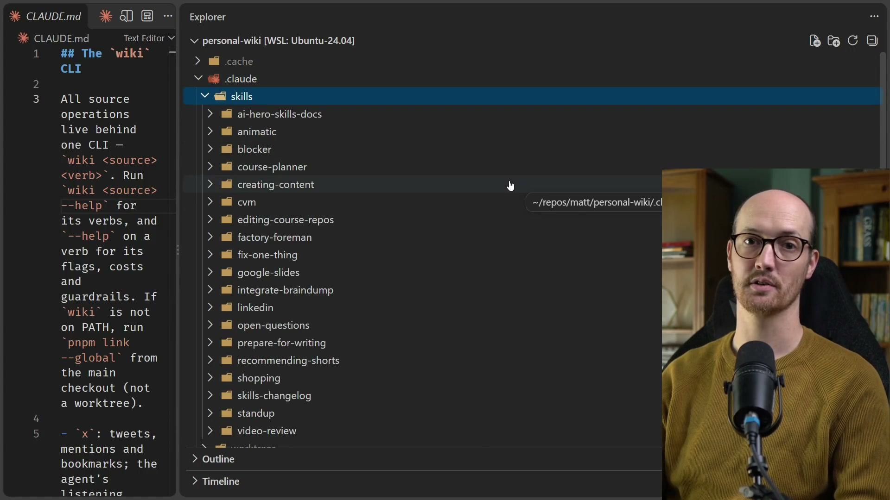
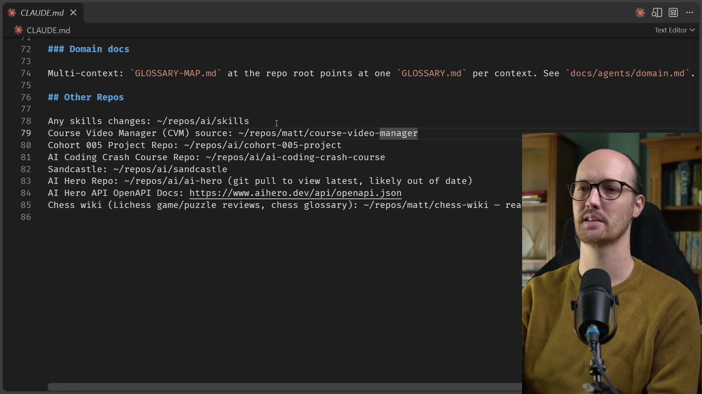
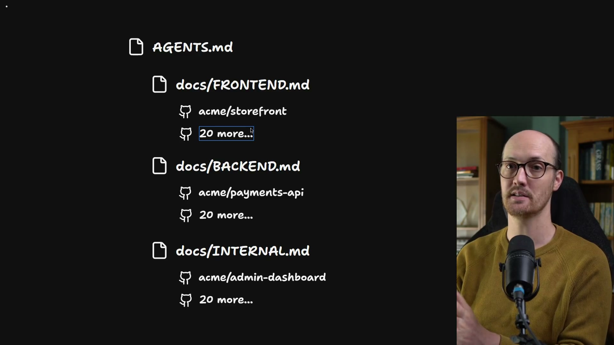
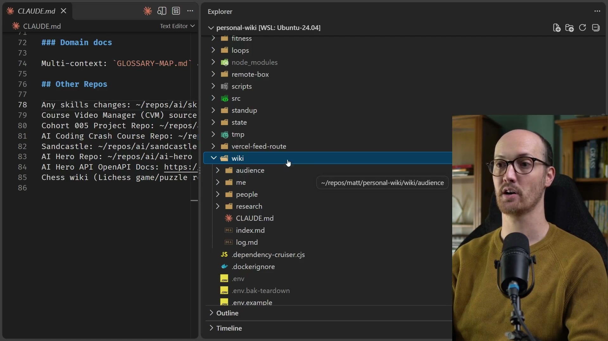
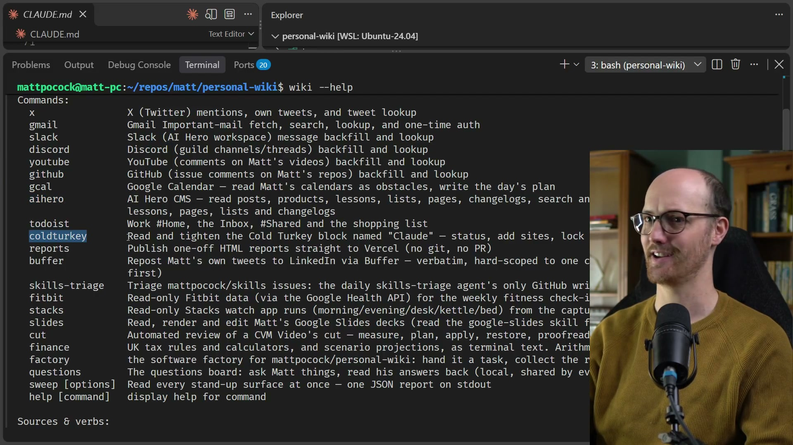

# The Home Repo: The effortless multi-repo agent setup

**Channel**: Matt Pocock
**URL**: https://www.youtube.com/watch?v=hWe-j78vNpc
**Upload Date**: 2026-11-12
**Duration**: 8m 53s
**Transcript extracted**: 2026-11-18

---

## Chapters

| # | Timestamp | Chapter |
| :--- | :--- | :--- |
| 1 | `00:00 - 00:27` | A too-simple technique goes viral |
| 2 | `00:27 - 02:20` | The multi-repo agent problem |
| 3 | `02:20 - 02:53` | The home repo solution |
| 4 | `02:53 - 04:42` | Tour of my home repo |
| 5 | `04:42 - 05:43` | Scaling and why not monorepos |
| 6 | `05:43 - 08:53` | Personal wiki and custom tooling |

## Suggested Keyframe Timestamps

- `00:21` (21s, `chapter`): A too-simple technique goes viral
- `02:08` (128s, `chapter`): The multi-repo agent problem
- `02:46` (166s, `chapter`): The home repo solution
- `04:30` (270s, `chapter`): Tour of my home repo
- `05:31` (331s, `chapter`): Scaling and why not monorepos
- `08:41` (521s, `chapter`): Personal wiki and custom tooling

## Key Visual Frames

## Transcript

### [00:00 - 00:27] A too-simple technique goes viral
**[00:01]** There's this technique that I've been using for a while that I thought was kind of just too boring and obvious to post about. And then in an office hours in the cohort I was running this week, I just showed it off and people went, wow, that's really cool. I never thought it could be so simple. And then I posted about it on Twitter and it went nuts. So
**[00:19]** obviously this is something people need to hear about. And this technique solves a problem which is how do you work with agents in multiple repos at once? So

### [00:27 - 02:20] The multi-repo agent problem
**[00:28]** let's set this up. Imagine that your organization looks like this, which most organizations do. They have lots of different repos that all have different concerns. We have one that is a storefront, one that is a payments API, one that's an admin dashboard, and 20 more repos that you might occasionally need to dip in and out of. This is easy when you need to make changes to only
**[00:47]** one of these repos, so you just run the agent inside the storefront. It's even pretty easy if you realize when you're working in the storefront you need to make changes to the payments API because you can actually just get your agent to work in multiple directories at once. And so this means that you would end up with a pull request inside Acme storefront and then a pull request inside payments API, all from the same
**[01:07]** session. Now that's fine and that works, but the issue becomes what do you do with the data, with the steering files, and with the stuff that you want the agent to have in every single session? What often happens is you will have your skills and your tooling and your agents.md and maybe even like wiki links and stuff all inside duplicated over
**[01:27]** multiple repos. This means that whenever you start an agent session you are going to have access to those things. So if you start it in storefront you're going to still have the same skills and tooling. But this is a massive pain because you then need to keep all of those skills, all of that tooling in sync across different repos and across maybe 30 40 repos. You could put all of
**[01:47]** these skills and tooling inside people's local machine, so in their user directory so it's accessible from every single one of these repos. But then because it's kind of invisible to the user it means that they won't be updated over time they'll probably fall behind what the global setup is. And also, I think of the users directory as the
**[02:05]** place where the user can make changes to their setup that suits how they work instead of how the team wants them to work. And so none of these solutions particularly feel great, and it means that people who work in multi-repo setups feel like they have no good choices. And so the solution that I

### [02:20 - 02:53] The home repo solution
**[02:21]** propose is called the home repo. This is a technique I've been using for a while where I have a single repo, so which is the home where all of my skills, all my steering files, I have a wiki in there and a load of custom tooling, all that live in that one repo. This means that whenever I run my agent, I'm running my agent always inside the home repo. That
**[02:41]** means that the agent operating inside the home repo, which is just like a normal repo, is able to reach the storefront and the payments API and just operate across lots of different repos at once and pull in all the context that

### [02:53 - 04:42] Tour of my home repo
**[02:53]** it needs to. And so you're probably thinking, please can we look at your home repo? Well, here it is. The main things we need to pay attention to in here are of course the claw.md inside here, which we'll get to in a minute, but also crucially the skills up the top here, so in clawed skills. These skills are private skills. In other words,
**[03:12]** these are skills that I do not want to release for whatever reason because they are extremely good and extremely sensitive to my business. And this means that these are available in every single session. So if your organization has a list of skills that you want to add, then you should add them inside the home repo just here. This is also a place that you can configure settings in a
**[03:32]** versioned way too. So if you're running a consistent agent in here, you can have settings in your settings.json that spill out over across your entire organization immediately. The main structural things come from the claw.md here or agents.md. And inside here, you can see that there are navigation pointers to all of the important repos
**[03:51]** that I on a day-to-day basis touch. So if there are any skill changes for instance, then it's at repos AI skills. Anything that needs updating in my course video manager, which is probably my hottest repo in terms of commits, then that goes there. Anything for the cohort 05 project, anything for the AI coding crash course repo. So when I'm talking about these links then from the
**[04:11]** home repo to other repos, this is how they're done. Literally just a path inside the agents.md. On a fresh machine, the agent what it does is if sandcastle doesn't exist at this location, then it clones it down. And then if there are several agents running at once, it will just use a work tree within that same repo. So it's zero
**[04:30]** setup basically. It just works on its own and then, you know, eventually you have to do some normal work tree cleanup as you go. If I wanted to add another repo to the list, then I just edit agents.md and then it just goes into the same setup. This setup works for maybe

### [04:42 - 05:43] Scaling and why not monorepos
**[04:44]** 20 30 40 repos possibly. It wouldn't scale to like 400 repos. But for those situations, I would just add a bit of progressive disclosure. Inside your agents.md, instead of linking to the raw repos, you would just say, okay, here are the front end repos, here are the back end repos, and here are the internal repos for internal tooling. And
**[05:03]** then inside there, you can just link to the repos from there. So this means that the agent would just be able to find the right repo based on just simple file system tactics. And by the way, it's worth saying that I love mono repos. Like if all of this stuff could live in one repo, I would do it. You know, I used to be employed at Vercel as the
**[05:22]** turbo repo dev rel. You know, I'm very into mono repos. But you can't always do them, especially if you need a mix of like some of these repos need to be public, some of them need to be private. So what I'd say is that if you can move all this stuff into a single repo, then great. If you can and most likely you can't just because of political will,
**[05:42]** then a home repo is the way to go.

### [05:43 - 08:53] Personal wiki and custom tooling
**[05:44]** There's one more thing to say about home repos, which is that I have noticed I've been able to be much more ambitious with the tooling I've created for my agents since adopting a home repo. I call my home repo my personal wiki because it is an enormous wiki of all of the data that is kind of sensitive to my business. It lives inside here inside wiki and it's
**[06:04]** essentially a LLM Wiki, Carpathy style, with a bunch of markdown files of interesting stuff that my audience finds cool or finds interesting. I will talk about how I generate this Wiki and how I keep it up to date in a future video because people are obsessed with this idea. But I mean, it's just very important to my business because I'm able to query
**[06:23]** it, able to extract really, really rich data from it that goes into course creation, goes into content creation, etc. And because I've got this home repo, it just makes it the obvious spot to house this Wiki. I've also been kind of burying the lead on tooling as well because tooling is absolutely essential, giving your agent like custom tools that
**[06:43]** it can use to interface with the stuff you use for your business. If I run Wiki help inside my personal Wiki directory, we can see that there is a ton of stuff here integrating with Gmail, with Slack, with Discord, with YouTube, with GitHub, Gcal, AI Hero, cold turkey to like uh do my blocks, things like this. I publish
**[07:01]** one-off HTML reports, append to butter a butter buffer. This stuff has been able to grow up organically inside the personal Wiki and add to this huge great ecosystem that I'm able to build on based on the fact that I've got it all centralized, that I always run in one location. This means that I'm able to do
**[07:20]** crazy things like say, okay, look up this message in Discord, then go to the crash course repo, let's say, make a fix there using all of the existing skills that you've already got. From there, you can use my CVM skill inside my course video manager, wherever it is just up here, and use this to go and actually
**[07:40]** edit the course to make the fix. In other words, the home repo becomes the tooling that links all different parts of your business up together, not only the code, but giving access to the agent to really rich data sources and rich tooling that it can use to actually do better work. So how do you set one up
**[07:58]** for yourself? Well, I have written an article called the home repo pattern. And in this article, I've included a prompt down here that you can use to set one up. It essentially just grills you about your own setup, looks at all of the repos that you need to care about, and then it will start to move things into a home repo. And of course, the
**[08:18]** link to this is down below. And by the way, if you dig what I'm putting out here, then you would really enjoy my self-paced AI coding crash course. This is the perfect introduction to if you want to learn about agents, if you have never tried using agents before maybe, or you just feel like you're falling behind in this big, exciting world. But
**[08:36]** anyway, that is the home repo, the pattern that I thought was kind of too basic to post, but now I talk about it, I realize, okay, it actually solves a bunch of problems that people are actually having. So enjoy it. Enjoy setting it up and enjoy your new home, I guess. Nice work, and I will see you in the next one.
