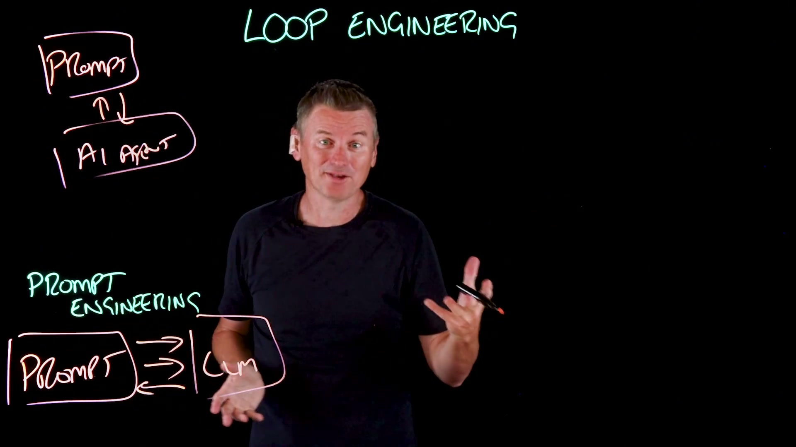
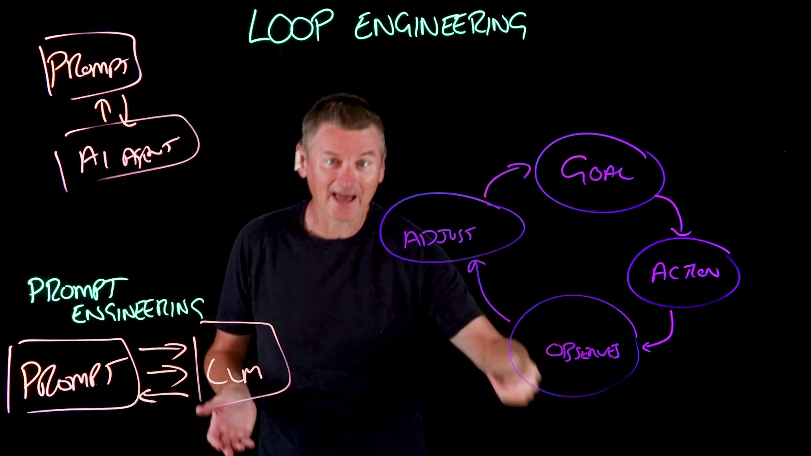
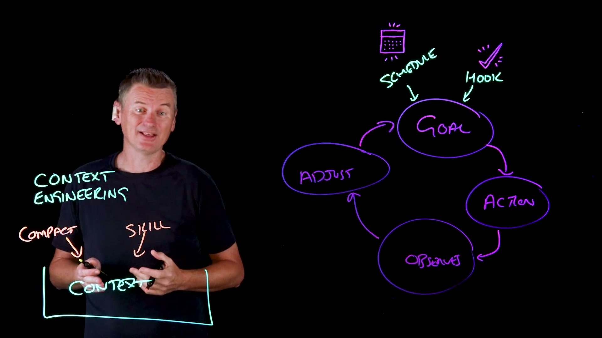
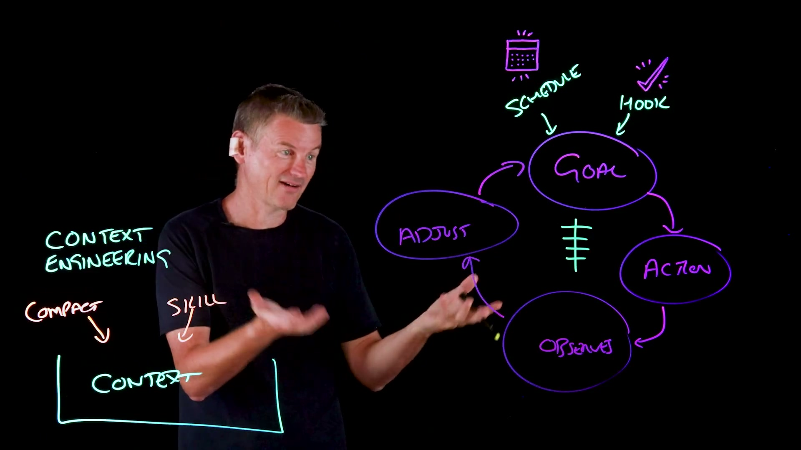
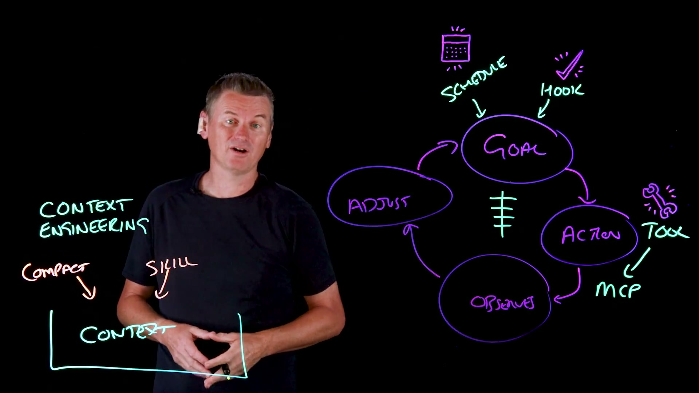
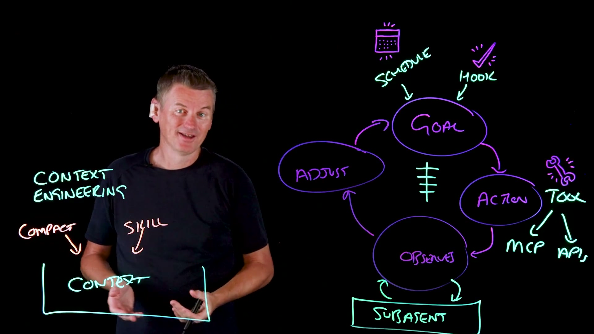
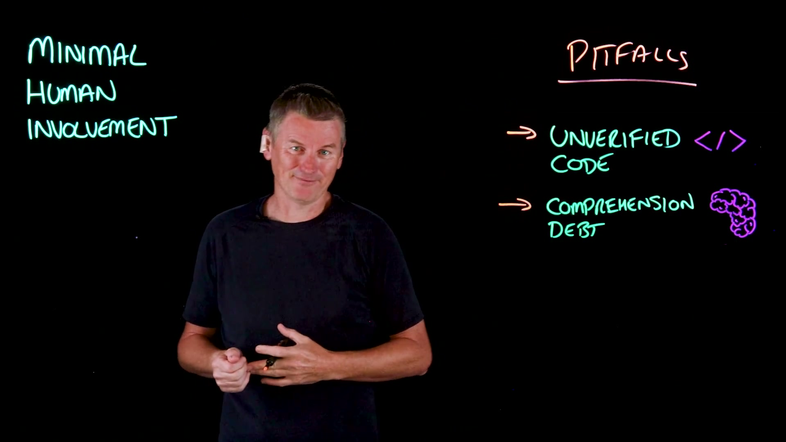
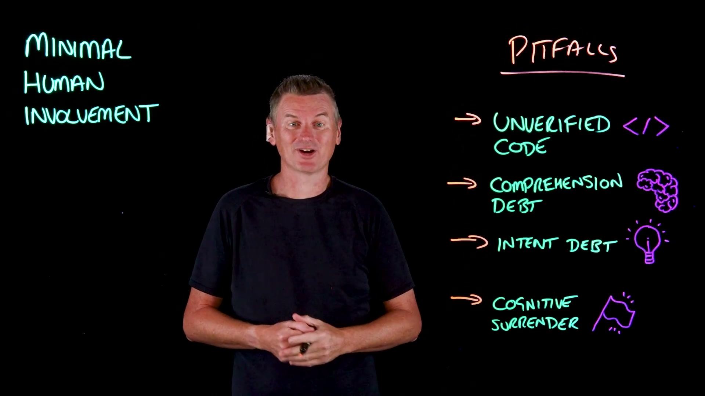
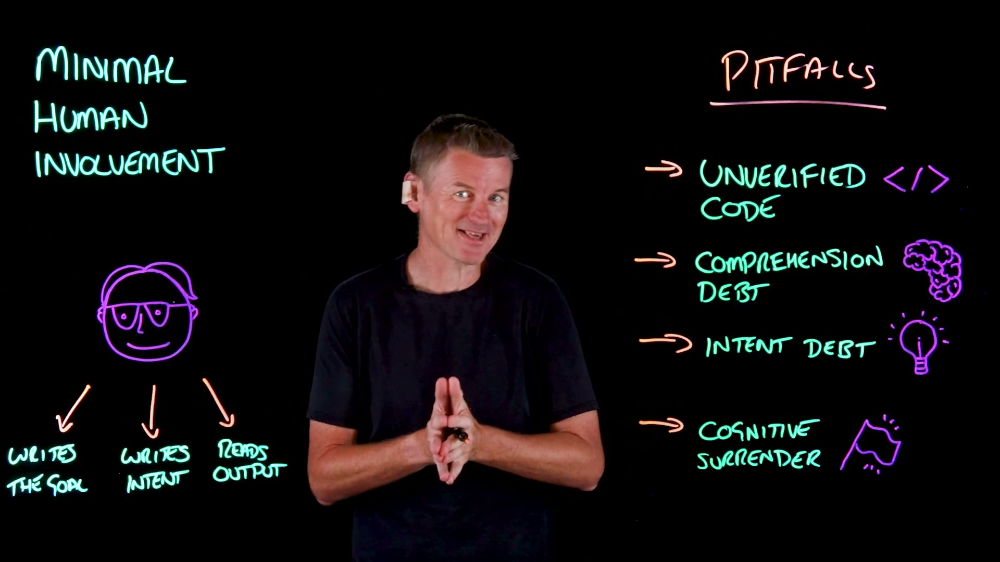

# What Is Loop Engineering? Building Better AI Agents

**Channel**: IBM Technology
**URL**: https://www.youtube.com/watch?v=DQBqh6gcx7U
**Upload Date**: 2026-10-19
**Duration**: 10m 48s
**Transcript extracted**: 2026-11-16

---

## Chapters

| # | Timestamp | Chapter |
| :--- | :--- | :--- |
| 1 | `00:00 - 01:18` | Understand Loop Engineering vs Prompt Engineering |
| 2 | `01:18 - 02:30` | Build an AI Agent Loop Around a Goal |
| 3 | `02:30 - 03:29` | Define Goals AI Agents Can Actually Verify |
| 4 | `03:29 - 04:18` | Engineer Triggers, Schedules & Hooks |
| 5 | `04:18 - 05:37` | Manage Agent Context, Skills & Persistent State |
| 6 | `05:37 - 06:10` | Give AI Agents Tools with MCP & APIs |
| 7 | `06:10 - 07:11` | Use Subagents to Check AI Agent Work |
| 8 | `07:11 - 07:49` | Keep Humans Inside Agentic Loops |
| 9 | `07:49 - 10:05` | Avoid Comprehension & Intent Debt |
| 10 | `10:05 - 10:48` | Define the Human Role in Loop Engineering |

## Suggested Keyframe Timestamps

- `00:12` (12s, `chapter`): Understand Loop Engineering vs Prompt Engineering
- `01:30` (90s, `chapter`): Build an AI Agent Loop Around a Goal
- `02:42` (162s, `chapter`): Define Goals AI Agents Can Actually Verify
- `03:41` (221s, `chapter`): Engineer Triggers, Schedules & Hooks
- `04:30` (270s, `chapter`): Manage Agent Context, Skills & Persistent State
- `05:45` (345s, `chapter`): Give AI Agents Tools with MCP & APIs
- `06:22` (382s, `chapter`): Use Subagents to Check AI Agent Work
- `07:20` (440s, `chapter`): Keep Humans Inside Agentic Loops
- `08:01` (481s, `chapter`): Avoid Comprehension & Intent Debt
- `10:16` (616s, `chapter`): Define the Human Role in Loop Engineering

## Key Visual Slides & Diagrams

- `01:05` — **Prompt Engineering vs Loop Engineering**:
  
  > Visual content: Compares **LOOP ENGINEERING** (`Prompt` <-> `AI Agent`, automated cyclical prompting) against **PROMPT ENGINEERING** (`Prompt` -> -> <- `LLM`, manual single-turn prompting).
- `02:25` — **Core Four-Stage Agent Loop**:
  
  > Visual content: Draws the 4-stage execution cycle on the right: `Goal` -> `Action` -> `Observe` -> `Adjust` -> `Goal`.
- `05:02` — **Triggers & Context Engineering**:
  
  > Visual content: Adds `Schedule` (calendar icon) and `Hook` (hook icon) triggers feeding into `Goal`, plus **CONTEXT ENGINEERING** (`Compact` and `Skill` pointing into the `Context` tray).
- `05:30` — **Persistent State Spine Inside the Loop**:
  
  > Visual content: Adds a green vertical **spine** icon at the center of the `Goal -> Action -> Observe -> Adjust` cycle representing persistent loop memory/state across iterations.
- `05:52` — **Tool Access via MCP**:
  
  > Visual content: Adds `Tool` (wrench icon) -> `MCP` attached to the `Action` stage.
- `06:58` — **Complete Loop Architecture & Subagent Verification**:
  
  > Visual content: Completes Board 1 showing `Tool` -> `MCP` & `APIs` beside `Action`, `Schedule` & `Hook` triggers entering `Goal`, the central persistent state spine, `Context Engineering` (`Compact`, `Skill` -> `Context`), and a `Subagent` verification box connected bidirectionally to `Observe`.
- `08:45` — **Minimal Human Involvement & First Two Pitfalls**:
  
  > Visual content: Starts Board 2 with `MINIMAL HUMAN INVOLVEMENT` (left) and underlined `PITFALLS` (right): `-> UNVERIFIED </> CODE` and `-> COMPREHENSION DEBT` (brain icon).
- `09:58` — **All Four Agentic Loop Pitfalls**:
  
  > Visual content: Lists all 4 pitfalls on the right: `UNVERIFIED </> CODE` (`</>` icon), `COMPREHENSION DEBT` (brain icon), `INTENT DEBT` (lightbulb icon), and `COGNITIVE SURRENDER` (flag icon).
- `10:28` — **Human Responsibilities Inside Loop Engineering**:
  
  > Visual content: Completes Board 2 under `MINIMAL HUMAN INVOLVEMENT` by adding the human icon (glasses) with 3 branches: `WRITES THE GOAL`, `WRITES INTENT`, and `READS OUTPUT`, paired with all 4 `PITFALLS`.

## Transcript

### [00:00 - 01:18] Understand Loop Engineering vs Prompt Engineering
**[00:00]** Loop engineering is a term that's related to working with AI agents, and it's kind of like the the newer, cooler version of prompt engineering. But with prompt engineering, that's all about writing the one, perfect, ultimate prompt and then sending that
**[00:19]** prompt to a large language model. Then the model comes back with a response and you need to write the next perfect prompt, and so forth. Now, loop engineering is the practice of designing a system that does all that prompting work for you.
**[00:39]** So what loop engineering does is it takes a prompt and sends it to an AI agent. Then loop engineering checks the agent's work and prompts it again. So we go back and forth, back and forth like this, looping until we're done.
**[00:59]** But we're not having to manually engineer every prompt. That's the job of loop engineering. There's minimal human intervention. Although, we'll be coming back to the the word minimal a bit later. Anyway. Let's give an agent a job. Let's say there is a checkout

### [01:18 - 02:30] Build an AI Agent Loop Around a Goal
**[01:18]** service with a bunch of failing unit tests. And the job is to get the failing unit tests to stop failing. So for that we're gonna use a loop. Now, the loop starts with a goal. In this case get the checkout unit tests to pass.
**[01:39]** Now the AI agent takes an action. That's the next stage in the loop. And for a coding agent, that's something like maybe opening a file or editing some code. Then, the next stage in the loop is the agent observes
**[01:58]** the output. And the last stop on the loop is to adjust based upon that. So if the test went green, yay! That one's done. It moves on to the next failing one. And if the test is still red, then
**[02:17]** they would try a different fix. And then it kind of goes back around to the goal. Are we done yet? Nope. Okay. Go again. And we keep going around the loop. So, specifying a good

### [02:30 - 03:29] Define Goals AI Agents Can Actually Verify
**[02:31]** goal is quite important because the goal is going to get evaluated every time the agent goes around the loop. It's what decides whether the agent keeps going. So, a goal of "make the checkout faster" it's a pretty bad goal in much the same way that "be happier" is a pretty bad New Year's
**[02:51]** resolution. They both have no measurable test, so the agent could go around forever, or it could stop after just one pass and declare victory, whereas a goal of "stop when every unit test in the checkout sweep passes" is verifiable, so the agent will know for sure when
**[03:09]** it's met. A good goal is specific, with an end condition, a stopping condition. So that's the loop. Basically, these four stages. Not much to it, huh? Doesn't really seem like we need a whole engineering discipline named after it.
**[03:29]** So, why do we? Well, loop engineering is really what gets built around this

### [03:29 - 04:18] Engineer Triggers, Schedules & Hooks
**[03:35]** loop. So let's take a look at that. So, something has to kick this loop off. Now, something that might kick it off is a schedule or something that could kick it off is called a hook. So a schedule is just something simple like run the check out loop every night. And a lot of teams would do that with just like a plain old cron job. And then a hook is event-driven,
**[04:00]** meaning the hook is invoked when something specific happens, like a file changing or a or a pull request opening. Developers largely use hooks for security and qualities such as to enforce policies. Now, every trip around the agentic loop is going to generate something.

### [04:18 - 05:37] Manage Agent Context, Skills & Persistent State
**[04:18]** going to generate context. Stuff like test output would be context or file contents, and context can really start piling up, which can make it hard for an agent to focus its attention on the important stuff. So, another engineering
**[04:39]** context, engineering is choosing which pass actually the loop gets to see. Now, that could mean that we need to do some operations on this context, like compact it. compaction would be one thing we can do. Or we could use the progressive
**[04:59]** disclosure of agent skills, which contain instructions for how to do something, how a particular recurring job happens. Now, inside the loop is something that I'm going to call a spine. And this is really persistent state. So maybe that's some
**[05:18]** markdown files where the agent writes down what it did and whether it worked. And the information stored in the spine can inform future iterations of the loop on what to do, what worked so far, and maybe what hasn't worked. Now, for this stage here, the action stage, the agent might need
**[05:37]** to call out to external resources. So it would do that using tool

### [05:37 - 06:10] Give AI Agents Tools with MCP & APIs
**[05:44]** access. Now that might be using standards like MCP, the Model Context Protocol. Or maybe would do tool calling directly with APIs. Agents use tools to execute code, to access file systems, to run
**[06:04]** commands in the terminal, to query databases, all that sort of stuff. That's action. The observe

### [06:10 - 07:11] Use Subagents to Check AI Agent Work
**[06:10]** stage, rather than have the same agent that wrote the code, check the code. Good loop engineering brings in a second agent. We can think of that second agent as being a sub agent. And that kind of acts as a checker and a coworker to
**[06:31]** farm tasks out to. And the sub agent has its own instructions and its own context and it may be powered by a different AI model than the main AI agent before sending its results back again. So that's the loop. There's a trigger to start the loop. There's context
**[06:51]** and skills to feed it information. There's a spine to remember what happened. There are tools to let it act on tasks, and there are sub agents to verify the result, which still leaves the question of what the human is doing.
**[07:11]** While all of this is looping away. All right, so back to minimal human involvement because I said

### [07:11 - 07:49] Keep Humans Inside Agentic Loops
**[07:18]** loop engineering requires minimal human involvement, compared to prompt engineering, because an agent writes its own prompts rather than having a person submit them manually. But even a well-built loop with a checker and a sub agent and a spine and all the rest of that, it still needs human involvement. A human in the loop approach helps avoid the most dangerous pitfalls
**[07:42]** that can happen with automated code generation And which pitfalls am I

### [07:49 - 10:05] Avoid Comprehension & Intent Debt
**[07:49]** talking about? Well, I've got four for you, starting with unverified code. So a checker sub agent is still just an agent. Human developers are ultimately responsible for all shipped code, and that means a real person has to read and verify that code
**[08:09]** And the gap between the total amount of code in a system and the degree to which humans understand it... that's known as comprehension debt. As agents write more code and humans check less of it, our comprehension, debt is going to keep going up and it can build up pretty fast
**[08:28]** because, well, agents write a lot of code, and if left unmitigated comprehension, debt can be a big problem. When human developers need to address urgent production failures, or humans need to architect a migration. And there's a... there's another debt as well we can put under pitfalls and that is intent debt, an agent can read what a system does, but working
**[08:53]** out why the system does it can be a bit harder, unless that something has been written down somewhere, perhaps in an agent.md file. Without that, an agent can make a change that is technically sound, but goes against a project's objectives. in our checkout loop example, maybe the agent
**[09:11]** fixes a failing test by, let's say, relaxing the validation on a discount code, which is a perfectly good fix as far as the tests are concerned, but a perfectly bad one as far as the business's bottom line is concerned. So the human's job here is to write the intent down, keep up to date and keep it visible to the AI agent. And then, just a fourth pitfall that I
**[09:35]** want to mention is the rather severe-sounding cognitive surrender. Yeah, we definitely don't want that. But it's very easy to do. Offloading work can lead to cognitive surrender when a person just blindly accepts whatever came out of the loop. So if the AI did it, I'm sure it's right. Yeah. When
**[09:53]** that happens, comprehension debt is also gonna go up because now nobody is even trying to understand the generated AI output. So. Minimal human intervention turns out to

### [10:05 - 10:48] Define the Human Role in Loop Engineering
**[10:05]** be quite a specific amount of human intervention. So, the human, they need to write the goal with the stopping condition. The human needs to write the intent where the agent can find it and the human needs to read the output from the
**[10:26]** agent. Loop engineering works best when there's a human in that loop. Are you engineering agentic loops in your own work? Let me know in the comments!
