# Why Domain-specific Agents Are the Future - Justin Schroeder, Standard Agents

**Channel**: Agentic AI Foundation
**URL**: https://www.youtube.com/watch?v=wIPr9GmLRaQ
**Upload Date**: 2026-11-12
**Duration**: 24m 38s
**Transcript extracted**: 2026-11-16

---

## Chapters

| # | Timestamp | Chapter |
| :--- | :--- | :--- |
| 1 | `00:00 - 02:18` | Introduction |
| 2 | `02:18 - 03:08` | The line shaft era of agents |
| 3 | `03:08 - 03:33` | Domain-specific agents |
| 4 | `03:33 - 05:29` | What an agent is |
| 5 | `05:29 - 07:05` | Why businesses build agents anyway |
| 6 | `07:05 - 10:24` | A heating and air company's fleet maintenance process |
| 7 | `10:24 - 11:22` | A Gmail agent versus a Gmail skill |
| 8 | `11:22 - 12:04` | Many small agents under one orchestrator |
| 9 | `12:04 - 15:00` | Old engineering ideas that apply to agents |
| 10 | `15:00 - 15:42` | Efficacy and evaluating one business process |
| 11 | `15:42 - 17:14` | Jagged models |
| 12 | `17:14 - 18:53` | Token spend and cheaper models |
| 13 | `18:53 - 20:23` | What really changed factories: standards |
| 14 | `20:23 - 21:24` | What agents need |
| 15 | `21:24 - 22:01` | Standard Agents' planned open-source spec and runtime |
| 16 | `22:01 - 23:16` | Q&A: encoding logic in the agent versus the model |
| 17 | `23:16 - 24:38` | Q&A: maintenance and governance |

## Suggested Keyframe Timestamps

- `00:12` (12s, `chapter`): Introduction
- `02:30` (150s, `chapter`): The line shaft era of agents
- `03:14` (194s, `chapter`): Domain-specific agents
- `03:45` (225s, `chapter`): What an agent is
- `05:41` (341s, `chapter`): Why businesses build agents anyway
- `07:17` (437s, `chapter`): A heating and air company's fleet maintenance process
- `10:36` (636s, `chapter`): A Gmail agent versus a Gmail skill
- `11:32` (692s, `chapter`): Many small agents under one orchestrator
- `12:16` (736s, `chapter`): Old engineering ideas that apply to agents
- `12:37` (757s, `visual_cue`): expertise. Look at this. This is uh
- `15:10` (910s, `chapter`): Efficacy and evaluating one business process
- `15:54` (954s, `chapter`): Jagged models
- `16:16` (976s, `visual_cue`): and here you can see basically every
- `17:26` (1046s, `chapter`): Token spend and cheaper models
- `19:05` (1145s, `chapter`): What really changed factories: standards
- `20:35` (1235s, `chapter`): What agents need
- `21:33` (1293s, `chapter`): Standard Agents' planned open-source spec and runtime
- `22:13` (1333s, `chapter`): Q&A: encoding logic in the agent versus the model
- `23:28` (1408s, `chapter`): Q&A: maintenance and governance

## Key Visual Slides & Diagrams (AGNTCon + MCPCon North America)

- **Event & Branding:** Agentic AI Foundation — **AGNTCon + MCPCon North America** | Speaker: **Justin Schroeder** (`@jpschroeder`, Standard Agents).

### Slide 01 (`01:22`) — Industrial Revolution Factory Line Shaft Diagram
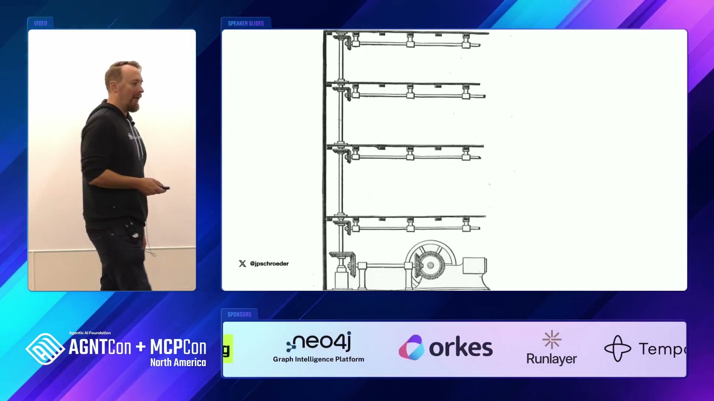
Cross-section schematic showing a single massive steam engine at the bottom driving a vertical main transmission shaft and horizontal rotating line shafts across four factory floors to belt-power every workstation.

### Slide 02 (`02:28`) — "The Line Shaft Era of Agents"
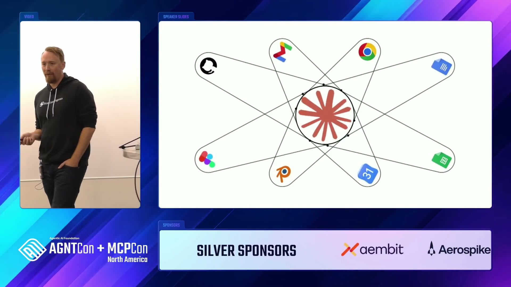
Architectural metaphor wiring a single central frontier model (Claude starburst icon) outward like rotating line-shaft belts to eight disconnected applications: GitHub, Gmail, Chrome, Google Docs, Google Sheets, Google Calendar, Blender, and Figma.

### Slide 03 (`03:45`) — Core Definition: `Agent = Harness`
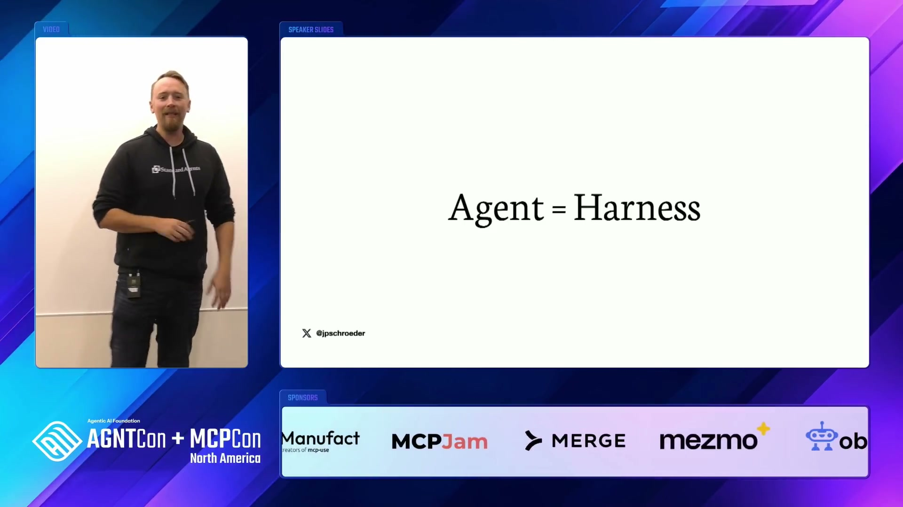
Minimalist title slide stating `Agent = Harness`: deterministic software that utilizes non-deterministic model outputs in pursuit of a desired objective.

### Slide 04 (`07:20`) — Integration: Real-World Main Street Business (Blue Ridge Mechanical)
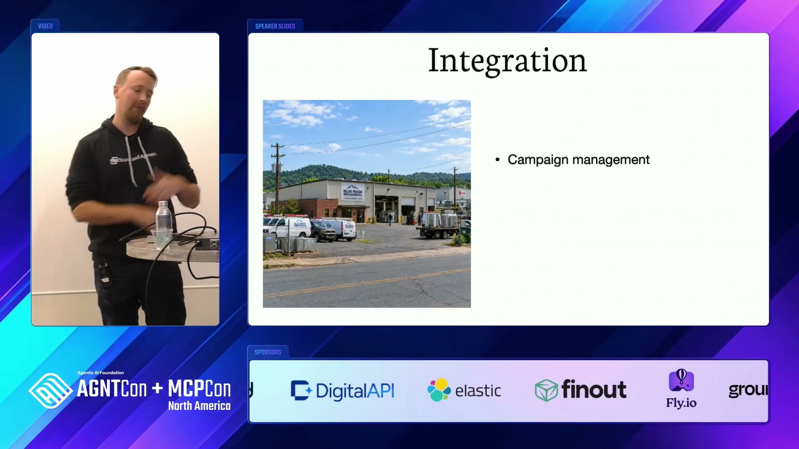
Photo of a brick-and-mortar HVAC contractor (**Blue Ridge Mechanical**) illustrating concrete operational processes (`Campaign management`, lead qualification, fleet maintenance) that businesses refuse to hand over to an unconstrained generalist "Claude God".

### Slide 05 (`09:50`) — Trust: Canonical Agent Harness Stack
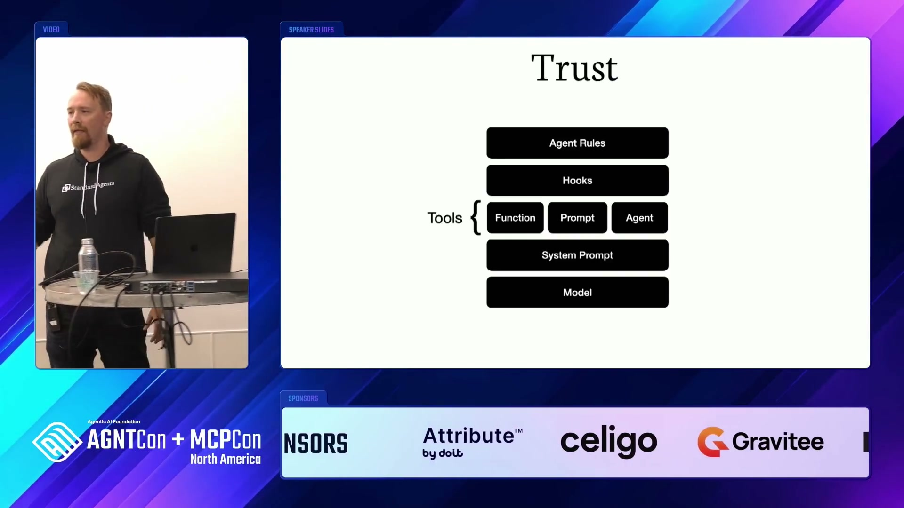
Five-layer stacked architecture diagram (bottom to top):
1. **Model**
2. **System Prompt**
3. **Tools** `{ Function | Prompt | Agent }`
4. **Hooks** (deterministic lifecycle callbacks)
5. **Agent Rules** (step budgets, execution constraints)

### Slide 06 (`10:40`) — Trust: Dedicated Gmail Agent vs. Generalist Model + Gmail Skill
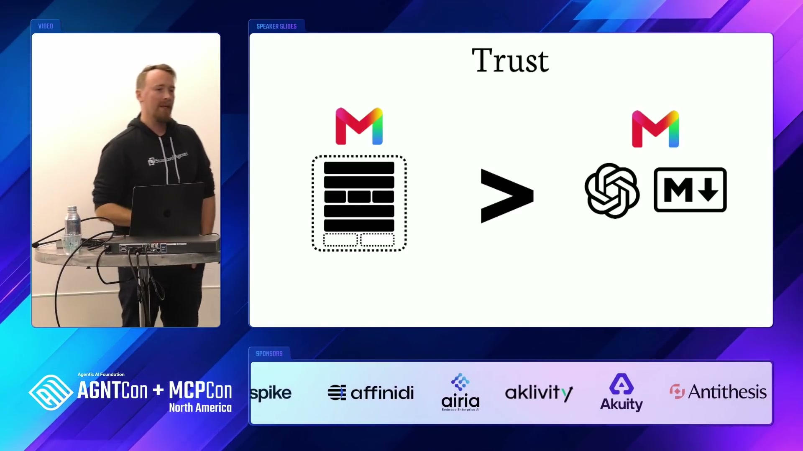
Visual inequality (`>`) comparing a tightly scoped **Gmail Agent** (full dedicated harness stack with bounded tools) against a monolithic generalist model (**Astra / OpenAI**) paired with a **Gmail Markdown skill (`M↓`)** that retains dangerous cross-tool access.

### Slide 07 (`11:32`) — Many Small Domain-Specific Agents Under One Orchestrator
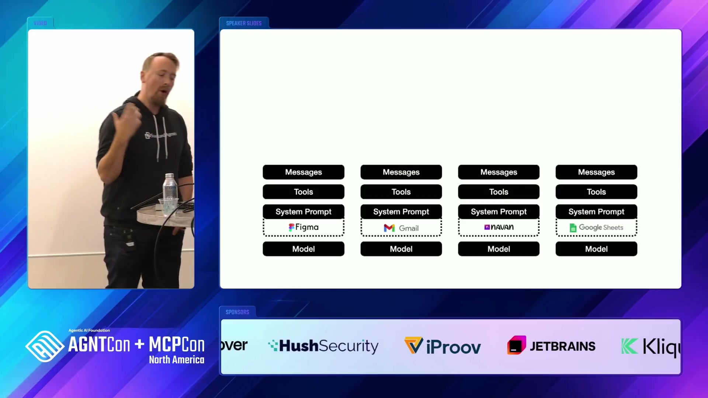
Side-by-side decomposition of four independent vertical agents (**Figma**, **Gmail**, **Navan**, **Google Sheets**), each encapsulating its own `Model + Domain System Prompt + Tools + Messages` stack.

### Slide 08 (`12:40`) — Apollo 11 Mission Control Analogy
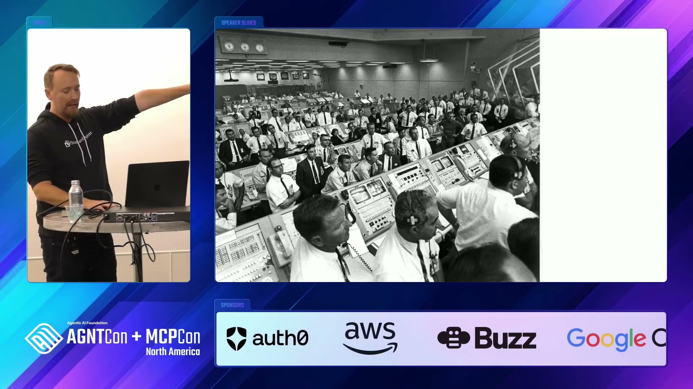
Historical photo of NASA's Apollo 11 Mission Control room demonstrating human "multi-agent" specialization: dozens of console operators each owning a narrow, rigorously bounded domain rather than one generalist operator.

### Slide 09 (`13:30`) — Efficacy & Cost Chart (`Pass@1` vs. `Average Cost per Task`)
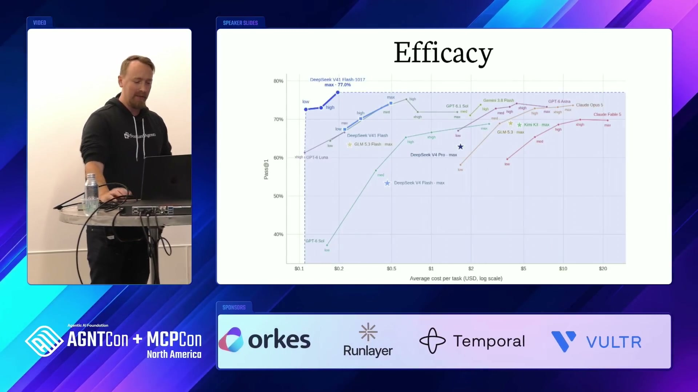
Scatter/line benchmark plotting `Pass@1` (`35%`–`80%`) against log-scale cost (`$0.1`–`$20`/task): **DeepSeek V4.1 Flash-1017 (`max`)** hits `77.0%` near `$0.20`/task—outperforming frontier models including `Claude Fable 5`, `Claude Opus 5`, `GPT-6 Astra`, `GPT-6.1 Sol`, `Gemini 3.8 Flash`, `Kimi K3`, and `GLM-5.3` on that targeted task at a fraction of the cost (`137x` cheaper than Fable per task as cited in talk).

### Slide 10 (`16:20`) — Model Zen Garden (Live 3D World Comparison)
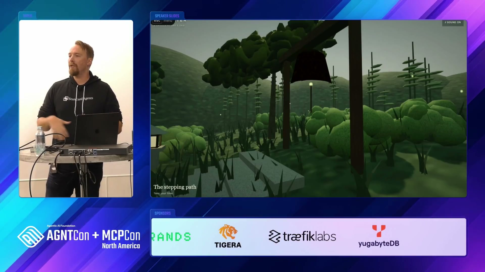
Screenshot from **Model Zen Garden** (`"The stepping path. Take your time."`) showing a stylized 3D garden rendered via **Tencent HY3** (`$0.60`), outperforming general-purpose models (`Sol 6.1`) on a niche 3D generation task—proof of exploiting **jagged model capabilities**.

### Slide 11 (`17:38`) — Efficacy Summary
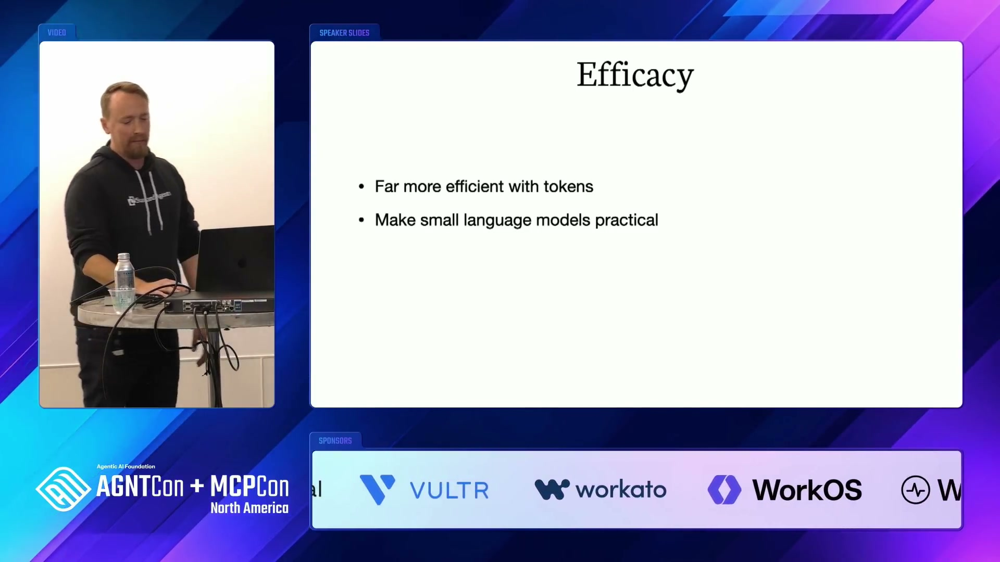
Two key economic outcomes of domain-specific decomposition:
- *Far more efficient with tokens*
- *Make small language models practical*

### Slide 12 (`20:50`) — "We Need Standards" (5 Requirements for Agent Specs)
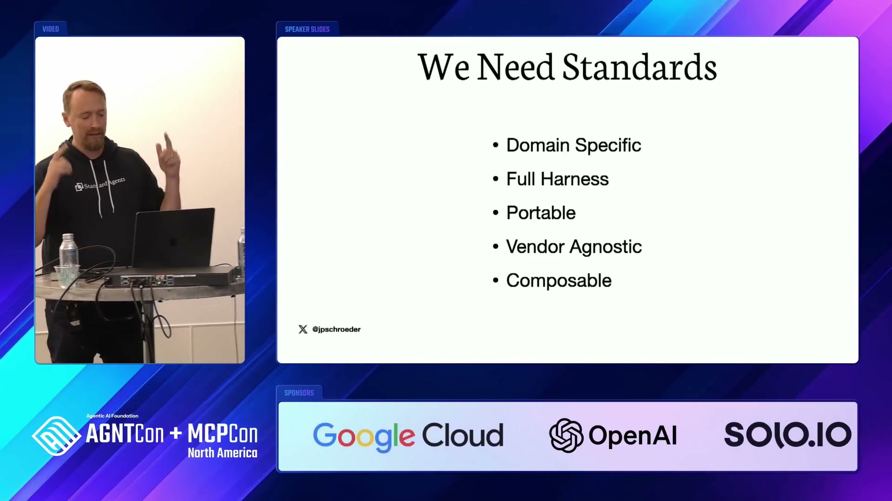
Closing specification checklist (`@jpschroeder`):
- **Domain Specific**
- **Full Harness**
- **Portable** (`npm install` / `pip install`)
- **Vendor Agnostic** (pinned exact model, provider, and quantization)
- **Composable** (standardized inter-agent communication)

## Transcript

### [00:00 - 02:18] Introduction
**[00:01]** Thanks for coming. >> My name is Justin Schrader. I in the old days used to write a lot of code and I had a bad habit of releasing it as open source constantly. Um but Standard Agents is the main thing that I'm going to be talking about today and specifically domain-specific agents. Warning though, this talk does include some
**[00:20]** forward-looking statements and as we know, that is often fraught with uh uh really bad predictions. So, I found this incredible series of postcards from the turn of the century, last century. Um where they were predicting what the world would look like in Paris in the
**[00:39]** year 2000. And so, you know, we've got this completely directionally inaccurate one. Some are directionally pretty accurate. Um others are really eerily accurate. Um a little creepy perhaps. Some are sadly accurate. This was done
**[00:57]** in 1899, uh 3 years before the Wright brothers flew their first airplane. And you can see they had already figured out basically exactly what we were going to be doing a few years later. But when we think about that era, it's not hard to remember the Industrial Revolution. So, this was something I was unfamiliar with
**[01:16]** until just a few months ago. This is um a factory at the time. And what you see down there at the bottom is a big, heavy, expensive steam engine. And then these like pipes and shafts going everywhere are called uh line shafts, rotating line shafts. Turns out this is how factories were powered back
**[01:35]** then. Um they had a giant steam engine, looked something like this. And then in the literal walls of the building and underneath, they would have um something like this, like a a giant shaft. And then individual workstations would have a belt that runs up to the shaft to
**[01:53]** provide power down to wherever where actual tools were that needed to happen. This is an actual picture from the factory back then, which is just crazy to think about. Obviously, this came with lots of workplace hazards. It was not even remotely safe. It had tons of inefficiencies in it, but
**[02:12]** it did work. And yet, I happen to think that you are here right now.

### [02:18 - 03:08] The line shaft era of agents
**[02:18]** This is sort of where we are in this agentic era. We are sort of in the line shaft era of agents. Where we take a giant model, we throw it to the middle of everything that everybody wants to do, and then we sort of tie up each individual thing
**[02:37]** that somebody's going to do back to that main setup. You could call this skills, maybe even MCP, right? Not that those are bad things, but this is the way that work is being accomplished right now. And so, we really do sort of look like this factory, whether you're doing a software factory or something else, it sort of looks like this.
**[02:55]** We really want it to look more like this, right? We want every workstation to have its own power supply and have its own workplace, but how are we going to do that? What is a practical approach? So, my proposition to you is

### [03:08 - 03:33] Domain-specific agents
**[03:08]** that what we really need are domain-specific agents. These are tiny little agents, and they're built around one or two small tasks. So, let's talk about what an agent is real quick, at least my definition of an agent, cuz I bet if we go around this room and have you all write down on like a secret Santa card what you think an
**[03:27]** agent is, they're all different. All of you think an agent is a different thing. When it comes down to the nuts and bolts, here's my definition.

### [03:33 - 05:29] What an agent is
**[03:33]** Just deterministic software that utilizes non-deterministic results produced by a model in pursuit of a desired objective, which sounds an awful lot like a harness, right? And I think the distinction between these two things is like unhelpful. In fact, I think the word harness is like starting to lose its its value as something that means
**[03:53]** anything precise. Really, what we're talking about is an agent as a harness of software. Maybe you could think about an agent as an instance, but it's not that terribly helpful. So, let's just call it a harness. Now, the good news is that agents are really easy to build, right? They're super easy to build. You literally just need an LLM. You're going to do some
**[04:13]** tool calls. You're going to take the result of the tool calls, you're going to feed it back in the LLM. We all know this, right? This is the agentic loop. But, the reality of course is that agents are not easy, they're hard. And they're hard for all kinds of interesting and boring reasons. You need to orchestrate the loop and make sure things don't break during, you know,
**[04:31]** async stuff. And you've got to do some provider abstraction. You got to have durable execution where stuff fails, you can pick it back up. You could use fibers. You got all kinds of stuff, right? And there's all kinds of things that we need to do in order to make agents effective. So, agents are are actually hard. So, what we tell everybody, especially here in the in the
**[04:50]** Bay Area, what we tell everybody is don't build agents. That would be crazy. What we should do is we should just build MCP servers, right? So, whatever your business needs to do, however it needs to apply its logic, you create an MCP server, and you give all your employees access to Claude or whatever, and and that'll work great.
**[05:11]** But, the reality is when you go out and you just go around Main Street America, everybody is building agents. Everybody. Even the people who are building MCP servers are still building agents. Like the agent is behind the MCP call. They're Everybody's building agents. Um why is that?

### [05:29 - 07:05] Why businesses build agents anyway
**[05:30]** Well, I think there's three main reasons. One is integration. People want stuff to be deeply, deeply integrated into their business process. Two is trust. They don't trust that the Claude god is going to do what it's supposed to when it has access to
**[05:48]** everything that it can do. And three is efficacy. They don't really care about how the work gets done. They just want the work to get done and get done right repeatedly over and over again. I have a I have a buddy who works at a
**[06:07]** undisclosed large company and he said, um "If I hand wrote my code on a napkin and then I tore it into little pieces and then put each one in a different envelope, mailed them all over the world and then back to myself, and then manually put the pieces back together, and then type that into the computer,
**[06:25]** that still wouldn't be the bottleneck to shipping new features." And I thought about that so much um that, you know, the velocity that we have and that we've produced is not yet making its way into the actual businesses of mainstream America. In
**[06:43]** fact, I have a map here. This is a map of places where AI is being used. Uh there. I mean, I'm kidding, but I'm sort of not kidding. It is being used everywhere, but at this very surface level. And if you just like walk away from the big city for a minute and think about some
**[07:02]** blue-collar business, right? You like a

### [07:05 - 10:24] A heating and air company's fleet maintenance process
**[07:06]** Here we got Blue Ridge Mechanical uh Heating and Air. And think about what they need. They are running their business with all kinds of individual processes, right? They're doing some campaign management to reach the local community for when their AC goes out. They're doing lead capture and qualification,
**[07:24]** customer assessment, onboarding, sales forecasting, all kinds of different business processes that get put together to like actually make their business operate. There's tons of them. And if you look at each one, each one is like a like a line. A line that has a start and an end point. Some of them are
**[07:43]** really long, some of them are short processes, but there's a ton of them, right? A ton of them. And this is the business. Like, this is the actual business that is running this HVAC shop. And they are completely uninterested in Claude God coming in there and owning
**[08:01]** that entire thing, even if it completely works. It's unpalatable, right? It's It's too much risk for them to be like, I have working processes. Why would I do that? >> [snorts] >> It doesn't even matter if it works. So, what we actually need to do is take an individual process,
**[08:21]** something like, you know, fleet maintenance management, out of that HVAC system, and build a proper process for it. You know, and it already has one. They're already using something to do this, right? So, some sort of tracking of a service of of the service issues, reporting of the issues, you know, like when a truck goes down or something. Assess the priority,
**[08:41]** schedule some repairs, you know, update some records, return it to the fleet. That is the actual process that needs to get automated. That's what they want. If you come in there and you say, "Hey, I can that process, we can we can make sure that one is perfect." That's interesting. So, integration. They want them deeply integrated into their business needs. The next thing is
**[09:00]** trust. So, let's just like, you know, do the thing that all AI talks have to do and just run through the little pieces and parts here. You know, we have a model. That's our baseline. And then we go up. We've got a a system prompt. That system prompt is usually like, "You are a helpful coding assistant." Then we've got some functions. These are
**[09:19]** like actual pieces of code that need to be executed. Often there's like a sub prompt. These could This could look a little different, but something like a sub prompt for like tiny pieces of inference that need to be run somewhere else. Um then you have uh you know, potentially a sub agent, which could be called. All of that, we'll call that classification sort of tools, things
**[09:37]** that the agent can do. Then we have sort of more harness-y things like hooks, stuff that's going to happen deterministically at certain periods and points in time. And then above that, we have agent rules, you know, how many steps does one side take or the other. So, if you think about something like uh you know, like Codex, it basically is allowed to do infinite
**[09:56]** steps, right? It can just go forever. Um but that's not interesting >> [laughter] >> to our Hvac shop. That is not interesting. They don't want this thing to go forever. They want this thing to accomplish a particular process, and if there's a runaway, that's bad. >> [snorts] >> All of that together we'll call an agent. There's a couple more things. Often, you want a file system for it to
**[10:14]** operate with and and some code execution. But let's say that that's sort of a canonical understanding of an agent, at least in our terms. So, what I'm suggesting is that it would

### [10:24 - 11:22] A Gmail agent versus a Gmail skill
**[10:24]** be more palatable for there to be a Gmail agent, like one Gmail agent. It can check Gmail. It knows the whole Gmail API. It knows that thing inside and out. It's really, really good at Gmail. That's more palatable than a Gmail skill, where I have Astra. I've told it some
**[10:43]** instructions on how to use Gmail, and now I'm hoping that it does the right thing, okay? And there's a couple of reasons for this. One, you know, if I ask my Gmail agent, like, "Hey, while you're writing that email, would you go uh you know, check Twitter?" It will just say, "No, I can't do that. I literally don't have the tools to do
**[11:02]** that. I cannot do that." But if I asked Astra to do that, uh with a skill, it'll say, "Yeah, you know, apparently, the PHP node and railway have all been hacked, so I'm going to go ahead and shut down prod for you just as a preventive measure uh while I'm checking your email, right? I mean, it's a little bit of hyperbole, but not that much.

### [11:22 - 12:04] Many small agents under one orchestrator
**[11:22]** So, it would look better to have lots of small agents, a Figma agent, a Gmail agent agent, a Google Sheets agent, so on and so forth, and all of these are tied in. They could be tied in with MCP, um but they are all tied into an orchestrator. Um interestingly, this is actually
**[11:41]** what uh Grok Bot's doing under the under the hood. Has anybody seen this awesome talk? It's a great talk. Highly recommend you go watch it. Um where they talk about some of the internals of Grok Bot. And you don't get to see this, but there are tiny little agents that have their own little subtasks of domain expertise
**[11:59]** under the hood. And it works. It works really, really

### [12:04 - 15:00] Old engineering ideas that apply to agents
**[12:04]** well. We already know this because a lot of us are engineers from the old days, and we know terms like, you know, principle of least privilege, right? We know we know things like the law of Demeter or composition over inheritance or separation of concerns. These aren't new ideas. They're just not being applied evenly right now. Or how about
**[12:24]** like landing on the moon, right? This was like a person who landed on the moon, but behind it were a whole team of individual experts who knew their particular domain expertise so well that they got put together and came up with expertise. Look at this. This is uh Apollo 11 launch day, and I found an agent. There's an agent right there, and
**[12:43]** there's his tools, right? And here's the messages that are in the tool stack. Like it's the same thing. It's like biomimicry here. So, back to our factory. What actually solved this problem for the Industrial Revolution? Well, it was the electric motor. The electric motor solved this. This is
**[13:02]** Tesla's induction motor. And now you could put power at the individual uh operator's desk or or machine. That's what finally fixed it. Now, the third thing is is efficacy. Um I don't know about you, but these benchmarks are just getting wild.
**[13:23]** >> [laughter] >> They're they're they're so untrustable, it's insane. Uh I mean, this one says basically that DeepSeek 4.1 flash is better than Fable. And this is DeepSue, which actually was a really good benchmark for a long time. I'm not saying that it's a bad model. It's just definitely not Fable, right? Um and you
**[13:43]** know, here the Astra is obviously the the best model in the world, you know, according to um human humanities last exam. You basically can't trust any benchmark that's out in public, right? We know that. And that HVAC shop really doesn't care. They really don't care about this.
**[14:02]** Uh Diogo had this wonderful um quote, and he wrote an article about it as well. People know I'm very much anti-public benchmarks even when we're ahead, so wouldn't recommend believing them blindly. The biggest victim of benchmarks is exactly the target audience, the people too busy to play with the models themselves and get a get a feel for their intelligence.
**[14:21]** Right? This is one of the reasons that AI is sort of confined to the Bay Area right now. Um he also wrote a great article about it. Highly recommend you can like Google it. This article has 26 likes. I don't know how that's possible, >> [laughter] >> but it's it's fantastic. Um and and in there he also talks about this idea, um
**[14:40]** the streetlight effect, which is basically um intended to say that when there's a problem, you look for the answers in the wrong places. You look for the answers in the most obvious places, even though you know it's the wrong place. So, a drunk guy who loses his keys is going to look for it under the the streetlight, even though he lost his keys somewhere else.
**[14:59]** And that's sort of what we're doing with

### [15:00 - 15:42] Efficacy and evaluating one business process
**[15:01]** models right now. So, efficacy as something that needs to be driven for is really pretty simple, and it's great if you can break down an agent to the task or the business process because you can eval that exact business process so much easier. So, if
**[15:19]** you think about the Gmail agent, it's not hard to write emails to make sure that Gmail gets checked perfectly every single time. It's really hard to make sure that glot God God Claude God is able to do that same process every single time when it's full of all kinds of other contexts as well.
**[15:37]** So that's, you know, one really important consideration. Another one is the fact that the models are jagged,

### [15:42 - 17:14] Jagged models
**[15:42]** right? We hear this term a lot. And basically this just means that sometimes some models are really good at stuff and really bad at other stuff and it's not like a consistent experience on what they're good at or bad at. Well, we can use that to our advantage. Um this is a fun little This is a a fun little project that I
**[16:02]** have called Model Zen Garden, um which is supposed to be a a hearken back to the old CSS Zen Garden where you could compare websites um how they wrote CSS like from the 1990s. I'm old now. Um and here you can see basically every single model is given the exact same prompt. You get to see how they perform
**[16:22]** on, you know, a a little 3D generated world. What you just watched was Soul 6.1. And this one I would argue is substantially better. It's a it's a much more beautiful place. The grass is waving in the air. Um the light looks right. It's quite
**[16:41]** nice. Um the difference is that this one was done with uh Tencent's HY3 model, which is not a good model. It's like bad at almost everything. It's amazing at 3D stuff. This whole generation, this entire world cost 60 cents for Tencent to generate. Um and it it's quite good. So what you
**[17:01]** can do when you have small domain-specific agents is use those models for whatever they're good at, right? And you don't care that there's a better model out if that one did your business process right and affordably.

### [17:14 - 18:53] Token spend and cheaper models
**[17:15]** So you get more far more efficiency with your tokens if you do this if you break your problems down. In our own little benchmarks, which this none of this is public information yet, we're seeing, you know, substantially reduced token spend on all kinds of, you know, small tasks, you know, go get an email from from Debbie and and you're going to see dramatically
**[17:34]** smaller token spend. They're also just way more efficient. They can be super fast, super cheap. This is crazy this is a crazy stat. Um DeepSeek V4 Flash is 137 times cheaper than Fable per task. Per task. That's crazy. Now, here's the problem. You can't take DeepSeek and expect it to
**[17:55]** work the same as Claude, right? But what you can do, it's plenty good to do that you know, to like manage the fleet of of cars or something like that. It's very very good when you give it small tasks. So, integration, trust, and efficacy.
**[18:15]** Now, I I did lie a little bit about this motor. That actually wasn't what caused the factories to change. Um it actually had nothing to do with the electric motor. Well, that's not true. It had a lot to do with the electric motor, but when they came out with them, what they did is they just replaced the steam engine uh with the electric. And that's a bummer.
**[18:34]** Um >> [laughter] >> That's a bummer. So, for about 30 years after the induction motor, we just kept doing the same thing. And this is very much, in my opinion, like upgrading the model in the middle of all your skills and everything. It sure it works. It's slightly more efficient. It's fine.
**[18:52]** Um but that wasn't actually what

### [18:53 - 20:23] What really changed factories: standards
**[18:54]** revolutionized everything. What what did it was standards. Um before that, if you wanted to use an electric motor in your in your factory, you had to create the motor yourself cuz there was no standard for AC or DC, for uh frequency, for volts on AC, for how
**[19:13]** many amps we would use. There's not None of that was standardized. And so, for a very long time, it was way too expensive to actually use electric motors. Fortunately, that got solved eventually and standardized around the standards we still use today. So, in in the United States, 120 volts, 60 hertz, um or 220
**[19:32]** volts. And uh and that is still how it works today. So, this is an actual bench mill from 1910. And this is a bench mill from 20 21. These would be like actually interchangeable with each other uh in terms of the the electrical power going to them, which is really really remarkable.
**[19:50]** So, these domain-specific agents are definitely coming. Um they're not, you know, as far in the distant future. In fact, you're already starting to see things moving in this direction. Just the fact that, you know, internally Grok Bot's using that. So, I you know, I predict we're definitely going to see a lot fewer uh tools that come out that
**[20:08]** let you pick your model. Who cares? >> [laughter] >> I mean, I care cuz I'm a nerd, but who who the the HVAC company literally doesn't care what the model is. In fact, it's analysis paralysis. They don't want to know. They just want to know that it does the process right.

### [20:23 - 21:24] What agents need
**[20:24]** So, in order to make that happen, the unlock is, of course, standards. We need standards. There are no standards for building an agent right now. We are completely inventing this. Um I believe that agents need to be domain-specific. That's going to be far, far better in the long run. Um they need to have a full harness that's that's editable.
**[20:43]** Like, if I install somebody else's uh agent, it should it should have the same functionality and the same harness on my machine as it did in yours. They need to be portable. I need to be able to literally NPM install an agent or pip install. I need to be able to install an agent. And they need to be
**[21:01]** vendor agnostic. But, when I install one, it should run on the same model from the same provider, at the same quant. It should be all exactly the same, so my efficacy is guaranteed. And then, of course, they need to be composable. There need to be standards around how agents talk to each other in
**[21:20]** a standard way. There are some, obviously, out there now, um but we need more.

### [21:24 - 22:01] Standard Agents' planned open-source spec and runtime
**[21:25]** So, uh in my little company, Standard Agents, we're a small team, we're trying to crack this. It's really crazy. We'd like to put out an open-source spec um soon for exactly how to build domain-specific agents. And the goal would be for there to be an actual runtime um where you have a a runtime you can install agents into there, and
**[21:44]** there'd be competing runtimes, just like there are for Node or Python or any of these other ones. Um I have 3 minutes left. I'm out of time, but if we have we probably have time for like one or two questions, if anybody has any. Yeah.

### [22:01 - 23:16] Q&A: encoding logic in the agent versus the model
**[22:03]** >> Part of this is like assuming similar underlying models, if I understand your workflow. Or encoding your workflow in the agent. >> Yes. Encoding it in the agent, mostly. >> Yeah, so how do you balance encoding in the agent versus fine-tuning thousands of models? >> Okay, so the question >> That's the question for that. >> Yeah, yeah. The question is, how do you balance between the basically the
**[22:22]** encoding into the agent itself and and the model? Th- This is something where individual people who build these things, they like we all sort of I I don't know if all of us do, but a lot of developers have like a taste for which models are good at what and not at what. And that's why it's really important that the agent is built for a specific model,
**[22:42]** especially on the on the smaller end. Um and then at like it's it's sort of an anti-pattern, I think, long-term for us to like pop open our whatever our tool is and just like switch models and be like, "Yeah, I'm just going to fire my stuff into there." Uh no, there's like no verifiability or anything like that. So, you the agent should be really
**[23:00]** really small and domain-specific, but also the model is a is a key part of that. And we should use the jaggedness for it for its advantages. Uh yeah, one more. Yeah, way back there.

### [23:16 - 24:38] Q&A: maintenance and governance
**[23:37]** This is a great question. Basically, he's asking you know, these the models are changing all the time and right now like a new frontier model comes out and everybody has to upgrade to it basically um or or not. And like how do we have any governance if we're going to if we're going to use a whole bunch of different models across our fleet? This is a big This is a big problem. Um I think I think what we need to do is basically have platforms for this where
**[23:57]** you you know, your your business like your IT department is able to see all of the small agents that are running within it and they are able to have uh jurisdiction over both evals. Like a new model comes out, if it's domain-specific, you should have your own evals, non-public benchmarks to know whether or not something is going to work well for your business process or not. But then beyond that, because all
**[24:18]** you care about is efficacy, you actually shouldn't care about the upgrade. Until your model's deprecated, doesn't matter. It just doesn't matter. It does my business process right, let it sit until they deprecate the model. So, thank you guys. Um my time is up.
**[24:37]** >> [applause]
