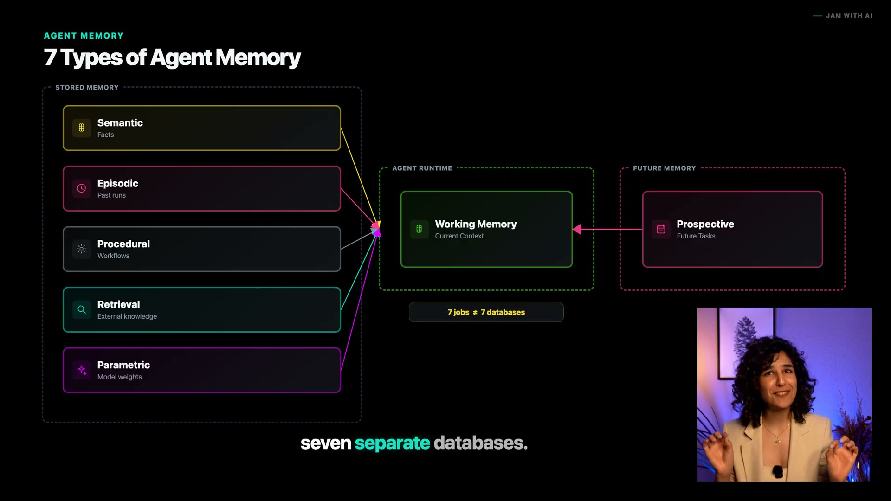
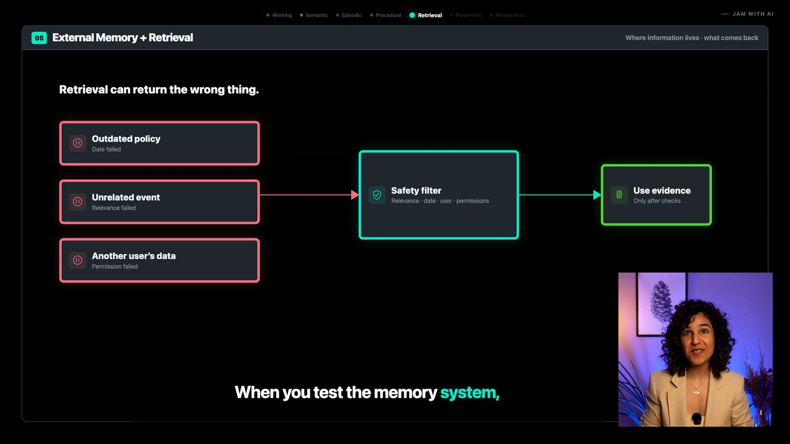
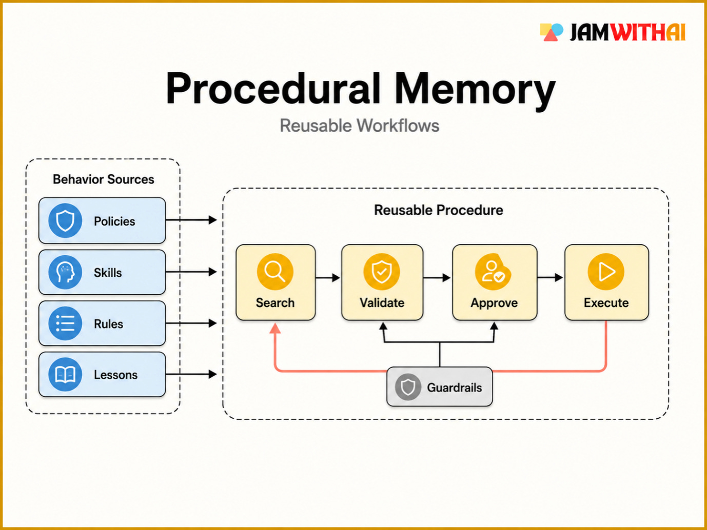
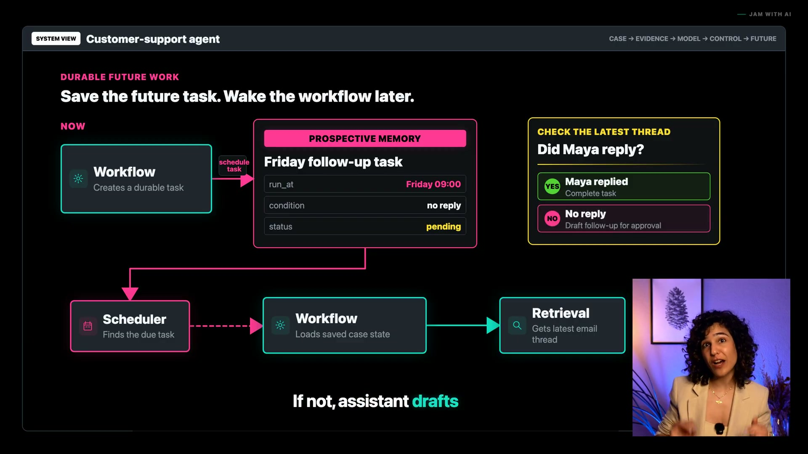

# AI Agent Memory Types

**AI Agent Memory Types** organizes agent state and recall into **seven distinct functional responsibilities** within [[Context Engineering]]: **Working**, **Semantic**, **Episodic**, **Procedural**, **External**, **Parametric**, and **Prospective Memory**. Rooted in cognitive science and **CoALA: Cognitive Architectures for Language Agents** (Sumers et al., 2023) and formalized by [[Jam With AI]] (Shirin Khosravi Jam & Shantanu Ladhwe) across [[Agent Memory The 7 Types You Should Know]] and [[AI Agent Memory 7 Types Explained in 12 Minutes]], this taxonomy emphasizes that **`7 memory jobs != 7 separate databases`** and *"More memory is not a better agent—a better agent forgets on purpose."* Effective systems map these responsibilities onto shared backing stores (`PostgreSQL + pgvector`, `Redis`, `Thread ID` checkpointers, workflow/skill files, durable queues/`Temporal`) around concrete survival, retrieval, forgetting, and wake-up needs.

---

## 1. Seven-Type Functional Comparison Matrix

| Type | What It Stores | Typical Backing Store & Primitives | Lifecycle & Mutability | Primary Failure Mode |
| :--- | :--- | :--- | :--- | :--- |
| **1. Working Memory** | Active prompt context: `System Prompt`, user query, recent `Messages`, `Retrieved Docs`, `Tool Outputs` | LLM **Context Window** paired with **`Thread ID` Checkpointer** (`LangGraph` DB reload-and-resend) / `Redis` buffer + **MemGPT** trimming | Ephemeral per turn/session; summarize, prune, or swap out | **[[Context Rot]]**, rising **real-time latency & cost** even with huge windows, dropping decisive early rules (e.g., AWS ECS vs. EKS constraint) |
| **2. Semantic Memory** | **"What is true"**: durable declarative facts (`Profile`, `Preferences`, `Org Facts`, `Account`) | `PostgreSQL` / per-user isolated `LangGraph` long-term memory store / entity tables | Selective LLM extraction; overwritten on change (`Python -> TypeScript`), explicit validation & user delete/TTL | **A wrong saved fact is worse than none** because agents trust stored facts completely; mixing transient chat (*"short today"*) with standing rules or untrusted web text |
| **3. Episodic Memory** | **"What happened"**: past run diary (`objective`, `actions`, `tool observations`, `errors`, `feedback`, `outcome`, `date`) | Event/trace log + vector/hybrid index paired with **post-run Reflection** (**Generative Agents**) | Append-only runs distilled into **concise lesson summaries**; retrieved by situational similarity | Archival sprawl (*10,000 raw traces without reflection*); repeating past tool failures or matching irrelevant transcripts |
| **4. Procedural Memory** | **"How to work"**: repeatable workflows, SOPs, tool rules, approval gates (`Search -> Validate -> Approve -> Execute` + `Guardrails`) | System prompts, `SKILL.md` ([[Agent Skills Architecture]]), workflow graphs (`LangGraph`), `tool` schemas | Slowly curated via code review / [[Memory Promotion Path]] from repeated episodic lessons | Contradictory rules in giant prompts; skipped guardrails; **bad habit formation from over-promoting one unlucky failure** |
| **5. External Memory (+ Retrieval)** | Knowledge outside the model: docs, SQL/DB records, emails, tickets, knowledge graphs | `PostgreSQL + pgvector`, Vector DBs, SQL, Graph DBs, SaaS APIs, RAG stores | Externally maintained; routed across **5 lookup modes** (vector similarity, **exact SQL/KV**, ACL/category filter, **time window**, **graph/link traversal**) | **Wrong evidence returned**: defaulting to vector search on exact IDs/dates, outdated policies, or **cross-tenant ACL leakage** |
| **6. Parametric Memory** | Broad language, code patterns, and general reasoning capabilities | **Model weights** (pre-training + [[LLM Fine-Tuning and Alignment]]) | Frozen during inference; fine-tuning adjusts style/behavior rather than volatile truth | Out-of-date cutoff facts, zero private data access, confident hallucination if used for mutable facts (*e.g., company expense limits*) |
| **7. Prospective Memory** | **"What to do later"**: deferred tasks, `Schedule`/`Trigger`, `Queue`/`Resume` loop, context, `status`, approver | Durable task table (`Postgres`) + queue/cron/scheduler/**`Temporal`** (Pattern 04 in [[Production AI Resilience and Scaling Patterns]]) | Stateful `Store Now -> Future Task -> Resume Later`; re-check live state on wakeup | **Silent non-execution** when chat ends, nagging forever without `done` criteria, acting on stale state, or **duplicate execution on retries** |

---

## 2. Critical Engineering Distinctions

### A. Two Orthogonal Axes: Stored vs. Active & What vs. Where (CoALA)
- **Stored $\neq$ Active**: Saving `10,000` turns in Postgres or a vector DB changes nothing until your runtime actively loads bytes into the prompt (**Working Memory**). Because unbounded context still raises real-time latency and token cost even in ultra-large windows, **Working Memory must hold only the minimum payload needed for the next good decision** paired with a persistent `Thread ID` **Checkpointer** (save-file reload-and-resend) and **MemGPT**-style paging/summarization.
- **What vs. Where**: **Semantic**, **Episodic**, and **Procedural** define *what* is remembered; **External/Retrieval** and **Parametric** define *where* knowledge lives and *how* it reaches the prompt. Writing memory reliably requires: **(1) selective write gating**, **(2) metadata scoping (`owner + scope + lifetime`)**, **(3) intent-matched filtered retrieval**, and **(4) explicit update/forget paths** (*"More memory is not a better agent—a better agent forgets on purpose"*).

### B. Semantic Memory vs. Semantic Search
- **Semantic Memory**: Stores durable declarative facts (`owner: user_184`, `scope: coding_assistant`, `fact: Prefers TypeScript`).
- **Semantic Search**: One *embedding-similarity lookup* inside **External Retrieval** alongside exact SQL/KV lookup, permission/category filters, temporal/deadline filters, and **graph/link traversal** ([[Retrieval-Augmented Generation and Vector DBs]]).
- **Rule of Thumb**: Never default to vector search when an exact ID lookup or keyword filter works cleanly—route by query intent, enforce **relevance, date, user, and tenant permissions**, and **evaluate retrieval independently** of final LLM answer quality ([[Product Evals and Error Analysis]]).

### C. Episodic Reflection $\rightarrow$ Procedural Guardrails
- **Reflection Over Raw Logs**: Storing raw traces creates a noisy archive; pairing each finished episode with a **short reflection summary** of what worked vs. failed enables effective situational recall.
- **Guardrail Promotion Gate**: Repeated patterns discovered across many episodes (*e.g., deployment crashes caused by missing env variables*) graduate safely into **Procedural Memory** (`Behavior Sources: Policies, Skills, Rules, Lessons` $\rightarrow$ `Reusable Procedure: Search -> Validate -> Approve -> Execute` enclosed by explicit **`Guardrails`**). Never promote a single anomalous failure into a permanent standing rule—route promotions through structured review ([[Memory Promotion Path]]).

### D. Prospective Memory Requires Outside-the-Model Infrastructure
An LLM cannot spontaneously wake itself up next Tuesday or Friday. Prospective memory requires:
1. **Store Now**: Persist a structured task covering **what to do**, **time/event trigger**, **resumption context**, **completion criteria (`status: pending`)**, and **who approves execution** (`cron`, queue, or durable engine such as **`Temporal`**).
2. **Resume Later**: A **Scheduler / Queue** wakes an application worker at trigger time.
3. **Verify & Deduplicate**: **Re-check latest live state** before acting *(Did Maya already reply? Was the task canceled? Is approval still missing?)* + **idempotency keys** so retries never send duplicate emails or repeat side effects.

> ⚠️ **Evolving nuance (July $\rightarrow$ August 2026)**: In the July 2026 Substack guide ([[Agent Memory The 7 Types You Should Know]]), Jam With AI emphasized **CoALA cognitive boundaries (*What vs. Where*)**, **`Thread ID` checkpointers**, **reflection distillation**, and **`Temporal`** task engines. One month later in the August 2026 video ([[AI Agent Memory 7 Types Explained in 12 Minutes]]), the operational stance tightened around three production failure defenses: **(1) validating untrusted external inputs (emails/web pages) before trusting them in Semantic Memory**, **(2) strict ACL/date isolation plus separate retrieval evaluation**, and **(3) live-state re-verification + idempotency keys on Prospective wakeups**.

---

## 3. Four First-Principles Design Questions
Before provisioning databases or frameworks (`Mem0`, `Zep`, `pgvector`, `Redis`, `LangGraph`, `Temporal`), evaluate each requirement against four questions:
1. **What information should survive?** *(Working vs. Semantic vs. Episodic)*
2. **How should it come back?** *(Exact SQL/KV, time/ACL filter, graph traversal, vector similarity, or deterministic prompt injection)*
3. **When should it update or disappear?** *(Overwrite rules, TTL expiration, user deletion, reflection pruning)*
4. **What should wake the system later?** *(Prospective timers, events, queues, live-state re-check, and approval gates)*

> **Goal**: *"Not to remember everything—but to give the agent the right information for the right decision at the right time."*

---

## Related Pages
- **Primary Sources & Entity**: [[Agent Memory The 7 Types You Should Know]], [[AI Agent Memory 7 Types Explained in 12 Minutes]], [[Jam With AI]]
- **Context & Second Brain**: [[Context Engineering]], [[Context Rot]], [[Context Window Management]], [[What Is Context Engineering]], [[Memory Architecture]], [[Memory Promotion Path]], [[Auto Memory]]
- **Runtime Stack & Resilience**: [[Production AI Agent Service Stack]], [[Production AI Resilience and Scaling Patterns]], [[Retrieval-Augmented Generation and Vector DBs]], [[Agent Skills Architecture]], [[Loop Engineering]], [[LLM Fine-Tuning and Alignment]], [[Product Evals and Error Analysis]]
