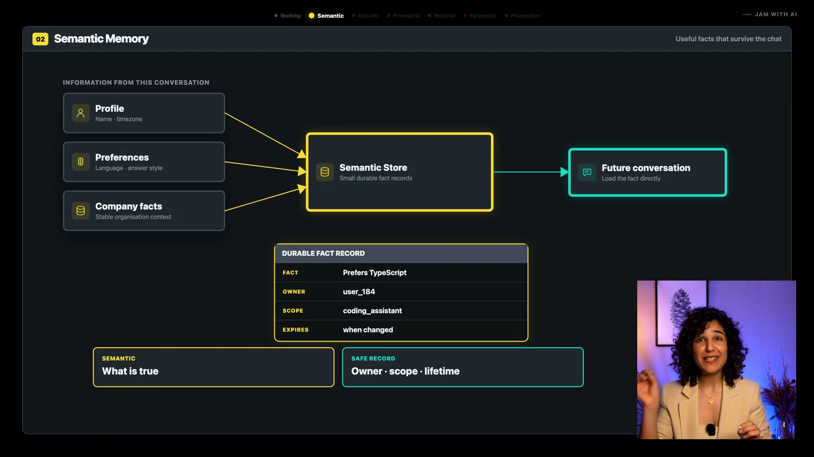

# AI Agent Memory Types

**AI Agent Memory Types** organizes agent state and recall into **seven distinct functional responsibilities** within [[Context Engineering]]: **Working**, **Semantic**, **Episodic**, **Procedural**, **External**, **Parametric**, and **Prospective Memory**. Formalized by Shirin Khosravi Jam ([[Jam With AI]]) in [[AI Agent Memory 7 Types Explained in 12 Minutes]], this taxonomy emphasizes that **`7 memory jobs != 7 separate databases`**: effective systems combine shared backing stores (`PostgreSQL + pgvector`, `Redis`, workflow/skill files, job queues) around concrete survival, retrieval, forgetting, and wake-up needs.

---

## 1. Seven-Type Functional Comparison Matrix

| Type | What It Stores | Typical Backing Store | Lifecycle & Mutability | Primary Failure Mode |
| :--- | :--- | :--- | :--- | :--- |
| **1. Working Memory** | Active prompt context: system rules, user query, recent turns, retrieved docs, tool outputs | LLM **Context Window** (`Redis` for active short-lived thread buffer) | Ephemeral per turn/session; must summarize, prune, or drop | **[[Context Rot]]**, token cost explosion, missed middle details once window bloats |
| **2. Semantic Memory** | **"What is true"**: durable facts, user profiles, persistent preferences, org facts | `PostgreSQL` / structured fact table / entity profile | Updated/overwritten on change (`Python -> TypeScript`); user-editable + optional TTL | **Stale or poisoned facts** if transient chat (`"keep this reply short"`) or untrusted web/email text is saved without owner/scope/validation |
| **3. Episodic Memory** | **"What happened"**: specific past agent runs (goal, actions, tool outputs, errors, outcome, date) | Event/trace log + vector/hybrid index (`Postgres + pgvector`) | Append-only per task run; retrieved by situational similarity | Repeating past tool mistakes or retrieving irrelevant stale episodes |
| **4. Procedural Memory** | **"How to work"**: SOPs, step sequences, tool usage rules, approval gates | System prompts, `SKILL.md` ([[Agent Skills Architecture]]), workflow code (`LangGraph`), `tool` schemas | Slowly curated via code review / [[Memory Promotion Path]] | Agent skips mandatory checks (*validate query*, *ask human before refund*) |
| **5. External Memory (+ Retrieval)** | Knowledge outside the model: docs, DB records, emails, tickets, APIs | `PostgreSQL + pgvector`, Vector DBs, SaaS APIs, RAG stores | Maintained externally; queried via **exact ID lookup, keyword, or embedding search** | **Wrong evidence returned**: outdated policies, off-topic hits, or **cross-tenant ACL leakage** |
| **6. Parametric Memory** | Broad language fluency, code & world patterns | **Model weights** (pre-training + fine-tuning) | Frozen during inference; expensive/slow to update | Out-of-date cutoff facts, zero access to private live data, hallucination if treated as DB |
| **7. Prospective Memory** | **"What to do later"**: deferred tasks, context, `status`, approval rules + triggers (time/event/condition) | Durable task table (`Postgres`) + queue/scheduler (Pattern 04 in [[Production AI Resilience and Scaling Patterns]]) | Stateful `pending -> completed / canceled`; must re-check live world state on wakeup | **Silent non-execution** when chat ends, acting on stale state, or **duplicate execution on scheduler retries** |

---

## 2. Critical Engineering Distinctions

### A. Saving Information $\neq$ Remembering It
Storing `10,000` raw chat turns provides zero leverage unless the pipeline enforces four guarantees: **(1) selective write gating** *(never persist untrusted tool payloads or one-off instructions as permanent facts)*, **(2) metadata scoping (`owner + scope + lifetime`)**, **(3) filtered retrieval** *(user + team + recency)*, and **(4) explicit update/forget paths**.

### B. Semantic Memory vs. Semantic Search
- **Semantic Memory**: Stores durable declarative facts (`owner: user_184`, `scope: coding_assistant`, `fact: Prefers TypeScript`).
- **Semantic Search**: An *embedding-similarity lookup algorithm* used inside **Retrieval** over External or Episodic Memory ([[Retrieval-Augmented Generation and Vector DBs]]).
- **Rule of Thumb**: Never default to vector search when an exact ID lookup or keyword filter works cleanly—always filter retrieval by **relevance, date, user, and permissions**, and **evaluate retrieval independently** of final LLM answer quality ([[Product Evals and Error Analysis]]).

### C. Prospective Memory Requires Outside-the-Model Infrastructure
An LLM cannot spontaneously wake itself up next Friday. Prospective memory requires:
1. Persisting a structured task (`run_at`, `condition`, context pointer, `status: pending`, approval gate).
2. A **Scheduler / Message Queue** waking the application worker at trigger time.
3. **Re-checking latest live state** before acting *(Did Maya already reply? Was the task canceled? Is approval still missing?)* + **idempotency keys** so retries never send the same email or trigger side effects twice.

---

## 3. Four First-Principles Design Questions
Before provisioning databases or frameworks (`Mem0`, `Zep`, `pgvector`, `Redis`), evaluate each requirement against four questions:
1. **What information should survive?** *(Working vs. Semantic vs. Episodic)*
2. **How should it come back?** *(Exact ID, keyword filter, vector similarity, or deterministic prompt injection)*
3. **When should it update or disappear?** *(Overwrite rules, TTL expiration, user deletion)*
4. **What should wake the system later?** *(Prospective timers, events, queues, and approval gates)*

> **Goal**: *"Not to remember everything—but to give the agent the right information for the right decision at the right time."*

---

## Related Pages
- **Primary Source & Entity**: [[AI Agent Memory 7 Types Explained in 12 Minutes]], [[Jam With AI]]
- **Context & Second Brain**: [[Context Engineering]], [[Context Rot]], [[Context Window Management]], [[Memory Architecture]], [[Memory Promotion Path]], [[Auto Memory]]
- **Runtime Stack & Resilience**: [[Production AI Agent Service Stack]], [[Production AI Resilience and Scaling Patterns]], [[Retrieval-Augmented Generation and Vector DBs]], [[Agent Skills Architecture]], [[Loop Engineering]], [[Product Evals and Error Analysis]]
