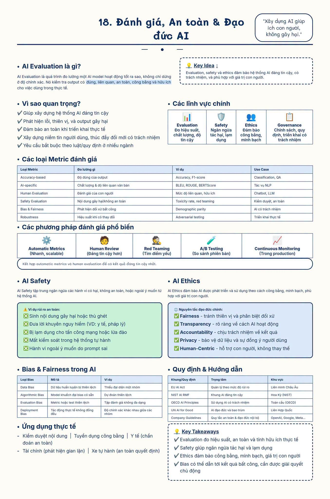

# AI Evaluation, Safety and Governance

**AI Evaluation, Safety, Ethics, and Governance** ensure that deployed AI systems are not only accurate on static benchmarks, but also reliable, fair, robust against misuse, accountable, and compliant with organizational and statutory guardrails ([[AI Complete Handbook]], Page `18.jpg`).

---

## 1. Multi-Dimensional Evaluation Metrics & Methods

Production evaluation extends beyond classical `Accuracy` and `F1-Score` (covered in [[Model Evaluation and Validation]]) into specialized generative, safety, fairness, and robustness signals:

| Metric Category | What It Measures | Representative Metrics / Probes | Primary Use Case |
| :--- | :--- | :--- | :--- |
| **Accuracy-Based** | Ground-truth output correctness | `Accuracy`, `Precision`, `Recall`, `F1` | Classification, extractive QA |
| **NLP / Generative** | Text quality & semantic overlap | `BLEU`, `ROUGE`, `BERTScore`, `MMLU`/`GSM8K`/`TruthfulQA`/`HELM` | Translation, summarization, LLM capability baselines (*benchmarks $\neq$ real-world utility*) |
| **Human Evaluation** | Perceived helpfulness, coherence, factuality | Side-by-side human ratings | Open-ended Chatbots & LLMs |
| **Safety Evaluation** | Harmful, toxic, or disallowed output propensity | `Toxicity Rate` (`0–1` via `Perspective API`, `Detoxify`, `HateCheck`), `Red Teaming` | Content moderation, jailbreak defense ([[LLM Handwritten Study Guide 15 Pages]]) |
| **Bias & Fairness** | Disparate outcomes across demographic subgroups | `Demographic Parity` | Responsible hiring, credit, healthcare AI |
| **Robustness** | Stability under perturbation or distribution shift | `Adversarial Testing` | Safety-critical real-world deployment |

### Five Operational Evaluation Methods
1. **Automatic Metrics**: Fast, scalable regression gates across datasets (see [[LLM-as-a-Judge and Eval Alignment]]).
2. **Human Review**: Gold-standard qualitative inspection on traces (see [[Product Evals and Error Analysis]]).
3. **Red Teaming**: Adversarial probing to uncover safety exploits and prompt-injection blind spots.
4. **A/B Testing**: Controlled live traffic comparison between candidate versions.
5. **Continuous Monitoring**: Ongoing production telemetry catching drift and silent regressions after release.

---

## 2. AI Safety, Bias Taxonomy & Ethical Principles

### AI Safety Risk Surface
AI Safety mitigates five operational hazards:
1. Generating hateful, abusive, or unsafe content.
2. Issuing dangerous medical, legal, or financial advice.
3. Abuse for cyberattacks, phishing, or large-scale fraud.
4. Loss of human control in autonomous agentic loops.
5. Unintended harmful side effects triggered by poorly specified prompts or objectives (see [[LLM Inference Optimization and Security]] and [[Software Supply Chain Security]]).

### Four Sources of AI Bias
| Bias Type | Mechanism | Concrete Example |
| :--- | :--- | :--- |
| **Data Bias** | Historical skew or subgroup under-representation in training sets | Clinical dataset lacking minority age/ethnic cohorts |
| **Algorithmic Bias** | Model optimization amplifies minor correlations present in data | Ranking algorithm over-weighting correlated proxy variables |
| **Evaluation Bias** | Unrepresentative test suites mask failure on edge cohorts | Testing speech recognition solely on clean studio English |
| **Deployment Bias** | Real-world usage produces unequal error rates across groups | Identical loan threshold yields higher false rejections for one region |

### Five Core AI Ethics Pillars
- **Fairness**: Preventing systemic discrimination and demographic bias.
- **Transparency**: Making system capabilities, limitations, and decision factors understandable.
- **Accountability**: Assigning explicit human/organizational ownership for AI outcomes.
- **Privacy**: Safeguarding user data with explicit consent and strict access boundaries.
- **Human-Centric Design**: Augmenting human agency rather than displacing oversight.

---

## 3. Global Governance & Regulatory Frameworks

| Framework / Standard | Issuing Body / Jurisdiction | Core Focus |
| :--- | :--- | :--- |
| **EU AI Act** | European Union | **Risk-tiered statutory regulation** (prohibiting unacceptable risk, strict obligations for high-risk medical/hiring/credit systems) |
| **NIST AI RMF** | US National Institute of Standards and Technology | **AI Risk Management Framework** (`Govern, Map, Measure, Manage`) for trustworthy systems |
| **OECD AI Principles** | Organisation for Economic Co-operation and Development | Intergovernmental norms for inclusive, transparent, and accountable AI stewardship |
| **UN AI for Good** | United Nations | Global sustainable development alignment and equitable ethical guardrails |
| **Company Guidelines** | Model Providers (`OpenAI`, `Anthropic`, `Google`, `Meta`) | Internal model specs ([[Model Specification (Spec)]]), acceptable-use policies, and frontier safety commitments |

---

## Related Pages
- **Sources**: [[AI Complete Handbook]], [[LLM Handwritten Study Guide 15 Pages]]
- **Empirical Evals**: [[Product Evals and Error Analysis]], [[LLM-as-a-Judge and Eval Alignment]], [[Closed-Loop Evals]], [[Model Evaluation and Validation]]
- **Security & Trust**: [[LLM Inference Optimization and Security]], [[Software Supply Chain Security]], [[Cloud Agent Sandbox and Auto Mode]]
