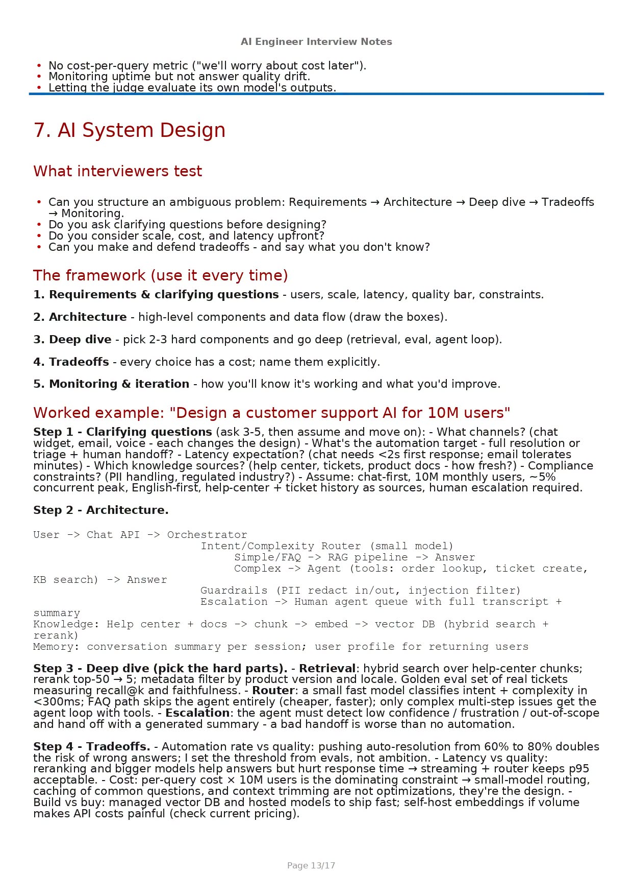

# AI System Design and Production Architecture

**AI System Design and Production Architecture** synthesizes how production LLM applications—chatbots, RAG systems, and tool-using agents—are architected, costed, bounded for safety, and iterated post-launch. Anchored by the **5-Step System Design Framework** and **The Meta Pattern** in [[AI Engineer Interview Notes]] (`koteswar.AI`), every architectural component must be justified by measurable business impact, unit economics, latency budgets, and evaluation metrics.



---

## 1. The Meta Pattern & 5-Step Design Framework

Across senior AI system design reviews, strongest designs connect every mechanism to **evaluation numbers, latency percentiles (`p50/p95 TTFT`), and unit economics (`cost per query/conversation × volume`)**: *"Build systems, measure them, understand tradeoffs."*

### Five-Step Architectural Blueprint
1. **Requirements & Clarifying Questions**: Pin user channels, daily/monthly volume & peak concurrency, latency targets (`<2s` streaming first token for chat vs minutes for email), quality bar, knowledge freshness, and compliance boundaries (`PII`, ACLs). State assumptions explicitly before drawing boxes.
2. **High-Level Architecture & Routing**: Separate cheap/fast deterministic paths (`RAG` for single-turn FAQ) from expensive multi-turn loops (`Agents`) at ingestion/routing rather than running `"GPT-4 / full agent loops for everything"`.
3. **Deep Dive (2–3 Hardest Components)**: Focus deeply on retrieval architecture, evaluation/safety gates, and agent/escalation boundaries.
4. **Explicit Tradeoffs**: Name the exact latency, cost, or error-rate price of each design decision.
5. **Monitoring & Iteration Loop**: Instrument live traces and human escalations into weekly regression fixes.

---

## 2. Reference Architecture: 10M-User Customer Support AI

Designed for `10M` monthly users (`~5%` concurrent peak), `<2s` perceived first response via streaming, and strict PII/ACL compliance:

```
User ─▶ Chat API ─▶ Orchestrator
                      │
                      ├─▶ Guardrails (Input/Output PII redaction + injection filter)
                      │
                      └─▶ Intent/Complexity Router (<300ms small model)
                            ├─ Simple/FAQ ──▶ RAG Pipeline (Top-50 Hybrid -> Top-5 Rerank) ─▶ Streaming Reply
                            ├─ Complex ─────▶ Tool Agent (order lookup, ticket create, KB search) ─▶ Reply
                            └─ Low Confidence / Out-of-Scope ─▶ Human Escalation Queue (Full Transcript + Summary)
```

### Key Architectural Choices & Deep Dives
- **Small-Model Routing (`<300ms`)**: Classifies intent and complexity upfront so high-volume FAQ lookups bypass expensive multi-step agent loops entirely.
- **Pre-Retrieval ACL & Hybrid Retrieval**: Chunks carry access-control metadata filtered *before* vector search (the model never sees unauthorized docs); Hybrid search (`Dense + BM25`) catches SKUs, error codes, and IDs before a cross-encoder reranks `Top-50 -> Top-5`.
- **Escalation Boundary as the Hardest Subproblem**: Tune confidence/frustration handoff thresholds empirically from real conversation failure rates rather than intuition—delivering both full transcript and an AI-generated summary to human agents.
- **Iteration Flywheel**: Ship the minimal FAQ RAG path first; perform weekly human triage on the **Escalation Queue** across four failure buckets (*retrieval gaps*, *reasoning errors*, *missing docs*, *policy gaps*) before rolling out gated fixes on golden eval sets.

---

## 3. Production Agent Guardrails & Memory Separation

When tasks genuinely require multi-step execution over fixed chains (and justify orchestration complexity via clear role handoffs in multi-agent setups):

- **Deterministic Tool Contracts**: Define strict JSON schemas with `descriptions`, `required` fields, and `enums` (avoid vague `"query: string"` parameters); validate inputs pre-execution; **return clear actionable error hints as tool observations** (not raw stack traces) so the model self-corrects; mark read tools **idempotent** while gating irreversible writes behind HITL approval.
- **Hard Execution Bounds**: Enforce max iteration caps, per-tool retry limits, per-run token/cost budgets + kill switches, loop repetition detection, and full trajectory logging (evaluating the *path*, not solely the final string; see [[Loop Engineering]] & [[Comprehension and Intent Debt]]).
- **Short-Term vs. Long-Term Memory**: *Short-term (working) memory* is a **context-window management problem** (sliding windows, summarization); *Long-term memory* is a **data-engineering problem** (persistent profile + vector store paired with explicit write, retrieval, and forgetting/update rules—because stale memory is worse than none; see [[Memory Architecture]]).

---

## 4. Latency, Cost Levers & Strategy Escalation

### Latency & Unit Economics Cheat Sheet
| Production Lever | Latency Impact | Cost Impact | Primary Use Case |
| :--- | :--- | :--- | :--- |
| **Token Streaming** | Drops perceived delay to `TTFT` | Neutral | All interactive chat interfaces |
| **Exact & Semantic Prompt Caching** | Faster prefill / bypassed inference | $\downarrow\downarrow$ | Repeated system prompts & common FAQ queries (see [[System Prompt Caching Optimization]]) |
| **Small-Model Routing** | $\downarrow$ | $\downarrow\downarrow$ | Handling easy/FAQ traffic (`90%+` quality at `~10%` cost; see [[Effort Level and Model Selection]]) |
| **Context Trimming** | Faster prefill | $\downarrow$ tokens | Capping retrieved chunks (`5` vs `50`) to suppress noise & [[Context Rot]] |
| **Cross-Encoder Reranking** | Slight $\uparrow$ | Slight $\uparrow$ | Precision boost (`Top-50 -> Top-5`) when entity/multi-doc accuracy plateaus |

### Build-vs-Train Escalation Decision Rule
1. **Prompting** *(Zero-shot $\rightarrow$ Few-shot $\rightarrow$ CoT)*: Cheapest to iterate; wins on formatting, tone, and structured reasoning.
2. **RAG**: Required for dynamic, external, or proprietary knowledge needing explicit citations and strict grounding (`recall@k` + `faithfulness`).
3. **Fine-Tuning (`LoRA` / Distillation)**: Chosen only after prompting + RAG prove insufficient—used to bake in consistent style/format across high call volumes (`100s+` curated examples) or distill a specialized task into a smaller, lower-latency model (**never** used to teach rapidly changing facts).

---

## 5. Surrounding Production Infrastructure & Traffic Layer (7 Patterns)

While Sections 1–4 optimize what happens *inside* the core AI service (implemented cleanly via the 9-layer Python application stack in [[Production AI Agent Service Stack]] / [[How a Production AI Agent System Actually Works]]: `FastAPI`/`Uvicorn`, `Pydantic` validation, `LangGraph` checkpoints, `Postgres + pgvector`, `Redis`, `LiteLLM`, `Langfuse`/`Opik`, and `Pytest` + AI Evals), scaling cleanly to `10,000+` concurrent users requires wrapping that unchanged core service in **seven outer request-lifecycle patterns** detailed in [[Production AI Resilience and Scaling Patterns]] and [[AI System Design 7 Patterns Explained in 17 Minutes]]:

1. **API Gateway vs. Model Gateway**: Centralize inbound validation, `request_id` tagging, and service routing without replacing FastAPI, while keeping outbound provider calls (`OpenAI`, `Anthropic`, local GPUs) behind an outbound model gateway.
2. **Admission Control & Token-Aware Rate Limiting**: Gate **Start / Wait / Reject (`HTTP 429 Retry-After`)** using **RPM + input/output TPM + active model calls** rather than naive request counts alone.
3. **Tenant-Scoped Caching**: Reuse embeddings, chunks, and vetted answers in **Redis** only under strict `tenant + permission + version/TTL` cache keys.
4. **Message Queues & Lane Isolation**: Offload long tasks (ingestion, batch embeddings, reports) with separate **Live (Reserved)** vs. **Batch (Capped)** worker pools, **DLQs**, and **idempotent** jobs.
5. **Timeouts, Jittered Retries, Circuit Breakers & Bulkheads**: Isolate provider failures (`CLOSED -> OPEN -> HALF-OPEN`), pair circuit trips with graceful verified fallbacks (never fabricate missing info), and avoid retry storms.
6. **Stateless Load Balancing & External State**: Keep replicas stateless by storing durable checkpoints in **PostgreSQL** and short-lived coordination state in **Redis**.
7. **Demand-Driven Autoscaling**: Scale on waiting-work signals (**queue depth, oldest wait time, active requests, GPU utilization**—never CPU alone), pre-warm GPU model servers for cold-start heavy weights, and **control work before adding capacity**.

---

## Related Pages
- **Sources**: [[AI Engineer Interview Notes]], [[AI Deployment Notes]], [[How a Production AI Agent System Actually Works]], [[AI System Design 7 Patterns Explained in 17 Minutes]], [[System Design for AI Engineers 7 Patterns]], [[System Design for Engineers 162 Concepts]]
- **Infrastructure & Entities**: [[Production AI Agent Service Stack]], [[Production AI Resilience and Scaling Patterns]], [[System Design 162 Concepts Resource Map]], [[Jam With AI]], [[Inference Serving and Deployment Patterns]], [[LLM Inference Optimization and Security]]
- **Retrieval & Alignment**: [[Retrieval-Augmented Generation and Vector DBs]], [[LLM Fine-Tuning and Alignment]], [[Prompt Engineering]]
- **Evals & Economics**: [[LLM-as-a-Judge and Eval Alignment]], [[Product Evals and Error Analysis]], [[Cost Optimization]], [[Inference Speed vs Intelligence Trade-off]]
- **Agents & Serving**: [[Agentic Engineering]], [[Domain-Specific Agents]], [[Memory Architecture]]
