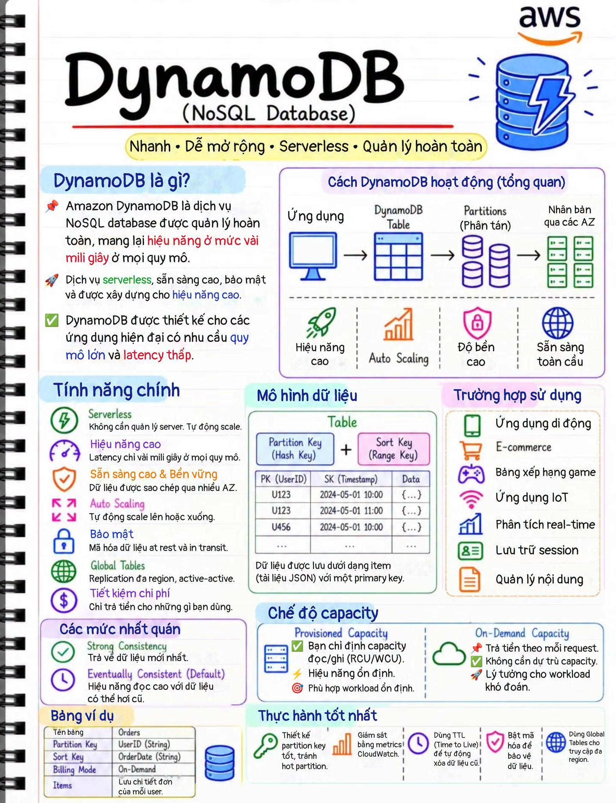
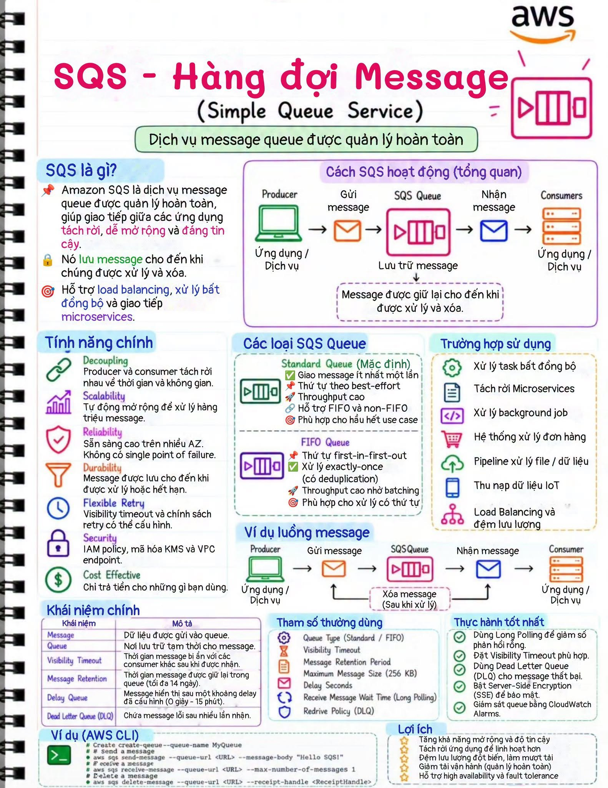
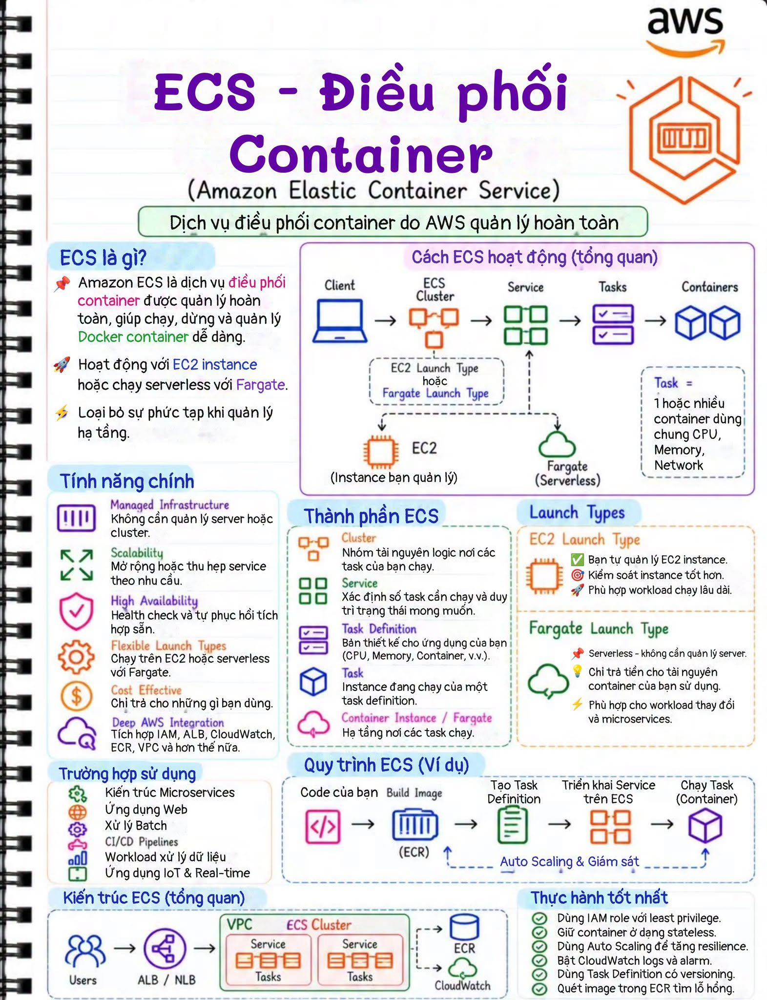
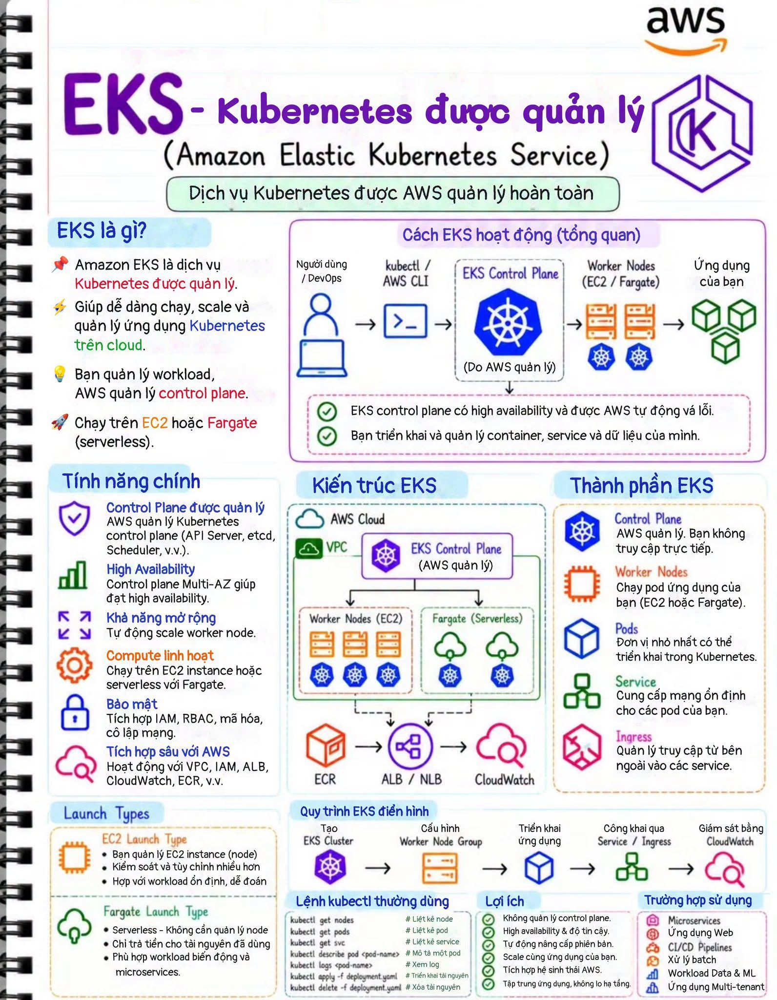

# AWS Databases, Containers and Messaging

Managed persistence, asynchronous decoupling, and container orchestration primitives in [[Amazon Web Services (AWS)|AWS]]—comparing relational **RDS** vs. serverless NoSQL **DynamoDB**, queuing in **SQS**, and container execution across **ECR**, **ECS**, and **EKS**. Synthesized from [[AWS Core Services Notes]] (Pages 8–13).

---

## 1. Relational vs. Serverless NoSQL Databases (`RDS` vs. `DynamoDB`)

| Dimension | Amazon RDS (Relational) | Amazon DynamoDB (NoSQL) |
| :--- | :--- | :--- |
| **Data Model** | Relational tables connected via SQL (`MySQL`, `PostgreSQL`, `MariaDB`, `Oracle`, `SQL Server`, `Amazon Aurora`) | Key-value & JSON document items keyed by **Partition Key (Hash)** + optional **Sort Key (Range)** |
| **Operations & Scaling** | Managed provisioning, patching, backups, **PITR**, **Multi-AZ failover** (`AZ-A ↔ AZ-B`), EBS SSD + Storage Auto Scaling | Completely **serverless**, millisecond latency at any scale, automatic AZ-replicated **Partitions**, optional **Global Tables** (active-active multi-region) |
| **Consistency & Capacity** | ACID relational guarantees; instance classes (`db.t3.small/medium`, `db.r5.large`) with On-Demand / Reserved billing | **Strong Consistency** vs. **Eventually Consistent (Default)** reads; **Provisioned (`RCU/WCU`)** vs. **On-Demand** pay-per-request |
| **Critical Best Practices** | Run Multi-AZ in production, enable automated backups, encrypt at-rest/in-transit, IAM access | Design high-cardinality partition keys to **avoid hot partitions**; enable **TTL** to auto-expire stale items |

---

## 2. Asynchronous Message Decoupling (`SQS`)

**Amazon SQS (Simple Queue Service)** decouples Producers and Consumers across time and space, absorbing burst traffic in microservice and AI/data processing pipelines:
- **Standard Queue (Default)**: Unlimited-scale high throughput with **at-least-once delivery** and **best-effort ordering**.
- **FIFO Queue**: Strict **First-In-First-Out** ordering and **exactly-once processing** (via deduplication) with batching support.
- **Reliability Parameters**: Max message payload `256 KB`; configurable **Visibility Timeout** (hides in-flight message from duplicate consumers); **Message Retention** up to `14 days`; **Delay Queues**; **Long Polling** (`ReceiveMessageWaitTime`) to cut empty poll costs; and **Dead Letter Queues (`DLQ`)** + Redrive Policy for poison messages.

---

## 3. Container Registry & Orchestration (`ECR`, `ECS`, `EKS`)

Containers standardize AI inference servers and backend microservices (see [[Model Packaging and Versioning]] and [[Inference Serving and Deployment Patterns]]):

- **ECR (Elastic Container Registry)**: Fully managed Docker registry (`<acct>.dkr.ecr.<region>.amazonaws.com/repo:tag`) replicated across AZs, integrated with IAM roles, KMS encryption, **Amazon Inspector** automated CVE vulnerability scanning, and Lifecycle Policies to prune stale image tags.
- **ECS vs. EKS Orchestration Comparison**:
  - **Amazon ECS** (AWS-native): Organizes `Cluster -> Service -> Task Definition -> Task` (one or more containers sharing CPU/RAM/Network). Supports both **EC2 Launch Type** (direct host control, steady workloads) and **Fargate Launch Type** (**serverless** container billing without managing underlying EC2 nodes).
  - **Amazon EKS** (Managed Kubernetes): AWS manages and patches the Multi-AZ **Control Plane** (`API Server`, `etcd`, `Scheduler`); engineering teams manage **Worker Nodes** (`EC2` instances or `Fargate` serverless) running Kubernetes `Pods`, `Service`, and `Ingress` (fronted by `ALB/NLB`), operated via standard `kubectl` workflows (`get`, `describe`, `logs`, `apply`, `delete`).

---

## Related Pages
- **Sources**: [[AWS Core Services Notes]]
- **Entities**: [[Amazon Web Services (AWS)]], [[Viet Nguyen AI]]
- **Concepts**: [[AWS Foundation, Networking and Compute]], [[AWS Observability and Cryptographic Security]], [[Model Packaging and Versioning]], [[Inference Serving and Deployment Patterns]], [[AI Deployment Lifecycle and Environments]]
