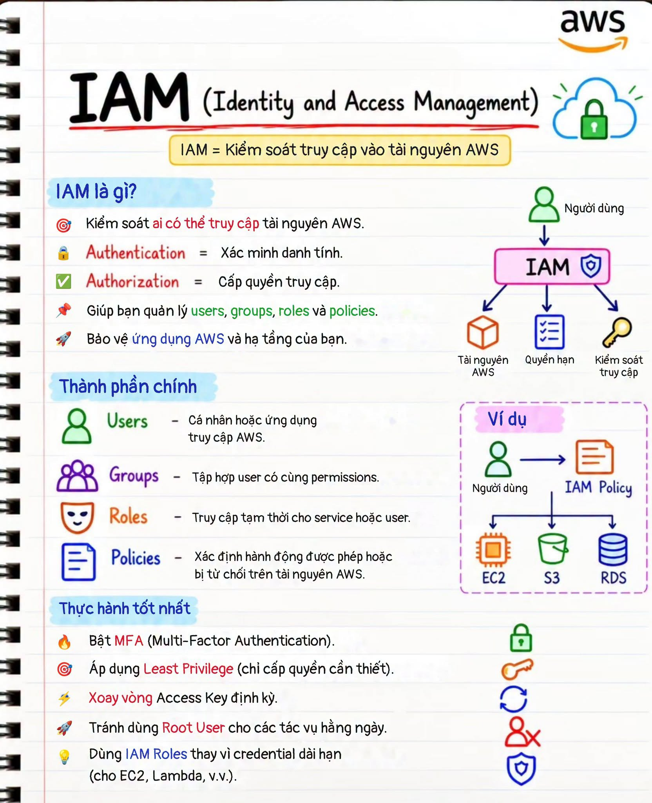
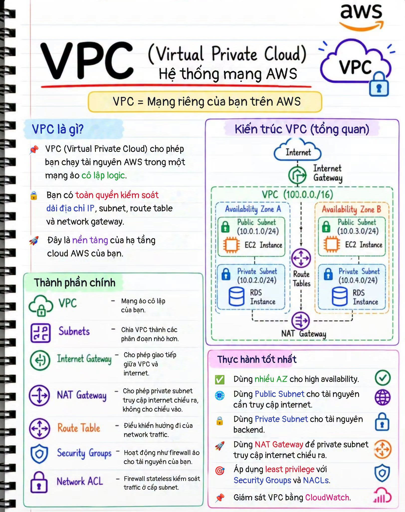
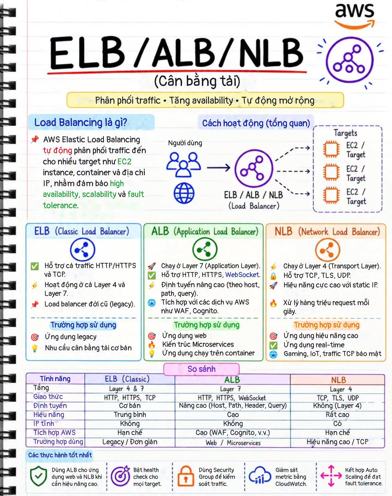

# AWS Foundation, Networking and Compute

Core global infrastructure, identity access control, virtual private networking, virtualized compute/block storage, load balancing, and DNS routing primitives in [[Amazon Web Services (AWS)|AWS]]. Synthesized from [[AWS Core Services Notes]] (Pages 1–7).

---

## 1. Global Infrastructure & Identity (`Regions`, `AZ`, `IAM`)

- **AWS Regions & Availability Zones**:
  - **Region** (`us-east-1`, `ap-southeast-1`, `eu-central-1`): Logically and physically isolated geographic location containing multiple independent **Availability Zones (AZs)** (`us-east-1a`, `1b`, `1c`), each backed by physical **Data Centers**; **Edge Locations** power CloudFront CDN delivery closer to users.
  - Design trade-offs balance **Latency** (nearest region), **High Availability & Disaster Recovery** (multi-AZ + cross-region backups), **Data Residency Compliance**, and regional cost differences.
- **IAM (Identity and Access Management)**:
  - Decouples **Authentication** (*who you are*) from **Authorization** (*what actions on which resources are allowed/denied*).
  - Primitives: **Users** (people/apps), **Groups** (permission bundles), **Roles** (temporary assumed credentials for EC2/Lambda/services), and JSON **Policies**.
  - Operational security baseline: enforce **MFA**, apply **Least Privilege**, avoid Root User for daily tasks, rotate access keys, and strongly prefer **IAM Roles** over static long-lived keys.

---

## 2. Virtual Private Networking (`VPC`)

A **VPC** provides a logically isolated virtual network (full control over IP CIDR block, e.g., `10.0.0.0/16`, subnets, route tables, and gateways):
- **Public vs. Private Subnets**: Public subnets route outbound/inbound internet traffic via an **Internet Gateway (IGW)** (hosting public-facing EC2 / Load Balancers); Private subnets hold backend services and databases (`RDS`), reaching the internet outbound-only through a **NAT Gateway**.
- **Defense-in-Depth Firewalls**:
  - **Security Groups**: Stateful virtual firewalls bound to instances/ENI resources.
  - **Network ACLs (NACLs)**: **Stateless** subnet-level packet filters.
- Deploy workloads across **Multi-AZ** subnets with Least Privilege SG/NACL rules and monitor traffic via VPC Flow Logs in CloudWatch.

---

## 3. Compute & Persistent Block Storage (`EC2` & `EBS`)

- **EC2 (Elastic Compute Cloud)**: Virtual servers parameterized by **AMI** (OS/template), **Instance Type** (CPU/RAM/network tier), attached **EBS** storage, and **Security Groups**. Combine **Auto Scaling + Load Balancing** with CloudWatch monitoring and regular OS patching.
- **EBS (Elastic Block Store)**: Persistent block volumes attached to EC2, **automatically replicated within a single AZ** so data survives instance stops/reboots, supporting point-in-time **Snapshots** and **KMS** encryption:
  - `gp3` (General Purpose SSD): Balanced cost/performance default for most workloads.
  - `io2` / `io1` (Provisioned IOPS SSD): Ultra-low latency, mission-critical IOPS databases.
  - `st1` (Throughput Optimized HDD): Big data / streaming / data lake sequential throughput.
  - `sc1` (Cold HDD): Lowest-cost archival block storage for infrequently accessed data.

---

## 4. Traffic Distribution & DNS (`ELB/ALB/NLB` & `Route 53`)

| Dimension | Classic ELB | ALB (Application Load Balancer) | NLB (Network Load Balancer) |
| :--- | :--- | :--- | :--- |
| **OSI Layer** | Layer 4 & Layer 7 | **Layer 7** (Application) | **Layer 4** (Transport) |
| **Protocols** | HTTP, HTTPS, TCP | HTTP, HTTPS, **WebSocket** | TCP, TLS, UDP |
| **Routing Power** | Basic | Advanced (`Host`, `Path`, `Header`, `Query`) | Pass-through L4 |
| **Throughput / IP** | Moderate / Dynamic | High / Dynamic | **Extreme** (millions RPS) / **Static IP** |
| **AWS Integration** | Limited | Rich (`WAF`, `Cognito`, target groups) | Limited |
| **Best Fit** | Legacy apps | Web apps, Microservices, ECS/EKS containers | Gaming, IoT, real-time low-latency TCP |

- **Route 53**: Highly available authoritative DNS mapping domains inside **Hosted Zones** (`A`, `AAAA`, `CNAME`, `MX`, `TXT` records) coupled with **DNSSEC**, active **Health Checks** (HTTP/HTTPS/TCP), and **8 Routing Policies**: *Simple, Weighted, Latency, Failover, Geolocation, Geoproximity (with bias), Multivalue Answer, and IP-based*.

---

## Related Pages
- **Sources**: [[AWS Core Services Notes]]
- **Entities**: [[Amazon Web Services (AWS)]], [[Viet Nguyen AI]]
- **Concepts**: [[AWS Databases, Containers and Messaging]], [[AWS Observability and Cryptographic Security]], [[Inference Serving and Deployment Patterns]], [[AI Deployment Lifecycle and Environments]]
