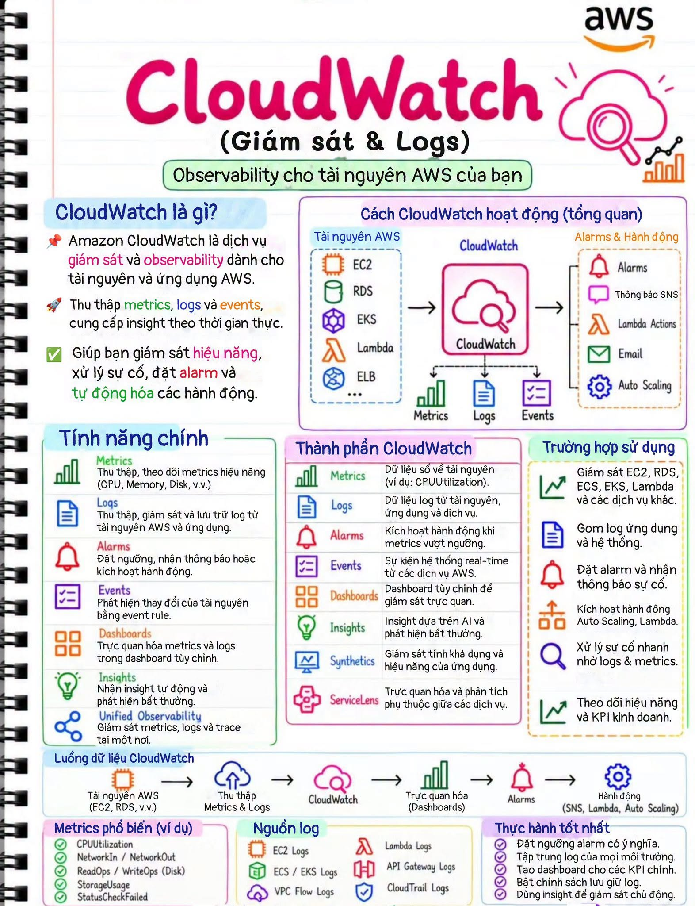
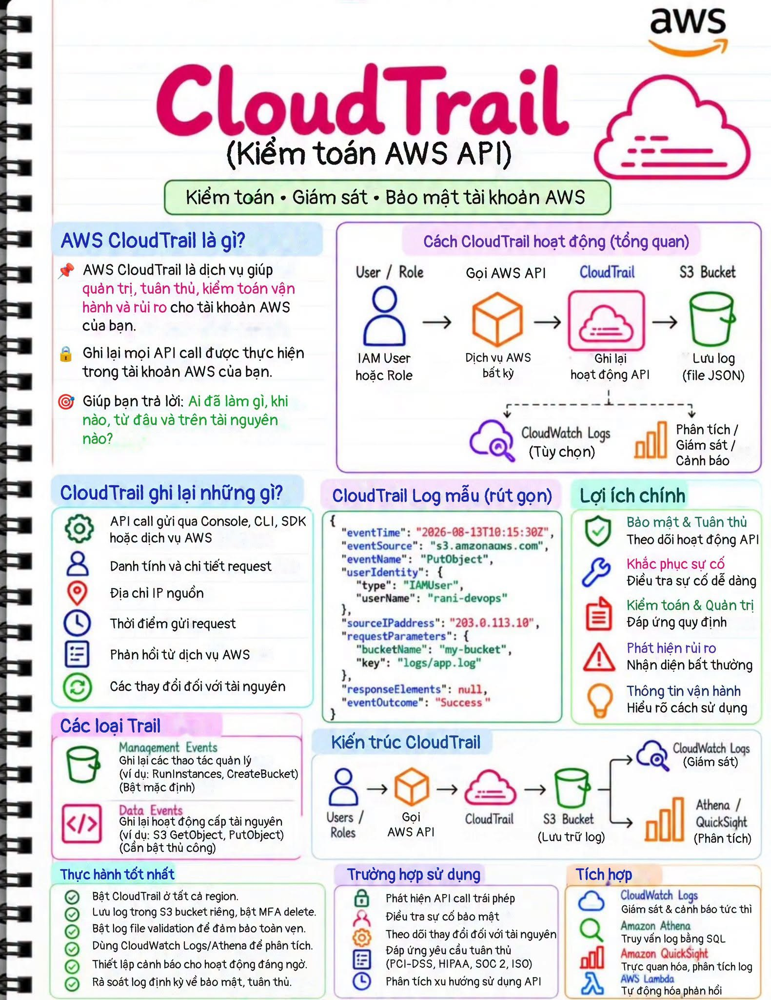
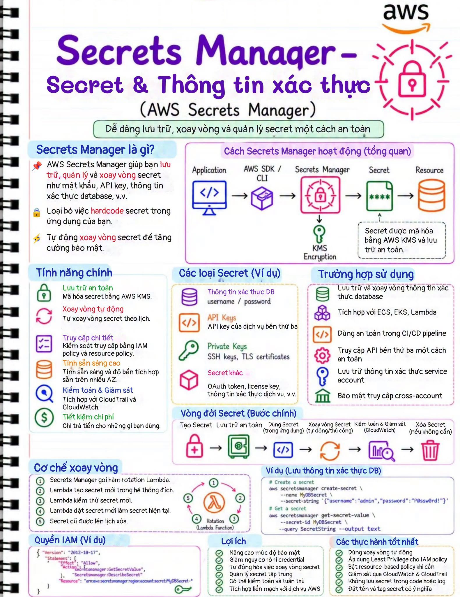
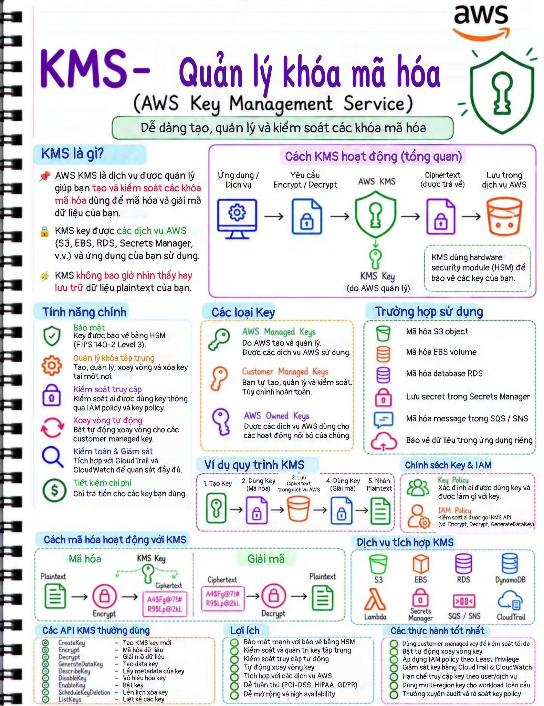

# AWS Observability and Cryptographic Security

Operational telemetry, immutable API governance auditing, dynamic credential rotation, and hardware-backed encryption across [[Amazon Web Services (AWS)|AWS]]. Synthesized from [[AWS Core Services Notes]] (Pages 14–17).

---

## 1. Unified Observability (`CloudWatch`) vs. API Auditing (`CloudTrail`)

A frequent architectural distinction in AWS operations separates *system health/performance* from *control-plane accountability*:

| Capability | Amazon CloudWatch | AWS CloudTrail |
| :--- | :--- | :--- |
| **Core Purpose** | Real-time performance observability, logs, alarms, and automated remediation | Account governance, compliance (`PCI-DSS`, `HIPAA`, `SOC 2`, `ISO`), and **API audit trail** (*who, what, when, source IP, resource*) |
| **Signal Types** | **Metrics** (`CPUUtilization`, `NetworkIn/Out`, `ReadOps/WriteOps`, `StatusCheckFailed`), **Logs** (`EC2`, `ECS/EKS`, `VPC Flow Logs`, `Lambda`, `API Gateway`), **Events**, **Insights** (anomaly detection), **Synthetics**, **ServiceLens** | **Management Events** (`RunInstances`, `CreateBucket` — on by default) and **Data Events** (`S3 GetObject/PutObject` — explicit opt-in) |
| **Storage & Action Flow** | Dashboards & Alarms trigger **SNS**, **Lambda**, Email, or **Auto Scaling** | Immutable JSON logs archived to hardened **S3 Bucket** (MFA Delete + **Log File Validation**) -> analyzed via **CloudWatch Alarms**, **Athena (SQL)**, **QuickSight**, and **Lambda** |

---

## 2. Dynamic Credentials (`AWS Secrets Manager`)

**AWS Secrets Manager** eliminates hardcoded DB credentials, third-party API keys, OAuth tokens, and SSH/TLS private keys from application codebases and logs:
- Stores secrets encrypted at rest under **AWS KMS** with Least Privilege IAM & Resource-based policies (supporting cross-account access).
- **5-Step Automated Rotation Cycle (via Lambda)**:
  1. Secrets Manager invokes the rotation **Lambda function**.
  2. Lambda creates a new secret version inside the target resource (e.g., RDS).
  3. Lambda tests authentication against the target with the new secret.
  4. Lambda promotes the new version to current.
  5. Old secret version is scheduled for deprecation/deletion.

---

## 3. Hardware-Backed Key Governance (`AWS KMS`)

**AWS Key Management Service (KMS)** creates and enforces cryptographic key policies protected inside **FIPS 140-2 Level 3 Hardware Security Modules (HSMs)** without ever reading or storing user plaintext:
- **Three Key Tiers**:
  1. **Customer Managed Keys (CMK)**: Created, customized, rotated, and policy-governed by the customer (*recommended for strict control and compliance*).
  2. **AWS Managed Keys**: Created and rotated by AWS specifically for integrated services.
  3. **AWS Owned Keys**: Internal multi-tenant keys managed transparently by AWS services.
- **Dual Authorization Boundary**: Access requires agreement between **Key Policy** (attached to the KMS key defining allowed principals/operations) and **IAM Policy** (`Encrypt`, `Decrypt`, `GenerateDataKey`, `CreateKey`, `DisableKey`, `ScheduleKeyDeletion`).
- Integrates natively across `S3`, `EBS`, `RDS`, `DynamoDB`, `Lambda`, `Secrets Manager`, `SQS/SNS`, and `CloudTrail`, with full API audit logging.

---

## Related Pages
- **Sources**: [[AWS Core Services Notes]]
- **Entities**: [[Amazon Web Services (AWS)]], [[Viet Nguyen AI]]
- **Concepts**: [[AWS Foundation, Networking and Compute]], [[AWS Databases, Containers and Messaging]], [[Enterprise Agent Stack]], [[Software Supply Chain Security]]
