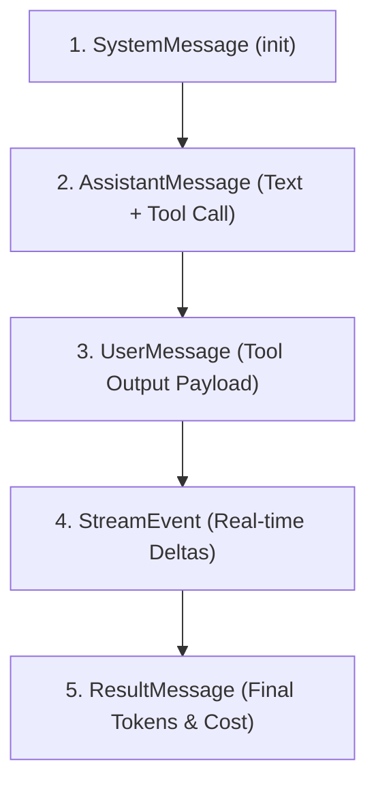

# Agent Loop Lifecycle

The **Agent Loop Lifecycle** is the event-driven execution stream that governs how an autonomous AI agent processes prompts, issues tool requests, handles user approvals, and iterates until goal completion.

---

## The 5 Message Types

## Turn Execution Rules

- **Turn Definition**: One complete round trip (Assistant tool call $\rightarrow$ System tool execution $\rightarrow$ User result payload).
- **Termination Signal**: The agent loop terminates when the model outputs a text-only `AssistantMessage` containing zero tool calls.
- **Circuit Breakers**: Loops are bounded using `max_turns` or `max_budget_usd`.

See [[How the agent loop works]], [[Agent SDK Architecture]], and [[Reasoning Effort]].
