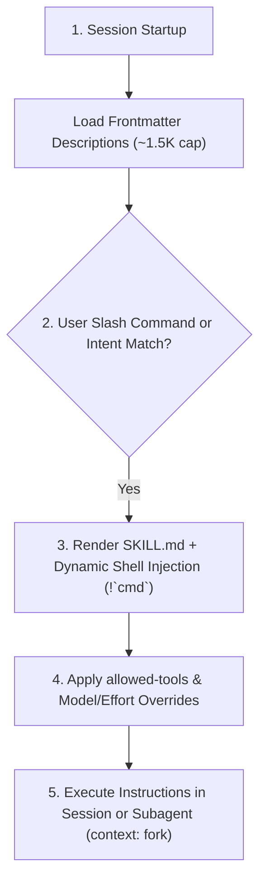

# Agent Skills Architecture

**Agent Skills Architecture** is the open modular extension paradigm (compliant with [Agent Skills](https://agentskills.io)) used in [Claude Code](../entities/Claude%20Code.md) and [Gemini CLI](../entities/Gemini%20CLI.md) to package prompt instructions, supporting reference files, scripts, and pre-approved tools into executable units.

---

## Architectural Lifecycle

## Core Design Principles

1. **Progressive Disclosure**: Only the short description is present at launch; full 500+ line reference documents load only when invoked.
2. **Deterministic Invocation Control**: `disable-model-invocation: true` prevents autonomous model execution of destructive or expensive workflows (`/deploy`).
3. **Turn-Scoped Permissions**: `allowed-tools` grants auto-approval for specific commands (`Bash(git commit *)`) strictly during the invocation turn.
4. **Self-Improving Dual-Skill Pattern**: As pioneered by [Warp](../entities/Warp.md), an Inner Base Skill executes domain tasks while an Outer Improver Skill asynchronously audits developer PR feedback to submit auto-generated Git pull requests to refine the skill definition over time.

---

## Related Knowledge Nodes

- **Concepts**:
  - [Self-Improving Agents](Self-Improving%20Agents.md)
  - [Agent Skills Best Practices](Agent%20Skills%20Best%20Practices.md)
  - [Loop Engineering](Loop%20Engineering.md)
  - [Progressive Disclosure](Progressive%20Disclosure.md)
  - [Orchestrator Skill Pattern](Orchestrator%20Skill%20Pattern.md)
  - [Dynamic Context Injection](Dynamic%20Context%20Injection.md)
- **Entities**:
  - [Warp](../entities/Warp.md)
  - [Claude Code](../entities/Claude%20Code.md)
  - [Anthropic](../entities/Anthropic.md)
  - [Gemini CLI](../entities/Gemini%20CLI.md)
- **Sources**:
  - [How Warp Builds Self-Improving Agents on Claude](../sources/How%20Warp%20Builds%20Self-Improving%20Agents%20on%20Claude.md)
  - [5 Best Practices for Building AI Agent Skills](../sources/5%20Best%20Practices%20for%20Building%20AI%20Agent%20Skills.md)
  - [Extend Claude with skills](../sources/Extend%20Claude%20with%20skills.md)
