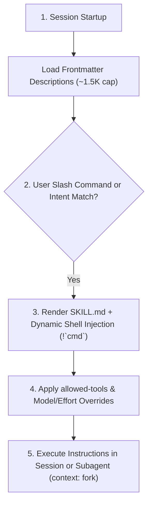

# Agent Skills Architecture

**Agent Skills Architecture** is the open modular extension paradigm (compliant with [Agent Skills](https://agentskills.io)) used in [[Claude Code]] and [[Gemini CLI]] to package prompt instructions, supporting reference files, scripts, and pre-approved tools into executable units.

---

## Architectural Lifecycle

## Core Design Principles

1. **Progressive Disclosure**: Only the short description is present at launch; full 500+ line reference documents load only when invoked.
2. **Deterministic Invocation Control**: `disable-model-invocation: true` prevents autonomous model execution of destructive or expensive workflows (`/deploy`).
3. **Turn-Scoped Permissions**: `allowed-tools` grants auto-approval for specific commands (`Bash(git commit *)`) strictly during the invocation turn.

See [[Extend Claude with skills]], [[Dynamic Context Injection]], [[Progressive Disclosure]], and [[Orchestrator Skill Pattern]].
