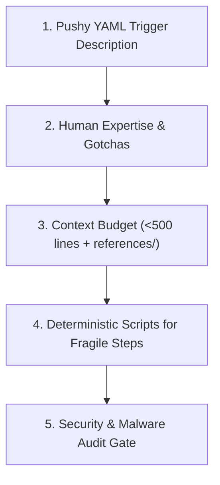

# Agent Skills Best Practices

**Agent Skills Best Practices** is the design methodology for authoring production-grade, secure, and token-efficient AI Agent Skills adhering to the Open Agent Skills Standard (`agentskills.io`).

---

## 5 Foundational Principles

## Core Directives

1. **Trigger Optimization**: Name $\le$ 64 chars, Description $\le$ 1,024 chars. State explicitly *what* the skill does and *when* to invoke it.
2. **Expertise & Gotchas**: Capture environment-specific gotchas from real runbooks and PR reviews rather than relying on generic LLM-authored text.
3. **Progressive Disclosure**: Keep `SKILL.md` under 500 lines (~5,000 tokens) and place supplementary manuals in a `references/` subdirectory.
4. **Deterministic Scripting**: Offload fragile or exact steps (math, data transforms) to executable scripts in `scripts/` to eliminate LLM hallucinations and conserve tokens.
5. **Security Gate**: Audit third-party skills for prompt injection and credential exfiltration prior to mounting.

See [5 Best Practices for Building AI Agent Skills](../sources/5%20Best%20Practices%20for%20Building%20AI%20Agent%20Skills.md), [Agent Skills Architecture](Agent%20Skills%20Architecture.md), [Progressive Disclosure](Progressive%20Disclosure.md), and [Agent Skills Security Audit](Agent%20Skills%20Security%20Audit.md).
