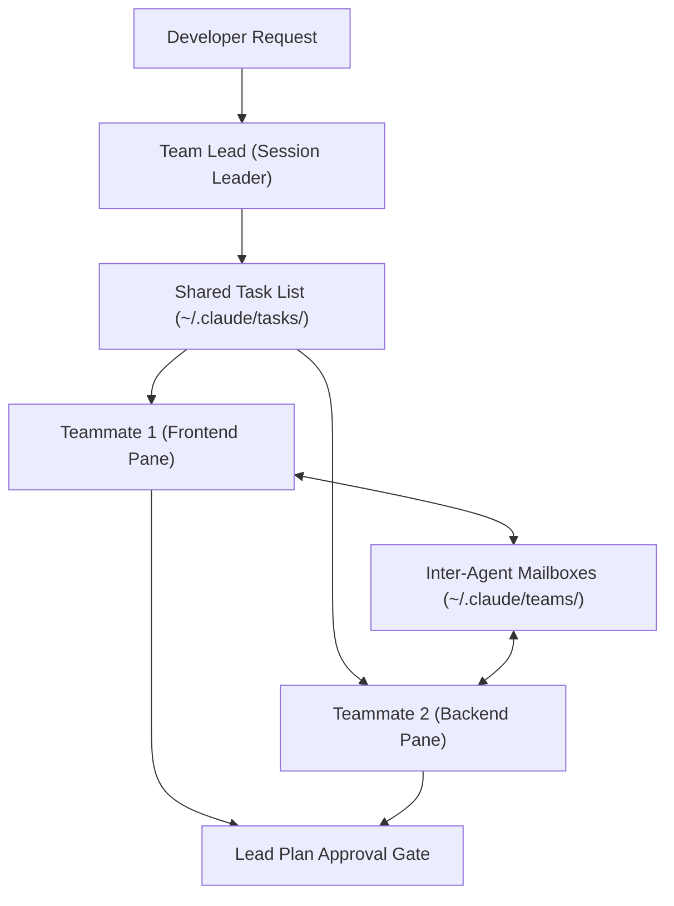

# Agent Teams Architecture

**Agent Teams Architecture** is the multi-session peer collaboration pattern in [[Claude Code]] (enabled via `CLAUDE_CODE_EXPERIMENTAL_AGENT_TEAMS=1`) where a Team Lead and independent Teammates coordinate software engineering projects via shared task lists and peer-to-peer messaging.

---

## Architectural Topography

## Key Distinctions from Subagents

1. **Peer Communication**: Teammates send direct messages to each other rather than strictly reporting back to a single parent context.
2. **Shared Task Backlog**: Work items are assigned or self-claimed from a central dependency graph with lock protection.
3. **Independent UI Panes**: Supports `tmux` / `iTerm2` split panes for real-time parallel session inspection.

See [[Orchestrate teams of Claude Code sessions]], [[Inter-Agent Messaging]], [[Parallel Agent Architecture]], and [[Subagent Architecture]].
