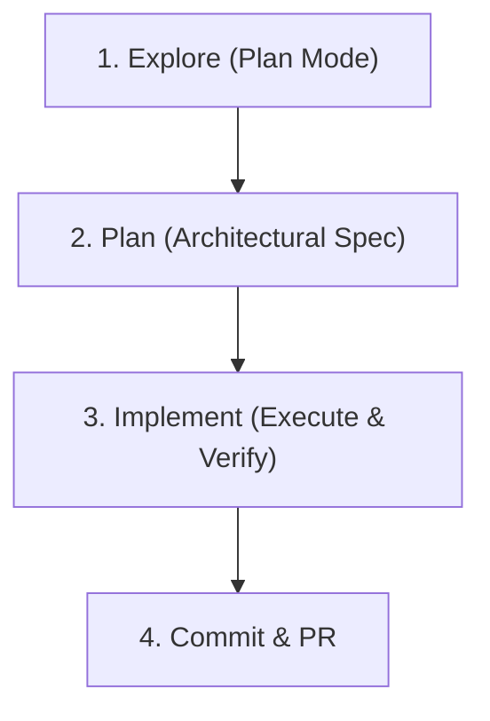

# Agentic Coding Workflow

The **Agentic Coding Workflow** is the operational methodology where an engineer transitions from writing code manually to directing an autonomous agent ([[Claude Code]]) through a structured 4-phase lifecycle:

## Core Principles

1. **Autonomous Execution**: The agent reads files, executes commands, fixes errors, and verifies its own work.
2. **Phase Separation**: Separating research/planning (non-modifying `plan mode`) from code editing avoids implementing the wrong solution.
3. **Evidence-Based Success**: Requiring the agent to produce empirical evidence (passing test logs, build outputs, visual diffs) before ending a turn.

See [[Best practices for Claude Code]], [[Verification Loop]], and [[Context Window Management]].
