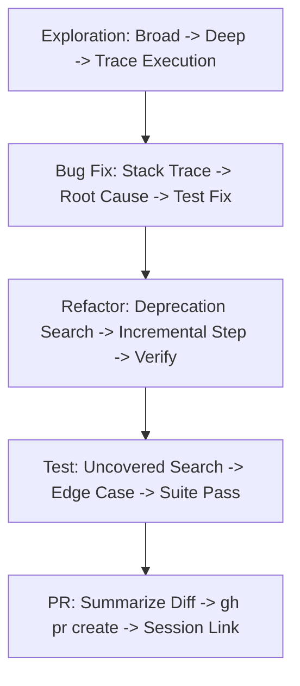

# Agentic Workflow Recipes

**Agentic Workflow Recipes** are repeatable prompt structures and terminal interaction patterns used in [Claude Code](../entities/Claude%20Code.md) to steer autonomous agents across common software engineering tasks.

---

## Core Recipe Categories

## Key Interactive Commands

- **Session Naming**: `/name <topic>` assigns a human-readable title to the active transcript.
- **Session Resuming**: `claude --resume` or `claude --from-pr <number>`.
- **Piping Shell Streams**: `cat build.log | claude -p "fix build failure"`.

See [Common workflows](../sources/Common%20workflows.md) and [Agentic Coding Workflow](Agentic%20Coding%20Workflow.md).
