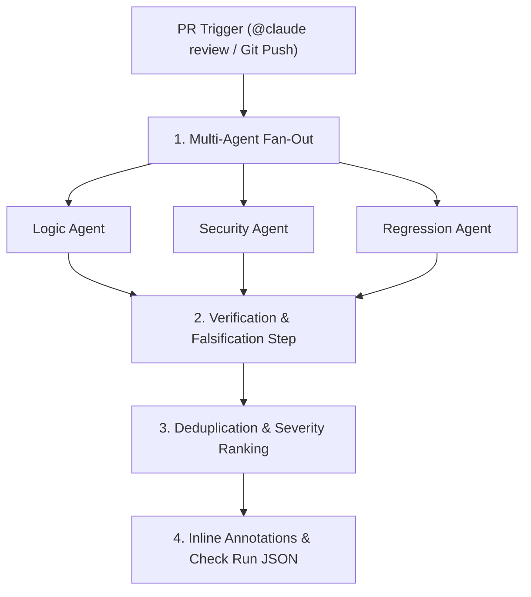

# Automated Multi-Agent Code Review

**Automated Multi-Agent Code Review** is a production verification architecture in [[Claude Code]] where a fleet of specialized subagents analyzes PR diffs in parallel against full codebase context, supported by an empirical verification step to eliminate false positives.

---

## Architectural Stages

## Key Benefits

1. **False Positive Suppression**: Findings are cross-checked against live codebase behavior before posting.
2. **Severity Calibration**: Issues are ranked into 🔴 Important, 🟡 Nit, and 🟣 Pre-existing categories.
3. **Local Terminal Alternative**: Available locally via the `/code-review` command.

See [[Code Review]], [[REVIEW.md Governance]], and [[Second Opinion Pattern]].
